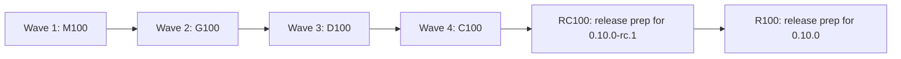

# Plan for 0.10.0

0.10.0 is a minor release after 0.9.2. It adds four built-in checks that judge a setup from the hits and the `dataLayer` of one run. They are the next slice of the `dataLayer` and Consent Mode work that #922 split:

- **Consent Mode order and the scenario's expected setup (#931).** A new check, `consentModeOrder`, and one new scenario option, `consentMode`. Part of #931: two cases wait (see Out of scope).
- **Hits that say granted while the frame's `dataLayer` says denied (#932).** A new check, `consentStateMismatch`. Part of #932: a denial by a default alone waits (see Out of scope).
- **Double sends during a side-by-side migration (#933).** A new check, `doubleSend`. Part of #933: `google-ads` pairs and `ga4` pairs with different client IDs wait (see Out of scope).
- **Click IDs that differ between contexts (#1529).** A new check, `clickIdHandover`.

Each item is one PR. A PR is done when its acceptance test passes in CI, an adversarial review reports no blockers or majors, and it is squash-merged. The release is cut as `0.10.0-rc.1`, field-tested, and then released as `0.10.0`.

0.10.0 starts from `main` at `e5c3c52` ("Release prep for 0.9.2 (#1679)"). 0.9.2 is released.

## Goals this release serves

From `docs/goals.md`:

- **Express expected behaviour as data, and report pass or fail with evidence.** M100 lets a scenario state the Consent Mode setup it expects (`options.consentMode`). Every new check names hits and pushes by record ID.
- **Record what a site sends to each tracking vendor, for a scripted visitor, at each consent state.** G100 closes the gap where a Google hit that says granted after a reject is trusted by `deniedIdentifiers`.
- **Make it easy to change a GTM config reliably. Every change gets trusted signals that tracking still works as intended.** D100 and C100 catch two failures of a side-by-side migration: the same event sent twice, and a click ID that is lost between two contexts.
- **Be safe by default.** No new check prints a value. Each is a warning until a person sets it to `fail`.
- **Keep the core platform-neutral.** None of the four names a platform. They key on frames, hosts and layer names, and their fixtures are plain pages with a frame.

Non-goals this release comes close to:

- **Legal advice or legal responsibility.** M100 and G100 judge consent. A warning means only that the hits and the `dataLayer` disagree, or that an order was not as the scenario stated. People decide what is allowed. The docs say the `gcd` letters are documented only by the community.
- **Production monitoring.** Unchanged. Every check works on one scripted run.
- **A schema registry for product events.** D100 compares pushes only in memory, to tell a double push from two different events. It stores and prints no shape or value of its own.
- **Changing GTM containers, a hosted service, a second interface.** Unchanged. No entry calls an API or adds an interface besides the CLI.

No entry widens the product or touches a non-goal. The checks above found nothing that stops the plan.

## Triage

Each issue was read on 2026-11-27 against `main` at `e5c3c52`. The maintainer set the scope: exactly #931, #932, #933 and #1529. All four are in milestone 0.10.0. The parent #922 is closed, and its split issues carry on.

| Issue | Kind | Status on main | Entry | Where in the code |
| --- | --- | --- | --- | --- |
| #931 | feature (new check, new option) | Open. `consentModeSetup` reads the `gcd` of each Google hit and the presence of a default. Nothing judges the order of pushes, and a scenario cannot state its expected setup. | M100 | `packages/expect/src/consent-mode-setup.ts`, `builtInChecks` and `DEFAULT_SEVERITY` in `packages/expect/src/evaluate.ts`, `ScenarioOptions`, `BUILTIN_NAMES` and the options parser in `packages/expect/src/scenario.ts` |
| #932 | feature (new check) | Open. `effectiveConsentAt` in `evaluate.ts` takes the consent of a Google hit from its own `gcs` and `gcd`, so `deniedIdentifiers` trusts a granted hit after a reject. | G100 | `effectiveConsentAt`, `deniedIdentifiersCheck`, `earlyIdentifiersCheck` in `evaluate.ts` |
| #933 | feature (new check) | Open. No check compares hits across frames or within a frame. | D100 | `builtInChecks` in `evaluate.ts`, `mappedEventName` in `packages/expect/src/event-map.ts` |
| #1529 | gap in `idHandover` | Open. `idHandover` compares `cid` and `sid` only. | C100 | `packages/expect/src/id-handover.ts`, a new reader in `packages/decoders/src/` |

The other open issues stay where they are (see Out of scope).

### Dependencies

#931, #932 and #933 name dependencies. Each was looked up in #922, in closed issues and in the earlier plans.

| Dependency | What it is | Built on main? | Shown by |
| --- | --- | --- | --- |
| C1 (#929) | The `consentModeSetup` check. | Yes, since 0.6.0. | `consentModeSetup` in `packages/expect/src/consent-mode-setup.ts`. It is registered in `builtInChecks` in `evaluate.ts`. `e2e/consent-mode-setup.e2e.test.ts` runs it. |
| D01 | The frame of each push. | Yes, since 0.6.0-rc.1. | `DataLayerEvent.frame` and `Request.frame` in `packages/core/src/records.ts`. `frameRef` in `packages/recorder/src/recorder.ts` numbers a frame once for requests and pushes. `buildConsentEpochs` in the same file already filters on `e.frame?.main`. |
| D3 (#927) | Custom `dataLayer` names. | Yes, since 0.6.0. | `options.dataLayerNames` in `packages/expect/src/scenario.ts` and `DataLayerEvent.layer` in `records.ts`. |
| D6 (#930) | An event name map. | Built for `diff` only. | `parseEventMap`, `builtInEventName` and `mappedEventName` in `packages/expect/src/event-map.ts`, and `--event-map` of `diff` in `packages/cli/src/args.ts`. A run has no user map. Only the built-in table (`SHOPIFY_TO_GA4` in `packages/decoders/src/event-names.ts`) can be used in a check. See Decisions. |
| Field check 3 | Are `setDefaultConsentState` and `updateConsentState` visible in `window.dataLayer`, and how. | **Not answered.** `docs/plan-0.6.0-rc.2.md` lists it as a field check. `git grep` finds no later plan, no design text and no `CHANGELOG.md` line that records an answer. | See Decisions: M100 and G100 are built so that neither depends on the answer. |

Every build dependency is built. No entry needs a dependency entry. #931 does not wait for the field test.

## Decisions

Decided by the maintainer (session of 2026-11-27):

1. **The scope is #931, #932, #933 and #1529.** Nothing else.
2. **0.10.0 is a minor release.** It may add built-in check names and one scenario option. A new name is a new public interface, so each is named here and in the entry.
3. **Each new check is a built-in with default severity `warn`,** set through `options.builtins` like the others. A new check adds no failure by default.

Decided in this plan:

- **The record stays at schema version 5, and no entry adds a field** (choice: maintainer may change). The record has no document field: `DataLayerEvent.frame` is `{main, n}` and the frame number is the same across navigations of the main frame, so a journey with two page loads has one queue per (frame, layer) with both documents in it. A document is derived from navigations, as `loaderReachesScope` in `packages/expect/src/evaluate.ts` and design §11 define it: a `visit` step start or a document request that did not abort. G100 and D100 take that boundary from `packages/expect/src/document.ts` (new), which holds two functions. `navigationTimes(ctx, frame)` returns the `visit` step starts and the non-aborted document requests of that frame, or of the main frame of its page for an embedded frame: exactly the list `sameFrame(loader)` builds in `loaderReachesScope` today. It is moved out of `loaderReachesScope`, which passes its loader's frame, so its result is unchanged for every input. `pageLoadTimes(ctx, frame)` returns only the page loads of that frame's page: the `visit` step starts and the main-frame document requests that did not abort and have the same `frame.page` as the given frame. A popup is a page of its own, so its document request is not a boundary for the page that opened it, and a popup that loads between a denying update and a hit does not hide the denial. When the given frame or a request has no page number (records from before 0.9.0, or a request with no frame), any main-frame document request counts. G100 and D100 use `pageLoadTimes` with the frame of the later hit. D100 also pairs only hits whose frames have the same `frame.page` when both have one, since hits on two pages are never in one document. A sub frame's own document request is not a boundary for them, so a pixel iframe that loads between a main-frame hit and its own hit does not hide the pair or the denial. No rule reads a queue as one document, and none defines a boundary from push contents. M100 rule 1 needs no boundary: it judges the first default and the first `config` of the queue. An optional document field would be a field of schema 5 and is not added. Every check reads what the record already has: `DataLayerEvent.frame`, `DataLayerEvent.layer`, `DataLayerEvent.args`, `Request.frame`, `Hit.consent`, `Hit.params`, `ConsentEpoch`, and the requests with their bodies in memory. The records hold values already, as they hold every push and request. No new check keeps a value anywhere else.
- **A new built-in adds a result only when it has something to judge** (choice: maintainer may change). `identifierRoute` and `serverContainerRejected` already work this way. A run with no input for a new check keeps exactly the results it has today. This keeps `results` in `--json`, the report and the demo records the same for runs the checks do not concern.
- **Four new built-in names:** `consentModeOrder`, `consentStateMismatch`, `doubleSend`, `clickIdHandover`. Each is added to `BUILTIN_NAMES` and to `DEFAULT_SEVERITY` as `warn`. Each is a name `options.builtins` accepts. No existing name changes.
- **One new scenario option: `consentMode`** (choice: maintainer may change). It is for scenarios only, not for `tagreeve/config.yml`, because the expected setup differs per scenario. The existing config check refuses it as an unknown option. It is a mapping with these keys, each optional, at least one given:
  - `mode`: `basic` or `advanced`.
  - `default`: `denied`, `granted`, or a mapping of `ad_storage`, `analytics_storage`, `ad_user_data` and `ad_personalization` to `granted` or `denied`. `denied` and `granted` mean all four signals.
  - `accept`: a list of the signals an accept grants. The default is all four. A reject grants nothing. This models a partial choice. The issue names three keys (`mode`, `default`, `region`). `accept` is a fourth, because "partial choices are modelled" needs a way to say what an accept grants.
  - `region`: a list of region codes (`DK`, `US-CA`), at most 20, that the scenario expects a regional default for.
  The parser follows the style of the other options: it names the key and the allowed forms, and it checks the shape before anything runs.
- **(1) #931 against `consentModeSetup`: a new check, not an extension** (choice: maintainer may change). `consentModeSetup` judges presence of signals from `gcd`, needs no option, and its name and message are read by `packages/cli/src/report/suite.ts` (the consent audit reads the result whose text is `builtin: consentModeSetup`). The new work judges order and an expected setup, needs `dataLayer` pushes in queue order and an option, and a person may want one at `fail` and the other at `warn`. Extending would change the message of a check that works. So `consentModeOrder` is new and `consentModeSetup` is unchanged. The two do not report the same thing: `consentModeSetup` reports a signal that was never set on a hit, and `consentModeOrder` reports an order or a mismatch against the scenario. The design text is in §11, where the built-in checks are described.
- **M100 rules** (choice: maintainer may change). Each rule judges one (frame, layer) or one decision, never a container:
  1. **Queue order.** Judged once per (frame, layer), on the first `consent default` push and the first `config` command of the queue. If the first default comes after the first `config`, it warns. Later defaults and later documents of the same queue are not judged for order (see the record decision and Out of scope). A `gtm.js` push is not used: with a GTM CMP template, Google's setup is a default in the Consent Initialization trigger, which can be pushed after `gtm.js`, so a default after `gtm.js` is not evidence of a fault. When the first default follows `gtm.js` and no `config`, the check passes and says order was not judged. Both the array form and the arguments-like object form count, read through `consentCommandOf` of `@tagreeve/core`. A (frame, layer) with no default push is not judged for order.
  2. **Update gap.** Judged only when the main frame has a `consent update` push in the `dataLayer`. If an update was made by a template API, it may not show, and then it is undefined whether a hit is before the update: the check passes and says the update was not in the `dataLayer`. A Google browser hit placed in a decided epoch (the epoch starts at the banner action or at the first update), sent before that decision's `consent update` push in the main frame, whose own signal is denied where the epoch grants it, warns as "sent after the decision and before the update". It replaces a `wait_for_update` check, which Google's docs call optional. A hit sent after the update, or one that already says granted, is not reported.
  3. **The expected setup**, only when `options.consentMode` is set. `default` and `region` are compared with the main frame's default pushes. `mode: basic` warns on any Google browser hit in the undecided epoch. `mode: advanced` warns on a Google hit in the undecided epoch whose own signal is granted where the default denies it. After an accept, the main frame's state must grant the `accept` signals and keep the others as the default. After a reject it must deny all four signals, since a reject grants nothing, and a reject with no update push passes with the message `no update was needed: the default denies all four` when the default already denies all four. The accept and reject comparison is made only when the main frame has an update push. With no update push the check passes and says the update was not in the `dataLayer`, and it does not say the accept failed. A regional default is judged by its push only: the test machine has no region, so the check never says a visitor in that region would see it.
  4. **When the default is not in the `dataLayer`.** If `options.consentMode` is set, hits show a default and no push carries one, the check passes and says the default was set outside the `dataLayer`, as `consentModeSetup` does. Without the option such a run has no result (rule 5). It never judges order from hits. The `dataLayer` may not show a template API call, a TCF call or another route. Rules 1, 2 and 3 are each written so that a consent call that does not show in the `dataLayer` gives a pass with a message, never a warning. So the answer to field check 3 changes only how often those messages appear, never a verdict, and #931 does not wait for it.
  5. **Added when:** a consent default push was recorded in some frame, or `options.consentMode` is set.
- **One consent replay** (choice: maintainer may change). `consentModeChanges(pushes, firstDecisionT)` in `packages/consent/src/consent-mode.ts` already replays consent commands with the §7.3 rules (a region default ignored, a default after an update or after the first decision ignored). `buildConsentEpochs` uses it. It depends only on `@tagreeve/core` types, and `@tagreeve/expect` cannot import `@tagreeve/consent` without its autoconsent driver. So M100 moves the function to `packages/core/src/consent-command.ts`, next to `consentCommandOf`, with no change to its behaviour, and `@tagreeve/consent` re-exports it so the recorder keeps its import. The moved function gets two additions that leave the epochs as they are: each change carries the push it came from (an optional `id`), and a switch that also reads the object form, off by default. `frame-consent.ts` filters by frame and layer and calls it with the switch on. Two replays that can drift are not added. The epochs still read the array form of the main frame only; `consentModeOrder` and `consentStateMismatch` read both forms and every frame.
- **(2) #932 against `deniedIdentifiers` and `earlyIdentifiers`: nothing is reported twice, by construction** (choice: maintainer may change). `effectiveConsentAt` gives each (hit, signal) one value. `denied` is judged by `deniedIdentifiers` (when the hit carries an identifier of that class). `unknown` before the first answer is judged by `earlyIdentifiers`. `granted` is judged by no existing check, and it is the only case `consentStateMismatch` reports. So one (hit, signal) pair is in one result at most. A hit with one signal denied and another granted can be in two results, each for its own signal, as a hit with one denied and one unknown signal can already. G100 adds a test that pins this. G100 reads the hit's own signals as the evaluator does and does not change `effectiveConsentAt`.
- **G100 rules** (choice: maintainer may change):
  1. **Per frame.** A hit's frame is `Request.frame.n` of its request. The state comes from the pushes whose `frame.n` is the same, in every layer of that frame. A hit whose request has no `frame` (a record made before version 5) is skipped and counted. If the layers of one frame disagree about a signal at the hit's time, the hit is skipped and counted as ambiguous.
  2. **The state at the hit.** The consent commands of the frame are replayed in order, in both forms. A default with a `region` list is ignored, and a default after an update is ignored, as in §7.3. This is the same replay M100 uses: one function, `consentModeChanges`, which moves to `@tagreeve/core` (see the replay decision below), and `frame-consent.ts` only filters a frame and a layer and calls it.
  3. **Reported only when the denial is an explicit `consent update` push.** A signal that is denied only by a default push is not judged. Consent can be raised outside the `dataLayer` (a template API, TCF), and field check 3 has not answered whether those calls show in `window.dataLayer`. A default-only denial would give false reports in that case. The result counts the hits skipped for this reason. This is what keeps #932 independent of the field check. The default-only denial, the commonest reject path (default denied, user rejects, no update), is therefore not judged in 0.10.0. It is named in Out of scope, and the entry is `Part of #932`.
  4. **Stable.** The hit is judged only when no consent command in that frame falls from 2000 ms before the hit to 2000 ms after it. Tags queue gtag commands and GA4 batches events, so a hit near a change can legitimately carry the old or the new state. The 2000 ms is a fixed constant in the check, not an option.
  5. **Added when** the run has a browser Google hit with a consent signal and a consent command push in that hit's frame.
  6. **What is reported.** A browser hit of `ga4` or `google-ads` whose own signal is `granted` while the stable state is denied by an update. The message names the frame kind, the vendor, the tag ID and the signal names. The evidence is the hit IDs and the push ID of the update. It never prints a `gcs` or `gcd` value.
  7. **One queue holds several documents** (see the record decision). A hit is skipped, and counted as in a new document, when a page load (`pageLoadTimes`) falls between the denying update and the hit, since a new page may set consent in a way the `dataLayer` does not show. A denial of page 1 is not carried into page 2. No push content (`gtm.js`, `config`, a default) defines a document.
- **(3) #933 compares pushes by in-memory equality and prints no value** (choice: maintainer may change).
  1. **The unit is a browser hit of `ga4` or `meta`.** Server hits and `google-ads` hits are left out. One `gtag` call sends one event to `/pagead/viewthroughconversion/`, `/rmkt/collect/` and `/ccm/collect`, which the decoder gives the same vendor, tag key, name and params a few ms apart, so by these rules every Google Ads event would be a double send. `google-ads` waits (see Out of scope). A pair is a double send when both hits have the same vendor, the same tag key, the same mapped event name, equal decoded `params`, and were sent within 1000 ms of each other, with no page load (`pageLoadTimes`, see the record decision) between them. Two page loads send the same page view, and that is not a double send. For `ga4` the two hits must also share the client ID, read with `ga4HitIds` (the one reader of `cid`, in memory, never printed). A `ga4` hit with no readable `cid` is not compared. `Hit.params` of a `ga4` hit holds only `ep.*`, `epn.*` and `tid`, so equal params alone are true for any two events with no `ep.*` params. The client ID is what tells one visitor's duplicate from two different senders. The existing fixture pair (the main frame `page_view` of `site.js` and the sandbox `page_view` of `pixel.js`, one `tid`, params `{tid}`) has two different client IDs, as `idHandover` shows, so it is not a double send, and no existing test, `failed` list, report mark or `site/demo/` record changes for D100. `meta` has no client ID in the record and is compared on vendor, tag key, name and params. The window is a fixed constant, not an option.
  2. **The tag key** is the tag ID the decoder sets: `tid` for `ga4`, `conversionId` with `label` for `google-ads`, `pixelId` for `meta`. A vendor with none uses the vendor alone.
  3. **The mapped name** is `mappedEventName(name)` of `event-map.ts` with no user map: the built-in Shopify standard to GA4 table only. A Shopify `checkout_completed` and a GA4 `purchase` count as one event. A user map for runs is not built (see Out of scope).
  4. **Two frames.** A pair from two different frames in one document is reported. Two sub frames that load in different navigations are not paired. No push proof is needed, since the migration case is exactly a pixel frame and a theme each sending the event.
  5. **One frame.** A pair from one frame and one document is reported too, with no push needed: two tags fired by one push, or two triggers, send two equal hits from one push, and that is the most common real double send. For `ga4` the shared client ID and equal params inside 1000 ms make a legitimate repeat unlikely. The message says which case it is. Pushes count only inside the pair's document: after the last page load (`pageLoadTimes`) before the first hit and before the next page load, and at most 1000 ms from the first hit. When the frame's `dataLayer` also holds two such pushes of that event that are deep-equal in memory and at most 1000 ms apart (dropping `gtm.*` stamps and functions), it says `the event was also pushed twice`. When it holds no such deep-equal pair but two or more matching pushes at most 1000 ms apart from the first hit of the pair, with no page load between, it says `the event was pushed <n> times with different contents`, with that count only. The deep-equal message takes precedence. Otherwise it says `one push or none was recorded`. A push is matched to a hit by the mapped event name. The push's event name is read from a recorded `args` that is an array or arguments-like object whose first item is `event` (the second is the name, the `gtag` form), or from an object with a string `event` key (the GTM form). Both names go through `mappedEventName`. A push whose name cannot be read is not matched.
  6. **Equality is in memory only.** The result prints the vendor, the tag ID, the event name (through `guardFieldName`, so a value-like name reads `(other)`), a count and the frame kinds. It never prints a param, an argument or a key path.
  7. **Added when** the run has at least two browser hits of `ga4` or `meta` with the same vendor, tag key and mapped name, with no navigation between them (and, for `ga4`, the same readable `cid`). A run without such a pair has no `doubleSend` result. The builder runs every existing scenario and the full e2e suite and finds no `doubleSend` result. If one appears, the check is wrong, not the test.
  8. **Not covered:** a pair from two frames with different client IDs (the Shopify custom pixel against a theme GTM, which `idHandover` shows with two IDs), `google-ads` pairs, two sends that differ in one param, and a link from each push to the hits it caused, which is #938 and waits (see Out of scope). The check says whether pushes were doubled. It does not say which push caused which hit.
- **(4) #1529: where click IDs are read, and what a match means** (choice: maintainer may change).
  1. **Read from decoders, not cookies.** The record stores cookie names and domains only (`CheckpointCookie`), never a value, and this plan does not change that. Design §11 says each decoder is the one reader of its own vendor's fields (`ga4HitIds` is the one reader of `cid` and `sid`), so each decoder gets its own click ID reader and `click-ids.ts` writes no second parser. `ga4ClickIds` next to `ga4HitIds` in `ga4.ts` (with the Stape unwrap) and `googleAdsClickIds` in `google-ads.ts` take `gclid`. `metaClickIds` in `meta.ts` takes `fbp` and `fbc`, including from multipart bodies. `metaCapiClickIds` in `meta-capi.ts` takes `user_data.fbp` and `user_data.fbc`, from JSON or form data. Each returns one entry per hit, in the order `decode` uses, as `ga4HitIds` does, so a batch lines up hit by hit. `clickIdsOf(request)` in `packages/decoders/src/click-ids.ts` only dispatches by vendor. The values are returned in memory. `Hit.ids` keeps presence only and the record is unchanged. The PR cites each vendor's own page for where each name is sent. A name a decoder cannot place is not read. The `ga4HitIds` paragraph of design §11 is extended to say each decoder is the one reader of its click IDs.
  2. **The context key is the one of `idHandover`:** frame kind plus the page host without the port. `id-handover.ts` exports its `contextLabel` for this, with no change of behaviour.
  3. **Compared by name across vendors.** `gclid` is one ID for `ga4` and `google-ads`, and `fbp` is one ID for the Meta pixel and the Conversions API. So the group is the ID name, not a tag ID.
  4. **A match means** two contexts that both sent the ID share at least one value. **A difference** is two contexts that both sent it and share none. A context that never sent the ID is not a difference: a click ID set only on the landing page gives a pass that says the ID was seen in one context only and nothing was compared. Not every hit carries a click ID, so absence proves nothing.
  5. **Hits left out:** server hits, and hits whose own `ads` consent is denied, as `idHandover` leaves out a hit whose analytics consent is denied.
  6. **The result** names the ID (`gclid`, `fbc` or `fbp`) and both contexts. It never prints a value, a hash, a length or a prefix.
  7. **A new check, not an extension of `idHandover`** (choice: maintainer may change). `idHandover` groups by measurement ID and reads only GA4. Click IDs group by name, and a person may want one at `fail` and not the other.
- **Existing tests that a new result changes.** The new results appear on runs of existing fixtures: 26 fixture pages push a consent default and send Google hits, and the sandbox pixel and the main frame of the fixture checkout share one `tid`. A result that passes still adds a line to `results` and to counts such as `(1 of 10)` in `site/demo/*.txt`, and a `warn` is also in `failed` and in the warning count (`e2e/cli-helpers.ts` takes every result that does not pass). So each entry's builder runs `pnpm test` and `pnpm e2e` on its final head, finds every existing test whose expected result the new result alters, and edits it. That edit, and a re-record of `site/demo/`, are allowed outside the Touches line when the only change is the new result. The commit message lists each such test, or says `none`, and the PR body names each. A new `warn` on a correct page of an existing fixture is a fault in the check, not a test edit. The two-page journey of `e2e/cli-checkout.e2e.test.ts` is the first case to run.
- **Waves are serial.** All four entries edit `BUILTIN_NAMES`, `DEFAULT_SEVERITY` and `builtInChecks`, the same built-in paragraph of `docs/design.md` §11 and the same rows of `docs/cli.md`. They go in four waves. A registry that would let them run in parallel is a refactor outside the scope.
- **Docs owners.** Each entry edits the docs of its own change, named on its Touches line. RC100 and R100 write the release docs (README line, §15, the version lines).
- **CHANGELOG.** No entry edits `CHANGELOG.md`. Each PR body ends with `CHANGELOG: <one line>`, and the release entries write the sections from them.
- **Upgrade notes.** The `## 0.10.0` section of `CHANGELOG.md` has a part called "Upgrading from 0.9" with the items under Flagged concerns.

## Order and waves

Four waves, one entry each, then the release candidate, then the release.

Why the waves are this way:

- **One entry per wave.** Each entry adds a name to `BUILTIN_NAMES` (one line) and to `DEFAULT_SEVERITY` (one line) in `packages/expect/src/scenario.ts` and `packages/expect/src/evaluate.ts`, adds a block to `builtInChecks`, and adds a paragraph to the built-in text in `docs/design.md` §11 and a section and a row to `docs/cli.md`. Those are the same parts of the same files.
- **G100 after M100.** G100 imports the frame replay (`packages/expect/src/frame-consent.ts`) that M100 adds. It does not change it.
- **D100 after G100.** D100 imports `pageLoadTimes` from `packages/expect/src/document.ts`, which G100 adds. It does not change it.
- **D100 and C100 share no other code with the others.** They are last because of the shared parts above only. C100 is last because it also edits the four decoders, `packages/decoders/src/index.ts` and `id-handover.ts`, which no other entry edits.
- **`fixtures/site/`.** Each entry adds its own pages, a route in `fixtures/site/src/index.ts` and rows in `fixtures/site/README.md`. They do so in different waves.
- **`e2e/`.** Every entry adds its own new e2e file and its own scenarios. An existing e2e file or demo record changes only where a new result alters what it states (see the Decision on existing tests).

## Rules for every PR

The rules in `AGENTS.md` and the earlier plans still hold: CLI only, no MCP server; no hosted service and no GTM API; fake IDs and identities only (`G-PWTEST0001`, `AW-000000001`, `100000000000001`, `GTM-PWTEST1`, `GTM-PWNOVER`); no cookie value, identity value, client ID, click ID, card value, access token, `gtmAuth` or container config in any output; e2e only against `fixtures/site` in `stub` mode, with no Docker and no network; context-level hooks only; third-party code unmodified. Vendor field names come from the vendor's own docs, which the PR cites. Tracker Radar, EasyPrivacy and Disconnect are not sources.

More for 0.10.0:

- **The record stays at schema version 5.** No entry adds a field.
- **A new check is a warning.** Default severity is `warn`, and no check turns an existing pass or warning into a failure. A person sets `builtins: { <name>: fail }` to make one fail a run.
- **No output prints a value.** A result holds vendor names, tag IDs, event names (through `guardFieldName`), signal names, frame kinds, hosts, counts and record IDs. A leak test asserts the planted value is in the input or the record first, then that it is absent from the message, the evidence text, `--json` and the text summary.
- **A run with nothing to judge keeps its results.** A new check adds a result only as its entry says. A test per entry proves a run without the input has no result of that name.
- **Each PR adds a regression test that fails without the change,** and the PR body says which line was reverted to see it fail.
- **Every negative test checks its input first.** A "not reported" case asserts the hits and pushes it relies on are in the input.
- **Never edit a file outside the Touches line,** except an existing test or a `site/demo/` record whose expected result a new result alters (see the Decision on existing tests). A flaky test is reported, not patched. Known flaky: #1608 and #1680, and the timeouts named in the task of each run.
- **An entry that changes what an existing test states says so.** The only expected cause is a new result, and the commit message lists each such test or says `none`. The PR body names each. Any other failing test is a regression until shown otherwise, and a new `warn` on a correct page is a fault in the check.
- **New e2e tests go in new files.**
- **CHANGELOG.** The PR body ends with `CHANGELOG: <one line>`.
- **Docs.** An entry edits the doc lines that state what it adds, as its Touches line names. It leaves the rest to RC100 and R100.

## PRs

### Wave 1

**M100 Consent Mode order and the scenario's expected setup (#931).** Round cap 4. Touches: `consentModeChanges` and its types moved from `packages/consent/src/consent-mode.ts` to `packages/core/src/consent-command.ts`, with `packages/core/src/index.ts` and the tests of both files, and `packages/consent/src/consent-mode.ts` re-exporting it; `packages/expect/src/frame-consent.ts` (new) and `packages/expect/src/frame-consent.test.ts` (new); existing tests and `site/demo/` records that the new result alters (see the Decision on existing tests); `packages/expect/src/consent-mode-order.ts` (new) and `packages/expect/src/consent-mode-order.test.ts` (new); in `packages/expect/src/scenario.ts` the `consentMode` field of `ScenarioOptions`, `BUILTIN_NAMES`, `OPTION_KEYS`, the options parser branch for `consentMode` and the `builtins` comment on `ScenarioOptions`; in `packages/expect/src/evaluate.ts` `DEFAULT_SEVERITY` and a block in `builtInChecks` after `consentModeSetup`; `packages/expect/src/index.ts` (one export); `fixtures/site/public/consent-mode-order.html` (new, with query variants for the late default, the grant of `ad_storage`, and the update after the banner action, early and late), the route in `fixtures/site/src/index.ts`, the rows in `fixtures/site/README.md` and `fixtures/site/src/pages-consent-order.test.ts` (new); `e2e/consent-mode-order.e2e.test.ts` (new) and the scenarios `e2e/scenarios/consent-mode-order-*.yml` (new); `docs/design.md` §11 (the built-in paragraph and the `options` text, one added paragraph on `consentModeOrder`) and one sentence in §7.3; `docs/cli.md` (the `builtins` row, the scenario options table row for `consentMode`, a new `### consentModeOrder` section after `consentModeSetup`).
Part of #931
- `consentModeChanges` moves to core, gets an optional push `id` on each change and a switch for the object form (off by default), as the replay decision says. Its behaviour for the epochs is unchanged.
- `frame-consent.ts` filters the pushes of one frame and one layer and calls it with the switch on. It returns the state at a time, the command that set each signal (`default` or `update`) and its push ID, and the times of every consent command. G100 uses it.
- `consentModeOrder` has the rules M100 (1) to (5) of Decisions. It judges order once per (frame, layer) and does not judge a later document, a `gtm.js` order, or a call that is not in the `dataLayer`. It never prints a pushed value other than a signal name and `granted` or `denied`.
- `options.consentMode` is parsed as Decisions says. A bad key, a bad `mode`, a `default` that is not `denied`, `granted` or a mapping of the four signals, an `accept` list with another name, or a `region` that is not a code is a scenario error. It is refused in `config.yml` like any unknown option.
Invariants: `consentModeSetup` and its message are unchanged. The epochs are unchanged: `consentModeChanges` behaves as before for the array form, its existing tests pass with no change, and `buildConsentEpochs` is not touched. `@tagreeve/consent` still exports it. A run with no consent default push and no `options.consentMode` has no `consentModeOrder` result. No record type changes. The entry does not close #931.
Evals:

| Id | Kind | What must be true | How to check |
| --- | --- | --- | --- |
| M100-1 | behaviour | A queue with a `config` command and then a `consent default` warns with the frame kind and layer name and the push IDs as evidence. A default before `config` passes. A queue `[gtm.js, default]` with Google hits that carry `gcd` does not warn, and the message says order was not judged. Both push forms count. | `pnpm exec vitest run --project unit packages/expect/src/consent-mode-order.test.ts`. It fails on `main`: the file is new. |
| M100-2 | behaviour | Two frames are judged apart: a main frame with the default first and a sub frame with it late names only the sub frame. Two layers of one frame (`dataLayerNames`) are judged apart. | The same file. |
| M100-3 | behaviour | Update gap: with a decision epoch, a Google hit placed in it, sent before the update push, with a denied own signal where the epoch grants, warns with the hit ID. The same hit sent after the update, or one that already says granted, does not. An accept action with a default pushed and no update push in the `dataLayer` passes, and the message says the update was not in the `dataLayer`. | The same file. |
| M100-4 | behaviour | `consentMode.default: denied` and a pushed default that grants `ad_storage` warns and names `ad_storage`. `region: [DK]` with only a global default warns. With a region default pushed for the same set, it passes, in any order of the codes. | The same file. |
| M100-5 | behaviour | `mode: basic` warns on a Google hit in the undecided epoch. `mode: advanced` passes when that hit shows the default and warns when it grants a signal the default denies. | The same file. |
| M100-6 | behaviour | `accept: [analytics_storage]` with an update that also grants `ad_storage` warns and names `ad_storage`. A reject with no update push passes when the default is denied, with the message that no update was needed. With `default: granted`, a reject whose update denies all four passes, and one whose update keeps `ad_storage` granted warns and names `ad_storage`. | The same file. |
| M100-7 | behaviour | With `options.consentMode` set, hits show a default and no push carries one: the result passes and says the default was set outside the `dataLayer`, and it judges no order. The same run without the option has no `consentModeOrder` result. | The same file. |
| M100-8 | error path | Each bad `consentMode` form in Decisions is a scenario error that names the key. `consentMode` in `config.yml` is refused. | The same file. |
| M100-9 | regression | A run with no consent default push and no `options.consentMode` has no `consentModeOrder` result. The existing `consentModeSetup` e2e file still passes. | The same file, and `pnpm build`, then `pnpm exec vitest run --project e2e e2e/consent-mode-setup.e2e.test.ts`. |
| M100-10 | quality bar | A planted token in an extra key of a consent push is in the record and absent from every output. | The e2e file below. |
| M100-11 | behaviour | End to end: the page pushes the default after `config` and sends a Google hit. The run warns with `consentModeOrder` and exits 0. With `builtins: { consentModeOrder: fail }` it exits 1. The page with the default first passes. The test first asserts the push order in the record. | `pnpm build`, then `pnpm exec vitest run --project e2e e2e/consent-mode-order.e2e.test.ts`. It fails on `main`: `consentModeOrder` is an unknown name. |
| M100-12 | regression | Two documents in one (frame, layer), each with the default first and then `config`, give no `consentModeOrder` warning. The two-page journey of the checkout e2e keeps its `failed` list. | A unit case in `consent-mode-order.test.ts`, and `pnpm build`, then `pnpm exec vitest run --project e2e e2e/cli-checkout.e2e.test.ts` with `failed` equal to `[SANDBOX, HANDOVER]`. Both fail if rule 1 reads the queue as one document. |
| M100-13 | regression | `consentModeChanges` gives the same changes for the epochs as before its move: its existing tests pass with no change. With the object-form switch on, an object-form command counts and carries the push ID. | `pnpm exec vitest run --project unit packages/core/src/consent-command.test.ts packages/consent`. |
| M100-14 | regression | After the entry merges, the full e2e suite passes on the final head, apart from the known flaky tests. Every existing test the new result changed is listed in the commit message, or the word `none`. | `pnpm build && pnpm e2e` and `git log`. |
| M100-15 | behaviour | Option wiring end to end: a scenario with `options.consentMode: { default: denied }` runs against a fixture page whose pushed default grants `ad_storage`. The run has a `consentModeOrder` result with `pass` false, severity `warn` and a message naming `ad_storage`, and exits 0. With `builtins: { consentModeOrder: fail }` it exits 1. The same scenario without the option has no such result for that rule. | The e2e file below. It fails on `main`: `consentModeOrder` and `consentMode` are unknown names. |
| M100-16 | behaviour | Update gap on recorded epochs: the page answers the banner and pushes the `consent update` 300 ms later, with a Google hit sent between the two. The run warns for the update gap and names the hit ID. The same hit sent after the update push does not warn. The test first asserts, in the record, the push order, the epoch start and the hit time. | The e2e file below. It fails on `main` for the same reason. |

Acceptance: M100-11, M100-15 and M100-16 pass, and fail on `main`. M100-9 and M100-12 pass.

### Wave 2

**G100 Compare gcs and gcd with the frame's dataLayer consent state (#932).** Round cap 4. Touches: `packages/expect/src/consent-state-mismatch.ts` (new) and `packages/expect/src/consent-state-mismatch.test.ts` (new); in `packages/expect/src/scenario.ts` `BUILTIN_NAMES` and the `builtins` comment; in `packages/expect/src/evaluate.ts` `DEFAULT_SEVERITY` and a block in `builtInChecks` after `consentModeOrder`; `packages/expect/src/index.ts` (one export); `packages/expect/src/document.ts` (new) and `packages/expect/src/document.test.ts` (new), and in `evaluate.ts` `loaderReachesScope` (its navigation list moves to the helper); existing tests and `site/demo/` records that the new result alters; `fixtures/site/public/consent-state-mismatch.html` and `fixtures/site/public/consent-state-mismatch-frame.html` (new), the routes in `fixtures/site/src/index.ts`, the rows in `fixtures/site/README.md` and `fixtures/site/src/pages-consent-mismatch.test.ts` (new); `e2e/consent-state-mismatch.e2e.test.ts` (new) and the scenarios `e2e/scenarios/consent-state-mismatch-*.yml` (new); `docs/design.md` §11 (one added paragraph on `consentStateMismatch` and its relation to `deniedIdentifiers` and `earlyIdentifiers`); `docs/cli.md` (the `builtins` row and a new `### consentStateMismatch` section after `consentModeOrder`).
Part of #932
- `consentStateMismatch` has the rules G100 (1) to (7) of Decisions. It imports `frame-consent.ts` and does not change it.
- The message names the frame kind, the vendor, the tag ID and the signal names, and it links to Google's Consent Mode page. It counts the hits skipped: no frame, layers that disagree, an unstable window, a default-only denial, a new document.
Invariants: `effectiveConsentAt`, `deniedIdentifiersCheck`, `earlyIdentifiersCheck` and `consentModeSetup` are unchanged, and so are their results on every existing fixture. Only the new `consentStateMismatch` result is added on a run that has something to judge. `frame-consent.ts` and `consent-mode-order.ts` are unchanged. `loaderReachesScope` passes its loader's frame to `navigationTimes` and gives the same result as before for every input: the dataLayer-incomplete tests and e2e files pass unedited. A run with no browser Google hit that has a consent signal and a consent command in its frame has no `consentStateMismatch` result. A server hit and a hit of a vendor that is not `ga4` or `google-ads` is left out. No record type changes.
Evals:

| Id | Kind | What must be true | How to check |
| --- | --- | --- | --- |
| G100-1 | behaviour | An accept update then a reject update in the main frame, and a hit 3000 ms later with `gcs=G111`: the check warns, names `ga4`, the tag ID, the frame kind and the signals, and its evidence is the hit ID and the push ID of the reject update. | `pnpm exec vitest run --project unit packages/expect/src/consent-state-mismatch.test.ts`. It fails on `main`: the file is new. |
| G100-2 | behaviour | A hit 1500 ms after the reject, and a hit sent 1500 ms before a consent push of its frame, are not reported. A hit 2500 ms after is. | The same file. |
| G100-3 | behaviour | Frames are judged apart: a sub frame denied by an update and a granted hit from that sub frame is reported as `sub frame`. A granted hit from the main frame, where the state is granted, is not. | The same file. |
| G100-4 | behaviour | A signal denied only by a default push is not reported, and the message counts the hit as skipped for that reason. | The same file. |
| G100-5 | behaviour | Two layers of one frame that disagree about a signal: the hit is skipped and counted. A hit whose request has no `frame` is skipped and counted. A server hit and a Meta hit are not judged. | The same file. |
| G100-6 | behaviour | No double report: a hit with `ad_storage` granted and `analytics_storage` denied, after a reject update and carrying an analytics identifier, makes `deniedIdentifiers` fail for analytics and `consentStateMismatch` name `ad_storage` only. A hit that says denied after the reject is not in `consentStateMismatch`. A hit before the first answer is in `earlyIdentifiers` only. | The same file. Each case runs `evaluate` and asserts the two result lists. |
| G100-7 | regression | A hit that says granted after a reject still passes `deniedIdentifiers`, as on `main`. The existing denied and early e2e files still pass. | The same file, and `pnpm build`, then `pnpm exec vitest run --project e2e e2e/denied-identifiers.e2e.test.ts e2e/early-identifiers.e2e.test.ts`. |
| G100-8 | regression | A run with no consent command in the hit's frame has no `consentStateMismatch` result. | The unit file. |
| G100-9 | quality bar | No `gcs` or `gcd` string and no pushed value is in any output. The planted `gcd` value is in the hit first. | The same file, and the e2e file below. |
| G100-11 | behaviour | A denying update on page 1, then a page load (a `visit` step start or a main-frame document request) and a granted hit on page 2: the hit is skipped as a new document and not reported. A `gtm.js` push or a consent default after the update, with no navigation, does not skip the hit. | The unit file and `packages/expect/src/document.test.ts`, which also pins that `loaderReachesScope` is unchanged and that a sub frame's own document request is not in `pageLoadTimes`. A second case: a main-frame hit, then a document request of an embedded frame, then a granted hit of that frame after a denying update before the first hit: the hit is still reported. A third case: a denying update on page 1, a popup's main-frame document request (another page number), then a granted hit on page 1: the hit is still reported. |
| G100-12 | regression | After the entry merges, the full e2e suite passes on the final head, apart from the known flaky tests. Every existing test the new result changed is listed in the commit message, or the word `none`. | `pnpm build && pnpm e2e` and `git log`. |
| G100-10 | behaviour | End to end: the page accepts, then rejects through a `consent update` push, then sends a hit that says granted. The run warns with `consentStateMismatch` naming the main frame, exits 0, and exits 1 with `builtins: { consentStateMismatch: fail }`. The test first asserts the reject push and the hit are in the record. | `pnpm build`, then `pnpm exec vitest run --project e2e e2e/consent-state-mismatch.e2e.test.ts`. It fails on `main`: unknown name. |

Acceptance: G100-10 passes, and fails on `main`. G100-6, G100-7 and G100-11 pass.

### Wave 3

**D100 Double sends during a side-by-side migration (#933).** Round cap 4. Touches: `packages/expect/src/double-send.ts` (new) and `packages/expect/src/double-send.test.ts` (new); in `packages/expect/src/scenario.ts` `BUILTIN_NAMES` and the `builtins` comment; in `packages/expect/src/evaluate.ts` `DEFAULT_SEVERITY` and a block in `builtInChecks` after `idHandover`; `packages/expect/src/index.ts` (one export); existing tests and `site/demo/` records (none expected); `fixtures/site/public/double-send.html` and `fixtures/site/public/double-send-frame.html` (new), the routes in `fixtures/site/src/index.ts`, the rows in `fixtures/site/README.md` and `fixtures/site/src/pages-double-send.test.ts` (new); `e2e/double-send.e2e.test.ts` (new) and the scenarios `e2e/scenarios/double-send-*.yml` (new); `docs/design.md` §11 (one added paragraph on `doubleSend`); `docs/cli.md` (the `builtins` row and a new `### doubleSend` section after `idHandover`).
Part of #933
- `doubleSend` has the rules (3) 1 to 8 of Decisions. It reports a pair from one frame with no push proof, and says whether the pushes were doubled. It imports `pageLoadTimes` from `document.ts` (built by G100), `mappedEventName` from `event-map.ts` and `guardFieldName` from `@tagreeve/decoders`, and changes neither.
- The message names the vendor, the tag ID, the event name, how many hits and the frame kinds (`main frame and sub frame`, or `twice from the main frame`). It holds no param, argument or key path.
Invariants: `mappedEventName`, `builtInEventName` and `diff` are unchanged. The window and the tag key are constants in `double-send.ts`. A run with no pair of browser `ga4` or `meta` hits that share vendor, tag key and mapped name inside one document (and, for `ga4`, the client ID) has no `doubleSend` result. No existing scenario has one: the builder runs all of them. The existing fixture pair of `site.js` and the sandbox `pixel.js` has different client IDs, so it has no `doubleSend` result and no existing test changes. A new `warn` on a correct page of an existing fixture is a fault in the check. Server hits are never compared. No record type changes.
Evals:

| Id | Kind | What must be true | How to check |
| --- | --- | --- | --- |
| D100-1 | behaviour | Two `ga4` hits with the same `tid`, the event `purchase`, equal params and the same client ID (read with `ga4HitIds`), one from the main frame and one from a sub frame, 400 ms apart: the check warns, names `ga4`, the tag ID, `purchase` and both frame kinds, and its evidence is the two hit IDs. It is still reported when a document request of the sub frame falls between the two hits, since that is not a page load. | `pnpm exec vitest run --project unit packages/expect/src/double-send.test.ts`. It fails on `main`: the file is new. |
| D100-2 | behaviour | `checkout_completed` from one frame and `purchase` from the other count as one event. `purchase` and `add_to_cart` do not. | The same file. |
| D100-3 | behaviour | Not reported: a different client ID, a page load between the hits, params that differ in one value, a gap of 1001 ms, another `tid`, a `google-ads` trio of `viewthroughconversion`, `rmkt/collect` and `ccm/collect` pings for one event, two sub frames of different navigations. Each case asserts both hits are in the input. | The same file. |
| D100-4 | behaviour | One frame: two equal hits from the main frame 300 ms apart with one `purchase` push (and with none) are reported as `twice from the main frame`, and the message says one push or none was recorded. With two deep-equal pushes within 1000 ms the message says the event was also pushed twice. With two matching pushes that differ in one value, it says the event was pushed 2 times with different contents, and prints neither value. The push is matched by event name in the array form, the `gtag` argument form and the arguments-like object form. Hits that differ in one param are not reported. Two deep-equal pushes on page 1 and one push on page 2 with the pair on page 2: the message says one push or none was recorded. | The same file. |
| D100-5 | behaviour | A server container hit that equals a browser hit is not compared. A batched request that holds the same event twice, from one frame with two equal pushes, is reported. | The same file. |
| D100-6 | quality bar | A planted fake transaction ID in the params and the pushes is in the input first and absent from the message, the evidence text, `--json` and the summary. A value-like event name prints `(other)`. | The same file, and the e2e file below. |
| D100-7 | regression | A run with no candidate pair has no `doubleSend` result. Two `ga4` hits with the same `tid`, the same event and equal params but different client IDs (the `site.js` and sandbox `pixel.js` pair) give no result, and no existing `failed` list, report mark or `site/demo/` record changes. Every existing scenario, run on D100's head, has no `doubleSend` result: `checkout`, `checkout-reject`, `accept`, `from-label`, `id-handover-frame-rotate-cid` and the `checkout-sgtm` ones in particular. | The same file, and `pnpm build`, then `pnpm exec vitest run --project e2e e2e/cli-checkout.e2e.test.ts e2e/from-label.e2e.test.ts e2e/id-handover.e2e.test.ts e2e/consent-mode-setup.e2e.test.ts` unedited, and `git diff --stat main -- e2e site/demo` lists only new `double-send` files. |
| D100-8 | behaviour | End to end: the page sends one `purchase` hit from the top frame and one from an embedded frame. The run warns with `doubleSend` and exits 0, and exits 1 with `builtins: { doubleSend: fail }`. Both hits carry one client ID. A second page that sends the hit from the top frame only has no `doubleSend` result. The test first asserts both hits and their frames in the record. | `pnpm build`, then `pnpm exec vitest run --project e2e e2e/double-send.e2e.test.ts`. It fails on `main`: unknown name. |
| D100-9 | behaviour | End to end, one frame: a listener attached twice pushes the same `purchase` twice and the page sends two hits. The run warns with `twice from the main frame` and says the event was also pushed twice. One push and two equal hits with one client ID warns too. Two hits with different params do not. | The same file. |
| D100-10 | regression | After the entry merges, the full e2e suite passes on the final head, apart from the known flaky tests. Every existing test the new result changed is listed in the commit message, or the word `none`. | `pnpm build && pnpm e2e` and `git log`. |

Acceptance: D100-8 passes, and fails on `main`. D100-4 and D100-6 pass.

### Wave 4

**C100 Click IDs are compared between contexts (#1529).** Round cap 3. Touches: `ga4ClickIds` in `packages/decoders/src/ga4.ts`, `googleAdsClickIds` in `google-ads.ts`, `metaClickIds` in `meta.ts` and `metaCapiClickIds` in `meta-capi.ts`, each with its test file and an export in `packages/decoders/src/index.ts`, and no change to the output of `decode`; `packages/decoders/src/click-ids.ts` (new, dispatch only) and `packages/decoders/src/click-ids.test.ts` (new); existing tests and `site/demo/` records that the new result alters; `packages/expect/src/click-id-handover.ts` (new) and `packages/expect/src/click-id-handover.test.ts` (new); `contextLabel` in `packages/expect/src/id-handover.ts` (it is exported, nothing else changes); in `packages/expect/src/scenario.ts` `BUILTIN_NAMES` and the `builtins` comment; in `packages/expect/src/evaluate.ts` `DEFAULT_SEVERITY` and a block in `builtInChecks` after `doubleSend`; `packages/expect/src/index.ts` (one export); `fixtures/site/public/click-id-handover.html` and `fixtures/site/public/click-id-handover-frame.html` (new), the routes in `fixtures/site/src/index.ts`, the rows in `fixtures/site/README.md` and `fixtures/site/src/pages-click-id-handover.test.ts` (new); `e2e/click-id-handover.e2e.test.ts` (new) and the scenarios `e2e/scenarios/click-id-handover-*.yml` (new); `docs/design.md` §11 (one added paragraph on `clickIdHandover`, and one sentence that each decoder is the one reader of its click IDs); `docs/cli.md` (the `builtins` row and a new `### clickIdHandover` section after `idHandover`).
Closes #1529
- The four decoder readers, `clickIdsOf` and `clickIdHandover` follow Decisions (4) 1 to 7. The PR cites the vendor page for each name it reads.
- The result names the ID and both contexts, never a value. The pass message says what was compared, and which IDs were seen in one context only.
Invariants: `idHandover` behaves as before: its tests pass with no change, and `contextLabel` has the same output. No decoder output changes: the readers are new exports and share the private parsers of their decoder, and `decode` output is the same, with its tests unchanged. `Hit.ids` keeps presence only. A run in which no click ID was sent has no `clickIdHandover` result. No record type changes.
Evals:

| Id | Kind | What must be true | How to check |
| --- | --- | --- | --- |
| C100-1 | behaviour | `clickIdsOf` and the four readers return `gclid` from a `ga4` request and a `google-ads` ping, `fbp` and `fbc` from a `meta` request, and `user_data.fbp` and `user_data.fbc` from a `meta-capi` request, in memory, one entry per hit in the order `decode` uses (a GA4 batch lines up hit by hit, also behind the Stape loader). A request of another vendor, or with none of them, returns nothing. A body that cannot be parsed returns nothing and does not throw. | `pnpm exec vitest run --project unit packages/decoders/src/click-ids.test.ts`. It fails on `main`: the file is new. |
| C100-2 | behaviour | The same fake `gclid` in main-frame hits and sub-frame hits passes. Different fake values warn, name `gclid` and both contexts, and give the hit IDs as evidence. `fbc` and `fbp` behave the same. | `pnpm exec vitest run --project unit packages/expect/src/click-id-handover.test.ts`. |
| C100-3 | behaviour | `gclid` sent by `ga4` in one context and by `google-ads` in the other is compared as one ID. | The same file. |
| C100-4 | behaviour | An ID seen in one context only passes, and the message says it was seen in one context only and nothing was compared. It is not a warning. | The same file. |
| C100-5 | behaviour | Two contexts with the same frame kind and the same host are one context. A different host is another context. | The same file. |
| C100-6 | behaviour | A hit with its own `ads` consent denied, and a server hit, are left out. Each case asserts the hit is in the input. | The same file. |
| C100-7 | quality bar | The planted fake values are in the requests first and absent from the message, the evidence text, `--json` and the summary. No hash, length or prefix is printed. | The same file, and the e2e file below. |
| C100-8 | regression | `idHandover` unit and e2e tests pass unchanged. A run that sent no click ID has no `clickIdHandover` result. | `pnpm exec vitest run --project unit packages/expect/src/id-handover.test.ts packages/expect/src/click-id-handover.test.ts`, then `pnpm build` and `pnpm exec vitest run --project e2e e2e/id-handover.e2e.test.ts`. |
| C100-10 | regression | After the entry merges, the full e2e suite passes on the final head, apart from the known flaky tests. Every existing test the new result changed is listed in the commit message, or the word `none`. | `pnpm build && pnpm e2e` and `git log`. |
| C100-9 | behaviour | End to end: the page sends a hit with a fake `gclid` from the top frame and one from an embedded frame, with a different value in each case. The run warns with `clickIdHandover` and exits 0, and exits 1 with `builtins: { clickIdHandover: fail }`. With the same value in both it passes. The test first asserts both values are in the records of the two requests. | `pnpm build`, then `pnpm exec vitest run --project e2e e2e/click-id-handover.e2e.test.ts`. It fails on `main`: unknown name. |

Acceptance: C100-9 passes, and fails on `main`. C100-8 passes.

## Release

**RC100 Release prep for 0.10.0-rc.1.** Written as its own entry after every entry above has merged. The PR runs `scripts/bump-version.sh 0.10.0-rc.1`, which sets `package.json` and the version lines of the README, `docs/cli.md` and `docs/design.md`. It writes the `## 0.10.0-rc.1` section of `CHANGELOG.md` from the PR lines, the README "In 0.10.0-rc.1" line, design §15 item 10 and a new §15.10 "Differences in 0.10", and re-records `site/demo/` if `pnpm docs:test` shows a change. The release notes carry the part "Upgrading from 0.9" (see Flagged concerns for what it lists). `package.json` is gated, so the maintainer merges it, and CI publishes the release under `next`. No agent publishes, tags or starts the release workflow.

Touches: `package.json`, the "In 0.10.0-rc.1" line of `README.md`, the version lines of `README.md`, `docs/cli.md` and `docs/design.md`, the `## 0.10.0-rc.1` section of `CHANGELOG.md`, `docs/design.md` §15, `site/demo/`.

Acceptance: `pnpm exec vitest run --project unit scripts/bump-version.test.ts` and `pnpm docs:test` pass on the release-prep PR.

**R100 Release prep for 0.10.0.** Written after the rc.1 field test and any fix PRs. It runs `scripts/bump-version.sh 0.10.0`, turns the `## 0.10.0-rc.1` section into `## 0.10.0` with the fix lines added, and updates the README line and design §15. It follows the same rules as RC100. CI publishes it under `latest` after the maintainer merges.

Touches: `package.json`, the "In 0.10.0" line and the version lines of `README.md`, the version lines of `docs/cli.md` and `docs/design.md`, the `## 0.10.0` section of `CHANGELOG.md`, `docs/design.md` §15, `site/demo/`.

Acceptance: `pnpm exec vitest run --project unit scripts/bump-version.test.ts` and `pnpm docs:test` pass on the release-prep PR.

## After the PRs

After CI publishes each of 0.10.0-rc.1 and 0.10.0, run `node scripts/check-npm-dist-tag.ts <version>` and the install check in `AGENTS.md`.

The maintainer field-tests 0.10.0-rc.1 in `stub` mode, supervised, with a person at every payment and log-in handoff. No agent does this. Two setups are tested, so the release covers a plain GTM setup besides a Shopify one:

- **A plain GTM store with a CMP.** Run a scenario with `options.consentMode` set to what the store should do. Read each `consentModeOrder` and `consentStateMismatch` result. **This answers field check 3:** with a CMP template that uses `setDefaultConsentState` and `updateConsentState`, say whether those calls show in `window.dataLayer`, and in what form. Write the answer into the release notes. If they do not show, the result says "default set outside the `dataLayer`", and `consentStateMismatch` skips the hits. No code waits for the answer.
- **A Shopify store with a custom pixel, during a move of GTM into the theme.** Run a scenario through the checkout. Read `clickIdHandover` for a click ID on the landing page and in the checkout. The pixel frame and the theme have different client IDs, so `doubleSend` does not judge that pair (rule (3) 8): record it as not tested by `doubleSend`. Test `doubleSend` on a case it covers: one GA4 or Meta tag fired twice for one event in the theme, for example by two triggers in the theme's GTM container, and read its result.
- **Count false reports.** For each new check, count the results that were not a real problem and say why. `consentStateMismatch` is the one at most risk (see Flagged concerns).
- **Run a baseline made with 0.9.2 against 0.10.0-rc.1.** The checks add results only, so the baseline drift should be none. Read any drift.

## Flagged concerns

Upgrade notes (the "Upgrading from 0.9" part of the release notes lists these):

- **Four new built-in names.** `consentModeOrder`, `consentStateMismatch`, `doubleSend` and `clickIdHandover` are accepted in `options.builtins`. Their default is `warn`, so no run starts to fail. A run that has input for one gets a new entry in `results`, in `--json` and in the report. A script that counts `results` sees more entries on those runs.
- **One new scenario option, `consentMode`.** It is not accepted in `config.yml`. A scenario that does not set it is not changed.
- **The record stays at schema version 5.** No field is added. A baseline made by 0.9 reads as before.

Risks:

- **`consentStateMismatch` can report a hit that is right.** The `dataLayer` may not show consent that a template API or TCF set, and field check 3 has not answered how often. G100 reports only a denial that an explicit `consent update` push made, and only outside a 2000 ms window of a change. A site that grants outside the `dataLayer` after its own `update` denial would still be reported. The default is a warning, and the rc field test counts false reports.
- **The `gcs` and `gcd` formats are documented only by the community.** M100 and G100 read the signals the Google decoder gives. A format change on Google's side would move both. The docs say so, as they do for `consentModeSetup`.
- **M100 rule 3 reads `mode` from hits.** `basic` and `advanced` are Google's terms. The check tells them apart by whether a Google hit is sent before the answer. A site that loads its tags late in `advanced` mode has no hit before the answer and is not reported. That is the safe direction.
- **M100 reads object-form commands that epochs do not.** The one replay, `consentModeChanges`, is read with the object form on by `frame-consent.ts` and off by the epochs. The epochs of §7.3 read the main frame and only the array form. In a run where the two differ, the epoch and the `consentModeOrder` result can disagree. The docs say which one each rule uses.
- **M100 judges less than the issue asks, on purpose (maintainer ruling).** Order is judged once per (frame, layer), against `config` only. Two cases are not judged in 0.10.0: a default after `gtm.js`, and a hit sent on a later page before the CMP restores the stored update (rule 2 covers only the window between a click and its update push). Field check 3 is open. Both are named in Out of scope. The rc field test says whether a later release should judge more.
- **D100 reads little of a `ga4` hit.** `Hit.params` holds only `ep.*`, `epn.*` and `tid`, not `cid`, items or currency. Equality is therefore weak, so D100 also requires the same client ID for `ga4`. Two hits that differ only in items or currency are still called equal. A `ga4` hit with no readable `cid` is not compared.
- **D100 judges less than #933 asks, on purpose.** A `ga4` pair with different client IDs (the migration case of a pixel frame against a theme) is not reported, because `Hit.params` of `ga4` holds only `ep.*`, `epn.*` and `tid` and the existing fixture pair has two IDs. `google-ads` is left out because one event goes to three endpoints. The rc field test says whether a later release should judge more.
- **D100 can miss a double send.** A pair that differs in one param (a timestamp, a random ID) is not equal and is not reported. A rename that is not in the built-in table is not covered, and the check does not link a push to the hits it caused (see Out of scope). The 1000 ms window is a guess at how close two sends of one event are. It is a fixed constant.
- **D100 can still report a repeat that is meant.** A single-page route change that sends an empty-params `page_view` twice inside 1000 ms, with one client ID, is reported. The navigation boundary covers page loads only.
- **D100 can report an event that is meant to repeat.** Two equal hits from two frames within 1000 ms are reported whatever the cause. The default is a warning.
- **C100 can warn on an ID that differs by design.** `fbp` and `_ga` style IDs are cookies of one host, so a checkout on another host can have its own value with no fault. It is a warning, and the message says "differs", not "lost". Not every hit carries a click ID, so a pass says only what was compared.
- **C100 reads values in memory.** The record has the requests, so the values are there as they are for every request. The check keeps none of them in its result.
- **A flaky test is reported, not patched.** `runner.test.ts`, `image.test.ts`, `run.test.ts`, `scripts/release-*.test.ts` and a timing case in `diff.test.ts` time out on some machines. #1608 and #1680 are flaky e2e tests.

## Out of scope

| Item | Why it waits |
| --- | --- |
| #935 value classes in `dataLayer` shapes, #938 link a push to its hits, #939 compare values of non-identity keys | The later slice of #922. They are in Backlog and not in the maintainer's scope. D100 reports two equal hits from one push but does not link a push to the hits it caused, which is #938. |
| #932 follow-up: a granted hit after a reject whose denial is a default push only | Field check 3 is open: a template API or TCF may raise consent without a `dataLayer` push. G100 judges only an explicit `consent update` denial. The issue stays open for this case. |
| #933 follow-up: a `ga4` pair from two frames with different client IDs, and `google-ads` pairs | `Hit.params` is too thin to tell a double send from two senders, and one Google Ads event goes to three endpoints. D100 judges `ga4` with one client ID and `meta`. The issue stays open for the rest. |
| #931 follow-up: a default after `gtm.js`, and a hit sent on a later page before the CMP restores the stored update | Field check 3 is open. M100 is `Part of #931`. The maintainer ruled both out of 0.10.0. The issue stays open for them. |
| #362 an MCP server | A non-goal. AGENTS.md: CLI only. |
| #1608 and #1680 flaky e2e tests | In Backlog. A flaky test is reported, not patched. |
| The open parts of #1599 and #1485 | Milestone 0.9.2. They are not in this release. |
| A user event map for runs (a `doubleSend` rename) | A new option and a file to parse. D100 uses the built-in table only. `diff --event-map` already covers a rename between two runs. A later release can add it if the field test shows a need. |
| `consentMode` in `config.yml` | The expected setup is per scenario. A site-wide default is a later option. |
| Reading click IDs from cookies | The record stores no cookie value, and this plan does not change that. |
| Emulating a visitor's region | The test machine has no region. M100 judges a regional default by its push only. |
| A `wait_for_update` value check | Optional in Google's docs. M100 rule 2 judges the defect that can be seen: a hit sent before the update. |
| One check per GTM container | A container is not recorded. M100 and G100 judge per frame and layer, as #922 decided. |
| A longer or configurable 2000 ms and 1000 ms window | Fixed constants. A later release can add an option if the field test shows a need. |
| Other Backlog issues | Not in the 0.10.0 milestone scope the maintainer set. |
