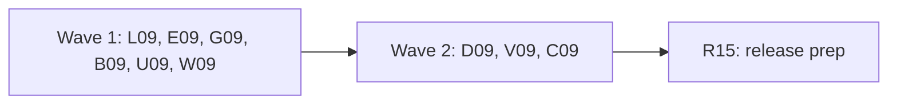

# Plan for 0.6.1

0.6.1 is a patch release. It fixes the open issues that the 2026-11-08 triage marked as a leak, a bug or wrong docs: 3 leaks, 21 bugs and 14 docs issues, 38 in all. It adds no feature. The `dataLayer` and Consent Mode features of #922 wait for 0.7.0.

0.6.1 starts from `main` after 0.6.0 (`d719e23`, "chore: prepare 0.6.0 (#1390)").

Each item is one PR. A PR is done when its acceptance test passes in CI, an adversarial review reports no blockers or majors, and it is squash-merged.

## Goals this release serves

From `docs/goals.md`:

- **Be safe by default.** A `dataLayer` push that holds an email, phone or hash that is not from the run identity is found (L09). A tag name and an event map key print no page text (L09, E09). A test payment fill cannot hang at its deadline (U09).
- **Compare two runs, or a run against a saved baseline.** `diff` and baselines name an event as the run pushed it, and do not merge two events that map to one name (E09). A hand-edited baseline with mixed push kinds is refused (B09).
- **Expose all of this to agents through the CLI, with stable `--json`.** `changed` agrees with `kindChanged` (E09). Event map errors give the right key position (E09). The docs say what the code does (C09).
- **Record what a site sends at each consent state.** A `dataLayer` name the hook could not trap gives the `dataLayerNotHooked` flag. One array under two names, or an array a child frame adopts, gives no false `dataLayerIncomplete` flag (D09).
- **The first run shows where the setup likely breaks consent rules.** `consentModeSetup` names the vendor of a hit with no tag ID, shows the failing letters and says how many tag IDs it left out (G09).
- **Expected behaviour as data, and pass or fail with evidence.** An exact count rule with unlinked server hits gives `serverSendUnlinked` when a subset of them could change the verdict (V09).

Non-goals this release comes close to:

- **Explaining why a tag did not fire.** Unchanged.
- **A hosted service.** Unchanged. The push scan runs on the user's machine, like the request scan.

## Triage

The issues come from the triage file of 2026-11-08. One read-only pass reread each issue with `gh issue view` and checked its file and line against `main` at `d719e23`. Every issue is still open and still valid. The triage file lists were rough; the Touches lines below are from the code.

| Issue | Kind | Entry | Note |
| --- | --- | --- | --- |
| #937 | leak | L09 | `buildFlags` in `packages/recorder/src/flags.ts` scans requests and hits only. `findForeignData` in `packages/expect/src/evaluate.ts` takes no `DataLayerEvent`. Scope in decision 1. |
| #1322 | leak | L09 | `maskTagName` in `packages/expect/src/tags.ts`. |
| #1316 | leak | E09 | `parseEventMap` echoes an unknown top-level key. |
| #1314, #1315 | bug | E09 | `normalizePushGroups` and `parseEventMap` in `packages/expect/src/event-map.ts`. |
| #1246 | bug | E09 | `normalizePushGroups` renames both sides before `diffPushes` (`packages/expect/src/diff.ts`). Decision 2. |
| #1370 | bug | E09 | `diffPushes` sets `changed` without `kindChanged`. Decision 6. |
| #1373 | bug | E09 | `commandLabel` and `collectPaths` in `packages/expect/src/push-shape.ts`. |
| #1306 | bug | G09 | The `ep.` loop in `packages/decoders/src/google-ads.ts` runs after `conversionId` is set. |
| #1308, #1309, #1385 | bug | G09 | `packages/expect/src/consent-mode-setup.ts`. The second half of #1309 ("every Google hit") is fixed on `main`: the message says "that carried gcd". Only the "and N more" half is left. |
| #1374 | bug | B09 | `compareBaseline` in `packages/cli/src/baseline.ts` uses `.some(kind === undefined)`. Decision 5. |
| #1329 | bug | B09 | `ensureConfig` in `packages/cli/src/init.ts` uses `exists()`. |
| #990 | bug | U09 | `readBlockingControls` in `packages/recorder/src/locators.ts` reads the whole document. Decision 4. |
| #1339 | bug | U09 | `packages/recorder/src/payment.ts`, the `handle.evaluate` in the deadline path. |
| #1384 | bug | U09 | The label style in `packages/recorder/src/handoff-overlay.ts`: `nowrap`, ellipsis, `max-width: 300px`. |
| #727 | bug | W09 | `scripts/wordmark.ts` reads `node_modules/@fontsource/jost`, which is not a dependency. |
| #867 | bug | W09 | `site/src/components/intro/desktop.tsx` and `Intro.tsx`. |
| #1235 | bug | D09 | `recorder.ts` passes `options.dataLayerNames` as `hooked`. The init script skips a name `trappable` refuses. |
| #1299, #1360 | bug | D09 | `hook()` and the tally in `packages/recorder/src/datalayer.ts`. |
| #1368 | docs | D09 | The `/datalayer-kinds` row of `fixtures/site/README.md`. D09 adds rows to the same table. |
| #1223 | bug | V09 | `evaluateRule` in `packages/expect/src/evaluate.ts` tries only all or none of the unlinked hits. |
| #1029 | bug | V09 | `sameKey` in `packages/recorder/src/server-container/link.ts`. Decision 3. |
| #1288, #1289, #1319, #1353, #1377 | docs | C09 | `docs/design.md` §12, §11, §5.2 and §13 (the issues name §13, §7.3 and §15; the lines are in §11, §5.2 and §13). #1289 also edits the `defaults` text of `docs/cli.md`. |
| #1334, #1342, #1344, #1366 | docs | C09 | `docs/cli.md`. |
| #1389 | docs | C09 | The text is in `packages/cli/src/baseline.ts` (B09 changes it) and `docs/cli.md` (C09). C09 closes the issue. |
| #1323 | docs | C09 | `docs/guide/tag-reports.md`. |
| #1294, #1337 | docs | C09 | Released lines of the `## 0.6.0-rc.3` section of `CHANGELOG.md`. |

Claims checked against the code at `d719e23`:

- `packages/recorder/src/flags.ts`, `buildFlags`: `possibleRealData` comes from `findForeignData(requests, hits, identity)`. `recorder.ts` calls `buildFlags` in `close` without `dataLayerEvents`. `evaluate` scans requests and hits again and skips a request that already has a flag. It does not scan pushes.
- `fixtures/site/public/datalayer-shapes.html` pushes a key and an event name that are the fake email `fake.person@example.test`. `datalayer-build.html` (build b) pushes an event named with it. `e2e/datalayer-diff.e2e.test.ts` and `e2e/baseline-warning-count.e2e.test.ts` expect exit 0 on build b. A push scan that fails the run changes that (decision 1).
- `packages/expect/src/event-map.ts`: `pathKeys` is `[final, recorded, userName(recorded)]`. Positions come from `Object.entries`, which lists integer-like keys first. The unknown top-level key is printed as written.
- `packages/expect/src/diff.ts`: `diffPushes` normalizes both sides, then keys nodes by `[epoch, event, kind, frame]`. `changed` sums five arrays and leaves out `kindChanged` and `moved`. `PushDiff.changed` is read only by `diff --json`.
- `packages/cli/src/baseline.ts`: the "saved by 0.6.0-rc.1" warning shows for any baseline with no `dataLayer` section, also one saved by 0.5.0.
- `packages/expect/src/consent-mode-setup.ts`: `tagId` returns a bare `(no tag ID)`. `lettersNote` cuts at five tag IDs with no "and N more". The fail branch takes the first three letter sets in the order seen.
- `packages/recorder/src/datalayer.ts`: `hook()` returns the existing state for an array it already hooked, so `window.myLayer = window.dataLayer` gives the tally the `dataLayer` state under the name `myLayer`. `hook()` returns nothing for an array with the `__tagreeveHooked` marker from another realm, and the tally then reports it with `a: null` and `posted: 0`.
- `NEVER_TRAPPED_NAMES` in `packages/expect/src/scenario.ts` is `location`, `Shopify`, `__proto__`, `constructor` and `prototype`. A Window accessor such as `status` or `origin` passes the validator, and the init script then skips it.
- `packages/recorder/src/server-container/link.ts`: `sameKey` keeps only browser hits with the same event name. `HitLinkMiss.clientId` in `packages/core/src/records.ts` has four values, and `packages/cli/src/summary.ts` counts them in `notExact.clientId`.

## Decisions

Decided in this plan:

- **Scope.** The 38 issues above. No feature. The 9 `dataLayer` and Consent Mode features (#922, #931 to #936, #938, #939) are for a 0.7.0 plan.
- **`recordSchemaVersion` stays 5.** `suiteSchemaVersion` stays 3 and `baselineSchemaVersion` stays 1. This plan adds no record field. Decision 3 adds one value to `HitLinkMiss.clientId`, and L09 adds the flag kind `possibleRealDataPush`; neither bumps the version.
- **Docs for wave 1 code go in C09.** Wave 1 code entries edit no file under `docs/`, so every entry in a wave touches different files. C09 writes their docs in wave 2, from the merged code.
- **#727: the font path is an argument.** `node scripts/wordmark.ts <path to Jost Medium .woff>`. No new dependency. Without the argument the script exits 2 with a usage line. The other choice is `@fontsource/jost` as a devDependency for one script.
- **#1384: the handoff label wraps.** At most four lines, at most 420 px wide and never wider than the viewport minus 32 px, as now. A longer text ends with an ellipsis and the full text is in the element's `title`. Done stays on the first line. An expand control is more code in a closed shadow root for the same result.
- **#1339: a hung check rethrows the timeout.** The `isConnected` evaluate and the `frameStillServed` check race a 500 ms timer. If the timer wins, the fill rethrows the original timeout error. A hung renderer is not a gone frame, so the gone-frame reason would be wrong.
- **#1235: the tally reports the names it skipped.** The init script keeps the configured names `trappable` refused. The tally returns them as `untrapped`, validated against the hooked names. A name the top frame's tally reports as untrapped counts as not hooked in `dataLayerNotHooked`. The other choice, a binding call at init, adds page traffic for a rare case.

Decided by the maintainer on 2026-11-08. Decisions 2 to 6 take the recommendation. Decision 1 takes the warning-only choice.

1. **Decided: #937, the push scan warns only.** Wave 1. `findForeignData` scans each `DataLayerEvent.args` with the same scanner as hit parameters. A push that holds a value not from the run identity gets a flag of a new kind, `possibleRealDataPush`. Its detail reads `dataLayer push <id> in step <id> carries <n> <kinds> value(s) that are not from the run identity, in <paths>`, with each path named as `findForeignData` names a JSON body leaf (`guardFieldName` over the leaf path), so push and request findings read the same. L09 stays in `evaluate.ts` and does not touch `push-shape.ts`. The `possibleRealData` check does not count these flags, so a push finding never changes the exit code, and a run that passed in 0.6.0 still passes. A new flag kind needs no record schema bump. Why: a patch release should not turn green runs red, and the request scan already gives many findings on a Shopify storefront. Whether push findings fail by default can be decided with #1392.
   - The second half of #937, "a test identity pushed before consent", is a new check. It is #1392, for 0.7.0. L09 does not close #937; it refers to it.
2. **Decided: #1246, which name `diff` shows.** Wave 1. Decided: pair events by the recorded name first. Use the built-in table and the user map only to pair an event that is left over on one side with one left over on the other side. Every output entry names the event as the run pushed it: side b's name, or side a's name for a removed event. A pair that the map joined gets the new optional field `renamedFrom` (side a's recorded name) in `diff --json`, and the text reads `purchase (renamed from checkout_completed)`. Two events of one run that map to one name stay two nodes. The other choice keeps the mapped name and adds the recorded names to each node. It changes less, but output still names an event no run pushed.
3. **Decided: #1029, a stricter tie for link rule 2.** Wave 2. Decided: a call does not link `exact` by client ID when another container-routed browser request shares one of its client IDs, or has no decoded hit, and was sent between the single same-key hit's `sentAt` and the call's arrival. Such a call gets the new `HitLinkMiss.clientId` value `concurrentRequest`, and `--json` `serverContainer.notExact.clientId` gets the same key. Record schema stays 5: a new value is read as a class name, like a new flag kind. The other choices: count it under `severalSameKeyHits`, which needs no new value but widens its meaning (a bump by the version 5 rule), or leave rule 2 as it is and keep #1029 in the Known list.
4. **Decided: #990, which controls a `wait` timeout lists.** Wave 1. Decided: when the last `click` step before the `wait` clicked a submit control inside a form, list only the blocking controls whose `form` is that form. In every other case, list every control, as now. `blockingControls` takes the clicked element's form from the step runner and reads `el.form` in the page. The other choice is to list that form's controls first and the rest after a separator, or only to document the limit.
5. **Decided: #1374, a baseline with mixed push kinds.** Wave 1. Decided: refuse it, with the M25 message `<file> has an invalid dataLayer section`, exit 2. Only a hand edit makes one. The other choice compares kinds for the groups that have one and merges the rest.
6. **Decided: #1370, `changed` and `kindChanged`.** Wave 1. Decided: `changed` is true when `kindChanged` is not empty. `diff --json` then shows `changed: true` next to the `push kind changed` warning. `moved` stays out of `changed`, as now: a move is not a change of shape. The other choice keeps the code and documents that a kind change alone leaves `changed` false.

## Order and waves



The leak fixes and the code fixes that share no file first, then the `dataLayer` hook, the server linking fixes and the docs, then the release prep.

Why the waves are this way:

- **Leaks first.** L09 and E09 hold the three leaks and run in wave 1.
- **`packages/expect/src/evaluate.ts`** changes in L09 (wave 1: `findForeignData` only) and V09 (wave 2: `evaluateRule`).
- **`packages/cli/src/summary.ts`** changes in L09 (wave 1: `formatFlags` and `PROSE_KINDS`) and V09 (wave 2: the `notExact.clientId` keys). Different functions.
- **`packages/recorder/src/recorder.ts`** changes in L09 (wave 1: the `buildFlags` call in `close`) and D09 (wave 2: the `hooked` names of `buildDataLayerNotHookedFlag`).
- **`fixtures/site/src/index.ts` and `fixtures/site/README.md`** change in U09 (wave 1: one new page) and D09 (wave 2: one new page and the #1368 row). L09 uses existing pages.
- **`docs/cli.md`, `docs/design.md` and `docs/guide/`** change in C09 only. C09 is in wave 2, so it documents the merged wave 1 code. For D09 and V09 in the same wave, C09 writes from this plan and merges after both; its reviewer checks the text against their merged code.
- **`CHANGELOG.md`** is the one file every entry edits. The plan PR adds the `## 0.6.1` block with all markers. Each entry replaces only its own marker line. C09 also edits two released lines of the `## 0.6.0-rc.3` section (#1294, #1337). R15 writes the section.
- **E09 and B09** both affect baseline compare. E09 changes `diffPushes` and its names, which `compareBaseline` calls. B09 changes `compareBaseline` and `validPushGroup` only. They touch different files.

## Rules for every PR

The rules in `AGENTS.md` and the earlier plans still hold: CLI only, no MCP server; no hosted service; fake IDs and identities only (`G-PWTEST0001`, `AW-000000001`, `100000000000001`, `GTM-PWTEST1`, `GTM-PWNOVER`); no cookie value, identity value, card value, `gtmAuth` or container config in any output, with a leak test for each PR that adds output; e2e only against `fixtures/site` (and the stand-in container), with no Docker and no network; context-level hooks only; third-party code unmodified, and no tracker data from Tracker Radar, EasyPrivacy or Disconnect.

More for 0.6.1:

- Each PR adds a regression test that fails when the change is removed, and the PR description says how that was checked. R15 is the exception.
- Each negative test checks first that its input really holds what the check looks for.
- New e2e tests go in new files, unless the entry names an existing file.
- Wave 1 code entries edit nothing under `docs/`. C09 writes their docs.
- A message names a key by its position or a fixed label, never by its text from a file or a page.
- CHANGELOG: the plan PR adds the `## 0.6.1` heading above `## 0.6.0`, with the line `Not released yet. The newest release is 0.6.0, below.` and every marker of "CHANGELOG markers". Each PR replaces only its own marker, so no two PRs add the heading. R15 removes leftover markers and the "Not released yet" line.

## PRs

### Wave 1

**L09 Scan `dataLayer` pushes for data not from the run identity, and mask hex tokens in tag names.**
Refs #937 (first half; the second half is #1392)
Closes #1322

Touches: `packages/expect/src/evaluate.ts` (`findForeignData` takes an optional `dataLayerEvents` argument and its findings carry a source, `request` or `push`; the `possibleRealData` check passes no events), `packages/expect/src/identity-values.test.ts`, `packages/expect/src/evaluate.test.ts`, `packages/expect/src/tags.ts` (`maskTagName` only), `packages/expect/src/tags.test.ts`, `packages/core/src/records.ts` (the `possibleRealDataPush` flag kind and its docstring), `packages/recorder/src/flags.ts` (`FlagInput` and `buildFlags`), `packages/recorder/src/flags-real-data.test.ts`, `packages/recorder/src/recorder.ts` (the `buildFlags` call in `close` only), `packages/cli/src/summary.ts` (`formatFlags` and `PROSE_KINDS` only), `packages/cli/src/summary.test.ts`, `e2e/datalayer-push-real-data.e2e.test.ts` (new), `CHANGELOG.md` (the L09 marker).
- `findForeignData` scans each push's `args` leaf by leaf, as it scans a JSON body, with the same leaf naming. A finding is keyed by the push's record ID. Its detail names the push ID, the step and the key paths named as decision 1 says, never the value.
- `buildFlags` gets `dataLayerEvents` and writes one `possibleRealDataPush` flag per push with a finding, with the push ID and the step in `recordIds`. Push findings exist only as recorder flags: `evaluate` passes no events, so the `possibleRealData` check counts request findings only, as now, and a record from 0.6.0 or earlier that `check` evaluates again gets no push findings. `buildFlags` uses the source to choose the kind.
- `formatFlags` in `summary.ts` collapses `possibleRealDataPush` to one `possibleRealDataPush: x<n>` line, as it does for `possibleRealData`, and `PROSE_KINDS` lists the new kind so `redactFlagDetail` does not read its detail as a URL. `--json` keeps the full detail.
- `maskTagName` adds a third split to its union, on each alphanumeric run (`/[^A-Za-z0-9]+/`). The coarse split stays, so a UUID or a hyphenated digest is still checked whole. `GA4 page_view` stays as it is (#1322).
Regression test: `identity-values.test.ts`: a push whose key and leaf hold a fake email that is not the run identity gives one finding with the push ID; the run identity's own email in a push gives none; the email is absent from the whole finding (precondition: the push holds it). `flags-real-data.test.ts`: `buildFlags` with that push gives one `possibleRealDataPush` flag, and the `possibleRealData` check result is unchanged by it. `evaluate.test.ts`: a record with a `possibleRealDataPush` flag and no request leak leaves the `possibleRealData` check passing. `summary.test.ts`: 3 push flags give one `possibleRealDataPush: x3` line, and the email is absent (precondition: the details hold it). `tags.test.ts`: `thanks-<32 hex>`, `x~<32 hex>`, `thanks!<32 hex>`, `thanks$<32 hex>` and `thanks^<32 hex>` read `(other)`, each after a check that the input holds the token.
Acceptance: `pnpm exec vitest run --project e2e e2e/datalayer-push-real-data.e2e.test.ts` passes. It runs `/datalayer-shapes` with `--json`. Precondition: the record's pushes hold `fake.person@example.test` and the run identity's email is another one. The record has a `possibleRealDataPush` flag whose `recordIds` hold a push ID, the exit code is the same as without the push finding, and stdout, the flag detail and the JSONL file outside the push itself do not hold the email. On the old code there is no such flag, so the test fails.

**E09 Event map errors, recorded event names in `diff`, and push shape labels.**
Closes #1316
Closes #1314
Closes #1315
Closes #1246
Closes #1370
Closes #1373

Touches: `packages/expect/src/event-map.ts`, `packages/expect/src/event-map.test.ts`, `packages/expect/src/diff.ts` (`diffPushes`, `PushRef` and `PushDiff`), `packages/expect/src/diff.test.ts`, `packages/expect/src/push-shape.ts` (`commandLabel` and `collectPaths` only), `packages/expect/src/push-shape.test.ts`, `packages/cli/src/diff.ts` (`describePushDiff` only), `packages/cli/src/diff.test.ts`, `fixtures/site/public/datalayer-event-map.html` (build b's `purchase` push gets a `coupon` key that build a's `checkout_completed` push lacks), `e2e/datalayer-event-map.e2e.test.ts` (the expectations that name a mapped event or read `changed`, which the new key and decision 2 change), `e2e/datalayer-recorded-names.e2e.test.ts` (new), `CHANGELOG.md` (the E09 marker).
- An unknown top-level key reads `top-level key <n> is not "events" or "paths"`. A bad path key reads `paths.<event> key <n> is not a key path`. No key text is printed (#1316).
- Key positions count the keys of `events` and `paths` in the order they are written in the file. A small scanner reads the key order from the JSON text after `JSON.parse` accepts it, so integer-like keys no longer come first (#1315).
- `pathKeys` drops the recorded-name and user-renamed-name fallbacks when that name is also a target in `events`. A swap map and a chain map then apply each `paths` entry to one group only (#1314).
- `diffPushes` pairs and names events as decision 2 says (#1246). `describePushDiff` shows `renamedFrom` in the text.
- `changed` counts `kindChanged` (decision 6, #1370).
- `commandLabel` and `collectPaths` give `consent <x>` and walk the consent signals only when the second item is `default` or `update`. An arguments-like event whose name starts with `gtm.` has a count and no paths, as the array form has (#1373).
Regression test: `event-map.test.ts`: `{"zz<script>":1}` gives the position message and the text `zz<script>` is absent; `{"events":{"bad/name":"x","5":"y"}}` names key 1; a bad path key names its position; the swap map and the chain map of #1314 leave the second group's paths as they were. `diff.test.ts`: two runs that both push `checkout_completed` with a changed path report `checkout_completed`; a run with both `checkout_completed` and `purchase` against a run that drops one reports one removed event; a pair joined by the table has `renamedFrom`; a kind change with equal paths gives `changed: true`. `push-shape.test.ts`: `{0:'consent',1:'foo',2:{}}` reads `gtag consent`; `{0:'event',1:'gtm.dom',2:{a:1}}` has no paths.
Acceptance: `pnpm exec vitest run --project e2e e2e/datalayer-recorded-names.e2e.test.ts` passes. It runs the scenarios `datalayer-event-map-a` and `datalayer-event-map-b`, then `diff --json` on the two records, without `--event-map`. Precondition: run a pushed `checkout_completed` and no `purchase`, run b pushed `purchase` and no `checkout_completed`, and only b's push has `coupon`. The test first asserts that `pathsAdded` has an entry with `path: "coupon"`, so the list cannot be empty. That entry has `event: "purchase"` and `renamedFrom: "checkout_completed"`, and no entry in `dataLayer` names `checkout_completed` as its `event`. On the old code the entry names the mapped event and has no `renamedFrom`, so the test fails. `diff.test.ts` has the same case for a pair with a path change.

**G09 `consentModeSetup` messages and the Google Ads conversion ID.**
Closes #1306
Closes #1308
Closes #1309
Closes #1385

Touches: `packages/decoders/src/google-ads.ts` (the `ep.` and `epn.` loop only), `packages/decoders/src/google-ads.test.ts`, `packages/expect/src/consent-mode-setup.ts`, `packages/expect/src/consent-mode-setup.test.ts`, `e2e/consent-mode-setup.e2e.test.ts` (message expectations only, if one changes), `CHANGELOG.md` (the G09 marker).
- The `ep.` and `epn.` loop skips `conversionId`, so a page parameter cannot set it (#1306).
- In the fail branch, the letter sets that hold an `l` come first, before the cap of three (#1308).
- `lettersNote` adds `; and <n> more` past five tag IDs, as the fail branch does (#1309).
- A hit with no tag ID is grouped by vendor: `GA4 (no tag ID)` or `Google Ads (no tag ID)` (#1385).
Regression test: `google-ads.test.ts`: a hit with `tid=AW-000000001` and `ep.conversionId=123456789` has `conversionId` `000000001`. `consent-mode-setup.test.ts`: four letter sets with the failing one last show it; six passing tag IDs show five and `and 1 more`; a Google Ads hit with no conversion ID reads `Google Ads (no tag ID)`.
Acceptance: each new unit case fails on the old code. `pnpm exec vitest run packages/decoders/src/google-ads.test.ts packages/expect/src/consent-mode-setup.test.ts` passes.

**B09 Baseline kinds and version text, and a folder at `tagreeve/config.yml`.**
Closes #1374
Closes #1329

Touches: `packages/cli/src/baseline.ts` (`parseBaseline` and `compareBaseline` only), `packages/cli/src/baseline.test.ts`, `packages/cli/src/init.ts` (`ensureConfig` and `failureText` only), `packages/cli/src/init.test.ts`, `e2e/init-config-folder.e2e.test.ts` (new), `CHANGELOG.md` (the B09 marker).
- A baseline whose `dataLayer` groups are partly kinded is refused as decision 5 says (#1374).
- The warning for a baseline with no `dataLayer` section reads `saved before 0.6.0-rc.2`, so a 0.5.0 baseline is not named rc.1 (#1389; C09 changes `docs/cli.md` and closes it).
- `ensureConfig` stats the path. A path that exists and is not a regular file prints `tagreeve/config.yml is not a file` on stderr and exits 2. `--json` lists the items done before it, as M28 does for the folders (#1329).
Regression test: `baseline.test.ts`: a baseline with one kinded and one unkinded group is refused (decision 5); a baseline with no `dataLayer` section warns `saved before 0.6.0-rc.2` and does not name rc.1. `init.test.ts`: a folder at `tagreeve/config.yml` gives the error and no `skipped` item.
Acceptance: `pnpm exec vitest run --project e2e e2e/init-config-folder.e2e.test.ts` passes. It makes a folder at `tagreeve/config.yml` in a temp project and runs `tagreeve init --json`. Exit 2, stderr says `is not a file`, and stdout `items` has no `skipped` entry for the config. On the old code it exits 0 with "Skipped", so the test fails.

**U09 Recorder steps: blocking controls, the payment deadline and the handoff label.**
Closes #990
Closes #1339
Closes #1384

Touches: `packages/recorder/src/locators.ts` (`readBlockingControls` and `blockingControls`), `packages/recorder/src/locators.test.ts`, `packages/recorder/src/steps.ts` (the `wait` case passes the last clicked form, decision 4), `packages/recorder/src/steps.test.ts`, `packages/recorder/src/payment.ts` (the deadline path only), `packages/recorder/src/payment.test.ts`, `packages/recorder/src/handoff-overlay.ts` (the label style and `title` only), `packages/recorder/src/handoff-overlay.test.ts`, `fixtures/site/public/terms-footer.html` (new), `fixtures/site/src/index.ts` (its route only), `fixtures/site/README.md` (its row), `packages/recorder/test/e2e/wait-url-form.e2e.test.ts` (new), `packages/recorder/test/e2e/handoff-overlay.e2e.test.ts` (one new case), `CHANGELOG.md` (the U09 marker).
- A `wait` timeout lists the controls decision 4 picks (#990).
- `fillVerified` has two paths at the deadline: the `TimeoutError` catch and the count-not-one branch. One helper races every await in the fill loop against the time left to the deadline plus 500 ms: the per-iteration `frameStillServed` and `inputs.count()` (`Locator.count()` has no timeout option), and after the deadline `handle.evaluate(isConnected)` and `countReason`. `cardFrameServed` (`elementHandles`, `contentFrame`, `isVisible`) and `markerInCardContainer` (`evaluateHandle`) run before the fill loop and are out of scope: they are filed as a follow-up `review-minor` issue, not fixed here. When the timer wins in the catch, the fill rethrows the original timeout. In the count-not-one branch, a timer win reads as an unreadable count reason (`countReason` already has `inputs not readable`) (#1339).
- The handoff label wraps as decided in this plan (#1384). The pill keeps its drag, its position and the Done button.
- `/terms-footer` has the `pay-form` of `/terms-required` and a footer newsletter form with an empty required email field. Every value on it is fake.
Regression test: `payment.test.ts`: a fake handle whose `evaluate` never settles makes the fill end within the step timeout plus 1 s with the original timeout error. A second case: a frame whose `evaluateAll` and `contentFrame` never settle, with more than one visible input, ends within the timeout plus 1 s with an `OwnReason`. A third case: a locator whose `count()` never settles at the top of an iteration ends within the timeout plus 1 s with an `OwnReason`. `handoff-overlay.test.ts`: the label has no `nowrap` and has a `title` equal to the text. `locators.test.ts`: with a clicked form, a control outside it is not listed.
Acceptance: `pnpm exec vitest run --project e2e packages/recorder/test/e2e/wait-url-form.e2e.test.ts packages/recorder/test/e2e/handoff-overlay.e2e.test.ts` passes. The first clicks Pay on `/terms-footer` and waits for `/thank-you` with a short timeout. Precondition: the footer email field is invalid in the page. The message names the terms checkbox and not the footer field. On the old code it names both, so the test fails. The new overlay case gives a 140-character text and checks that the label's rendered height is more than one line and that the whole text is in `title`. On the old code it is one line, so the case fails.

**W09 The wordmark script and the intro Skip button.**
Closes #727
Closes #867

Touches: `scripts/wordmark.ts` (the font path argument and the header comment), `scripts/wordmark.test.ts` (new), `brand/README.md` (line 34 only), `site/src/components/intro/desktop.tsx` (`MenuBar` and `SkipButton` only), `site/src/components/intro/Intro.tsx` (the wasted-stage Skip button only), `scripts/site-intro.docs.test.ts` (one new case), `CHANGELOG.md` (the W09 marker).
- `scripts/wordmark.ts` reads the `.woff` from its first argument. No argument or an unreadable file exits 2 with a usage line that names the argument, not a `node_modules` path (#727). `brand/README.md` says where to get Jost Medium and how to pass it.
- When the stage turns to `wasted` and the menubar Skip button had focus, focus moves to the new Skip button. Escape is unchanged (#867).
Regression test: `wordmark.test.ts` runs the script with no argument and with a missing file. It exits 2, writes no brand file, and the message holds no `@fontsource` path.
Acceptance: `pnpm docs:test` passes, with the new case in `scripts/site-intro.docs.test.ts`: Tab to the menubar Skip button, wait for the `wasted` stage, then `document.activeElement` is the visible Skip button inside the overlay and Enter ends the intro. On the old code focus is on `body`, so the case fails.

### Wave 2

**D09 `dataLayer` names the hook could not trap, aliased arrays and adopted arrays.**
Closes #1235
Closes #1299
Closes #1360
Closes #1368

Touches: `packages/recorder/src/datalayer.ts` (the init script: `hook()`, the tally and the untrapped list), `packages/recorder/src/datalayer.test.ts`, `packages/recorder/src/datalayer-tally.ts` (`validateTally`), `packages/recorder/src/datalayer-tally.test.ts`, `packages/recorder/src/datalayer-names.ts` (`buildDataLayerNotHookedFlag`), `packages/recorder/src/datalayer-names.test.ts`, `packages/recorder/src/recorder.ts` (the `hooked` names in `close` only), `fixtures/site/public/datalayer-alias.html` and `fixtures/site/public/datalayer-alias-child.html` (new), `fixtures/site/src/index.ts` (their routes only), `fixtures/site/README.md` (their rows and the `/datalayer-kinds` row), `packages/recorder/test/e2e/datalayer-alias.e2e.test.ts` (new), `CHANGELOG.md` (the D09 marker).
- The hook state keeps the name it was hooked under. The tally uses a state only for that name. A name whose array is the same object as an earlier name's array is left out of the tally, so its pushes are counted once (#1299).
- The tally leaves out an array that has its own `__tagreeveHooked` marker and no state in this realm. The frame that owns it counts it. An array with no marker keeps `a: null`, so `mode=redefine` of `/datalayer-theme` is still flagged (#1360).
- The tally returns `untrapped`, and the recorder treats those names as not hooked (this plan, #1235). `validateTally` keeps only names that are in the hooked names list.
- `fixtures/site/README.md`: the `/datalayer-kinds` row ends with `| None. |` (#1368).
- `/datalayer-alias` has modes by query. `mode=alias`: `window.myLayer = window.dataLayer`, then 3 pushes to `dataLayer`. `mode=adopt`: a same-origin iframe (`/datalayer-alias-child`) runs `window.dataLayer = parent.dataLayer` and pushes 2 items. `mode=status`: loads a Google loader URL with `l=status`, in the same way as the existing `/datalayer-renamed` page loads `l=myLayer`. Every value is fake.
Regression test: `datalayer.test.ts` (vm sandbox): an alias name gives one tally entry for the array; a second realm that adopts a marked array gives no entry; a `status` accessor on the sandbox window is in `untrapped`. `datalayer-names.test.ts`: a configured name in `untrapped` gives the flag. `datalayer-tally.test.ts`: an `untrapped` name that is not a hooked name is dropped.
Acceptance: `pnpm exec vitest run --project e2e packages/recorder/test/e2e/datalayer-alias.e2e.test.ts` passes. `mode=alias` with `dataLayerNames: [myLayer]`: 3 pushes and no `dataLayerIncomplete` flag, and close does not wait the full 1000 ms. `mode=adopt`: the child's pushes are recorded once and there is no flag for the child frame. `mode=status` with `dataLayerNames: [status]`: one `dataLayerNotHooked` flag that names `status`. On the old code `mode=alias` and `mode=adopt` give a false flag and `mode=status` gives none, so the test fails.

**V09 Unlinked server hits with an exact count, and the link rule 2 tie.**
Closes #1223
Closes #1029

Touches: `packages/expect/src/evaluate.ts` (`evaluateRule` only), `packages/expect/src/server-sends.test.ts`, `packages/recorder/src/server-container/link.ts` (`sameKey` and the miss reason), `packages/recorder/src/server-container/link.test.ts`, `packages/core/src/records.ts` (the `HitLinkMiss.clientId` union and its docstring), `packages/cli/src/summary.ts` (the `notExact.clientId` keys only) and `packages/cli/src/summary.test.ts`. `CHANGELOG.md` (the V09 marker).
- For a `must` rule with an exact count, `evaluateRule` tries each number of unlinked hits in scope, from 0 to all. When any number gives a verdict other than the plain one, the result has `serverSendUnlinked`. `at least` and `at most` counts are monotone, so all or none is still enough for them (#1223).
- `sameKey` follows decision 3 (#1029). The single-request case stays `exact`.
Regression test: `server-sends.test.ts`: `count: 1`, 0 judged hits and 2 unlinked hits give `serverSendUnlinked`. `link.test.ts`: the #1029 case (a pre-reject `purchase` in flight, a post-reject request with another name and the same client ID, then a container `purchase` call) gives no `exact` link and the decision 3 miss reason; one request and one call still link `exact`.
Acceptance: each new unit case fails on the old code. `e2e/server-container-link.e2e.test.ts` and `e2e/server-container-link-miss.e2e.test.ts` still pass unchanged.

**C09 Docs: the open docs issues and the docs for wave 1.**
Closes #1288
Closes #1289
Closes #1294
Closes #1319
Closes #1323
Closes #1334
Closes #1337
Closes #1342
Closes #1344
Closes #1353
Closes #1366
Closes #1377
Closes #1389

Touches: `docs/design.md`, `docs/cli.md`, `docs/guide/tag-reports.md`, `docs/guide/server-container.md`, `CHANGELOG.md` (the two rc.3 lines named below, found by their text, and the C09 marker), `scripts/docs-text.docs.test.ts` (new cases).
- `docs/design.md` §12: the colon stays after "its flag is not given", and the unreadable-path sentence moves after the list (#1288). §12 and the `defaults` text of `docs/cli.md`: a path of the wrong kind is skipped like a missing one, and only a path that cannot be read exits 2 (#1289).
- §11 tag rule row: `status` is one of `success`, `failure`, `exception` or `timeout`, and another value exits 2 (#1319).
- §5.2: the `dataLayerNotHooked` flag lists each missed name once, at most five, with a count of the rest, and a name that is not a valid layer name or looks like a value reads `(other)` (#1353).
- §13, the `--json` output bullet: the record masks a value-like `unloadGap` event name, and the summary masks a URL at the end of a detail for every flag kind except the prose kinds (#1377).
- `docs/cli.md`: "No message holds any text from the file" (#1334). A `baseline save` failure names the output path, which is the default path in the one-path form (#1342). The exit 2 row lists `baseline save` that cannot name or write its file, and the record-path prefix covers every one-path refusal (#1344). The `diff` `dataLayer` field list has `kindChanged` with its shape, and says how `changed` treats it (#1366). A baseline with no push shapes is "saved before 0.6.0-rc.2" (#1389).
- `docs/guide/tag-reports.md`: one sentence on the `noTagReports` advice, install the reporter and run with `--gtm-override` (#1323).
- `CHANGELOG.md`: find the lines by their text, not by line number. The rc.3 T08 line says the failure was seen in a GTM preview (#1294). The rc.3 M29 line says "a card frame that moves, or reloads after its input was found" (#1337).
- Docs for wave 1: the push scan and its decision 1 severity (L09: the §13 leak detection paragraph, the `possibleRealData` sentence of `docs/cli.md`); the event map errors, recorded names, `renamedFrom` and `changed` (E09: the `diff` section and the `--event-map` row); the `(no tag ID)` labels and "and N more" (G09: the `consentModeSetup` section); the mixed-kind baseline and the `config.yml` folder (B09: the `baseline` and `tagreeve init` sections); the blocking controls of the clicked form and the wrapping handoff label (U09: the `wait` and `handoff` paragraphs; the "cut with an ellipsis" sentence changes).
- Docs for wave 2, from this plan: untrapped names and the aliased and adopted arrays (D09: design §5.2); the exact count rule and the rule 2 tie (V09: the linking rules paragraph of design §4, the `notExact` field of `docs/cli.md`, and in `docs/guide/server-container.md` the `concurrentRequest` row of the `linkMiss.clientId` table, the sentence on when a client ID link is `exact`, and the `serverSendUnlinked` bullet for the exact count case). C09 merges after D09 and V09.
Regression test: `docs-text.docs.test.ts` gets one case per issue that reads the fixed text and fails on the old text: "Neither message" is gone from `docs/cli.md`; `kindChanged` is in the `diff` section; "names the path you gave" is gone; the §12 colon comes before `` `suite` with no folder``; "only a missing path counts as absent" is gone; the §11 row lists `timeout`; "saved by 0.6.0-rc.1" is gone from `docs/cli.md`; the rc.3 T08 line does not say "published container"; the tag reports guide holds `--gtm-override` in the CANNOT EVALUATE paragraph; the server container guide's `linkMiss.clientId` table has a `concurrentRequest` row; the rc.3 M29 line says "or reloads after its input was found" (#1337); the `docs/cli.md` exit 2 row names `baseline save` (#1344); §5.2 says the `dataLayerNotHooked` flag lists at most five names (#1353); §13 says the record masks a value-like `unloadGap` event name (#1377).
Acceptance: `pnpm docs:build` and `pnpm docs:test` pass. Each new case fails on `main` at `d719e23`.

### Release

**R15 Release prep.** Touches: `package.json` (the version), `packages/cli/src/summary.test.ts` (the `readVersion()` line only), `docs/cli.md` (the version sentence), `docs/design.md` (the status line, revision 16 and §15.6), `CHANGELOG.md` (the `## 0.6.1` section), `scripts/changelog-markers.test.ts` (one case: no `<!--` marker is left in the newest section), `README.md` (the status block), `site/demo/` (rerun `scripts/record-site-demo.ts`, if the output it shows changed), the release pill and any other test or doc that pins `0.6.0` as the current version.
- Version `0.6.1`. The install line is `npm i -g tagreeve`.
- `## 0.6.1`: remove the "Not released yet" line and the leftover markers. Write the section from the markers: a short intro, the fixes, "Upgrading from 0.6.0" and "Known in 0.6.1".
- "Upgrading from 0.6.0" lists what a user can see: pushes are scanned for data not from the run identity and a finding is a `possibleRealDataPush` warning that never changes the exit code (decision 1); `diff` names events as recorded, with `renamedFrom` (decision 2); `changed` counts a kind change (decision 6); a baseline with mixed push kinds exits 2 (decision 5); a folder at `tagreeve/config.yml` exits 2; a `wait` timeout lists only the clicked form's controls (decision 4); the handoff label wraps; the rule 2 miss reason `concurrentRequest` (decision 3). The record stays version 5.
- "Known in 0.6.1" is the 0.6.0 list without the items this release fixes (#1360, #1299, #1385, #1029, #990, #1384). It cites only open issues: #1017, #1004 and #1084 are closed, so their lines lose the issue number or go.
- Design status line: revision 16 is the 0.6.1 release. §15.6 lists what 0.6.1 changed.
Acceptance: `pnpm lint`, `pnpm typecheck`, `pnpm test`, `pnpm e2e`, `pnpm docs:build` and `pnpm docs:test` pass; `scripts/release.sh 0.6.1` runs on `main` after merge. The maintainer publishes.

## CHANGELOG markers

The plan PR adds this above `## 0.6.0`, a blank line between each pair. Each entry replaces its marker with its line or lines.

```markdown
## 0.6.1

Not released yet. The newest release is 0.6.0, below.

<!-- L09 -->

<!-- E09 -->

<!-- G09 -->

<!-- B09 -->

<!-- U09 -->

<!-- W09 -->

<!-- D09 -->

<!-- V09 -->

<!-- C09 -->

<!-- R15 -->
```

Entry IDs: H09, M09, P09, Q09, R09 and S09 are used by earlier plans, so this plan does not use them. R15 continues the release prep numbers after R13 (0.6.0-rc.3) and R14 (0.6.0).

## After the PRs

The maintainer field-tests `0.6.1` on the same kind of store, in `stub` mode, supervised, with a person at every payment and log-in handoff:

- **The push scan.** Count the `possibleRealDataPush` flags on a Shopify storefront, next to the request `possibleRealData` flags. The count feeds the #1392 decision on whether push findings should fail by default.
- **The handoff label.** A 140-character instruction is readable in the headed window.
- **`consentModeSetup`.** The Conversion Linker group reads `Google Ads (no tag ID)`.

## Flagged concerns

- **Decision 2 changes `diff` names.** An agent that read the mapped name from 0.6.0 output reads the recorded name now. `renamedFrom` keeps the link between the two.
- **C09 documents D09 and V09 from the plan.** It merges last in wave 2 and rebases on both. Its reviewer reads the merged code, not only the plan.
- **The event map key scanner reads raw JSON text.** It runs only after `JSON.parse` accepts the text, and it reads key order only. A repeated key counts at each place it is written.
- **#937 stays open.** The second half, "a test identity pushed before consent", is #1392 for 0.7.0. L09 only refers to #937.
- **V09 can change a link that passed.** A stricter tie turns some `exact` links into misses. A rule that passed on an exact link can then read `serverSendUnlinked` or `serverSendProbableLink`.

## Out of scope

| Item | Why it waits |
| --- | --- |
| #922, #931 to #936, #938, #939 | `dataLayer` and Consent Mode features. A 0.7.0 plan. |
| The second half of #937 (a test identity pushed before consent) | A new check. With the #922 work in 0.7.0 (decision 1). |
| `review-minor` test hardening, cleanup and site issues | They stay in the Backlog milestone. |
| #1275 (X08) | A separate cleanup after 2026-11-10. |
| Less `possibleRealData` noise on a Shopify storefront | Not a leak or a bug. |
| An MCP server (#362) | AGENTS.md: CLI only. |
