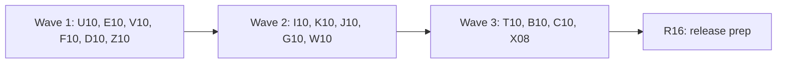

# Plan for 0.6.2

0.6.2 is a clean-slate patch release. It fixes every open `review-minor` issue that the triage of 2026-11-09 marked as valid, so 0.7.0 starts with an empty minor backlog: 118 issues (12 bugs, 10 docs, 55 test, 34 cleanup and 7 site issues). It also removes the node-forge exception from `pnpm-workspace.yaml` (X08, #1275). It adds no feature.

0.6.2 starts from `main` after 0.6.1 (`184f6d5`, "chore: prepare 0.6.1 (#1449)").

Each item is one PR. A PR is done when its acceptance test passes in CI, an adversarial review reports no blockers or majors, and it is squash-merged.

## Goals this release serves

From `docs/goals.md`:

- **Be safe by default.** A test payment fill cannot hang before its fill loop, and the deadline grace does not restart (U10). Leak tests first show that their input holds the value they look for (Z10, J10, B10, T10).
- **Expected behaviour as data, and pass or fail with evidence.** An exact count rule with `body` or `identity.hashesMatch` and unlinked or probable server hits warns when a placement could change its verdict (V10). A push finding names the push, not "the body" (V10).
- **Compare two runs, or a run against a saved baseline.** A move or a kind change of a joined pair names the recorded event (E10). A cross-epoch join pairs only events that can become a move (E10).
- **Expose all of this to agents through the CLI, with stable `--json`.** `diff --json` gets only additive fields (E10). The docs say what the code does (C10).
- **Record what a site sends at each consent state.** A `wait` timeout lists the blocking controls again when the clicked form is gone (U10). An unload send no longer breaks a client ID link (V10).

Non-goals this release comes close to:

- **A second interface.** Unchanged. Every change is in the CLI and its `--json`.
- **A hosted service.** Unchanged.

## Triage

The issues come from the triage file of 2026-11-09 (the 118 rows with verdict "valid"). One read-only pass reread each issue with `gh issue view` and checked its files against `main` at `184f6d5`. Every issue is still open. Two are partly fixed on `main`, and the plan covers only what is left:

- **#1395.** The "Known in 0.6.1" list has the #1392 line. `docs/guide/reading-results.md` still says nothing about `possibleRealDataPush`.
- **#1397.** Design §4 lists `concurrentRequest` and `possibleRealDataPush`, and the "client ID link is narrower" paragraph of `docs/guide/server-container.md` has the new condition. The `records.ts` header docstring and the `serverSendProbableLink` bullet of the server container guide do not.

The triage file lists were rough. The Touches lines below are from the code.

| Issues | Kind | Entry | Where in the code |
| --- | --- | --- | --- |
| #1404, #1418 | bug | U10 | `cardFrameServed`, `markerInCardContainer` and `withinDeadline` in `packages/recorder/src/payment.ts` |
| #1419, #1415 | bug | U10 | `rememberClickedForm` in `steps.ts`; `readBlockingControls` and `blockingControls` in `locators.ts` |
| #1411, #1428 | bug | U10 | The pill and label styles in `packages/recorder/src/handoff-overlay.ts` |
| #1338, #1412, #1202, #1417 | test | U10 | `payment.test.ts`, `locators.test.ts`, `steps.test.ts`, `wait-url-controls.e2e.test.ts`, `handoff-overlay.e2e.test.ts` |
| #1423, #1424 | bug | E10 | `diffPushes` and `pairNames` in `packages/expect/src/diff.ts` |
| #1211, #1369, #1371 | cleanup | E10 | `diff.ts` (the neighbour rule, the kind merge rule, `PushMove`); `compareBaseline` in `packages/cli/src/baseline.ts` |
| #1372 | test | E10 | `event-map.test.ts:190`, `diff.test.ts` |
| #1429, #1430, #1407 | bug | V10 | `evaluateRule`, `passRestsOnProbableLink`, `failureRestsOnProbableLink` and the push entries of `findForeignData` in `packages/expect/src/evaluate.ts` |
| #1432 | bug | V10 | `hasConcurrentRequest` in `packages/recorder/src/server-container/link.ts` |
| #1431 | test | V10 | `link.test.ts` |
| #972, #1041, #1049, #1061, #1330 | cleanup | F10 | `out-dir.ts`, `defaults.ts`, `init.ts`, `project-config.ts`, `run.ts`, `suite.ts` in `packages/cli/src` |
| #1137, #1132 | test | F10 | `defaults.test.ts:98`, `e2e/init.e2e.test.ts:89` |
| #1236, #1357, #1238 | cleanup | D10 | `loaderName` in `datalayer-names.ts`, `isGoogleLoaderUrl` and `dataLayerReassignedFlags` in `recorder.ts`, `isDataLayerName` in `datalayer.ts`, `parseOptions` in `packages/expect/src/scenario.ts` |
| #1318, #1327 | cleanup | D10 | `TAG_STATUSES` and the two duration messages in `scenario.ts`; `TagStatus` in `packages/core/src/records.ts` |
| #1351, #1265, #1298, #1326, #1271 | test | D10 | `datalayer-names.test.ts`, `datalayer-tally.test.ts`, `scenario.test.ts`, a new recorder e2e file |
| #1105, #1106, #1107, #1108, #1325 | test, cleanup | Z10 | `e2e/from-label.e2e.test.ts`, `e2e/run-label.e2e.test.ts`, `e2e/cli-helpers.ts`, `e2e/wait-url-timeout.e2e.test.ts` |
| #1124, #1169, #1365, #954, #1380 | test, cleanup | Z10 | `scripts/server-container-guide.docs.test.ts`, `scripts/release-workflow.test.ts`, `scripts/record-site-demo.ts` |
| #1349, #1350, #1352, #1007 | cleanup, docs, test | I10 | `isEdgeShift`, `readingForms`, `base64InPlace`, `hashJudge` and `checkHashes` in `evaluate.ts`; `scan()` in `packages/core/src/identity.ts` |
| #1162 | test | I10 | `packages/expect/src/meta-capi.test.ts:97,125` |
| #1425, #1312, #1317, #1251, #1252 | cleanup, test | K10 | `event-map.ts`, `pairNames` in `diff.ts`, `packages/expect/src/index.ts` |
| #1291, #1209, #1379 | cleanup | K10 | `isGtagCommand` in `push-shape.ts`; `FRAME_KINDS` in `baseline.ts`; `dataLayerLabelRank` in `summary.ts` |
| #1243 | test | K10 | `e2e/datalayer-event-map.e2e.test.ts:76` |
| #1355, #1359, #1358, #1300, #1218 | test | J10 | `datalayer.test.ts` and the recorder e2e files for the theme, the tally and frames |
| #1217, #1171, #1172, #1212, #1213 | test | J10 | `e2e/unload-gap-frame-nav.e2e.test.ts`, `e2e/datalayer-shapes.e2e.test.ts`, `e2e/datalayer-diff.e2e.test.ts` and their fixture pages |
| #1116, #1117, #1180 | cleanup | G10 | `packages/recorder/src/gtm-templates/tpl.ts`, `packages/cli/src/template.ts` |
| #1118, #1178, #1181, #1332, #1186 | test | G10 | `web-tag-reporter.test.ts`, `template.test.ts`, `scripts/package-bin.test.ts` with `scripts/build.ts`, `recorder-close.test.ts` |
| #750, #759, #760, #835, #837, #838, #857 | site | W10 | `site/src/components/...`, `site/src/lib/demo-data.ts`, `site/src/styles/docs.css` |
| #729, #866 | test | W10 | `scripts/docs-site.docs.test.ts:39`, `scripts/site-intro.docs.test.ts:303` |
| #1150, #1224, #1222, #1305 | cleanup | T10 | `GOOGLE_VENDORS` in `consent-mode-setup.ts` and `evaluate.ts`; the expected tags and list helpers in `tags.ts` and `summary.ts`; `gcd[2 + 2 * i]` in `packages/decoders/src/ga4.ts` |
| #1307, #1167, #1378 | test | T10 | `consent-mode-setup.test.ts`, `e2e/report-marks.e2e.test.ts:25`, `summary.test.ts` |
| #1144, #1341, #1156 | cleanup | B10 | `VARIANT_NAME` in `baseline.ts` and `args.ts`; `readBaseline`; `suiteCommand` and `main.ts` |
| #1146, #1192, #1244, #1340, #1195, #1155, #908 | test | B10 | `baseline.test.ts`, `suite.test.ts` |
| #1395, #1397, #1413, #1435, #1436, #1437 | docs | C10 | `docs/guide/reading-results.md`, `records.ts` header, `docs/guide/server-container.md`, `docs/cli.md`, `docs/design.md` |
| #1445, #1446, #1447 | docs | C10 | Released lines of the `## 0.6.1` section of `CHANGELOG.md` |
| #1438, #1439 | test | C10 | `scripts/docs-text.docs.test.ts` |
| #1448 | test | plan PR | `scripts/changelog-markers.test.ts`. The plan PR adds `## 0.6.2` with markers while `package.json` stays 0.6.1, which the newest-section case refuses. So the plan PR keys that case to `## 0.6.1\n` and asserts its install line and its Known heading, as the 0.6.0 case does. |
| #1275 | chore | X08 | `pnpm-workspace.yaml` |

## Close without a PR

None. Every valid issue was still open and still present in the code at `184f6d5`. #1395 and #1397 are partly fixed; C10 fixes the rest and closes them.

## Decisions

Decided in this plan:

- **Scope.** The 118 issues above and X08. No feature. The 0.7.0 and Backlog features (#922, #931 to #939, #1391, #1392, #1401) wait. #1442 is an accepted known limit and stays open.
- **`recordSchemaVersion` stays 5.** `suiteSchemaVersion` stays 3 and `baselineSchemaVersion` stays 1. No entry adds a record field. E10 adds optional fields to `diff --json` only.
- **Docs for code entries go in C10.** Code entries edit nothing under `docs/`, so every entry in a wave touches different files. C10 runs in wave 3 and writes from the merged code of waves 1 and 2.
- **#1404: a hung pre-fill await gives the unreadable reason.** `cardFrameServed` and `markerInCardContainer` race each await against the step deadline, as the fill loop does. A timer win ends the step with the U09 reason `the card frame could not be read`. A hung frame is not a missing frame and not a missing marker, so `not found` and `test mode not detected` would be wrong.
- **#1418: one hard stop.** Every raced await in the fill uses `deadline + DEADLINE_GRACE_MS` as one fixed end time. The grace does not restart after the deadline.
- **#1415: a gone form lists every control.** When the remembered form is not connected, or the page it lived in has gone, the `wait` timeout lists every blocking control, as 0.6.0 did. `readBlockingControls` ignores a form that is not connected to this document, and `blockingControls` retries with no form when the evaluate with a form throws.
- **#1419: a click inside a submit button counts.** `rememberClickedForm` resolves the control with `closest('button, input[type=submit], input[type=image]')` before the type check.
- **#1428 and #1411: the handoff label width and radius.** The label may use the room up to `min(420px, 100vw - 32px)` less the padding, the gap and Done. The fixed 300 px goes. The pill radius is 14 px, so four lines are not cut at the corners. Four lines, the ellipsis, `title` and the full-height Done stay as in 0.6.1.
- **#1423: moves and kind changes keep `renamedFrom`.** `PushMove` and `PushKindChange` get the optional `renamedFrom`, the first run's recorded name, as `PushRef` has. `describePushDiff` prints `(renamed from <name>)` on a move line. The `push kind changed: <event>` warning of `diffRuns` (`diff` text and `--json`) and the baseline `push kind changed` line print it too.
- **#1424: a cross-epoch join must be able to become a move.** `pair(false)` joins only a target in a neighbouring epoch (the `neighbourEpochs` helper of #1211) with the same kind, the same frame kind and equal path types (`typesId`), because `diffPushes` only makes a move for equal types. A join of unequal types in different epochs is not made. The join is decided over all `from` values, so an earlier `from` of other types cannot take a target that a later `from` of equal types fits.
- **#1369: one rule for merged kinds.** `diff.ts` exports `kindsMerged(a, b)`. `diffPushes` and `compareBaseline` both call it. No output changes.
- **#1432: unload sends are not container requests.** `hasConcurrentRequest` skips a request with `initiator: 'unload'`. Design §4 says these sends are answered in the page and never reach the container.
- **#1407: a push finding with no leaf path reads "in the push".** A push has no body. The request text stays "in the body".
- **#1327: one duration message.** Handoff `settle`, handoff `timeout`, wait `timeout` and the other duration keys fail with `must be a duration such as 4s, 500ms or 2m`, from one helper. The wait string form keeps its own message, because it also takes a selector.
- **#1156: suite usage errors go up to `main`.** `suiteCommand` lets a `UsageError` go up, as `run.ts` does. The text and the exit code stay the same. The suite unit tests check the thrown error or call `main`.
- **#1180: the CLI asks the recorder for the template.** `@tagreeve/recorder` exports `readWebTagReporterTemplate()`. In `dist/` the template is bundled; from source it is read next to `tpl.ts`. No path outside the package is tried, and only `ENOENT` is caught.
- **#1181: the build test builds into a temp folder.** `scripts/build.ts` takes `--outdir <dir>`, default `dist`. `scripts/package-bin.test.ts` builds into a temp folder inside the repo, under `node_modules/.cache/tagreeve-package-bin-<random>` as `scripts/docs-site.docs.test.ts` does, so the external dependencies resolve, and runs the CLI from there. It checks the mtime of `dist/cli.js` is unchanged. `pnpm test` no longer deletes `dist/`.
- **#1252: the public API of `event-map.ts`.** `packages/expect/src/index.ts` exports only `parseEventMap` and the `EventMap` type from `event-map.ts`. `PushGroup` moves to `push-shape.ts`, which removes the type cycle. Nothing outside `packages/expect` imports the other names.
- **#837 and #838: the home page shows whole outputs.** The finished hit list of the agent demo scrolls, is focusable, and keeps every hit. The run panel has no max height, so its `Result` line shows without scrolling the panel.

OPEN, for the maintainer. Each has a recommendation.

1. **OPEN: #1429 and #1430, how an exact count tries placements.** Wave 1, V10. A `must` rule with an exact count and `body` or `identity.hashesMatch` depends on which hits are in scope, not only on how many. The same holds for probable links under `count: '='`.
   - **Recommended:** try every subset of the unlinked hits in scope (and, for probable links, every hit placed by its link or by its own time) when there are at most 10 such hits. Above 10, give the `serverSendUnlinked` or `serverSendProbableLink` note whenever any such hit is in scope. A verdict that a subset could flip is never a hard PASS or FAIL. 1024 placements is cheap; the cap keeps a run with many hits bounded.
   - Other choice: for rules with `body` or `hashesMatch`, always warn when an unlinked or probable hit is in scope, with no search. Simpler, but it warns on rules no placement can change.
   - User effect either way: some rules that failed in 0.6.1 warn in 0.6.2, so a run can exit 0 where it exited 1.
2. **OPEN: #1371, the push kind of a move in `diff --json`.** Wave 1, E10. `moved[].kind` is the move type (`epoch` or `frame`), and `PushRef.kind` is the push kind.
   - **Recommended:** add the optional `pushKind` (`gtag` or `object`) to each `moved[]` entry of the `dataLayer` section. Keep `kind` as the move type. Additive, so no agent breaks. C10 documents both.
   - Other choice: no field; only say in the docstrings and `docs/cli.md` that `moved[].kind` is the move type.

## Order and waves



The bugs and the entries that share no file with them first, then the cleanups that build on them, then the last shared files, the docs and X08, then the release prep.

Why the waves are this way:

- **Bugs first.** All 12 bugs are in wave 1: U10 (6), E10 (2) and V10 (4).
- **`packages/expect/src/evaluate.ts`** changes in V10 (wave 1: `evaluateRule`, the two probable-link functions and the push entries of `findForeignData`), I10 (wave 2: `isEdgeShift`, `readingForms`, `hashJudge`, `checkHashes`) and T10 (wave 3: the `GOOGLE_VENDORS` import and the `expectedTags` line).
- **`packages/expect/src/diff.ts`** changes in E10 (wave 1: `diffPushes`, `pair`, the move types) and K10 (wave 2: the paths lookup in `pairNames` and the `PushGroup` import).
- **`packages/expect/src/event-map.test.ts`** changes in E10 (wave 1: the #1372 case only) and K10 (wave 2).
- **`packages/cli/src/baseline.test.ts`** changes in E10 (wave 1: the renamed kind-change case only) and B10 (wave 3).
- **`packages/cli/src/baseline.ts`** changes in E10 (wave 1: `compareBaseline`), K10 (wave 2: `validPushGroup`) and B10 (wave 3: the `VARIANT_NAME` import and `readBaseline`).
- **`packages/cli/src/summary.ts`** changes in F10 (wave 1: the defaults import), K10 (wave 2: `dataLayerLabelRank`) and T10 (wave 3: `tagList` and the `summarizeTags` call). `summary.test.ts` changes in K10 and T10.
- **`packages/cli/src/suite.ts`** changes in F10 (wave 1: the out folder and the defaults list) and B10 (wave 3: `suiteCommand`).
- **`packages/core/src/records.ts`** changes in D10 (wave 1: the tag status list) and C10 (wave 3: the header docstring).
- **`fixtures/site/src/index.ts` and `fixtures/site/README.md`** change in U10 only (wave 1: one new page). J10 uses query modes on existing pages.
- **`packages/expect/src/identity-values.test.ts`** changes in V10 (wave 1: the #1407 case) and I10 (wave 2).
- **`docs/`** changes in C10 only. C10 is in wave 3, so it documents the merged code of waves 1 and 2. T10 and B10 in wave 3 change nothing a user sees.
- **`CHANGELOG.md`** is the one file every entry edits. The plan PR adds the `## 0.6.2` block with all markers. Each entry replaces only its own marker. C10 also edits three released lines of `## 0.6.1` (#1445, #1446, #1447). R16 writes the section.
- **X08** may only be built after 2026-11-10 14:09 UTC. It is in wave 3 so the date has passed.

## Rules for every PR

The rules in `AGENTS.md` and the earlier plans still hold: CLI only, no MCP server; no hosted service; fake IDs and identities only (`G-PWTEST0001`, `AW-000000001`, `100000000000001`, `GTM-PWTEST1`, `GTM-PWNOVER`); no cookie value, identity value, card value, `gtmAuth` or container config in any output; e2e only against `fixtures/site` in `stub` mode (and the stand-in container), with no Docker and no network; context-level hooks only; third-party code unmodified, and no tracker data from Tracker Radar, EasyPrivacy or Disconnect. The record schema stays at version 5.

More for 0.6.2:

- **Each PR adds a regression test that fails without the change,** and the PR description says how that was checked. A test-only issue names the strengthened test and a mutation of the code that the test now catches and the old test did not. A cleanup with no behaviour change names the existing tests that must pass unchanged. X08 and R16 are the exceptions.
- **Every negative test checks first that its input holds what the check looks for.** A leak check first asserts the value is in the input or the record, then asserts it is absent from the output.
- **An acceptance test must fail without the fix.** The PR says which line was reverted to see it fail.
- **State the invariant first when a fix touches a function with several cases.** Write the rule in the PR, then add a table test or an exhaustive test over the cases, then patch. E09 needed four rounds because each fix closed one case and opened another. This holds for U10 (the payment awaits), E10 (`pairNames` and `diffPushes`), V10 (`evaluateRule` placements) and D10 (the duration keys).
- **Never edit a file outside the Touches line.** Not even to work around a flaky test. If a file outside the line must change, stop and say so in the PR. A flaky test is reported, not patched.
- **Page code is untrusted, but not an unbounded adversary.** A page that sabotages its own globals (replaces `Array`, `Set`, `eval`, stalls its own main thread, forges a marker) is out of scope (#1442). Reviewers do not escalate such cases to blockers or majors.
- **Reviewers file only bugs, leaks and wrong docs.** A finding outside those three kinds is not filed as a new issue. The pipeline's minor pass fixes in-file nits in files the PR already changes, after the PR signs off. The point of 0.6.2 is an empty minor backlog, so a reviewer who files a style nit as a new issue works against the release.
- **New e2e tests go in new files,** unless the entry names an existing file.
- **Code entries edit nothing under `docs/`.** C10 writes their docs.
- **A message names a key by its position or a fixed label,** never by its text from a file or a page.
- **CHANGELOG.** The plan PR adds the `## 0.6.2` heading above `## 0.6.1`, with the line `Not released yet. The newest release is 0.6.1, below.` and every marker of "CHANGELOG markers". Each PR replaces only its own marker. An entry with no change a user can see replaces its marker with one line that lists its issues, for the "Tests and cleanup" line R16 writes. R16 removes leftover markers and the "Not released yet" line.

## PRs

### Wave 1

**U10 Recorder steps: the payment deadline before the fill, submit clicks, gone forms and the handoff label.**
Closes #1404
Closes #1418
Closes #1419
Closes #1415
Closes #1411
Closes #1428
Closes #1338
Closes #1412
Closes #1202
Closes #1417

Touches: `packages/recorder/src/payment.ts` (`cardFrameServed`, `markerInCardContainer` and `withinDeadline`), `packages/recorder/src/payment.test.ts`, `packages/recorder/src/steps.ts` (`rememberClickedForm` only), `packages/recorder/src/steps.test.ts`, `packages/recorder/src/locators.ts` (`readBlockingControls` and `blockingControls`), `packages/recorder/src/locators.test.ts`, `packages/recorder/src/handoff-overlay.ts` (the pill and label styles only), `packages/recorder/src/handoff-overlay.test.ts`, `packages/recorder/test/e2e/wait-url-form.e2e.test.ts`, `packages/recorder/test/e2e/wait-url-controls.e2e.test.ts` (new guard cases), `packages/recorder/test/e2e/handoff-overlay.e2e.test.ts` (new cases), `fixtures/site/public/terms-reload.html` (new), `fixtures/site/src/index.ts` (its route only), `fixtures/site/README.md` (its row), `CHANGELOG.md` (the U10 marker).
- Invariant, stated in the PR before the patch: every await on a card frame in the payment step ends by `deadline + DEADLINE_GRACE_MS`, before and inside the fill loop. `cardFrameServed` and `markerInCardContainer` race their awaits (`elementHandles`, `contentFrame`, `isVisible`, `evaluateHandle`) as decided (#1404). `withinDeadline` uses one fixed end time (#1418). A table test lists each await and checks a hung fake for each.
- `payment.test.ts` adds a positive control: `play({ frameUrl: 'http://127.0.0.1:4000/card-frame-extra-input' })` fills 3 fields, before the two negative cases that move the frame there (#1338).
- `rememberClickedForm` uses `closest(...)` (#1419). A gone form lists every control (#1415).
- `locators.test.ts` runs `readBlockingControls` against a small DOM with a form argument: a control outside the form is not listed, and a form that is not connected lists every control. `steps.test.ts`: a non-submit click after a submit click makes the next wait pass no form (#1412).
- `wait-url-controls.e2e.test.ts` gets a required `select` with an empty option and a required `textarea` as guard cases. Each reads `select "<name>" (invalid)` or `textarea "<name>" (invalid)`, and the option text is absent (#1202).
- The handoff label width and the pill radius as decided (#1428, #1411). `handoff-overlay.e2e.test.ts` reads the label `title` through an aria snapshot or the element's accessible description and checks it equals the whole text. If the closed shadow root hides it, the PR says so with evidence and the unit test stays the only cover (#1417).
- `/terms-reload` has a `novalidate` form whose submit reloads the same page with a required field marked `aria-invalid`. Every value is fake.
Regression test: `payment.test.ts`: a fake frame whose `contentFrame` never settles, and one whose `evaluateHandle` never settles, each end within the step timeout plus 1 s with `the card frame could not be read`; a slow frame that answers each await in 400 ms after the deadline ends within the timeout plus 600 ms. `steps.test.ts`: a click on a `<span>` inside `<button type=submit>` remembers the form. `handoff-overlay.test.ts`: the label has no `300px` and the pill radius is `14px`.
Acceptance: `pnpm exec vitest run --project e2e packages/recorder/test/e2e/wait-url-form.e2e.test.ts packages/recorder/test/e2e/handoff-overlay.e2e.test.ts` passes. New in `wait-url-form`: click submit on `/terms-reload`, then wait for `/thank-you` with a short timeout. Precondition: after the reload the page has the invalid field. The message names that field. On the old code the evaluate with the stale form throws and the list is empty, so the test fails. New in `handoff-overlay`: at a 320 px viewport the pill's right edge is at most `innerWidth - 16`; at 1280 px a 140-character label is wider than 300 px. On the old code the second case fails. `handoff-hardening.e2e.test.ts` passes unchanged.

**E10 `diff`: renamed moves and kind changes, cross-epoch joins, one neighbour rule.**
Closes #1423
Closes #1424
Closes #1211
Closes #1369
Closes #1371
Closes #1372

Touches: `packages/expect/src/diff.ts` (`diffPushes`, `pair` inside `pairNames`, `findMove`, `PushMove`, `PushKindChange`, the kind-change warning in `diffRuns`, and the new `neighbourEpochs` and `kindsMerged`), `packages/expect/src/diff.test.ts`, `packages/expect/src/event-map.test.ts` (the #1372 case only), `packages/cli/src/diff.ts` (`describePushDiff` only), `packages/cli/src/diff.test.ts`, `packages/cli/src/baseline.ts` (`compareBaseline` only), `packages/cli/src/baseline.test.ts` (the renamed kind-change case only), `CHANGELOG.md` (the E10 marker).
- Invariant, stated in the PR before the patch: every `dataLayer` entry of `diff` names the event as one run pushed it, and an entry for a pair the map joined has `renamedFrom`. A table test covers each output list (`pathsAdded`, `pathsRemoved`, `typeChanges`, `kindChanged`, `moved`, `eventsAdded`, `eventsRemoved`) and the `diffRuns` kind-change warning for a joined pair.
- `moved` and `kindChanged` entries carry `renamedFrom` (#1423). Moves get `pushKind` if OPEN decision 2 takes the recommendation (#1371).
- `pair(false)` follows the decision (#1424). One `neighbourEpochs(order, from, to)` helper serves `findMove` and `diffPushes` (#1211). `kindsMerged(a, b)` serves `diffPushes` and `compareBaseline` (#1369).
- `event-map.test.ts:190` maps `checkout_completed` to `order_done` against a gtag `order_done` push: the pair forms and `kindChanged` has one entry. `diff.test.ts` gets "two purchase groups of different kinds on one side stay two nodes" through `diffRuns` (#1372).
Regression test: `diff.test.ts`: run a pushes `checkout_completed` in `undecided`, run b pushes `purchase` in `granted`: one `moved` entry with `event: "purchase"` and `renamedFrom: "checkout_completed"`. The #1424 example (epochs `undecided`, `granted`, `denied`; map `{checkout_completed: purchase, order_done: purchase}`; a has `checkout_completed` in `undecided` with other types and `order_done` in `denied` with equal types; b has `purchase` in `granted`) gives one move from `denied`, not two removed events and one added. The table case runs both orders of the two a-side events. `diffRuns` text and `--json` warnings and the baseline line carry `(renamed from <name>)` for a joined kind change. `cli/src/diff.test.ts`: the move line reads `(renamed from checkout_completed)`. `baseline.test.ts`: a gtag `purchase` against an object `checkout_completed` baseline joined by the map gives `dataLayer push kind changed: purchase (renamed from checkout_completed)`; the existing case at line 487 and the rest of the file pass unchanged for #1369.
Acceptance: each new unit case fails on the old code. `pnpm exec vitest run packages/expect/src/diff.test.ts packages/expect/src/event-map.test.ts packages/cli/src/diff.test.ts packages/cli/src/baseline.test.ts` passes. `e2e/datalayer-recorded-names.e2e.test.ts` and `e2e/datalayer-event-map.e2e.test.ts` pass unchanged.

**V10 Exact counts with scoped rules, probable links, unload sends and the push label.**
Closes #1429
Closes #1430
Closes #1432
Closes #1407
Closes #1431

Touches: `packages/expect/src/evaluate.ts` (`evaluateRule`, `passRestsOnProbableLink`, `failureRestsOnProbableLink`, and the whole-text label of push entries in `findForeignData`), `packages/expect/src/server-sends.test.ts`, `packages/expect/src/identity-values.test.ts` (the #1407 case only), `packages/recorder/src/server-container/link.ts` (`hasConcurrentRequest` only), `packages/recorder/src/server-container/link.test.ts`, `e2e/datalayer-push-real-data.e2e.test.ts` (one assertion on the detail), `CHANGELOG.md` (the V10 marker).
- Invariant, stated in the PR before the patch: for an exact count, a result is a hard PASS or FAIL only when no placement of the unlinked and probable hits in scope gives another verdict. Placements follow OPEN decision 1 (#1429, #1430). A table test runs each rule shape (plain count, `body.only`, `identity.hashesMatch`) against each placement.
- `hasConcurrentRequest` skips `initiator: 'unload'` (#1432).
- A push finding with no leaf path reads `in the push` (#1407).
Regression test: `server-sends.test.ts`: the #1429 example (`count: 1`, `body.only`, unlinked A with an outside field and clean B) gives `serverSendUnlinked`; both #1430 examples give `serverSendProbableLink`; with 11 unlinked hits in scope the rule warns without a search. `link.test.ts`: a same-client-ID request sent before the same-key hit's `sentAt` still links `exact` (#1431); an unload send with the same client ID in flight still links `exact` (#1432). `identity-values.test.ts`: a push with the email as a key reads `in the push` and not `in the body` (precondition: the push holds the email).
Acceptance: each new unit case fails on the old code. `pnpm exec vitest run --project e2e e2e/datalayer-push-real-data.e2e.test.ts e2e/server-container-link.e2e.test.ts e2e/server-container-link-miss.e2e.test.ts` passes. The first file now asserts that the `/datalayer-shapes` push flag detail does not contain `the body`; on the old code it does, so the test fails.

**F10 CLI project folder: one home for paths and defaults.**
Closes #972
Closes #1041
Closes #1049
Closes #1061
Closes #1330
Closes #1137
Closes #1132

Touches: `packages/cli/src/out-dir.ts`, `packages/cli/src/out-dir.test.ts`, `packages/cli/src/defaults.ts`, `packages/cli/src/defaults.test.ts`, `packages/cli/src/init.ts`, `packages/cli/src/init.test.ts`, `packages/cli/src/project-config.ts`, `packages/cli/src/project-config.test.ts`, `packages/cli/src/run.ts` (the out folder block only), `packages/cli/src/suite.ts` (the out folder block and the defaults import and type only), `packages/cli/src/summary.ts` (the defaults import only), `e2e/init.e2e.test.ts`, `CHANGELOG.md` (the F10 marker).
- `defaults.ts` holds every `tagreeve/` path name, with a new `DEFAULT_RUNS`. `out-dir.ts` and `init.ts` import them (#1041, #1049).
- `out-dir.ts` has one entry point that returns the folder, whether it came from a default, and the notice. `run` and `suite` call it once (#972).
- `config` joins `DefaultSetting` and `SETTING_TEXT` in `defaults.ts`. `ConfigDefault`, `DefaultEntry` and `formatDefaults` leave `project-config.ts`. The `Defaults:` line and the `defaults` list read the same as in 0.6.1 (#1061).
- `ensureFolder` throws a local `NotAFolder` error class, and `failureText` checks it with `instanceof` (#1330).
- The unreadable-default test uses `test.skipIf(process.platform === 'win32' || process.getuid?.() === 0)` (#1137).
- `e2e/init.e2e.test.ts` adds `init --site http://x.example`: exit 2 and stderr holds `init does not take --site` (#1132).
Regression test: `defaults.test.ts`: `formatDefaultsLine` with a config entry and two file entries gives the same text as 0.6.1's `formatDefaults`. `init.test.ts`: a file at `tagreeve/scenarios` still prints `is not a folder` with a check by class. `out-dir.test.ts`: the entry point returns the notice only for a default folder.
Acceptance: `pnpm exec vitest run --project e2e e2e/init.e2e.test.ts e2e/out-default.e2e.test.ts e2e/path-defaults.e2e.test.ts e2e/project-config.e2e.test.ts` passes. The new `init --site` case fails if the `init` known-option refusal in `args.ts` is removed, where `--bogus` does not. The other files pass unchanged.

**D10 One rule in one place: Google loader URLs, layer names, tag statuses and durations.**
Closes #1236
Closes #1357
Closes #1238
Closes #1318
Closes #1327
Closes #1351
Closes #1265
Closes #1298
Closes #1326
Closes #1271

Touches: `packages/recorder/src/datalayer-names.ts`, `packages/recorder/src/datalayer-names.test.ts`, `packages/recorder/src/recorder.ts` (`isGoogleLoaderUrl` and `dataLayerReassignedFlags` only), `packages/recorder/src/datalayer.ts` (the `isDataLayerName` definition only), `packages/recorder/src/datalayer-tally.test.ts`, `packages/expect/src/scenario.ts` (`parseOptions` for layer names, `TAG_STATUSES` and the duration checks), `packages/expect/src/scenario.test.ts`, `packages/core/src/records.ts` (the tag status list next to `TagStatus` only), `packages/recorder/test/e2e/datalayer-handoff-loader.e2e.test.ts` (new), `CHANGELOG.md` (the D10 marker).
- One loader-path predicate in `datalayer-names.ts`, used by `loaderName` and by the reassigned-flag check. The reassigned check keeps its narrower Google-host rule (#1236, #1357).
- `buildDataLayerReassignedFlags({ runId, reassigns, loaders })` moves to `datalayer-names.ts` as a pure function with unit tests. The flag text does not change (#1357).
- `isDataLayerName` is exported from `@tagreeve/expect` next to its constants, used in `parseOptions`, and imported by the recorder (#1238).
- `GTM_TAG_STATUSES` is exported from `@tagreeve/core` next to `TagStatus`, and `scenario.ts` imports it (#1318).
- One duration helper, as decided (#1327). `scenario.test.ts` gets a table test over every duration key.
- `datalayer-names.test.ts`: loaders `l=a`, `l=<encoded pw.test@example.test>`, `l=b`. Precondition: `loaderLayerName` returns the email. The detail holds `"a", (other), "b"` and not the email (#1351).
- The new e2e file: in a handoff window, the `/datalayer-renamed` loader (`l=myLayer`) with `dataLayerNames: [myLayer]` gives no `dataLayerNotHooked` flag and the stored URL reads `l=[redacted]`; without the option, one flag names `myLayer` (#1265).
- A recorder-level case calls the `dataLayer` binding callback for more than `MAX_TALLY_KEYS` keys, then the next payload still adds a `DataLayerEvent` (#1298).
- `scenario.test.ts`: the selector-wait case uses `wait: { role: link, timeout: 2s }` and asserts `wait.timeout` and `unknown key` (#1326). `// @ts-expect-error` above `const o: ScenarioOptions = { network: 'live' }` (#1271).
Regression test: the cases above. Each test-only case names its mutation in the PR: masking only the first name (#1351), reading `l=` after redaction (#1265), an early return on a capped key (#1298), letting locator waits take `timeout` (#1326), widening `network` to `NetworkMode` (#1271).
Acceptance: `pnpm exec vitest run --project e2e packages/recorder/test/e2e/datalayer-handoff-loader.e2e.test.ts` passes. Moving `loaderLayerName` after `redactForHandoff` in `recordFor` makes it fail. `packages/recorder/test/e2e/datalayer-wrap.e2e.test.ts` and `e2e/datalayer-renamed.e2e.test.ts` pass unchanged.

**Z10 e2e helpers and script tests.**
Closes #1105
Closes #1106
Closes #1107
Closes #1108
Closes #1325
Closes #1124
Closes #1169
Closes #1365
Closes #954
Closes #1380

Touches: `e2e/cli-helpers.ts` (`runCli` gets an optional cwd), `e2e/from-label.e2e.test.ts`, `e2e/run-label.e2e.test.ts`, `e2e/wait-url-timeout.e2e.test.ts`, `scripts/server-container-guide.docs.test.ts`, `scripts/release-workflow.test.ts`, `scripts/record-site-demo.ts` (one `DEMO_DATE` constant), `CHANGELOG.md` (the Z10 marker).
- `from-label`: `expect(from.evidence).toHaveLength(1)`, and every `pass` check has its message (#1105, #1106).
- `run-label` uses `runCli` with a cwd and `CliRun.failed`. For a suite manifest the message lists the cells with `failed` or a non-zero `exitCode` (#1107, #1108).
- `wait-url-timeout` asserts the run took under 20 000 ms (#1325).
- `unsafeFileTargets`: `>&` with no space before it is found; an input redirect alone after `tee` gives no target; the second `readFileSync` of the guide goes (#1124, #1169, #1365).
- `release-workflow.test.ts` opens step-level `./` actions (`action.yml`, `runs.steps`) and runs the secrets and token-name check inside `workflowProblems` for every nested file (#954).
Regression test: `server-container-guide.docs.test.ts` table cases: `cat x>&out.txt` gives `['out.txt']`, `tee < ~/plain.txt` gives `[]`. `release-workflow.test.ts`: a step-level local action that runs `npm publish` is refused, and a nested workflow that names `NPM_TOKEN` is refused.
Acceptance: `pnpm test` and `pnpm exec vitest run --project e2e e2e/from-label.e2e.test.ts e2e/run-label.e2e.test.ts e2e/wait-url-timeout.e2e.test.ts` pass. The PR names the mutation each strengthened test now catches: `from:` opening one step early (#1105), a 30 s wait (#1325), the old `>&` regex (#1124), a step-level publish action (#954).

### Wave 2

**I10 The identity scan: one decoder for the edge shift, and one rule for plain hashes.**
Closes #1349
Closes #1350
Closes #1352
Closes #1007
Closes #1162

Touches: `packages/expect/src/evaluate.ts` (`isEdgeShift`, `readingForms`, `base64InPlace`, `hashJudge` and `checkHashes` only), `packages/core/src/identity.ts` (an exported `readings(text)` over `variants`), `packages/core/src/identity.test.ts`, `packages/expect/src/identity-values.test.ts`, `packages/expect/src/evaluate.test.ts`, `packages/expect/src/meta-capi.test.ts`, `CHANGELOG.md` (the I10 marker).
- `isEdgeShift` reads the body forms through `readings()` from `@tagreeve/core`, plus the JSON-unescaped form. `readingForms` and `base64InPlace` go, with their comments (#1349, #1350). The JSON-unescape step stays only if a case needs it; else it goes (#1352).
- `hashJudge` returns its own verdict for a plain value where hashing is required, and `checkHashes` switches on the verdict alone (#1007).
- `meta-capi.test.ts` drops the `identity.email` check that cannot fail, or puts a plain email in the hit and asserts it is in the input first (#1162).
Regression test: `identity-values.test.ts`: a binary-edged base64 token and a glued token that `scan()` reads as `ann@shop.example`, next to `note=joann%40shop.example`, give 2 values and keep the field names (#1349). A case whose long value is only in the JSON-unescaped form fails when the unescape is removed, or the PR shows no such case exists and drops it (#1352). `evaluate.test.ts`: a third vendor added to the required-hash set needs only the set (#1007).
Acceptance: each new case fails on the old code. `pnpm exec vitest run packages/expect packages/core` passes, with the existing edge-shift cases unchanged.

**K10 Push shapes and the event map: one owner for each rule.**
Closes #1425
Closes #1312
Closes #1317
Closes #1251
Closes #1252
Closes #1291
Closes #1209
Closes #1379
Closes #1243

Touches: `packages/expect/src/event-map.ts`, `packages/expect/src/event-map.test.ts`, `packages/expect/src/diff.ts` (the paths lookup in `pairNames` and the `PushGroup` type only), `packages/expect/src/push-shape.ts`, `packages/expect/src/push-shape.test.ts`, `packages/expect/src/index.ts`, `packages/cli/src/baseline.ts` (`validPushGroup` only), `packages/cli/src/summary.ts` (`dataLayerLabelRank` only), `packages/cli/src/summary.test.ts`, `e2e/datalayer-event-map.e2e.test.ts` (the bad-map case only), `CHANGELOG.md` (the K10 marker).
- The kept-name variant of `pairNames` moves into `event-map.ts` and shares one `pathKeys` and targets helper with `normalizePushGroups` (#1425). `mapPushGroups` takes `pathKeys` as a required argument (#1317).
- `push-shape.ts` exports a label-kind helper. `builtInEventName` and `dataLayerLabelRank` use it, and the summary uses `shape.kind` for the gtag case (#1251, #1379).
- `isGtagCommand` becomes `startsWithString` (#1291). `PUSH_FRAME_KINDS` is exported next to `PushFrameKind`, and `validPushGroup` uses it (#1209).
- `PushGroup` moves to `push-shape.ts`, and `index.ts` exports only `parseEventMap` and `EventMap` from `event-map.ts` (#1252).
- `event-map.test.ts`: `{"events":{"legacy":"checkout_completed"},"paths":{"checkout_completed":{"ecommerce":"data"}}}` with a group recorded as `legacy` gets the path (#1312).
- The bad-map e2e puts the secret on the invalid entry (`{ events: { legacy_promo: 'pw-secret-value-9 <' } }`). It asserts that stderr names the key by its position and holds no `pw-secret-value` (#1243).
Regression test: `event-map.test.ts` #1312 case fails when the user-renamed key is dropped from `pathKeys`. `summary.test.ts`: a page push with the event `consent x` from an object push does not rank as a command. `push-shape.test.ts`: the label-kind helper agrees with `eventLabel` for each label form.
Acceptance: `pnpm exec vitest run --project e2e e2e/datalayer-event-map.e2e.test.ts e2e/datalayer-recorded-names.e2e.test.ts` passes. The bad-map case fails if `parseEventMap` prints the value of the invalid entry. `pnpm typecheck` passes with the narrowed `index.ts`.

**J10 `dataLayer` hook and tally tests.**
Closes #1355
Closes #1359
Closes #1358
Closes #1300
Closes #1218
Closes #1217
Closes #1171
Closes #1172
Closes #1212
Closes #1213

Touches: `packages/recorder/src/datalayer.test.ts`, `packages/recorder/test/e2e/datalayer-theme.e2e.test.ts`, `packages/recorder/test/e2e/datalayer-tally.e2e.test.ts`, `packages/recorder/test/e2e/datalayer-frame.e2e.test.ts`, `e2e/unload-gap-frame-nav.e2e.test.ts`, `fixtures/site/public/unload-gap-frame-nav.html` (a `main` query mode), `e2e/scenarios/unload-gap-main-nav.yml` (new), `e2e/datalayer-shapes.e2e.test.ts`, `fixtures/site/public/datalayer-shapes.html`, `fixtures/site/src/pages-datalayer-shapes.test.ts`, `e2e/datalayer-diff.e2e.test.ts`, `fixtures/site/public/datalayer-build.html`, `fixtures/site/src/pages-datalayer-build.test.ts`, `e2e/baseline-warning-count.e2e.test.ts` (only if build a's new keys change its count), `CHANGELOG.md` (the J10 marker).
- `datalayer.test.ts`: the name-read case makes a second check observable (#1355). The missing J07 cases are ported with the current harness, including a frozen or non-configurable `push` and a throwing binding that never throw into page code (#1359).
- `datalayer-theme`: before close, the recorded main-frame count is 8, below `pwRaw.length` 9 (#1358). `datalayer-tally`: the planted value and URL are asserted in the page's raw array before the absence checks, and the document token is absent from the records (#1300). `datalayer-frame`: the written file holds `/datalayer-frame-child?again=1` before the absence checks (#1218).
- `/unload-gap-frame-nav?main=1` pushes `add_to_cart` from the main frame just before a navigation and sends no hit. The new case checks it against the main-frame rule only, and fails when the `!frame?.main` filter in `close` is removed (#1217).
- `datalayer-shapes`: `LEAKS` adds `sku-\d`, `USD`, `25.5` and `15.5` (#1171). `denied` stays out: it is legitimate output text (the `deniedIdentifiers` check name, `"state": "denied"`). The precondition is that each value is in the record's push args. The child iframe gets `sandbox="allow-scripts"`, and the test shows its pushes are `embedded` (#1172).
- `datalayer-diff`: build a's `purchase` also carries the masked keys and an email-as-key push; the saved record is shown to hold each `LEAKS` entry before `expectNoLeaks` on the file; `USD` joins `LEAKS` (#1212). A static rc.1-shaped baseline (a literal in the test) loads with `run --baseline` (#1213).
Regression test: these are the tests. The PR names the mutation each one now catches.
Acceptance: `pnpm exec vitest run --project e2e e2e/datalayer-shapes.e2e.test.ts e2e/datalayer-diff.e2e.test.ts e2e/unload-gap-frame-nav.e2e.test.ts e2e/datalayer-push-real-data.e2e.test.ts packages/recorder/test/e2e/datalayer-theme.e2e.test.ts packages/recorder/test/e2e/datalayer-tally.e2e.test.ts packages/recorder/test/e2e/datalayer-frame.e2e.test.ts` passes. `e2e/datalayer-push-real-data.e2e.test.ts` passes unchanged with the sandboxed frame.

**G10 The GTM template: permissions, the CLI lookup and the build test.**
Closes #1116
Closes #1117
Closes #1118
Closes #1180
Closes #1178
Closes #1332
Closes #1181
Closes #1186

Touches: `packages/recorder/src/gtm-templates/tpl.ts`, `packages/recorder/src/gtm-templates/tpl.test.ts`, `packages/recorder/src/gtm-templates/sandbox.test-helper.ts`, `packages/recorder/src/gtm-templates/web-tag-reporter.test.ts`, `packages/recorder/src/index.ts` (the new export only), `packages/recorder/src/recorder-close.test.ts`, `packages/cli/src/template.ts`, `packages/cli/src/template.test.ts`, `scripts/build.ts` (`--outdir` and the template bundling), `scripts/package-bin.test.ts`, `CHANGELOG.md` (the G10 marker).
- `readTemplateSections` reads only the web sections (#1116). `parsePermission` finds `key` in `mapKey` before it reads `mapValue`, and `TemplatePermission` holds `{ key, read, write, execute }` per entry. The harness `callInWindow` needs `execute` (#1117).
- `web-tag-reporter.test.ts`: the template without one granted permission throws `not granted`; `callInWindow` with a key outside `access_globals` throws; the flags test finds `access_globals` by `publicId` (#1118).
- The template lookup and the build test as decided (#1180, #1181).
- `template.test.ts`: the `--json` steps in their fixed order by key text (#1178); at least one `GTM-` match before the `every` check (#1332).
- `recorder-close.test.ts`: the no-report case uses fake timers and asserts `browser.close` was called before any time advanced (#1186).
Regression test: `tpl.test.ts`: a permission entry with `mapKey` in another order reads the right key and flags. `template.test.ts`: with the bundled template missing, `template web` exits with an error and prints no other file. The PR names the mutations: removing `|| !granted.has(permission)` (#1118), removing the `tagReports.length === 0` guard (#1186), an empty match list (#1332).
Acceptance: `pnpm test` passes and leaves `dist/` as it was: the test checks the mtime of `dist/cli.js` before and after when it exists. `pnpm build` and `pnpm exec vitest run --project e2e e2e/tag-reports.e2e.test.ts` pass.

**W10 The site: the docs callout, the demo checks and the home page panels.**
Closes #750
Closes #759
Closes #760
Closes #835
Closes #837
Closes #838
Closes #857
Closes #729
Closes #866

Touches: `site/src/components/docs/MarkdownContent.astro`, `site/src/lib/demo-data.ts`, `site/src/lib/demo-data.test.ts`, `site/src/components/home/AgentDemo.astro`, `site/src/components/demo/AgentDemo.tsx`, `site/src/components/demo/agent-demo.css`, `site/src/components/home/Commands.astro`, `site/src/styles/docs.css`, `site/demo/*.reply.md` (only a number the new check refuses), `scripts/docs-site.docs.test.ts`, `scripts/site-intro.docs.test.ts`, `scripts/site-docs.docs.test.ts`, `scripts/site-home.docs.test.ts`, `scripts/site-demo.docs.test.ts`, `CHANGELOG.md` (the W10 marker).
- The agent callout follows the guide's first paragraph (#750).
- The reply number check allows only the numbers a reply can state: the matching-hit counts in failed rule messages, each failed rule's evidence length, the failed-rule count and the exit code (#759).
- The agent demo island gets only `{ storyHost, userPrompt, scenarios }` (#760).
- The commands panel keeps its leading spaces with `white-space: pre-wrap` and a hanging indent, and wraps a flag such as `--site` as one word (#835).
- The finished hit list and the run panel as decided (#837, #838).
- The docs theme fade covers `.page > .header` and `.sidebar-pane` (#857).
- The forbidden store host check builds its needle at runtime, so the literal host is not in a repo file, and asserts grep status 1 (#729). The intro poll timeout is `WASTED_HOLD_MS + 3000` (#866).
Regression test: `demo-data.test.ts`: `(6 hits)` in place of `(2 hits)` in the reject reply throws. `site-home.docs.test.ts`: the `--json` panel text holds its indent; the `Result` line is visible in the run panel at 1440 x 900 without scrolling it; the island props hold no command output. `site-docs.docs.test.ts`: the callout comes after the first paragraph on a guide; the header and the sidebar have the fade.
Acceptance: `pnpm docs:build` and `pnpm docs:test` pass. Each new case fails on the old site. `scripts/docs-site.docs.test.ts` fails when `dist` is missing, where it passed before.

### Wave 3

**T10 Tags, Google consent and the summary: shared helpers and stronger tests.**
Closes #1150
Closes #1224
Closes #1222
Closes #1305
Closes #1307
Closes #1167
Closes #1378

Touches: `packages/expect/src/consent-mode-setup.ts` (export `GOOGLE_VENDORS`), `packages/expect/src/consent-mode-setup.test.ts`, `packages/expect/src/evaluate.ts` (the `GOOGLE_VENDORS` import and the `expectedTags` line only), `packages/expect/src/tags.ts` (`expectedTagsOf` and an exported list helper), `packages/expect/src/tags.test.ts`, `packages/cli/src/summary.ts` (`tagList` and the `summarizeTags` call only), `packages/cli/src/summary.test.ts`, `packages/decoders/src/ga4.ts` (a private `gcdLetterAt`), `packages/decoders/src/ga4.test.ts`, `e2e/consent-mode-setup.e2e.test.ts`, `e2e/report-marks.e2e.test.ts`, `CHANGELOG.md` (the T10 marker).
- One `GOOGLE_VENDORS` (#1150). One `expectedTagsOf(run)` (#1224). One list helper for "and N more" (#1222). One `gcdLetterAt` (#1305).
- `consent-mode-setup.test.ts`: the Ads hit carries `ep.tid=G-PWTEST0001` next to a GA4 hit for `G-PWTEST0001` with other letters, and the two groups stay apart; the gcs-only hits have `raw { gcs: 'G100' }` and no `gcd`, and the message lacks "found every signal set"; the outside-the-dataLayer case asserts `(gcd letters: G-PWTEST0001 rrrr)`. The e2e first checks that `raw.gcd` holds `rrrr` (#1307).
- `report-marks`: the `consentModeSetup` result exists with `severity: 'warn'` (#1167).
- `summary.test.ts`: the `redactFlagDetail` table builds its rows with the recorder builders and adds a `possibleRealData` row (#1378).
Regression test: these are the tests. Each cleanup keeps the text of every message; the existing `tags.test.ts`, `summary.test.ts` and `ga4.test.ts` cases pass unchanged.
Acceptance: `pnpm exec vitest run --project e2e e2e/consent-mode-setup.e2e.test.ts e2e/report-marks.e2e.test.ts` passes. The `report-marks` case fails if the `consentModeSetup` default severity is set to `fail`.

**B10 Baseline and suite: one variant pattern, one usage error path, stronger tests.**
Closes #1144
Closes #1341
Closes #1156
Closes #1146
Closes #1192
Closes #1244
Closes #1340
Closes #1195
Closes #1155
Closes #908

Touches: `packages/cli/src/baseline.ts` (the `VARIANT_NAME` import and `readBaseline` only), `packages/cli/src/baseline.test.ts`, `packages/cli/src/args.ts` (export `VARIANT_NAME`), `packages/cli/src/suite.ts` (`suiteCommand` only), `packages/cli/src/main.ts` (only if the usage error helper moves), `packages/cli/src/suite.test.ts`, `CHANGELOG.md` (the B10 marker).
- `VARIANT_NAME` has one definition in `args.ts` (#1144). `readBaseline` uses `errnoCode` (#1341). Suite usage errors as decided (#1156).
- `baseline.test.ts`: the crafted-name case asserts `Give the baseline path` (#1146); the folder case asserts no raw Node error text and, from a temp cwd with a relative path, no tmpdir prefix (#1192); a baseline with `checkout_completed` against a run with `purchase` and the same paths gives no `dataLayer` warning (#1244); `main(['baseline','save',record])` with a `recordSchemaVersion` 3 record and a variant exits 2 with `<record>: This record is from a suite` (#1340).
- `suite.test.ts`: the invalid-only case asserts `Fix an invalid file` and no `Save missing files` (#1195); the stores case asserts the spec holds `token=abc`, `/private/path` and `pw-secret-value` before the absence checks (#1155); the K05 case asserts stderr holds neither `pw-fixture-auth` nor the base64 config (#908).
Regression test: these are the tests. The PR names the mutation each one catches: moving normalization out of `diffPushes` (#1244), moving the schema check out of the wrapped call (#1340), the save hint for an invalid-only failure (#1195).
Acceptance: `pnpm exec vitest run packages/cli` passes. `pnpm exec vitest run --project e2e e2e/baseline.e2e.test.ts e2e/suite-baseline.e2e.test.ts e2e/suite.e2e.test.ts` passes unchanged.

**C10 Docs: the open docs issues and the docs for waves 1 and 2.**
Closes #1395
Closes #1397
Closes #1413
Closes #1435
Closes #1436
Closes #1437
Closes #1445
Closes #1446
Closes #1447
Closes #1438
Closes #1439

Touches: `docs/cli.md`, `docs/design.md`, `docs/guide/reading-results.md`, `docs/guide/server-container.md`, `packages/core/src/records.ts` (the header docstring only), `CHANGELOG.md` (three released lines of `## 0.6.1`, found by their text, and the C10 marker), `scripts/docs-text.docs.test.ts`.
- `docs/guide/reading-results.md`: one sentence that `possibleRealDataPush` is a warning and never fails a run (#1395).
- `records.ts` header: the flag kind `possibleRealDataPush` and the `HitLinkMiss.clientId` value `concurrentRequest` within version 5. The `serverSendProbableLink` bullet of `docs/guide/server-container.md` gets the concurrent request condition (#1397).
- `docs/cli.md`: the payment paragraph lists `the card frame could not be read` (#1413); the `--tracker-list` and `--stores` rows say a path of the wrong kind is skipped like a missing one (#1436); the handoff text says a longer label is cut after the fourth line with an ellipsis (#1437).
- `docs/design.md` §11: "a baseline saved before 0.6.0-rc.2" (#1435).
- `CHANGELOG.md` `## 0.6.1`: the upgrade bullet reads "A record from 0.6.0 or earlier has no push flags. Nothing adds them to a stored record." (#1445); a new upgrade bullet says an exact `count` rule can warn with `serverSendUnlinked` (#1446); the `consentModeSetup` line ends `(#1306, #1308, #1309, #1385)` (#1447).
- `scripts/docs-text.docs.test.ts`: `section` and `line` throw when a bound or a line is missing (#1438); the #1289 case asserts the new sentences in `docs/cli.md` and `docs/design.md` (#1439).
- Docs for waves 1 and 2, from the merged code: U10 (the label width and the 320 px case, the gone-form fallback, a click inside a submit button, the pre-fill deadline), E10 (`renamedFrom` on `moved` and `kindChanged` and in the `push kind changed` warning, `pushKind` if decided, neighbour-epoch joins, in the `diff` section of `docs/cli.md` and design §11), V10 (the exact count placements in the `serverSendUnlinked` and `serverSendProbableLink` text, unload sends in the linking paragraph of design §4 and the guide, `in the push`), D10 (the one duration message, if `docs/cli.md` quotes it), I10 (only if design §13 describes the edge shift forms).
Regression test: one `docs-text.docs.test.ts` case per issue that reads the fixed text and fails on the old text, plus one positive case per wave 1 doc change.
Acceptance: `pnpm docs:build` and `pnpm docs:test` pass. Each new case fails on `main` at `184f6d5`. A `section` call with a renamed heading throws.

**X08 Remove the node-forge age exception.**
Closes #1275

Gated: build it only after 2026-11-10 14:09 UTC, when node-forge 1.4.2 is two weeks old. `pnpm-workspace.yaml` is a gated file, so the maintainer merges this PR.

Touches: `pnpm-workspace.yaml` (the `minimumReleaseAgeExclude` block only), `CHANGELOG.md` (the X08 marker).
- Remove the `minimumReleaseAgeExclude` block. Keep `minimumReleaseAge: 20160`. Do not change `pnpm-lock.yaml`.
Acceptance: `pnpm install --frozen-lockfile` passes from a clean clone, and CI passes. No regression test: the install check is the test.

### Release

**R16 Release prep.** Touches: `package.json` (the version), `packages/cli/src/summary.test.ts` (the `readVersion()` line only), `docs/cli.md` (the version sentence), `docs/design.md` (the status line, revision 17 and §15.6), `CHANGELOG.md` (the `## 0.6.2` section), `scripts/changelog-markers.test.ts` (one `released section 0.6.2` case like the 0.6.1 one), `README.md` (the status block), `site/demo/` (rerun `scripts/record-site-demo.ts`, if the output it shows changed), the release pill and any other test or doc that pins `0.6.1` as the current version.
- Version `0.6.2`. The install line is `npm i -g tagreeve`.
- `## 0.6.2`: remove the "Not released yet" line and the leftover markers. Write the section from the markers: a short intro, the fixes, one "Tests and cleanup" line that cites the test-only and cleanup issues, "Upgrading from 0.6.1" and "Known in 0.6.2".
- "Upgrading from 0.6.1" is there only if something a user can see changed. From this plan: the handoff label is wider on a wide window and fits a narrow one; a `wait` timeout lists every control when the clicked form is gone; an exact count rule can warn where 0.6.1 gave PASS or FAIL (OPEN decision 1); an unload send no longer gives `concurrentRequest`; a push finding with no path reads `in the push`; `diff --json` `moved` and `kindChanged` entries can have `renamedFrom` (and `pushKind`, OPEN decision 2); a cross-epoch event join needs a neighbouring epoch; the duration error text. The record stays version 5.
- "Known in 0.6.2" is "Known in 0.6.1" without the items this release fixes: the #1428 line goes. "The other open `review-minor` issues" line goes when none is open; else it says how many. It cites only open issues.
- Design status line: revision 17 is the 0.6.2 release. §15.6 lists what 0.6.2 changed.
Acceptance: `pnpm lint`, `pnpm typecheck`, `pnpm test`, `pnpm e2e`, `pnpm docs:build` and `pnpm docs:test` pass; `scripts/release.sh 0.6.2` runs on `main` after merge. The maintainer publishes.

## CHANGELOG markers

The plan PR adds this above `## 0.6.1`, a blank line between each pair. Each entry replaces its marker with its line or lines.

```markdown
## 0.6.2

Not released yet. The newest release is 0.6.1, below.

<!-- U10 -->

<!-- E10 -->

<!-- V10 -->

<!-- F10 -->

<!-- D10 -->

<!-- Z10 -->

<!-- I10 -->

<!-- K10 -->

<!-- J10 -->

<!-- G10 -->

<!-- W10 -->

<!-- T10 -->

<!-- B10 -->

<!-- C10 -->

<!-- X08 -->

<!-- R16 -->
```

Entry IDs: H10, M10, P10, Q10 and R10 are used by earlier plans, so this plan does not use them. X08 keeps the ID #1275 names. R16 continues the release prep numbers after R15 (0.6.1).

The plan PR also closes #1448: it keys the newest-section case of `scripts/changelog-markers.test.ts` to `## 0.6.1\n`, so the `## 0.6.2` block with markers passes, and asserts the 0.6.1 install line and Known heading.

## After the PRs

The maintainer field-tests `0.6.2` on the same kind of store, in `stub` mode, supervised, with a person at every payment and log-in handoff:

- **The handoff label.** A 140-character instruction is readable in the headed window, at a wide and a narrow size.
- **A `wait` timeout after a submit that reloads the page.** The list names the blocking controls of the new page.
- **Exact count rules with `--server-container`.** Count the rules that now warn, next to 0.6.1 on the same store.

## Flagged concerns

- **OPEN decision 1 can turn a FAIL into a WARN.** A run with `--server-container` that exited 1 in 0.6.1 can exit 0 in 0.6.2. The note says why.
- **E10 and K10 both edit `diff.ts`.** E10 owns `diffPushes` and `pair` in wave 1. K10 owns only the paths lookup in `pairNames` in wave 2, and rebases on E10.
- **J10 sandboxes the `/datalayer-shapes` frame.** Its pushes come from an opaque origin. `e2e/datalayer-push-real-data.e2e.test.ts` reads the same page and must pass unchanged.
- **J10 changes build a of `/datalayer-build`.** `e2e/baseline-warning-count.e2e.test.ts` reads it. J10 may change that file only if its count changes, and says so.
- **G10 changes how the CLI finds the template.** A broken bundle now fails loudly. `pnpm build` and the tag reports e2e prove the bundled path.
- **C10 documents waves 1 and 2 from the merged code.** Its reviewer reads the code, not only the plan.

## Out of scope

| Item | Why it waits |
| --- | --- |
| #922, #931 to #939, #1391, #1392, #1401 | Features. The 0.7.0 plan or the Backlog. |
| #1442 | An accepted known limit. It stays open. |
| New `review-minor` findings in 0.6.2 PRs | Bugs, leaks and wrong docs are filed; in-file nits go to the minor pass. |
| An MCP server (#362) | AGENTS.md: CLI only. |
