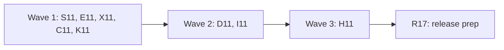

# Plan for 0.7.0

0.7.0 is a polish release for tracking quality. It adds a plain GTM demo shop to the fixture site, so every new check is tested on a site with no platform as well as on the fake Shopify store. It adds three checks that work on any GTM site: rules on dataLayer pushes (#936), a warning for a test identity pushed before consent (#1392), and a warning when the GA4 client ID changes on the way into a checkout frame or onto a checkout host (#934). It fixes the Consent Mode setup check for consent commands pushed as a plain object (#1401) and the epoch-move matching of `diff` (#1457). It also clears the docs and chores left after 0.6.2. Each item is one PR. A PR is done when its acceptance test passes in CI, an adversarial review reports no blockers or majors, and it is squash-merged.

0.7.0 starts from `main` after the goals change (`7203f86`, "docs: goals: keep the core platform-neutral, Shopify as an addition (#1502)").

## Goals this release serves

From `docs/goals.md`:

- **Keep the core platform-neutral.** S11 adds a plain GTM demo shop with no Shopify page, host, name or frame. D11, I11, H11 and K11 each get one test case on a page with no platform. S11 marks the checks that are Shopify-specific today (`sandboxPageUrl`, `platformHosts`) as such in the docs.
- **Express expected behaviour as data, and report pass or fail with evidence.** D11 lets a scenario state which pushes must or must not happen, with which key paths and types (#936).
- **Be safe by default.** I11 warns when the run's own test email or phone, or their hashes, reach the dataLayer before consent (#1392). No message ever holds the value.
- **Record what a site sends to each tracking vendor, at each consent state.** K11 finds a `consent default` pushed as a plain object (#1401). H11 shows when the GA4 client ID does not carry over into a checkout (#934).
- **Compare two runs, or a run against a saved baseline.** E11 keeps a cross-epoch join that `pairNames` made (#1457).
- **Expose all of this to agents through the CLI, with stable `--json`.** New results and rule kinds are additive. The record stays at schema version 5.

Non-goals this release comes close to:

- **A second interface.** Unchanged. Every change is in the CLI and its `--json`.
- **Explaining why a tag did not fire.** H11 reports that IDs differ and where, not why.
- **Legal advice.** I11 warns; people decide what is allowed.

## Triage

Each issue was checked against `main` at `7203f86` by read-only agents on 2026-11-15. Results:

| Issue | Kind | Status on main | Entry | Where in the code |
| --- | --- | --- | --- | --- |
| #936 | feature | Open. `parseRule` refuses a `dataLayer` key. | D11 | `Rule` and `parseRule` in `packages/expect/src/scenario.ts`; `pushShapes` and its helpers in `push-shape.ts`; `Context`, `evaluateRuleHits`, `evaluateRule` and the `scoped` line of `evaluate()` in `evaluate.ts` |
| #1392, #937 | feature | Open. Design §13 says a test identity pushed before consent is not checked. The first half of #937 shipped in 0.6.1 (L09). | I11 | `ownValues` and `candidates` in `packages/core/src/identity.ts`; `BUILTIN_NAMES` in `scenario.ts`; `DEFAULT_SEVERITY` and `builtInChecks` in `evaluate.ts` |
| #934 | feature | Open. The GA4 decoder keeps `ids.client_id` as a flag only; the value is read from the request. H11 adds a `ga4HitIds` reader to the GA4 decoder, so no second parser exists. | H11 | `packages/decoders/src/ga4.ts` (`eventLines`); new `packages/expect/src/id-handover.ts`; `BUILTIN_NAMES`, `DEFAULT_SEVERITY`, `builtInChecks` |
| #1401 | bug | Open. `consent-mode-setup.ts:90` accepts only `isConsentCommand` pushes. `push-shape.ts` already reads the object form privately (`argumentsLike`, `commandOf`, `isObjectConsent`). | K11 | `consentModeSetup` in `packages/expect/src/consent-mode-setup.ts`; `argumentsLike`, `isObjectConsent` and `commandLabel` in `push-shape.ts`; a new helper in `packages/core` |
| #1457, #1465 | bug, cleanup | Open. Two greedy matchers: `pairNames` picks a join target, and the gone loop of `diffPushes` matches again without it. `diff.ts:8` still re-exports `PushGroup`. | E11 | `pairNames` and the gone loop of `diffPushes` in `packages/expect/src/diff.ts`; `diff.test.ts` |
| #1498 | test | Open. `rawRequest` in `identity-values.test.ts` uses a fresh ULID, whose time prefix can hold `123`. | X11 | `rawRequest` and `withHeaders` in `packages/expect/src/identity-values.test.ts` |
| #1453 | test | Open, still on milestone 0.6.2. | X11 | the strip regex of `unsafeFileTargets` in `scripts/server-container-guide.docs.test.ts` |
| #1275 | chore | Due since 2026-11-10. | X11 | `pnpm-workspace.yaml` |
| #1483, #1490, #1491, #1492, #1493, #1494, #1495, #1496 | docs | Open. #1483 changed meaning: after #1487 every card field shares the step deadline, so the line should say "at the step deadline". | C11 | released `## 0.6.2` section of `CHANGELOG.md`; `README.md` line 20; `docs/cli.md` line 168; `scripts/docs-text.docs.test.ts` line 200 |
| Plain GTM fixture | fixture | Every fixture page with a checkout is a Shopify page (`site.js` always injects the `/web-pixels@` sandbox). The plain pages are single-page cases with no journey. | S11 | new `fixtures/site/public/plain/`; the page map in `fixtures/site/src/index.ts`; `fixtures/site/README.md` |

## Close without a PR

- **#1486.** Covered by #1500 (`150ee39`): the build no longer refuses an old or partial default `dist`. Folders inside `dist` and `node_modules/.cache` stay refused, as #1500 decided.
- **#1489.** The "Eight other" line was never on `main`; the Known line reads "Other `review-minor` issues are open".
- **#922.** Every part is built, planned here, or moved to the Backlog. It closes when this plan merges, as the milestone says: C1 (#929) and D2 to D6 and D01 are built; #936, #1392 (with #937), #934 and #1401 are entries of this plan; #931, #932, #935, #938 and #939 are in the Backlog; #933 is cut.

The maintainer closes #1486 and #1489 with a comment when this plan merges.

## Decisions

Decided by the maintainer on 2026-11-15:

1. **A plain GTM demo shop comes first.** S11 adds a local, offline shop inside the fixture site with a stand-in GTM container and a stand-in consent banner with Consent Mode: product, own checkout, thank-you. It has no Shopify page, host, name or frame. The checks of this release get their plain-GTM test case there.
2. **#934 is a general check, `idHandover`.** It covers any checkout in a frame or on another host, the Shopify sandbox included. It is not marked Shopify-specific.
3. **#1392 warns by default.** A scenario can set it to `fail`. There is no field count of `possibleRealDataPush` yet, so that flag stays warn-only too.
4. **The docs and chores left after 0.6.2 are in.** C11 and X11.

Decided in this plan:

- **The record stays at schema version 5.** No entry adds a record field. New built-in names and the `dataLayer` rule kind are additive in `--json`.
- **S11 needs no network.** The shop serves its own stand-in for `gtm.js` and `gtag.js`. It sends GA4 and Google Ads image hits, with `gcs` and `gcd` for the current consent state, to the Google collection hosts that `stub` mode answers, and pushes `gtag('event', 'purchase', ...)` with an `ecommerce` object. The banner is `assets/banner.js`, with a Consent Mode default of denied and an update on the banner answer.
- **S11 marks Shopify-specific checks in the docs only.** `sandboxPageUrl`, `platformHost` and `options.platformHosts` get a "Shopify-specific" mark in `docs/cli.md` and `docs/guide/reading-results.md`, `docs/guide/what-it-checks.md` gets a short new "Platform-specific checks" paragraph that names them, and design §11 says how platform-specific checks are marked. No `platform` field goes into `--json`.
- **D11 syntax.** A rule has a `dataLayer` mapping: `{ event, has: [paths], types: { path: type }, kind, frame }`. `before`, `in`, `after`, `from` and `count` stay at rule level, as for cookie rules (tag rules refuse `before` and `in`). Paths are the masked form that `--json` shows (`items[*].item_id`), with the `body.has` globs. A numbered index such as `items[3]` exits 2 with a hint to write `[*]`. Event names are as recorded, with no Shopify-to-GA4 mapping. An event name that reads `(other)` in the shapes exits 2.
- **D11 semantics.** `must` with `has` passes when at least the counted pushes of that event in scope hold every listed path. `mustNot` with `has` passes when no push of that event in scope holds any listed path. `types` holds when every matching push has exactly that type at the path. A `dataLayer` rule mixed with a hit filter, a `body.*` key or `vendor` exits 2. A `dataLayer` rule never gets `serverSendProbableLink` or `serverSendUnlinked`. When the dataLayer hook is incomplete in scope (`dataLayerIncomplete` or `dataLayerNotHooked`), a `mustNot` that would pass warns that the pushes could not all be read.
- **I11 is a built-in named `earlyIdentityPush`.** It reads stored records, so it also runs on `evaluate` of an old run. It looks at pushes in an `undecided`, `denied` or `withdrawn` epoch, and in a `mixed` epoch where `ad_user_data` or `analytics_storage` is denied, using the existing grace window. It matches the run identity's email and phone, their hashes, and the `extra` emails and phones. With no identity in the record it passes with the message that it could not check. It runs before the `possibleRealData` block, which returns early when there is no identity.
- **H11 compares the GA4 client ID, then the session ID.** Hits are grouped by GA4 measurement ID (`tid`). A context is the frame kind plus the page host, so a frame checkout and a checkout on another host both count. `sid` is compared only where `cid` matches. A hit whose decoded `consent.analytics` is `denied` (from `gcs` or `gcd`) is left out, because cookieless pings rotate `cid`; a hit with no consent signal is counted. When `cid` matches and `sid` differs, the result warns with the fixed label `session ID differs`. Server container hits and hits without `cid` are left out. A run with one context passes. Click IDs (`gclid`, `fbc`, `fbp`) wait for the Backlog; H11 files that issue. Default severity `warn`.
- **K11 changes the Consent Mode setup check only.** `@tagreeve/core` exports `consentCommandOf(args)`, which reads the array form and the arguments-like object form. `consentModeSetup` and `push-shape.ts` both use it. `consentModeChanges` in `packages/consent/src/consent-mode.ts`, which feeds the epochs, is not changed in 0.7.0: changing it moves epochs and verdicts. K11 files that as a new issue for the Backlog, which also names the private `isConsentCommand` in `packages/recorder/src/datalayer.ts`, so a later release moves both onto the helper.
- **E11: a cross-epoch join is binding.** `pairNames` returns the target epoch of each join (`joinedTo`). `diffPushes` first gives each joined node exactly the fresh node at (`joinedTo`, event, kind, frame), then runs the greedy pass on the rest. The greedy order for same-name moves with no join stays as it is and is written down as a known limit. No `--json` field changes.

## Order and waves



The demo shop, the fixes and the chores first; then the two checks that need the shop; then the second built-in; then the release prep.

Why the waves are this way:

- **S11 first.** D11, I11 and H11 put their plain-GTM test case on the S11 shop.
- **`packages/expect/src/scenario.ts` and `evaluate.ts`.** D11 owns `Rule`, `parseRule`, a new `parsePushSelector`, `Context`, `evaluateRuleHits`, `evaluateRule` and the `scoped` line of `evaluate()`. I11 owns `BUILTIN_NAMES`, `DEFAULT_SEVERITY` and a new function in `builtInChecks`. Different parts, so both are in wave 2. H11 edits the same parts as I11 (`BUILTIN_NAMES`, `DEFAULT_SEVERITY`, `builtInChecks`), so it is in wave 3.
- **`packages/expect/src/push-shape.ts`.** K11 (wave 1) changes `argumentsLike`, `isObjectConsent` and `commandLabel` to use the core helper. D11 (wave 2) exports a per-push shape built from `commandOf`, `eventLabel` and `collectPaths`, after K11 has merged.
- **`site/demo/`.** I11 and H11 each add a built-in, which the recorded demo runs list. Each re-records them with `scripts/record-site-demo.ts`. They are in different waves.
- **`fixtures/site/src/index.ts`.** S11 adds the `/plain/*` routes in wave 1. D11 and I11 add one page each in wave 2 (different lines of the page map). H11 adds the `?checkout=offsite` variant of the S11 checkout in wave 3.
- **`fixtures/site/public/plain/checkout.html` and `assets/plain-gtm.js`.** I11 (wave 2) adds `?identity=early`; H11 (wave 3) adds `?checkout=offsite` and `?cid=rotate`. Different waves, different query modes.
- **`e2e/report-marks.e2e.test.ts`, `docs/guide/reading-results.md`, `scripts/site-docs.docs.test.ts`.** I11 and H11 each edit them for their own built-in, in different waves.
- **`docs/cli.md`.** C11 changes line 168 (the payment fill). K11 adds one sentence to the Consent Mode setup paragraph. S11 adds the Shopify-specific marks to the `builtins` rows. D11 adds a new section "Rules on dataLayer pushes" after "Rules on tags". I11 and H11 each add their `builtins` row and section. The parts differ within a wave.
- **`docs/design.md`.** S11, K11, D11, I11 and H11 each edit their own paragraph of §11; D11 and I11 edit §13; R17 writes §15.7.
- **`CHANGELOG.md`.** The plan PR adds the `## 0.7.0` block with all markers. Each entry replaces only its own marker. C11 also edits released lines of `## 0.6.2`, which no other entry touches.

## Rules for every PR

The rules in `AGENTS.md` and the earlier plans still hold: CLI only, no MCP server; no hosted service; fake IDs and identities only (`G-PWTEST0001`, `AW-000000001`, `100000000000001`, `GTM-PWTEST1`, `GTM-PWNOVER`); no cookie value, identity value, client ID, card value, `gtmAuth` or container config in any output; e2e only against `fixtures/site` in `stub` mode (and the stand-in container), with no Docker and no network; context-level hooks only; third-party code unmodified, and no tracker data from Tracker Radar, EasyPrivacy or Disconnect. The record schema stays at version 5.

More for 0.7.0:

- **Each PR adds a regression test that fails without the change,** and the PR description says which line was reverted to see it fail. A test-only issue names the mutation the strengthened test now catches. A cleanup with no behaviour change names the existing tests that must pass unchanged.
- **Every negative test checks first that its input holds what the check looks for.** A leak check first asserts the value is in the input or the record, then asserts it is absent from the output.
- **A statement that something does not happen is tested as the positive case with one change.** For example, I11's "a foreign email gives no finding" is paired with the same page and the run's own email, which does give one.
- **Each new check gets a test case on the S11 plain GTM shop.** A check that also has a Shopify case keeps it on the existing shop pages.
- **A check that works on one platform only is marked as such** in `docs/cli.md` and `docs/guide/what-it-checks.md`. The checks of this release are general and get no mark.
- **State the invariant first when a fix touches a function with several cases.** Write the rule in the PR, then a table test over the cases, then patch. This holds for E11 (`pairNames` and `diffPushes`) and D11 (`parseRule`).
- **A new default-warn check: the plan names the likely tests, the builder confirms (maintainer, 2026-11-15).** An entry that adds a check which warns by default names in its Touches the existing test files that a search of the code shows are likely to change (for example `git grep -nE 'toEqual\(\[SANDBOX\]\)|!== SANDBOX|built-in check|WARN:|Result: pass with' e2e packages scripts`). The builder runs the tests with the new check and changes only the assertions that fail because of the new result, in any test file, so that they expect it: the new warning stays visible. The PR lists each assertion it changed. A listed file that needs no change stays unchanged. Any other kind of change to a test outside the Touches line is a stop with a plan conflict.
- **Never edit a file outside the Touches line.** A flaky test is reported, not patched. Known flaky: the second test of `e2e/unload-gap-frame-nav.e2e.test.ts`.
- **Page code is untrusted, but not an unbounded adversary** (#1442). Reviewers do not escalate a page that sabotages its own globals.
- **Reviewers file only bugs, leaks and wrong docs.** In-file nits go to the minor pass.
- **New e2e tests go in new files,** unless the entry names an existing file.
- **A message names a key by its masked path or a fixed label,** never by a value from a file or a page.
- **CHANGELOG.** Each PR replaces only its own marker. An entry with no change a user can see replaces its marker with one line that lists its issues, for the "Tests and cleanup" line R17 writes.

## PRs

### Wave 1

**S11 Plain GTM demo shop and Shopify-specific marks.** Round cap 4. Touches: new `fixtures/site/public/plain/product.html`, `fixtures/site/public/plain/checkout.html`, `fixtures/site/public/plain/thank-you.html`, new `fixtures/site/public/assets/plain-gtm.js` (the stand-in for `gtm.js` and `gtag.js`), the page map in `fixtures/site/src/index.ts` (the `/plain/*` routes), new `fixtures/site/src/pages-plain.test.ts`, `fixtures/site/README.md` (a new "Plain GTM pages" section), new `e2e/scenarios/plain-gtm-journey.yml`, new `e2e/plain-gtm.e2e.test.ts`, `docs/cli.md` (the `sandboxPageUrl` row and the `platformHosts` option), `docs/guide/reading-results.md` (the `sandboxPageUrl` bullets), `docs/guide/what-it-checks.md` (a new "Platform-specific checks" paragraph), `docs/design.md` §11 (one paragraph on platform marks), `CHANGELOG.md` (the S11 marker).
- `/plain/product` loads `assets/banner.js` and `assets/plain-gtm.js`. Consent Mode starts denied. The banner answer pushes a `consent update`.
- `assets/plain-gtm.js` pushes `gtm.js` and page events to `window.dataLayer`, and sends GA4 hits (`tid=G-PWTEST0001`) and a Google Ads conversion (`AW-000000001`) to the Google collection hosts, each with `gcs` and `gcd` for the current consent state. It loads nothing from the internet.
- `/plain/checkout` is a form on the same host with the field IDs of the fake store's checkout. Submit goes to `/plain/thank-you`, which pushes `purchase` with an `ecommerce` object (`transaction_id`, `value`, `currency`, `items[*].item_id`) and sends a GA4 `purchase` hit.
- No page under `/plain/` holds `web-pixels`, `wpm@`, `myshopify`, `shopify` or a Shopify host, and none has an iframe.
- `docs/cli.md` and `docs/guide/reading-results.md` mark `sandboxPageUrl`, `platformHost` and `options.platformHosts` as Shopify-specific. `docs/guide/what-it-checks.md` gets a new "Platform-specific checks" paragraph that names them. Design §11 says a platform-specific check is marked in those docs.
Evals:

| Id | Kind | What must be true | How to check |
| --- | --- | --- | --- |
| S11-1 | behaviour | The plain journey runs with default `builtins` and exits 0, with no `sandboxPageUrl` or `platformHost` flag. | `pnpm exec vitest run --project e2e e2e/plain-gtm.e2e.test.ts`; the test reads the `--json` summary. |
| S11-2 | behaviour | The run records the purchase push with `ecommerce.transaction_id` and a GA4 `purchase` hit, both after the banner accept. | The same e2e test reads the records. |
| S11-3 | behaviour | `consentModeSetup` reads the plain shop's `gcd` and passes on the plain journey. | The same e2e test asserts the GA4 hit records hold `gcd`, then finds `builtin: consentModeSetup` with `pass` and a message that is not "could not be read". |
| S11-4 | regression | Each `/plain/` page returns 200, loads `plain-gtm.js`, and holds no Shopify string or iframe. | `pages-plain.test.ts` first asserts status 200 and the `plain-gtm.js` script tag, then greps the served HTML and scripts for `web-pixels`, `wpm@`, `shopify` and `<iframe`. |
| S11-5 | error path | A request for a page that does not exist under `/plain/` returns 404. | `pages-plain.test.ts`. |
| S11-6 | behaviour | The docs mark `sandboxPageUrl` and `platformHosts` as Shopify-specific. | `grep -n "Shopify-specific" docs/cli.md docs/guide/reading-results.md` lists both files; `grep -n "Platform-specific checks" docs/guide/what-it-checks.md` finds the new paragraph; `pnpm docs:build` passes. |

Regression test: `e2e/plain-gtm.e2e.test.ts`, `fixtures/site/src/pages-plain.test.ts`.
Acceptance: `pnpm exec vitest run --project e2e e2e/plain-gtm.e2e.test.ts` passes, and fails on the old code because the `/plain/*` routes return 404.
QA: run `tagreeve run e2e/scenarios/plain-gtm-journey.yml --site <fixture url>` with accept and with reject, and read the summary and the HTML report.

**E11 `diff`: a cross-epoch join is binding (#1457, #1465).** Round cap 4. Touches: `pairNames` and the gone loop of `diffPushes` in `packages/expect/src/diff.ts`, the `PushGroup` re-export on `diff.ts:8`, `packages/expect/src/diff.test.ts` (the import line and a new four-label case), `CHANGELOG.md` (the E11 marker).
Closes #1457
Closes #1465
- `pairNames` records the target epoch of each cross-epoch join on the joined node (`joinedTo`).
- `diffPushes` first matches each joined gone node to exactly the fresh node at (`joinedTo`, event, kind, frame), then runs the greedy pass on the nodes left.
- A same-name move with no join keeps today's greedy order. The PR writes this down in the `diffPushes` docstring as a known limit.
- `diff.ts` no longer re-exports `PushGroup`. `diff.test.ts` imports it from `push-shape.ts`.
Invariants: A cross-epoch join that `pairNames` made is never undone by the gone loop. No `--json` field is added, removed or renamed.
Evals:

| Id | Kind | What must be true | How to check |
| --- | --- | --- | --- |
| E11-1 | behaviour | With four epoch labels and two renamed events whose joins point to different neighbour epochs, `diffPushes` reports each move to the epoch `pairNames` chose. | `pnpm exec vitest run --project unit packages/expect/src/diff.test.ts`, the new case. |
| E11-2 | regression | Every existing `diff.test.ts` and `event-map.test.ts` case passes unchanged. | The same command, plus `packages/expect/src/event-map.test.ts`. |
| E11-3 | regression | `diff --json` output of the existing e2e diff files is unchanged. | `pnpm exec vitest run --project e2e e2e/diff.e2e.test.ts e2e/datalayer-diff.e2e.test.ts e2e/datalayer-renamed.e2e.test.ts`. |
| E11-4 | behaviour | `PushGroup` has one home. | `git grep -n "export type { PushGroup" packages/expect/src` prints nothing; `pnpm typecheck` passes. |
| E11-5 | error path | A joined node whose `joinedTo` target is missing among the fresh nodes falls back to the greedy pass and does not throw. | A unit case in `diff.test.ts`. |

Regression test: the four-label case of #1457 in `diff.test.ts`.
Acceptance: the new `diff.test.ts` case passes, and fails on the old code because the gone loop moves one renamed node to the other node's join target.

**X11 Tests and chores: request IDs, the placeholder strip and node-forge (#1498, #1453, #1275).** Round cap 2. Touches: `rawRequest` and `withHeaders` in `packages/expect/src/identity-values.test.ts`, the strip regex of `unsafeFileTargets` and its table rows in `scripts/server-container-guide.docs.test.ts`, `pnpm-workspace.yaml` (the `minimumReleaseAgeExclude` block), `CHANGELOG.md` (the X11 marker).
Closes #1498
Closes #1453
Closes #1275
- `rawRequest` uses a fixed request ID with no digits. The eight `possibleRealData` tests fail only when the phone digits leak.
- The strip regex takes a placeholder only after `name=` at a start, `?`, `&`, a space or a quote, and up to `&`, a quote or the line end. Two new rows (a quoted URL that ends in `<auth>`, and `id=<env id>&auth=<auth>`) give no targets.
- `pnpm-workspace.yaml` has no `minimumReleaseAgeExclude` block; `minimumReleaseAge: 20160` stays.
Evals:

| Id | Kind | What must be true | How to check |
| --- | --- | --- | --- |
| X11-1 | regression | The eight `possibleRealData` tests pass when the request ID would have held `123`. | Temporarily give `rawRequest` the ID `req_01M7123QAAAAAAAAAAAAAAAAAA` on the old test: it fails; on the new test the fixed ID is used and the tests pass. `pnpm exec vitest run --project unit packages/expect/src/identity-values.test.ts`. |
| X11-2 | behaviour | A test still fails when the phone digits do leak into the message. | Mutate `evaluate.ts` to print the phone; the test fails. Restore. |
| X11-3 | behaviour | The two new placeholder rows give no unsafe targets. | `pnpm exec vitest run --project docs scripts/server-container-guide.docs.test.ts` after `pnpm docs:build`. |
| X11-4 | behaviour | `pnpm install --frozen-lockfile` passes without the node-forge exception. | Run it in a clean clone. |
| X11-5 | error path | A real unsafe target next to a placeholder is still reported. | The existing positive rows of the docs test pass. |

Acceptance: `pnpm test` passes with the fixed request ID, and the X11-1 mutation shows the old test failing on a `123` prefix.

**C11 Docs: the 0.6.2 notes, README and the payment deadline line (#1483, #1490 to #1496).** Round cap 2. Touches: the released `## 0.6.2` section of `CHANGELOG.md` (the lines named in the bullets below, found by their words, and the Upgrading section), the 0.6.2 line of `README.md` that starts "A scoped `must` rule", the card-fill deadline sentence of `docs/cli.md`, the #1456 phrase in `scripts/docs-text.docs.test.ts`, `CHANGELOG.md` (the C11 marker).
Closes #1483
Closes #1490
Closes #1491
Closes #1492
Closes #1493
Closes #1494
Closes #1495
Closes #1496
- The card-fill deadline sentence of `docs/cli.md` says the fill ends "at the step deadline". The sentence before it says "shares the step deadline" and stays.
- The 0.6.2 "Tests and cleanup" line no longer lists #1462, #1468, #1470, #1180 and #1181; each goes on the line that names its change. The PR checks each move against the commit.
- "A push finding with no path reads `in the push`" is its own `possibleRealDataPush` bullet.
- The 0.6.1 field-test sentence says "after its release".
- The warn-with-browser-hits line drops "With an exact count".
- The Upgrading section says the card fields share one step deadline, which a user cannot change.
- The #1456 line reads "A kind change does not report the `event` key path (#1456)." The docs test changes to that phrase in the same PR.
- The README line reads "A scoped `must` rule can now warn where 0.6.1 failed".
Evals:

| Id | Kind | What must be true | How to check |
| --- | --- | --- | --- |
| C11-1 | behaviour | `docs/cli.md` says "at the step deadline" for the card fill and no longer says "the deadline of the field's fill". | `grep -n "deadline of the field" docs/cli.md` prints nothing; `grep -c "at the step deadline" docs/cli.md` prints 1, and `grep -c "shares the step deadline" docs/cli.md` prints 1. |
| C11-2 | behaviour | The docs text test pins the new #1456 phrase. | `pnpm docs:build && pnpm exec vitest run --project docs scripts/docs-text.docs.test.ts`. |
| C11-3 | regression | `scripts/changelog-markers.test.ts` passes. | `pnpm exec vitest run --project unit scripts/changelog-markers.test.ts`. |
| C11-4 | error path | Putting the old #1456 phrase back makes the docs test fail. | Revert the CHANGELOG line only; the docs test fails. Restore. |

Acceptance: the docs project passes with the new phrase, and C11-4 shows it fails with the old one.

**K11 Consent Mode setup: consent commands pushed as an object (#1401).** Round cap 3. Touches: a new `consentCommandOf` in `packages/core/src` with its unit test and the `packages/core/src/index.ts` export, `argumentsLike`, `isObjectConsent` and `commandLabel` in `packages/expect/src/push-shape.ts`, `consentModeSetup` in `packages/expect/src/consent-mode-setup.ts` (line 90), `consent-mode-setup.test.ts` (its `push` helper), `fixtures/site/public/consent-mode-hits.html` (a `?push=relay` mode), the consent-mode pages test in `fixtures/site/src`, `e2e/consent-mode-setup.e2e.test.ts` and a new `e2e/scenarios/consent-mode-setup-relay.yml`, `docs/cli.md` (one sentence in the Consent Mode setup paragraph), `docs/design.md` §11 (one sentence), `CHANGELOG.md` (the K11 marker).
Closes #1401
- `consentCommandOf(args)` returns the consent command for `['consent', 'default' | 'update', x]` and for `{0: 'consent', 1: 'default' | 'update', 2: x}`, and nothing for any other shape.
- `consentModeSetup` finds a `consent default` in either form. A relayed object-form default gives "found every signal set", not "outside the dataLayer".
- `push-shape.ts` uses the helper. Its labels and paths do not change.
- `isConsentCommand` on the record stays as recorded; no record field changes.
- `?push=relay` on `/consent-mode-hits` has a sandboxed child frame `postMessage` a plain object with the index keys (`{0: 'consent', 1: 'default', 2: {...}}`, because an `arguments` object cannot be cloned); the parent pushes `event.data`. This is a plain page with no Shopify parts.
- K11 files a new issue for `consentModeChanges` in `packages/consent/src/consent-mode.ts`, which still skips the object form for epochs, and for the private `isConsentCommand` in `packages/recorder/src/datalayer.ts`.
Invariants: The helper accepts only `consent` with `default` or `update`. The check's verdict for an array-form push does not change.
Evals:

| Id | Kind | What must be true | How to check |
| --- | --- | --- | --- |
| K11-1 | behaviour | The helper returns the same command for the array form and the object form. | `pnpm exec vitest run --project unit packages/core/src/` (the new test). |
| K11-2 | behaviour | A relayed object-form default passes the setup check. | `pnpm exec vitest run --project e2e e2e/consent-mode-setup.e2e.test.ts`, the relay case. |
| K11-3 | error path | `{0: 'consent', 1: 'foo'}` and `{0: 'config'}` are not consent commands. | The core unit test. |
| K11-4 | regression | `push-shape` labels and paths are unchanged. | `pnpm exec vitest run --project unit packages/expect/src/push-shape.test.ts` and `pnpm exec vitest run --project e2e e2e/datalayer-kinds.e2e.test.ts` pass unchanged. |
| K11-5 | regression | The relay push is recorded with `isConsentCommand: false`. | The e2e test reads the records. |

Acceptance: the relay e2e case passes, and fails on the old code because the message says `outside the dataLayer`.

### Wave 2

**D11 Rules on dataLayer pushes (#936).** Round cap 4. Touches: `Rule`, `parseRule` and a new `parsePushSelector` in `packages/expect/src/scenario.ts`; a new per-push shape export in `packages/expect/src/push-shape.ts` (built from `commandOf`, `eventLabel` and `collectPaths`; `pushShapes` output unchanged); new `packages/expect/src/push-rules.ts` and `push-rules.test.ts`; `Context`, `evaluateRuleHits`, `evaluateRule` and the `scoped` line of `evaluate()` in `packages/expect/src/evaluate.ts`; `packages/expect/src/index.ts` (exports); `scenario.test.ts` and `evaluate.test.ts`; new `e2e/datalayer-rules.e2e.test.ts` with `e2e/scenarios/datalayer-rules.yml` and `datalayer-rules-pass.yml`; `fixtures/site/public/datalayer-rules.html` (a purchase without `ecommerce.transaction_id`; `?complete=1` adds it; its pushes hold fixed sentinel strings for the leak check), its line in the page map and its row in `fixtures/site/README.md`; a pages test; `docs/cli.md` (new section "Rules on dataLayer pushes" after "Rules on tags"), `docs/guide/what-it-checks.md`, the expectations section of `README.md`, `docs/design.md` §11 (rule table and filters) and §13 (privacy bullet), `CHANGELOG.md` (the D11 marker).
Closes #936
- A scenario rule can hold `dataLayer: { event, has, types, kind, frame }`, with `before`, `in`, `after`, `from` and `count` at rule level.
- `must` with `has` passes when the counted pushes of that event in scope hold every listed path; the result names the pushes by `dle_` ID.
- `mustNot` with `has` passes when no push of that event in scope holds any listed path.
- `types` holds when every matching push has exactly that type at the path.
- An unknown sub-key, a numbered index such as `items[3]`, a type outside string, number, boolean, null, object and array, or `dataLayer` mixed with a hit filter, a `body.*` key or `vendor` exits 2 and names the key.
- A `mustNot` that would pass while the dataLayer hook is incomplete in scope warns.
- One case runs on the S11 shop: `must` purchase with `ecommerce.transaction_id` passes on `/plain/thank-you`.
Invariants: No pushed value appears in any rule message or evidence. A path copied from a run's `--json` shapes matches that run. `before`, `in`, `after` and `from` select the same windows for pushes as for cookies. `mustNot` with no matching push in scope passes. A `dataLayer` rule never gets `serverSendProbableLink` or `serverSendUnlinked`.
Evals:

| Id | Kind | What must be true | How to check |
| --- | --- | --- | --- |
| D11-1 | behaviour | `must` purchase with `has: [ecommerce.transaction_id]` exits 1 on `/datalayer-rules` and lists the push by `dle_` ID; with `?complete=1` it exits 0. | `pnpm exec vitest run --project e2e e2e/datalayer-rules.e2e.test.ts`. |
| D11-2 | behaviour | The same rule passes on the S11 `/plain/thank-you`. | The same e2e file, plain case. |
| D11-3 | behaviour | `mustNot` purchase with `before: consent` fails when the purchase is pushed before the banner answer, and passes with `after: <accept step>`. | The same e2e file. |
| D11-4 | error path | `items[3]`, type `int`, an unknown sub-key, and `dataLayer` with `vendor` each exit 2 and name the key. | `pnpm exec vitest run --project unit packages/expect/src/scenario.test.ts`. |
| D11-5 | behaviour | The fixture's sentinel values are in the push records and absent from stdout and the result messages. | The e2e test asserts the precondition on the JSONL, then the absence. |
| D11-6 | regression | The body, tag and cookie rule e2e files pass unchanged. | `pnpm exec vitest run --project e2e e2e/body-rules.e2e.test.ts e2e/cookie-rules.e2e.test.ts` and the tag rules file. |

Regression test: `push-rules.test.ts`, `scenario.test.ts`, `e2e/datalayer-rules.e2e.test.ts`.
Acceptance: `pnpm exec vitest run --project e2e e2e/datalayer-rules.e2e.test.ts` passes, and fails on the old code because `parseRule` refuses the `dataLayer` key and the run exits 2.
QA: write a rule from the `--json` shapes of a real run of the S11 shop and check it matches; try `items[3]`.

**I11 Test identity pushed before consent: `earlyIdentityPush` (#1392).** Round cap 3. Touches: a new export (`ownValueKinds`) in `packages/core/src/identity.ts` and `identity.test.ts`; `BUILTIN_NAMES` and the `builtins` docstring in `packages/expect/src/scenario.ts`; new `packages/expect/src/early-identity-push.ts` and its unit test; `DEFAULT_SEVERITY` (`warn`) and one call line in `builtInChecks` in `packages/expect/src/evaluate.ts`, placed before the `possibleRealData` block; `evaluate.test.ts`; the `BUILTIN_NAMES` assertion in `packages/expect/src/early-identifiers.test.ts`; new `e2e/datalayer-identity-push.e2e.test.ts` with its scenarios; `fixtures/site/public/datalayer-identity.html` (`?after=1` pushes after the answer), its line in the page map and its row in `fixtures/site/README.md`; a pages test; `fixtures/site/public/plain/checkout.html` and `assets/plain-gtm.js` (`?identity=early` pushes the typed identity before the banner answer, and the default pushes it after accept) with `fixtures/site/src/pages-plain.test.ts`; `e2e/report-marks.e2e.test.ts` (the severity assertion also excludes `earlyIdentityPush`); `site/demo/*` (re-recorded); the builtin list in `site/src/lib/annotations.ts`; `docs/guide/reading-results.md` (the fence, its `Result:` line and the annotation lines stay in step) and `scripts/site-docs.docs.test.ts` (the pinned `Result:` line); `docs/cli.md` (the `builtins` row and a section), the `README.md` builtins list, `docs/design.md` §11 (builtins) and §13 (replace "Pushes are not checked for a test identity that was pushed before consent"), `CHANGELOG.md` (the I11 marker).
Closes #1392
Closes #937
- A push in an `undecided`, `denied` or `withdrawn` epoch, or in a `mixed` epoch with `ad_user_data` or `analytics_storage` denied, that holds the run's email or phone, a hash of them, or an `extra` email or phone, gives a `warn` result `builtin: earlyIdentityPush`.
- The result names the push by `dle_` ID, its key paths and the kind of value (email, phone, email hash, phone hash). It never holds the value.
- `builtins: { earlyIdentityPush: fail }` makes the result fail and the run exit 1.
- With no identity in the record the result passes with a message that it could not check.
- One case runs on the S11 shop: the plain checkout pushes the identity after accept and gives no finding; the same page with `?identity=early` gives one.
Invariants: No identity value or hash appears in any message, evidence or stdout. A push with only foreign values never gives this result (it stays `possibleRealDataPush`). A push in a granted epoch after the grace window never gives it. With no `builtins` override the exit code does not change.
Evals:

| Id | Kind | What must be true | How to check |
| --- | --- | --- | --- |
| I11-1 | behaviour | An email push and an email-hash push before the banner answer give one `warn` result with `dle_` evidence, key paths and kinds; the run exits 0. | `pnpm exec vitest run --project e2e e2e/datalayer-identity-push.e2e.test.ts`. |
| I11-2 | behaviour | The email and its hex hash are in the push record and absent from text and `--json` stdout and from the result record. | The same e2e test, precondition then absence. |
| I11-3 | behaviour | `?after=1` with accept gives no finding; reject followed by a push gives one. | The same e2e test. |
| I11-4 | behaviour | `builtins: { earlyIdentityPush: fail }` exits 1. | The same e2e test. |
| I11-5 | regression | A foreign email before consent gives no `earlyIdentityPush`, and the same page with the run's own email gives one. | The same e2e test, paired cases. `e2e/datalayer-push-real-data.e2e.test.ts` passes unchanged. |
| I11-6 | error path | A record with no identity gives a pass with a message and no throw. | `pnpm exec vitest run --project unit packages/expect/src/early-identity-push.test.ts packages/expect/src/evaluate.test.ts`. |

Acceptance: the new e2e test finds the `builtin: earlyIdentityPush` result, and fails on the old code because there is no such result.

### Wave 3

**H11 Client ID handover: `idHandover` (#934).** Round cap 4. Touches: new `packages/expect/src/id-handover.ts` and `id-handover.test.ts`; `BUILTIN_NAMES` in `scenario.ts`; `DEFAULT_SEVERITY` (`warn`) and the built-in block in `evaluate.ts`; `packages/expect/src/index.ts`; the S11 shop gets `?checkout=offsite` (the checkout on the `127.0.0.1` host) and `?cid=rotate` in `fixtures/site/public/plain/product.html` (a link to the offsite checkout), `fixtures/site/public/plain/checkout.html`, `assets/plain-gtm.js` and the `/plain/*` routes in `fixtures/site/src/index.ts`; `fixtures/site/src/pages-plain.test.ts`; `packages/decoders/src/ga4.ts` and `ga4.test.ts` (a new `ga4HitIds(request)`); new `e2e/id-handover.e2e.test.ts` with its scenarios; the failed-result assertions that pin the list to the sandbox result (`toEqual([SANDBOX])` or `!== SANDBOX`) in `e2e/cli-consent.e2e.test.ts` (also the warning count of the `undecided-warn` run), `e2e/cli-checkout.e2e.test.ts`, `e2e/identity-country.e2e.test.ts` and `e2e/optional-fill.e2e.test.ts`, whose runs load `site.js` and its sandbox pixel, so they also expect the `idHandover` warning (`e2e/test-payment.e2e.test.ts`, `e2e/test-payment-frames.e2e.test.ts` and `e2e/wait-url.e2e.test.ts` reach no shop page and pass unchanged); `e2e/report-verdict.e2e.test.ts` (the exact `<li>` verdict in its second test gains `; built-in check idHandover warned in 2 runs`); `e2e/report-marks.e2e.test.ts` (the severity assertion also excludes `idHandover`); `site/demo/*` (re-recorded); `site/src/lib/annotations.ts`; `docs/guide/reading-results.md` (the fence, its `Result:` line and the annotation lines stay in step) and `scripts/site-docs.docs.test.ts` (the pinned `Result:` line); `docs/cli.md` (the `builtins` row and a section), `docs/guide/what-it-checks.md`, the `README.md` builtins list, `docs/design.md` §11 (a paragraph that names `ga4HitIds` in the GA4 decoder as the one reader of `cid` and `sid`), `CHANGELOG.md` (the H11 marker).
Closes #934
- H11 files a new Backlog issue for the click identifiers (`gclid`, `fbc`, `fbp`) that #934 also names, and comments on #934 with its number before the PR merges.
- `packages/decoders/src/ga4.ts` exports `ga4HitIds(request)`, built on `eventLines`, which returns the `cid` and `sid` of each hit in the order `decode` uses. It reads the request as `decode` sees it: a GA4 request wrapped by the Stape custom loader (`/pwstape?pk=...`) is unwrapped with `unwrapStapeLoader` first, so its hits keep their `cid`. `id-handover.ts` calls it and parses no GA4 query or body itself. Nothing is stored in the record.
- On the Shopify fixture the main-frame hits (sent through the Stape loader, `cid` `1111...`) and the sandbox pixel hits (`cid` `3333...`) differ, so every Shopify fixture run warns.
- GA4 hits are grouped by `tid`. A context is the frame kind plus the page host.
- When a measurement ID's `cid` differs between contexts, the result `builtin: idHandover` warns and names the measurement ID and both contexts by frame kind and host. It never holds an ID value, hash, length or prefix.
- `sid` is compared only where `cid` matches. When `cid` matches and `sid` differs, the result warns with the fixed label `session ID differs`.
- A hit whose decoded `consent.analytics` is `denied` (from `gcs` or `gcd`, so `G100` and `G110` both count), server container hits and hits without `cid` are left out. A hit with no consent signal is counted.
- A run with one context passes.
- On the S11 shop, `?checkout=offsite` with the same `cid` passes and `?checkout=offsite&cid=rotate` warns. The `pw_consent` cookie of `localhost` is not sent to `127.0.0.1`, so the scenario answers the banner again on the offsite checkout. On the Shopify fixture, the sandbox pixel's different `cid` warns.
Invariants: No ID value appears in any message, evidence or `--json`. Evidence is hit IDs only. With no `builtins` override the exit code does not change. No record field changes.
Evals:

| Id | Kind | What must be true | How to check |
| --- | --- | --- | --- |
| H11-1 | behaviour | Same `cid` and `sid` across two contexts passes. | `pnpm exec vitest run --project unit packages/expect/src/id-handover.test.ts`. |
| H11-2 | behaviour | `?checkout=offsite&cid=rotate` on the S11 shop warns and names `G-PWTEST0001` and both contexts. | `pnpm exec vitest run --project e2e e2e/id-handover.e2e.test.ts`. |
| H11-3 | behaviour | The fixture's `cid` and `sid` strings are in the `request` records (URL or body) of the run's JSONL, and absent from stdout, `--json`, the result message and its evidence. | The same e2e test, precondition on the request records, then absence. |
| H11-7 | behaviour | A GA4 hit wrapped by the Stape custom loader yields its `cid` and `sid`. | `pnpm exec vitest run --project unit packages/decoders/src/ga4.test.ts`, a `/pwstape?pk=` case. |
| H11-4 | behaviour | Hits with `gcs=G100` or `gcs=G110` and differing `cid`s pass, and the same hits with `gcs=G111` warn. | The unit test, paired cases. |
| H11-8 | behaviour | Same `cid` with a different `sid` warns with `session ID differs`; the same hits with the same `sid` pass. | The unit test, paired cases. |
| H11-9 | behaviour | `?checkout=offsite` with the same `cid` passes, and `?checkout=offsite&cid=rotate` warns. | `pnpm exec vitest run --project e2e e2e/id-handover.e2e.test.ts`, paired cases. |
| H11-5 | behaviour | `builtins: { idHandover: fail }` exits 1. | The e2e test. |
| H11-6 | error path | Hits with no `cid` and a run with one context pass without a throw. | The unit test. |

Acceptance: `e2e/id-handover.e2e.test.ts` finds `builtin: idHandover` with `warn` on the offsite case, and fails on the old code because there is no such result.
QA: run the Shopify fixture journey and the S11 shop with default `builtins`; read the warning text.

### After the waves

**R17 Release prep.** The version, the CHANGELOG section from the markers, design §15.7 "Differences in 0.7", the re-recorded site demo, a `released section 0.7.0` case in `scripts/changelog-markers.test.ts`, and a release candidate for the field test. Written as its own entry when the waves have landed.

## CHANGELOG markers

The plan PR adds this above `## 0.6.2`, a blank line between each pair. Each entry replaces its marker with its line or lines.

```markdown
## 0.7.0

Not released yet. The newest release is 0.6.2, below.

<!-- S11 -->

<!-- E11 -->

<!-- X11 -->

<!-- C11 -->

<!-- K11 -->

<!-- D11 -->

<!-- I11 -->

<!-- H11 -->

<!-- R17 -->
```

Entry IDs: the earlier plans use ids up to R16 and some with 11 (M11, P11, Q11, R11), so this plan uses S11, E11, X11, C11, K11, D11, I11 and H11, which no earlier plan uses. R17 continues the release prep numbers.

`scripts/changelog-markers.test.ts` needs no change for the plan PR: it refuses the first `##` heading only when it is older than `package.json` (0.6.2), and it looks up each released section by name.

## After the PRs

The maintainer field-tests the 0.7.0 release candidate in `stub` mode, supervised, with a person at every payment and log-in handoff:

- **On the same kind of Shopify store as 0.6.2.** Count the `earlyIdentityPush`, `idHandover` and `possibleRealDataPush` results next to 0.6.2 on the same store. The `possibleRealDataPush` count decides whether it can ever fail by default.
- **On a plain GTM site, when the maintainer names one.** A run of the journey with default `builtins`. If none is named, the S11 shop is the only plain-GTM case of this release, and the field-test notes say so.

## Flagged concerns

- **Two new built-ins show in every run.** I11 and H11 add a line to every run's results, text summary and report. Every Shopify fixture run warns on `idHandover`, because the sandbox pixel sends another `cid`. An e2e test that counts warnings or result lines may change. Under the maintainer's rule (below), the files that break are in the Touches of the entry that breaks them: the four e2e files whose runs load the sandbox pixel and pin the failed list to the sandbox result, `e2e/report-verdict.e2e.test.ts` (the exact verdict string of its second test) and `e2e/report-marks.e2e.test.ts` (H11), `e2e/report-marks.e2e.test.ts` (I11), `docs/guide/reading-results.md` and `scripts/site-docs.docs.test.ts` (I11 and H11). The builder confirms the list by running the tests, as the rule for a new default-warn check says.
- **K11 leaves the epochs alone.** A relayed object-form consent update still does not move the consent epoch. K11 files the issue; a later release decides it, because it moves verdicts.
- **E11 keeps a known limit.** Same-name moves with no join keep the greedy order. A full bipartite matching is more code and is left for a later issue if a case shows up.
- **D11 is the largest entry.** It shares `scenario.ts` and `evaluate.ts` with I11 in wave 2, in different functions. I11 rebases on D11 if both are open at once.
- **The S11 shop is not a field observation.** It follows the common gtag and GTM pattern. The milestone asked for fixtures copied from field observations; for plain GTM there are none yet.

## Release from CI (#1573)

Added on 2026-11-19, after 0.7.0-rc.3. Today a person builds the release commit on a laptop with `scripts/release.sh`, pushes the tag, and runs `npm publish` by hand with a one-time password. The `release-tag` workflow only checks the tag and runs a dry-run publish. `docs/release.md` says "There is no provenance yet". This part of the plan moves the build, the tag and the publish into GitHub Actions. npm trusted publishing (OIDC) replaces the one-time password, and npm adds provenance on its own because the repo and the package are public. It is release tooling for the maintainer and changes nothing in the product. It removes the long-lived npm token, and users get provenance: each published version links to the commit and the workflow run that built it.

### Decisions

Decided by the maintainer on 2026-11-18 and 2026-11-19:

1. **A merged version bump starts the release.** A push to `main` that changes `version` in `package.json` releases that version. There is no manual release button.
2. **No approval step.** CI publishes with `npm publish`, not `npm stage publish`. The release decision is the merge of the release-prep PR, and `package.json` is gated, so a person merges it.
3. **Two PRs after this plan:** T12 (the workflow) and V12 (the bump script).

Decided in this plan:

- **The build moves into CI.** `release.yml` runs `scripts/release.sh <version>` in CI, so the `dist/` that npm serves is the one CI built. Provenance would be close to meaningless if a laptop built `dist/`.
- **The release commit and the tag stay as they are.** The release commit holds `dist/` and a `package.json` without the `build` script, and only the annotated tag `v<version>` points at it. It is never merged to `main`.
- **The release commit uses the GitHub Actions bot identity.** `release.yml` sets `GIT_AUTHOR_NAME` and `GIT_COMMITTER_NAME` to `github-actions[bot]` and both emails to `41898282+github-actions[bot]@users.noreply.github.com`. The id 41898282 is the one that `gh api /user/github-actions%5Bbot%5D` returns, and the `release-workflow` rule set pins that exact email. `release.sh` already takes these variables. The maintainer can ask for another identity in the plan PR.
- **The decision logic is a script with unit tests, not shell in YAML.** A new `scripts/release-plan.ts` reads the version at `github.event.before` and at `github.sha` (so a push of several commits still counts the bump), and prints one of `skip: version unchanged`, `skip: v<version> already on npm`, or `release <version> <dist-tag>`. It imports `distTagFor` and the two version patterns from `scripts/check-npm-dist-tag.ts`, which T12 exports (the patterns are private `const`s today), so there is one rule for both: `next` for `-rc.N` and `latest` otherwise. It refuses a version that is not `X.Y.Z` or `X.Y.Z-rc.N`, and a version that is not higher than the one at `github.event.before`. It exports the comparison it uses, so `0.7.0-rc.10` is higher than `0.7.0-rc.9` in one place only.
- **Each job does one thing, with the least permission.**
  - `plan` (`contents: read`) checks out with `fetch-depth: 0`, sets up Node 22.18 or newer and runs `release-plan.ts`. The later jobs run only on a `release` line.
  - `tag` (`contents: write`) checks out with `fetch-depth: 0`, runs `release.sh --at ${{ github.sha }} <version>` and pushes the tag. It gives the tag name `v<version>` and the commit SHA of the tag as job outputs. `check` and `publish` check out that SHA and read the tag name from the `tag` output, so the commit that was tested is the commit that is published. `release.sh` gets an `--at <sha>` option: it requires `HEAD` to equal that SHA and the SHA to be an ancestor of `origin/main`, instead of requiring `HEAD` to equal `origin/main`. Without it, a merge to `main` between the push and the `tag` job, or while a run waits behind `concurrency`, makes `release.sh` refuse, and a rerun fails the same way. `release.sh --at` also handles a rerun: when `v<version>` already exists on the remote, it fetches and peels the tag, exits 0 without pushing when the tag's commit has the triggering commit as parent, and refuses otherwise. Then a rerun of a failed publish does not tag twice.
  - `check` calls the existing `release-tag.yml` checks as a reusable workflow at the tag. `release-tag.yml` gains `on: workflow_call` with two inputs, `ref` (the tag name `v<version>`) and `sha` (the commit to check out), and keeps its tag trigger, its read-only permissions and its dry-run publish. In a called workflow the `github` context is the caller's, so the inputs must feed three places. The `ref:` of `actions/checkout` reads `inputs.sha || github.sha`. The tag-name check and the dist-tag `case` read a `tag` value set once from `${{ inputs.ref || github.ref_name }}` through `env:`, with no bare `GITHUB_REF_NAME` left. A step after the checkout first runs `git fetch --depth=1 origin "refs/tags/$tag:refs/tags/$tag"`, because `actions/checkout` fetches no tags when its `ref` is a SHA, and then fails unless `git rev-parse "refs/tags/$tag^{commit}"` equals `git rev-parse HEAD`. A tag a person pushes by hand goes through the same step, with `github.sha` as the SHA. `check` passes `ref: needs.tag.outputs.tag` and `sha: needs.tag.outputs.sha`, and has `permissions: { contents: read }`, which is all that `release-tag.yml` asks for; a called workflow cannot get more than its caller grants. The `v*-rc.*) dist_tag=next` and `*)` case text stays, because a test pins it. The `release.yml` rule set skips the `uses ... /publish|release/i` rule for the one local `uses: ./.github/workflows/release-tag.yml` of the `check` job, and keeps it for every other `uses`. A tag pushed by `GITHUB_TOKEN` starts no other workflow, so the call is needed.
  - `publish` (`id-token: write`, `contents: read`, environment `npm`) lists `check` in `needs` and has no `if:` with `always()`, `!cancelled()` or `failure()`, so it runs only after `check` passed. It checks out `needs.tag.outputs.sha`, sets up Node 24, installs one pinned npm with `npm install -g npm@<version>`, checks that `npm --version` is 11.21.0 or newer, and runs `npm publish --tag <dist-tag>`. The npm that Node 24 bundles is older than 11.21, so the install step is needed. The builder pins an exact npm version of at least 11.21.0 that is at least two weeks old, read from `npm view npm versions`. 11.21 is the minimum for trusted publishing with dist-tag changes from CI; 11.5 is enough only for trusted publishing itself. It uses no token, secret or `.npmrc` auth line.
  - `verify` (`contents: read`) sets up Node 22.18 or newer, lists `publish` in `needs`, and runs `node scripts/check-npm-dist-tag.ts <version>` with up to 10 tries 30 s apart, because npm's view lagged about two minutes after the rc.3 publish. A failure turns the run red.
- **One release at a time.** `release.yml` has `concurrency: { group: release, cancel-in-progress: false }`. GitHub keeps one pending run per group, so a later `package.json` push can cancel a pending release run. Because `plan` compares with `github.event.before`, the later run does not see the earlier bump; `docs/release.md` says to rerun a cancelled release run, and `verify` failing to find the version is the signal.
- **Every third-party action in `release.yml` is pinned by commit SHA,** most of all in `tag` (`contents: write`) and `publish` (OIDC). The rule-set test checks it.
- **The release-deciding scripts are gated.** T12 adds `scripts/release-plan.ts`, `scripts/release-plan.test.ts` and `scripts/check-npm-dist-tag.ts` to `gates` in `.github/pipeline.json`, and V12 adds `scripts/bump-version.sh`.
- **No dispatch and no dry-run path in `release.yml`.** It has one trigger, the push to `main`. The dry runs that exist today stay: CI runs `release.sh --no-tag` and installs the result on every PR, and `release-tag.yml` runs `npm publish --dry-run` on the tag. A dry run cannot test the OIDC setup anyway, because `--dry-run` exchanges no token. So the first real publish is the first test of the npmjs.com and environment settings. If it fails, the tag is already pushed, and the maintainer fixes the setting and reruns the failed `publish` job. `docs/release.md` says so.
- **The settings are the maintainer's.** On npmjs.com, a trusted publisher for `tagreeve`: GitHub Actions, `alfhen/tagreeve`, workflow `release.yml`, environment `npm`. On GitHub, an environment `npm` whose deployment branches are `main` only. The issue says `main` and `v*` tags; `main` alone is enough because `publish` runs in a push run on `main`. On npmjs.com the publisher also allows `npm publish` and dist-tag changes (the issue's "Allow `npm publish` and dist-tag"). After the first CI publish works, "disallow tokens" on npmjs.com. No PR changes a repo or npm setting. T12 writes the steps in `docs/release.md`.
- **The pipeline still never releases.** `autoRelease` stays `false` in `.github/pipeline.json`. No agent runs a publish command, pushes a tag or reruns a job of the release workflow. A release happens only when a person merges a version bump.
- **The workflow rules test grows, it does not loosen.** `scripts/release-workflow.test.ts` keeps every rule for `release-tag.yml`, with one edit: the case that asserts the `on` keys expects `['push', 'workflow_call']`, and the `Workflow.on` type gains `workflow_call`. `push.tags` stays `['v*']`. It gets a second rule set for `release.yml`: only `publish` has `id-token: write`, only `tag` has `contents: write`, no job passes secrets, the file names no token and no `secrets.` context, every `npm publish` line has `--tag`, the only publish without `--dry-run` sits in the `publish` job under `environment: npm`, the `publish` job runs `npm install -g npm@<exact X.Y.Z, 11.21.0 or newer>` before its `npm --version` check and before `npm publish` (a range, `latest` or a missing install fails), there is no `gh release` and no `npm stage`, and the push trigger is `branches: [main]` with `paths: [package.json]`.
- **CHANGELOG.** T12 and V12 add no CHANGELOG line. The release prep of the first version published from CI adds one line: the package is published from CI with provenance.

### Entries

**T12 Release from CI with trusted publishing (#1573).** Refs #1573 (does not close it; V12 closes it). Round cap 4. Touches: new `.github/workflows/release.yml`; `.github/pipeline.json` (the new gates); `.github/workflows/release-tag.yml` (the `workflow_call` trigger with the `ref` and `sha` inputs, the `sha` use in `actions/checkout`, the `ref` use in the tag-name check and the dist-tag `case`, and the tag-peels-to-SHA step); `scripts/release.sh` (the `--at <sha>` option; gated, so a person merges the PR) and `scripts/release-version.test.ts` (cases for `--at`); `scripts/check-npm-dist-tag.ts` (export the two version patterns, and nothing else); new `scripts/release-plan.ts` and `scripts/release-plan.test.ts`; `scripts/release-workflow.test.ts` (the `release.yml` rule set, plus the one edited `on` keys case of `release-tag.yml`; every other existing case is unchanged); `docs/release.md`; the Releasing section of `AGENTS.md` and its line on publishing to npm in the rules list.
- `release-plan.ts` prints exactly one line in the forms above and exits 0. It exits 2 with a message on a bad or lower version. It reads `npm view tagreeve versions --json` to tell whether the version is already on npm, and treats a failed read as an error that stops the run, never as "not published".
- `docs/release.md` describes the new flow from "merge the release-prep PR" to "check the result", the npmjs.com and GitHub settings, and what to do when a job fails: a rerun fixes a setting, npm lag or a flaky step (`tag` and `publish` are safe to rerun, and `tag` works after `main` has moved because of `--at`); after a good publish with a red `verify`, rerun `verify`, not `publish`; a rerun uses the workflow file of the original commit, so a bug in `release.yml` needs a new version bump or the release by hand; that the first real publish is the first test of the OIDC setup and how to recover when it fails, the "allow publish and dist-tag" setting, and npm 11.21 or newer. It drops "There is no provenance yet". It keeps a short section on a release by hand for when CI is down, and says that only the maintainer does it.
- `release.sh --at` is tested in a temp repo with a temp bare origin and a stub `pnpm` on `PATH`, never against the real repo.
- The Releasing section of `AGENTS.md` says that CI publishes after a person merges a version bump, the rules-list line on publishing to npm says that the maintainer's merge of a version bump is the say-so, and that no agent runs `npm publish`, pushes a tag or starts the release workflow.
Invariants: No workflow names an npm token or a secret. Only the `publish` job can mint an OIDC token. `release.yml` has no `workflow_dispatch` trigger, and `publish` never runs unless `check` passed. `release-tag.yml` keeps every rule it has today, except that it can also be called.
Evals:

| Id | Kind | What must be true | How to check |
| --- | --- | --- | --- |
| T12-1 | behaviour | A version change from `0.7.0-rc.3` to `0.7.0-rc.4` plans `release 0.7.0-rc.4 next`, and to `0.7.0` plans `release 0.7.0 latest`. | `pnpm exec vitest run --project unit scripts/release-plan.test.ts`. |
| T12-2 | behaviour | No version change plans `skip: version unchanged`, and a version already on npm plans `skip: v<version> already on npm`. | The same test, with the npm read stubbed. |
| T12-3 | error path | A lower version, a version like `0.7.0-beta.1`, and a failed npm read each exit 2. | The same test. |
| T12-4 | behaviour | The `release.yml` rule set passes on the real file and fails on each of: `id-token: write` on another job, `contents: write` on another job, a `secrets.` context, a publish without `--tag`, a publish without `--dry-run` outside the `publish` job, a `publish` job without `environment: npm`, `npm stage`, `check` removed from `publish.needs`, an `if:` on `publish` or on any of its steps that uses `always()`, `!cancelled()` or `failure()`, a `workflow_dispatch` trigger, a missing `npm install -g npm@` step before the publish in `publish`, an npm version there that is not exact or is lower than 11.21.0, the install placed after the `npm --version` check or the publish, a top-level `permissions` with `id-token: write` or `contents: write`, and a third-party action in `release.yml` that is not pinned by SHA. | `pnpm exec vitest run --project unit scripts/release-workflow.test.ts`. |
| T12-5 | regression | Every existing `release-tag.yml` case passes, except that the `on` keys case expects `['push', 'workflow_call']`; `push.tags` is still `['v*']`. | The same test. |
| T12-6 | quality bar | `release.yml` has only the `push` trigger with `branches: [main]` and `paths: [package.json]`, and `publish` reaches `npm publish` only through `needs: [tag, check]` with no status function. | The rule-set test parses the file: the `on` keys are `['push']`, `publish.needs` holds `check`, and no `if:` in `publish` holds `always(`, `cancelled(` or `failure(`. A mutated copy with `workflow_dispatch` added, `check` dropped from `needs`, or `if: always()` on `publish` must fail. |
| T12-8 | behaviour | `release-tag.yml` has no bare `GITHUB_REF_NAME`, its checkout `ref:` reads `inputs.sha || github.sha`, and its tag step fetches the tag and passes only when the tag peels to `HEAD`. | `scripts/release-workflow.test.ts` takes the `run` text of the tag step from `release-tag.yml` and runs it in a temp repo set up the way `actions/checkout` sets up a SHA checkout (`git init`, `git fetch --depth=1 origin <sha>`, a detached checkout) against a temp bare origin that holds an annotated tag. It exits 0 when the tag peels to the SHA and non-zero when the tag points at another commit. Without the fetch line the first case exits non-zero. |
| T12-9 | behaviour | `release.sh --at <sha>` creates the tag when `main` is one commit past `<sha>`, and refuses when `HEAD` is not `<sha>`; without `--at` it still refuses when `HEAD` is not `origin/main`. | `pnpm exec vitest run --project unit scripts/release-version.test.ts`, in a temp repo with an origin. |

Acceptance: `scripts/release-plan.test.ts`, the new cases of `scripts/release-workflow.test.ts` and the `--at` cases of `scripts/release-version.test.ts` pass, and they fail on `main`, where neither `release-plan.ts` nor `release.yml` exists.
QA: read `release.yml` job by job against the Decisions above. Read `docs/release.md` as the maintainer doing the first release.

**V12 Version bump script (#1573).** Closes #1573. Round cap 3. After T12. Touches: new `scripts/bump-version.sh` and `scripts/bump-version.test.ts`; `packages/cli/src/summary.test.ts` (the `readVersion()` pin reads `package.json` instead of a literal); `scripts/docs-text.docs.test.ts` (the version test also checks `docs/design.md`); `.github/pipeline.json` (the `bump-version.sh` gate); `docs/release.md` (the release-prep steps); the release-prep issue text in `AGENTS.md`, if it names the pin files.
- `bump-version.sh <version>` refuses a bad version with the same pattern as `release.sh`. It refuses a version that is not higher than the current one, using the comparison that `release-plan.ts` exports, through `node`. It sets `version` in `package.json` and rewrites each line that names the current release: the README Status line, the `docs/cli.md` sentence "The current release candidate is", and the version in the `docs/design.md` line 3 text `Status: revision N, for release <version>`. On a final version, the `docs/cli.md` sentence names the new final release and drops the release-candidate wording; `bump-version.test.ts` pins both forms. It prints each file it changed.
- It does not write prose. The README "In 0.7.0-rc.N" line, the design §15 milestone line and the CHANGELOG section stay for the person or agent who writes the release prep, and the script prints a reminder that names them.
- A test fails when any of those lines disagrees with `package.json`. `scripts/docs-text.docs.test.ts` already checks the README and `docs/cli.md`; V12 adds `docs/design.md` there, pinned to the `for release <version>` text of line 3 only; the `0.7 (built, ...)` milestone line is prose for the release prep and is not pinned.
- The builder finds the full pin set with `git grep -n "$(node -p 'require("./package.json").version')"` on `main` and lists it in the PR. A file that holds the version as test data (`scripts/check-npm-dist-tag.test.ts`) is left alone.
Evals:

| Id | Kind | What must be true | How to check |
| --- | --- | --- | --- |
| V12-1 | behaviour | `bump-version.sh 0.7.0-rc.4` and `bump-version.sh 0.7.0` in a temp copy of the repo change `package.json` and the three lines, and `bump-version.test.ts` asserts each line itself. | `pnpm exec vitest run --project unit scripts/bump-version.test.ts`. |
| V12-2 | error path | A bad version and a lower version exit non-zero and change no file. | The same test. |
| V12-3 | regression | `summary.test.ts` passes, and fails when `readVersion()` returns another string than `package.json`. | `pnpm exec vitest run --project unit packages/cli/src/summary.test.ts`. |

Acceptance: `scripts/bump-version.test.ts` passes, and fails on `main`, where the script does not exist.

### Order

T12 first, then V12. T12 refers to #1573 and does not close it; V12 closes it. Both edit `docs/release.md` and `AGENTS.md`, so they go one after the other. The first release after T12 merges is the first one published from CI. The maintainer puts the npmjs.com and GitHub settings in place before that release.

### Flagged concerns

- **A bad merge to `main` can publish.** With no approval step, any merged change of `version` publishes. `package.json` is gated, so a person merges it. The GitHub environment `npm`, limited to `main`, and the trusted publisher, limited to `release.yml`, keep other branches and workflows out.
- **A pushed tag starts no workflow.** A tag that `GITHUB_TOKEN` pushes does not trigger `release-tag.yml`, so `release.yml` calls it directly. A tag a person pushes by hand still triggers it as today.
- **The `tag` job builds with a write token.** It runs `pnpm install` and `pnpm build` with `contents: write`, and checkout persists the token in `.git/config`. pnpm 10 blocks dependency build scripts by default, which lowers the risk. Splitting the build into a read-only job is possible later; this plan accepts the risk for now.
- **npm's view lags.** `check-npm-dist-tag.ts` read the old dist-tag for about two minutes after the rc.3 publish. `verify` retries for that reason.

## Out of scope

| Item | Why it waits |
| --- | --- |
| #933 | Cut by the milestone. |
| #931, #932, #935, #938, #939 | Backlog, by the milestone. |
| #1485 | The rename is done (#1487). Moving the vendor name table into core touches `evaluate.ts`, which D11, I11 and H11 change. Backlog. |
| #1442 | An accepted known limit. It stays open. |
| Click IDs in `idHandover` (`gclid`, `fbc`, `fbp`) | Backlog, after H11 has field data. H11 files the issue. |
| A `platform` field in `--json` results | The docs mark is enough for now; a field is a schema decision. |
| A hosted demo site | Not a PR of this repo. The S11 shop is local and offline. |
| An MCP server (#362) | AGENTS.md: CLI only. |
