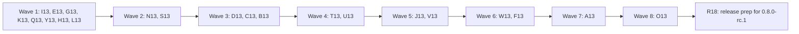

# Plan for 0.8.0

0.8.0 has one goal: two commands give a DPO-ready audit of a site's consent behaviour (#1391): `tagreeve suite --consent ...` runs it and `tagreeve report <suite dir> --html` shows it. It adds a consent matrix to `suite`, which runs each scenario under accept, reject, no answer and accept then withdraw. It adds canaries: seeded test click IDs on the start URL, searched for in every request, with the route each one took. It adds a consent audit to the HTML report. It also fixes the issues found in the 0.7.0 field tests and reviews: the install docs (#1587), baseline drift on `gcd` letters (#1569), the `addToCart` message on a 429 (#1576), the `Server container` line wording (#1583), path moves in `diff` (#1584), scrubbed secrets on server container records (#1585), server-side rules when the container rejects requests (#1579), and six review follow-ups (#1533, #1532, #1531, #1530, #1519, #1513). Each item is one PR. A PR is done when its acceptance test passes in CI, an adversarial review reports no blockers or majors, and it is squash-merged.

0.8.0 starts from `main` at `119e6b9` ("Release prep for 0.7.0 (#1586)").

## Goals this release serves

From `docs/goals.md`:

- **Record what a site sends to each tracking vendor, for a scripted visitor, at each consent state.** S13 runs one scenario under each consent state. T13 lists what each vendor got in each state.
- **Express expected behaviour as data, and report pass or fail with evidence.** J13 judges each canary route by the consent epoch it left in, with request IDs as evidence.
- **Be safe by default.** Canaries are fake values. No observed real value is stored: the cookie hop (V13) keeps only the canary's name. Q13 marks scrubbed secrets.
- **The first run shows where the setup likely breaks consent rules.** A13 puts the findings of every state on one report page.
- **Compare two runs.** G13 and N13 stop two kinds of noise in `baseline` and `diff`.
- **Expose all of this to agents through the CLI, with stable `--json`.** Every new field is additive. The record stays at schema version 5.
- **Keep the core platform-neutral.** The matrix and canary e2e tests run on the plain GTM shop (`/plain/*`) and on new plain pages. Nothing in this release is Shopify-specific.

Non-goals this release comes close to:

- **Legal advice or legal responsibility.** The audit shows what was sent and flags likely problems. The report says that people decide what is allowed. A pass means only that no planted value was found in the searched forms.
- **Output tuned for people first.** The consent audit is a section of the HTML report. `--json` gets no field for readability's sake.
- **A hosted service, a second interface, changing GTM containers.** Unchanged. CLI only, no GTM API.
- **Explaining why a tag did not fire.** A route names the request that carried a canary, never the tag that sent it.

## Triage

Each issue was read on 2026-11-19 against `main` at `119e6b9`.

| Issue | Kind | Status on main | Entry | Where in the code |
| --- | --- | --- | --- | --- |
| #1391 | feature | Open. Feasibility comment: canaries feasible, matrix feasible, server internals out of reach. | S13, T13, C13, B13, U13, J13, V13, W13, F13, A13 | `suiteCommand` in `packages/cli/src/suite.ts`; `buildFlags` and `close` in `packages/recorder/src/recorder.ts`; `variants` and `fieldHashes` in `packages/core/src/identity.ts`; `packages/cli/src/report/` |
| #1587 | docs | Open. Five places give `npm i -g tagreeve@next`. `scripts/docs-text.docs.test.ts` requires `@next` and refuses the bare command. | I13 | `README.md`, `docs/cli.md`, `docs/guide/first-run.md`, `INSTALL_COMMAND` in `site/src/lib/prompt.ts` |
| #1569 | bug | Open. `diffShapes` keys a tuple on raw `gcd`, so `p` and `q` are two tuples. | G13 | `diffShapes` in `packages/expect/src/diff.ts`; `GCD_LETTERS` in `packages/decoders/src/ga4.ts` |
| #1576 | bug | Open. `waitForCart` throws one fixed message. | K13 | `waitForCart` and `createCartCheck` in `packages/recorder/src/steps.ts` |
| #1583 | docs | Open. `forwarded` counts the container's own requests to Google. | D13 | `docs/cli.md` (`Server container` paragraph), `docs/guide/server-container.md` |
| #1584 | enhancement | Open. `diffPushes` moves whole events across epochs, not single paths. | N13 | `diffPushes` in `packages/expect/src/diff.ts`; `describePushDiff` in `packages/cli/src/diff.ts` |
| #1585 | enhancement | Open. `redactSecretsInUrl` and `redactSecretsInBody` leave no mark. | Q13 | `packages/recorder/src/redact.ts`; `packages/recorder/src/server-container/capture.ts` |
| #1579 | enhancement | Open. Filed by N12. Rules run before the built-ins and do not know the container rejected requests. | O13 | `evaluate()` and `builtInChecks` in `packages/expect/src/evaluate.ts` |
| #1533 | docs | Open, two points. | D13 | `docs/guide/what-it-checks.md`; `docs/design.md` §11 |
| #1532 | docs or bug | Open. A literal nested array is not a consent command. | E13, D13 | `consentCommandOf` in `packages/core/src/consent-command.ts` |
| #1531 | bug | Open. `sidsOf` merges the session IDs of all shared client IDs. | H13 | `packages/expect/src/id-handover.ts` (the `sidsOf` block) |
| #1530 | bug | Open, four points. | L13 | `loaderReachesScope` in `packages/expect/src/evaluate.ts`; `parsePushSelector` in `packages/expect/src/scenario.ts` |
| #1519 | bug | Open, four points. Needs a choice on whole-email matching. | Y13 | `ownValueKinds`, `ownMatcher` and `scan` in `packages/core/src/identity.ts`; `ownLeaves` in `packages/expect/src/early-identity-push.ts` |
| #1513 | test | Open. Not shown that `gtm.uniqueEventId` can reach `args`. | E13 | `argumentsListOf` in `packages/core/src/consent-command.ts`; `packages/recorder/src/datalayer.ts` |

No issue on the 0.8.0 milestone is left out.

## Decisions

Decided by the maintainer:

1. **0.8.0 is the consent audit of #1391,** with its three pieces: the consent matrix, identifier tracing first slice (canaries), and the audit report (2026-11-08).
2. **The matrix comes first,** then the canaries, then the report.
3. **Install docs** (#1587, 2026-11-19): the main install command is `npm i -g tagreeve`. `npm i -g tagreeve@next` stays as the way to try a release candidate. No release step moves `next` after a final release.
4. **The open 0.8.0 issues are in:** #1587, #1569, #1576, #1583, #1584, #1585, #1579, #1533, #1532, #1531, #1530, #1519 and #1513.

Rules from #1391 that every entry keeps:

- A pass means only "no planted value was found in the searched forms". The output says what was searched and what was skipped.
- Observed real values never reach a record, a log or an error. They are handled like `gtmAuth`.
- CLI only. No hosted service and no GTM API.

Decided in this plan:

- **The record stays at schema version 5.** Every new record item is an optional field or a new flag kind or note, which design §4 allows within a version: `Request.secretsRedacted` (Q13), `Run.canaries` (C13), `Flag.route` and the flag kinds `identifierRoute` and `canarySearch` (U13), `CheckpointCookie.canary` (V13), `Run.consentCell` (S13) and the result note `serverContainerRejected` (O13). No entry changes the meaning of a field.
- **The matrix is a `suite` dimension: `tagreeve suite [<dir>] --consent accept,reject,none,withdraw`** (choice: maintainer may change). #1391 allows `run --consent` or a suite dimension. `suite` already has cells, `suite.json`, a table and a suite report, so the matrix reuses them.
- **The matrix point is the scenario's first `consent` step** (choice: maintainer may change). Each cell copies the scenario and sets that step's value to the cell's state. A scenario with no `consent` step, or whose first one is `withdraw`, exits 2 before any browser starts and names the scenario.
- **The withdraw cell needs `options.withdrawWith`,** a selector for the site's cookie settings link (choice: maintainer may change). The cell answers `accept` at the matrix point and then plays `wait: 1s`, `click: <withdrawWith>` and `consent: withdraw`, the steps `e2e/scenarios/accept-then-withdraw.yml` uses. `withdraw` in the list without the option exits 2 and names the option.
- **A scenario's own rules run only in the cell of its own state** (choice: maintainer may change). The rules were written for the state the scenario answers. The other cells run the built-in checks only, and their `suite.json` cell gets `rulesSkipped` with the count.
- **`--consent` takes one variant and no baseline in 0.8.0** (choice: maintainer may change). `--consent` with a second `--variant` or with `--baseline` exits 2. `--stores` works with it.
- **The record names its cell** (choice: maintainer may change). `Run.consentCell` is `accept`, `reject`, `none` or `withdraw`, set by `labelRecord` as it sets `Run.store`, and absent outside a matrix. The state is also in the `suite.json` cell labels (`labels.consent`) and in the record file name `<scenario>[.<store>].<state>.<variant>.jsonl`. `baselineFileName` adds `.<state>` after the store, so `baseline save` of a cell record never writes the file that a plain `run --baseline` reads.
- **The withdraw column counts only the withdrawn epoch** (choice: maintainer may change). T13 counts every hit of the accept cell, the hits of the reject and none cells that are not in a `granted` epoch (a later `consent` step can grant), and only the hits in the `withdrawn` epoch of the withdraw cell.
- **Canaries are a scenario option, `canaries: true`** (choice: maintainer may change). The run appends `gclid`, `gbraid`, `wbraid`, `fbclid`, `msclkid` and `ttclid` to the start URL. Each value is `TEST-<PARAM>-<seed>-<cell>-0001`, for example `TEST-GCLID-7-REJECT-0001`, with `RUN` as the cell outside a matrix. So every cell of a matrix has its own canaries. A start URL that already has one of these parameters exits 2 and names the parameter. The run identity's email and phone are canaries too. Output names a canary by source and name (`url param gclid`, `identity email`), never by value. Only `Run.canaries` holds the URL canary values, and an identity canary has no value outside `Run.identity`.
- **The recorder searches for canaries when the run closes,** on the raw records, as it scans for `possibleRealData` today (choice: maintainer may change). The matcher is pure code in `@tagreeve/core`. Each finding is an `identifierRoute` flag. One `canarySearch` flag per run says what was searched and what was skipped. The search covers request URLs, bodies and decoded `Hit.params` values. It does not search headers, including `Referer` and `Cookie`, and every message that says what was searched says so. The built-in `identifierRoute` in `@tagreeve/expect` judges the flags, so `evaluate` of a stored run judges them too.
- **Route kinds** (choice: maintainer may change): `pageUrl` when the canary is only in the decoded `Hit.page` value or in a referrer field, for example GA4 `dl` and `dr`, Meta `dl` and `rl`, Pinterest `ad.loc`, Google Ads `url`, `dl` and `ref`. The decoders own the field names: B13 puts them in `packages/decoders/src/page-fields.ts`, exported from `@tagreeve/decoders`, and every decoder reads its page field from there; the recorder keeps no vendor table of its own; `direct` when the sink holds the canary under its own parameter name, or the canary is the identity; `cookie` (V13) when a checkpoint saw it in a first-party cookie before the sink; `unknown` otherwise.
- **Names in a route are masked.** `route.sink.field`, the V13 cookie hop name and every parameter, key or cookie name a route prints go through `guardFieldName` from `packages/decoders/src/fields.ts`. A value-like name, such as a body key that is an email, reads `(other)`. The raw name is never stored.
- **A sink is a request to a host outside the site, `firstPartyHosts` and `serverHosts`** (choice: maintainer may change). A request to the site or to the user's own server container is a hop, not a leak.
- **`identifierRoute` fails by default, and a `pageUrl` route warns** (choice: maintainer may change). One rule judges every sink. A sink that decoded into a Google hit that carries its own consent (`gcs` or `gcd`, design §7.3) takes that consent. Every other sink, a hit of another vendor or a request that decoded into no hit, takes the consent of its epoch, with the grace window. The sink fails when that consent is `undecided`, `denied` or `withdrawn`, or `mixed` with `ad_user_data` or `analytics_storage` denied. A `pageUrl` route only warns, because a cookieless ping sends the page URL by design. The result exists only on a run that planted canaries, so no existing run changes.
- **Docs owners** (choice: maintainer may change). To keep the files of one wave apart, some code entries leave `docs/cli.md` and `docs/design.md` to a later entry: D13 documents G13, K13, Q13, Y13 and N13; T13 documents S13; J13 documents C13 and U13; W13 documents V13; A13 documents F13. The release candidate is cut only after all of them merge.
- **CHANGELOG** (choice: maintainer may change). No entry edits `CHANGELOG.md`. Each PR body ends with the one CHANGELOG line it wants, and R18 writes the `## 0.8.0-rc.1` section from them.
- **#1569: a `gcd` letter change is a warning, not drift.** An added and a removed tuple of one key pair up when their IDs, four consent states and `gcs` are equal, and `gcd` differs only in signal letters where each pair is `p` and `q`, or `t` and `v`. The pair gives a warning line and no drift. The letter rule lives next to `GCD_LETTERS` in `packages/decoders/src/ga4.ts`. Only these two pairs count (choice: maintainer may change).
- **#1576: the message keeps its prefix** (choice: maintainer may change). It reads `click did not add to cart: the store answered 429 (rate limited) to /cart/add.js`. Other 4xx and 5xx answers read the same way without `(rate limited)`. The path is the pathname only, with value-like segments read as `(other)` by `isValueSegment`. With no cart request, or one with no answer, the message stays as it is.
- **#1583 is docs only** (choice: maintainer may change). The line keeps its text. `docs/cli.md` and `docs/guide/server-container.md` say that `forwarded` counts the requests the container itself sends to Google, and that the rejected count is about browser requests.
- **#1584: a path move is a new list, `pathsMoved`** (choice: maintainer may change). A missing path and a new path of the same event, push kind, frame, path and types, in two neighbour epochs, become one entry `{ event, path, types, frame, pushKind, from, to }`. `moved` keeps its two kinds. Like an event move, a path move does not set `changed`.
- **#1585: `Request.secretsRedacted`** (choice: maintainer may change). It is a sorted list of the names whose values were replaced in the URL, the body or the headers, set only on a server container call that had one. The URL and body names are `SECRET_VALUE_NAMES` (`access_token`, `appsecret_proof`). The header names come from the same set `redactHeaders` uses (`authorization`, `proxy-authorization`, `cookie`, `set-cookie`, `access-token`, `x-api-key`), so the two cannot drift. `redacted` keeps its `handoff` meaning. No summary count.
- **#1579: a rule that rests on missing server hits reads `cannot evaluate`** (choice: maintainer may change). A rule can read server hits when it has `sentBy: server`, or has no `sentBy` (the rule matches both senders). When `serverContainerRejected` warns or fails, such a rule whose verdict rests on absence, a `must` that failed or a `mustNot` that passed, gets `pass: false`, `severity: warn` and the new note `serverContainerRejected`. A `must` that passed and a `mustNot` that failed found real hits and keep their verdicts. A `sentBy: browser` rule keeps its verdict. The built-in already says the run is incomplete.
- **#1532 is docs only** (choice: maintainer may change). The docs say a `consent default` counts in the gtag `arguments` form, recorded as an array or as a plain object with the keys `0`, `1` and `2`. A literal nested array such as `dataLayer.push(['consent', 'default', {...}])` does not count. E13 pins this in a unit test.
- **#1513 starts with the test** (choice: maintainer may change). E13 shows where `gtm.uniqueEventId` can reach a recorded consent object, with a stand-in that is a guess at GTM's order (no GTM source is cited). If the key is in `args` in an order a real page could produce, E13 stops and asks the maintainer, because widening `argumentsListOf` changes the `--json` push shapes. If it appears in none, `argumentsListOf` stays as it is.
- **`gtm.`-prefixed keys in an indexed consent default are left to the maintainer.** Whether they count is decided after E13's observation, not in this plan. #1513 stays open.
- **#1519: whole emails** (choice: maintainer may change). An email matches the run's own email when the two normalised emails are equal. The contains rule stays only for readings that came from a base64 decode, where glued junk is expected, so the test "holds for own base64 emails with random junk glued on" still passes. So a foreign email glued to the run's email inside base64 still counts as the run's own (Flagged concerns). `scan` uses the same rule, so a foreign email in a plain or URL-decoded reading that contains the run's email, such as `other.buyer@example.test`, is now reported as `possibleRealData`. A whole decoded reading that equals one of the run's digests counts under any key. The matcher cache is keyed on the identity's values, not the object. `earlyIdentityPush` checks keys on their own.
- **#1587 leaves history alone** (choice: maintainer may change). Released CHANGELOG sections and the `brand/` handoff files keep `@next`. `scripts/bump-version.sh` needs no change: its pattern starts at "The current".

## Order and waves

The small fixes first, then the matrix, then the canaries, then the report.

No two entries of one wave touch the same file. Why the waves are this way:

- **O13 in wave 8.** It edits `packages/core/src/records.ts`, which has one entry per wave from wave 1 to wave 5 (S13 takes wave 2), `packages/cli/src/report/model.ts`, which F13 edits in wave 6, and `docs/cli.md` and `docs/design.md`, which A13 edits in wave 7. Wave 8 is free of all of them. O13 documents itself.
- **Small fixes in waves 1 to 3.** They do not depend on #1391. G13 and N13 both edit `packages/expect/src/diff.ts`, so N13 waits for wave 2. D13 documents the code fixes of waves 1 and 2, so it is in wave 3.
- **The matrix: S13 in wave 2, T13 in wave 4.** S13 and L13 both edit `packages/expect/src/scenario.ts`. T13 needs S13's cells and writes the matrix docs, so it is not in wave 3 with D13.
- **The canaries: C13 and B13, U13, J13, then V13 and W13.** C13 needs S13's cell name in `packages/cli/src/run.ts`. B13 puts the decoders' page fields in one module, which U13 reads. It is in wave 3 because no other wave 3 entry touches `packages/decoders/`; G13 edits `ga4.ts` in wave 1. U13 needs C13's canaries and B13's module. J13 judges U13's flags. V13 adds the cookie hop to U13's routes and runs next to J13, because they share no file. W13 needs J13's judge and V13's routes.
- **The report: F13 in wave 6, A13 in wave 7.** F13 reads J13's results. A13 needs T13's table and F13's route view, and writes the report docs.
- **`docs/cli.md` and `docs/design.md`.** At most one entry per wave edits them: I13 (wave 1, `docs/cli.md` only), D13 (wave 3), T13 (wave 4), J13 (wave 5), W13 (wave 6), A13 (wave 7), O13 (wave 8). The other entries leave them to their docs owner (Decisions).
- **`packages/core/src/records.ts`.** Q13 (wave 1), S13 (wave 2), C13 (wave 3), U13 (wave 4), V13 (wave 5), O13 (wave 8): one per wave.
- **`packages/expect/src/scenario.ts`.** L13 (wave 1), S13 (wave 2), C13 (wave 3), J13 (wave 5).
- **`packages/cli/src/run.ts`.** S13 (wave 2), C13 (wave 3), U13 (wave 4).
- **`packages/cli/src/summary.ts`.** C13 (wave 3), U13 (wave 4).
- **`packages/decoders/src/index.ts`.** B13 only (wave 3).
- **`packages/decoders/src/ga4.ts` and `packages/decoders/src/ga4.test.ts`.** G13 (wave 1), B13 (wave 3).
- **`packages/decoders/src/page-fields.ts`.** B13 makes it (wave 3); U13 (wave 4) only imports it.
- **`packages/recorder/src/canary-routes.ts`.** U13 makes it (wave 4); V13 (wave 5) and W13 (wave 6) extend it.
- **`packages/cli/src/suite.ts` and `packages/cli/src/report/suite.ts`.** S13 (wave 2, the refusal of a consent suite), T13 (wave 4), A13 (wave 7, report only).
- **`packages/cli/src/report/model.ts`.** F13 (wave 6), O13 (wave 8).
- **`packages/cli/src/baseline.ts`.** G13 (wave 1), S13 (wave 2).
- **`README.md`.** I13 (wave 1), J13 (wave 5), A13 (wave 7).

## Rules for every PR

The rules in `AGENTS.md` and the earlier plans still hold: CLI only, no MCP server; no hosted service and no GTM API; fake IDs and identities only (`G-PWTEST0001`, `AW-000000001`, `100000000000001`, `GTM-PWTEST1`, `GTM-PWNOVER`); no cookie value, identity value, client ID, card value, `gtmAuth` or container config in any output; e2e only against `fixtures/site` in `stub` mode (and `server` mode on the fixture's loopback host with the stand-in container), with no Docker and no network; context-level hooks only; third-party code unmodified. The record schema stays at version 5.

More for 0.8.0:

- **Each PR adds a regression test that fails without the change,** and the PR body says which line was reverted to see it fail.
- **Every negative test checks its input first.** A leak check asserts the value is in the input or the record, then that it is absent from the output.
- **A statement that something does not happen is tested as the positive case with one change.**
- **Output names canaries, it does not print them.** A canary is named by source and name (`url param gclid`, `identity email`). The URL canary values are in `Run.canaries` only, and identity values stay in `Run.identity`. Observed values are never stored or printed. V13 tests this with a cookie value that is not a canary.
- **Each new check and the matrix get a test case on a plain page** with no Shopify part: the `/plain/*` shop or the new `click-id-relay` pages.
- **Never edit a file outside the Touches line.** The docs step of a code entry whose docs owner is another entry leaves `docs/cli.md` and `docs/design.md` alone, and the PR body lists what the owner must write. A flaky test is reported, not patched. Known flaky: the second test of `e2e/unload-gap-frame-nav.e2e.test.ts`.
- **A new result on existing runs.** O13 changes results of server container runs. The builder runs the tests and changes only the assertions in the files its Touches names that fail because of the new result, and lists each one.
- **New e2e tests go in new files,** unless the entry names an existing file.
- **A message names a key by its masked path or a fixed label,** never by a value from a file or a page.
- **CHANGELOG.** No entry edits `CHANGELOG.md`. The PR body ends with `CHANGELOG: <one line>`, or `CHANGELOG: tests and cleanup (#N)` for a change no user can see.

## PRs

### Wave 1

**I13 Install docs: `npm i -g tagreeve`, `@next` for release candidates (#1587).** Round cap 3. Touches: `README.md` (the Install section and step 1 of Quick start), `docs/cli.md` (the Install section: the code block and the sentence before "The current release"), `docs/guide/first-run.md` (the Install block), `site/src/lib/prompt.ts` (`INSTALL_COMMAND` and step 1 of `PROMPT`), `scripts/docs-text.docs.test.ts` (`installProblem` and its tests), `scripts/docs-site.docs.test.ts` (the npm button text), `scripts/bump-version.test.ts` (`cliLine`, `CLI_HEAD` and the backtick list of the final case).
Closes #1587
- The code blocks and the site button say `npm i -g tagreeve`.
- The text after each block says `npm i -g tagreeve` installs the newest final release and `npm i -g tagreeve@next` the newest release candidate.
- The `docs/cli.md` sentence reads "`npm i -g tagreeve` installs the newest final release, and `npm i -g tagreeve@next` the newest release candidate." It is followed by the sentence `scripts/bump-version.sh` writes, which does not change.
- `installProblem` now requires the bare command as the install command and accepts `@next` only next to the words "release candidate". It still refuses a claim that `tagreeve` installs `0.3.0`.
- The setup prompt tells the agent to install with `npm i -g tagreeve`.
Evals:

| Id | Kind | What must be true | How to check |
| --- | --- | --- | --- |
| I13-1 | behaviour | The README, the CLI page, the first-run guide and the site prompt give `npm i -g tagreeve` as the install command. | `pnpm docs:build && pnpm exec vitest run --project docs scripts/docs-text.docs.test.ts`. |
| I13-2 | error path | The install check fails on text that gives only `npm i -g tagreeve@next`, and on `@next` with no release-candidate wording. | The same file, its table of bad inputs. |
| I13-3 | behaviour | The home page button shows and copies `npm i -g tagreeve`. | `pnpm exec vitest run --project docs scripts/docs-site.docs.test.ts`. |
| I13-4 | behaviour | `bump-version.sh` to an rc and to a final version keeps the new install sentence and rewrites only the current-release sentence. | `pnpm exec vitest run --project unit scripts/bump-version.test.ts`. |
| I13-5 | regression | No current install text names `@next` as the main command. | `git grep -n "npm i -g tagreeve@next" -- README.md docs/cli.md docs/guide site/src` lists only lines that say "release candidate". |

Acceptance: the docs text test passes with the new rule, and fails on `main`, where the README gives `npm i -g tagreeve@next` as the install command.

**E13 Consent commands: the nested array and the `gtm.uniqueEventId` stamp (#1532, #1513).** Round cap 3. Touches: `packages/core/src/consent-command.test.ts`, `fixtures/site/public/consent-mode-hits.html` (a new `?push=stamped` mode), `fixtures/site/src/pages-consent-mode.test.ts`, new `packages/recorder/test/e2e/datalayer-stamp.e2e.test.ts`.
Refs #1532 (D13 closes it)
Refs #1513 (stays open for the maintainer, Decisions)
- `consent-command.test.ts` pins that `[['consent', 'default', {...}]]`, a literal nested array, is not a consent command, and that the `arguments` form and the index-key object are.
- `?push=stamped` pushes a gtag `consent default` as a plain object with the keys `0`, `1` and `2`, the only shape `argumentsListOf` reads, through a stand-in `push` wrapper that sets `gtm.uniqueEventId` on the pushed object. The stamping order of real GTM is not cited here, so the wrapper is a guess and the test covers each order a page could have. Modes: the default, which calls the inner push and then stamps; `order=inner`, which installs the wrapper before the page's first push, so the recorder's hook wraps it from outside and the key can be set after the recorder's own `record` call; and a control, `when=before`, which stamps before the inner push.
- The e2e test reads the recorded `dataLayerEvent` of the push in each mode, also after the later length-growth read, and reports where `gtm.uniqueEventId` appears in `args`. The control must show the key, so the test can fail.
- If the key is in `args` in the default order or in `order=inner`, the PR stops and asks the maintainer, with the record shape as evidence.
Invariants: No change to `packages/core/src/consent-command.ts` or `packages/recorder/src/datalayer.ts`.
Evals:

| Id | Kind | What must be true | How to check |
| --- | --- | --- | --- |
| E13-1 | behaviour | A literal nested array is not a consent command; the two gtag forms are. | `pnpm exec vitest run --project unit packages/core/src/consent-command.test.ts`. |
| E13-2 | behaviour | The page really stamps the key: after the push, the page's own `dataLayer` object holds `gtm.uniqueEventId`, in every mode. | The e2e test reads it with `page.evaluate` before it reads the record. |
| E13-3 | behaviour | For the default order and `order=inner`, the test reports and prints whether the recorded push has `gtm.uniqueEventId` in `args` and what `consentCommandOf(args)` returns. This is an observation: a key in `args` is the stop rule, not a failed eval. | `pnpm exec vitest run --project e2e packages/recorder/test/e2e/datalayer-stamp.e2e.test.ts`. |
| E13-4 | regression | The other consent-mode pages serve as before. | `pnpm exec vitest run --project unit fixtures/site/src/pages-consent-mode.test.ts`. |
| E13-5 | behaviour | The control `?push=stamped&when=before` records the key in `args`, so the test can show it. | The same e2e file. |

Acceptance: `datalayer-stamp.e2e.test.ts` passes and reports where the key appears in each mode. E13-2 and E13-5 show the stamp exists and can be recorded, so the test does not pass on a page that never stamps. A key in the default order or in `order=inner` is the stop rule: E13-3 reports it and the PR asks the maintainer.

**G13 Baseline: a `gcd` default or update letter is not drift (#1569).** Round cap 3. Touches: `packages/decoders/src/ga4.ts` (a new `sameGcdState(a, b)` next to `GCD_LETTERS`) and `packages/decoders/src/ga4.test.ts`; `diffShapes` and `ShapeDiff` in `packages/expect/src/diff.ts` and `packages/expect/src/diff.test.ts`; `compareBaseline` and its describe helpers in `packages/cli/src/baseline.ts` and `packages/cli/src/baseline.test.ts`.
Closes #1569
- `sameGcdState` is true when two `gcd` strings are equal except at the four signal letters, and each differing pair is `p` and `q`, or `t` and `v`.
- `diffShapes` pairs an added and a removed tuple of one key whose IDs, consent states and `gcs` are equal and whose `gcd` passes `sameGcdState`. The pair goes into a new `ShapeDiff.gcdLetters` list and not into `added` or `removed`. Different counts on the pair still give a count change.
- `compareBaseline` adds one warning per pair: `gcd letters changed for ga4 view_product [epoch denied]: 13p3p3p2p5l1 -> 13q3q3q2q5l1 (same consent state). This is not drift.`
- A change of an effective state, such as `p` to `t`, stays drift.
- Docs owner: D13.
Invariants: `drift`, `added`, `removed` and `countChanges` in `--json` and `suite.json` keep their meaning. No `diff` output changes.
Evals:

| Id | Kind | What must be true | How to check |
| --- | --- | --- | --- |
| G13-1 | behaviour | The two tuples of #1569 give no drift and one warning. | `pnpm exec vitest run --project unit packages/cli/src/baseline.test.ts`, a case built from the issue's tuples. |
| G13-2 | behaviour | `p` to `t` in one letter, with the same `gcs`, is still drift. | The same test, paired case. |
| G13-3 | behaviour | `sameGcdState` holds for `p`/`q` and `t`/`v` and not for `p`/`r`, `l`/`p`, a different prefix or a short string. | `pnpm exec vitest run --project unit packages/decoders/src/ga4.test.ts`. |
| G13-4 | error path | A pair with different `gcs` or different ID presence stays drift. | `pnpm exec vitest run --project unit packages/expect/src/diff.test.ts`. |
| G13-5 | regression | The baseline e2e files pass unchanged. | `pnpm exec vitest run --project e2e e2e/baseline.e2e.test.ts e2e/baseline-warning-count.e2e.test.ts e2e/suite-baseline.e2e.test.ts`. |

Acceptance: G13-1 passes, and fails on `main`, where the case reports `drift (1 added, 1 removed)`.

**K13 `addToCart`: name the store's answer (#1576).** Round cap 3. Touches: `waitForCart` and `createCartCheck` (or a new helper beside them) in `packages/recorder/src/steps.ts`, `packages/recorder/src/steps.test.ts`, `packages/recorder/test/e2e/steps.e2e.test.ts` (new cases next to the `addToCartError` cases).
Closes #1576
- When the step times out and a cart request of the step got a 4xx or 5xx answer, the message reads `click did not add to cart: the store answered <status> to <path>`. A 429 adds ` (rate limited)` after the status.
- With several such answers, the last one is named.
- `<path>` is the request's pathname with value-like segments read as `(other)`. No query, host or body.
- With no cart request, or one that is still pending or failed, the message stays `click did not add to cart`.
- Docs owner: D13.
Evals:

| Id | Kind | What must be true | How to check |
| --- | --- | --- | --- |
| K13-1 | behaviour | A `/cart/add.js` POST answered 429 fails the step with `click did not add to cart: the store answered 429 (rate limited) to /cart/add.js`. | `pnpm exec vitest run --project e2e packages/recorder/test/e2e/steps.e2e.test.ts`, the new 429 case. |
| K13-2 | behaviour | The existing 422 case now names 422 and still contains `click did not add to cart`. | The same file. |
| K13-3 | behaviour | A cart path with a value-like segment and a query reads `(other)` and shows no query. | `pnpm exec vitest run --project unit packages/recorder/src/steps.test.ts`. |
| K13-4 | regression | A click with no cart request keeps the old message, and a 200 or 302 answer passes. | The existing `steps.e2e.test.ts` cases pass unchanged. |

Acceptance: K13-1 passes, and fails on `main`, where the message does not name 429.

**Q13 Mark scrubbed secrets on server container requests (#1585).** Round cap 3. Touches: `Request` in `packages/core/src/records.ts` (optional `secretsRedacted`); `packages/recorder/src/redact.ts` (new `secretNamesIn` for a URL or body and a header name helper that reads the set `redactHeaders` uses, beside the redact functions, which keep their signatures and text) and `packages/recorder/src/redact.test.ts` (added cases only); the request build in `packages/recorder/src/server-container/capture.ts` and `packages/recorder/src/server-container/capture.test.ts`; `e2e/server-container.e2e.test.ts` (the Conversions API case).
Closes #1585
- A server container call that had any value replaced in its URL, body or headers gets `secretsRedacted`, a sorted, unique list of the replaced names. URL and body names come from `SECRET_VALUE_NAMES` (`access_token`, `appsecret_proof`). Header names, lower-cased, come from the same set `redactHeaders` uses (`authorization`, `proxy-authorization`, `cookie`, `set-cookie`, `access-token`, `x-api-key`), so the list and the redaction cannot drift.
- A call with no secret has no field. Browser requests never get it.
- The values stay `[redacted]` as today. `redactSecretsInUrl` and `redactSecretsInBody` still return a string; `capture.ts` gets the names from the new functions.
- Docs owner: D13.
Invariants: No secret value in the record. `Request.redacted` keeps its `handoff` meaning. Schema version 5.
Evals:

| Id | Kind | What must be true | How to check |
| --- | --- | --- | --- |
| Q13-1 | behaviour | The stand-in's Conversions API call is recorded with `access_token=[redacted]` and `secretsRedacted: ["access_token"]`. | `pnpm exec vitest run --project e2e e2e/server-container.e2e.test.ts`. |
| Q13-2 | behaviour | A token in the query and a proof in a JSON body give both names, sorted, once each. | `pnpm exec vitest run --project unit packages/recorder/src/server-container/capture.test.ts`. |
| Q13-3 | behaviour | An `x-api-key` header gives `x-api-key`. | The same file. |
| Q13-4 | error path | A call with no secret has no `secretsRedacted` key. | The same file, paired case. |
| Q13-6 | behaviour | An `Authorization` header gives `authorization`, and its recorded value is `[redacted]`. | `pnpm exec vitest run --project unit packages/recorder/src/server-container/capture.test.ts`, an `Authorization` case. |
| Q13-5 | regression | The redact functions return the same text as before. | `pnpm exec vitest run --project unit packages/recorder/src/redact.test.ts`. `git diff main -- packages/recorder/src/redact.test.ts` shows only added lines. |

Acceptance: Q13-1 passes, and fails on `main`, where the record has no `secretsRedacted`.

**Y13 Identity matcher: whole emails, standalone digests, keys (#1519).** Round cap 4. Touches: `ownValueKinds`, `ownMatcher`, `candidates` (if the reading kind must travel) and the own-email check in `scan` in `packages/core/src/identity.ts`, `packages/core/src/identity.test.ts` (the own-phone check in `ownValueKinds` and `scan` too); `ownLeaves` in `packages/expect/src/early-identity-push.ts`, `packages/expect/src/early-identity-push.test.ts`; `packages/expect/src/identity-values.test.ts` (a `possibleRealData` case for a foreign email that contains the run's email).
Closes #1519
- In a plain or URL-decoded reading, an email is the run's own only when the two normalised emails are equal.
- In a reading that came from a base64 decode, an email is the run's own when it contains the run's email. So a foreign email glued to the run's email inside base64 still counts as the run's own (Flagged concerns).
- In a plain or URL-decoded reading, a phone is the run's own only when its digits equal the run's phone digits, the national digits or an extra phone. In a base64 reading the contains rule stays.
- A whole decoded reading that equals one of the run's email or phone digests counts, under any key.
- The matcher cache is keyed on the identity's email, phone and `extra` values.
- `earlyIdentityPush` checks each key of a push on its own, also when its child is `null`, an object or `true`.
- Docs owner: D13. The PR body asks D13 to write that a foreign email glued to the run's email inside base64 still counts as the run's own.
Invariants: A foreign email or phone in a plain or URL-decoded reading never gives `earlyIdentityPush`. A base64 reading keeps the contains rule for both (Flagged concerns). No identity value or hash in any message. The test "holds for own base64 emails with random junk glued on" passes unchanged.
Evals:

| Id | Kind | What must be true | How to check |
| --- | --- | --- | --- |
| Y13-1 | behaviour | With run email `buyer@example.test`, a push of `other.buyer@example.test` before consent gives no `earlyIdentityPush`; the same push with `buyer@example.test` gives one. | `pnpm exec vitest run --project unit packages/expect/src/early-identity-push.test.ts`. |
| Y13-2 | behaviour | A percent-encoded base64 digest of the run email under the key `digest` is found. | `pnpm exec vitest run --project unit packages/core/src/identity.test.ts`. |
| Y13-3 | behaviour | Changing `identity.email` after a first call changes the next result. | The same file. |
| Y13-4 | behaviour | `{ [email]: true }` and `{ [email]: null }` before consent give the finding, with the path and no value. | `early-identity-push.test.ts`. |
| Y13-5 | behaviour | `scan` now reports `other.buyer@example.test` as a foreign email, and still skips `buyer@example.test`. | `pnpm exec vitest run --project unit packages/expect/src/identity-values.test.ts packages/core/src/identity.test.ts`. |
| Y13-7 | behaviour | Known behaviour: with run email `buyer@example.test`, a push before consent of the base64 of `other.buyer@example.test` gives `earlyIdentityPush`, because base64 readings keep the contains rule. | `early-identity-push.test.ts`, a case that pins this as the known limit. |
| Y13-8 | behaviour | With run phone `+4512345678`, a push before consent of `+45123456789` or `9912345678` gives no `earlyIdentityPush` and `scan` reports it as foreign; `+45 12 34 56 78` still gives one. | `early-identity-push.test.ts` and `packages/core/src/identity.test.ts`. |
| Y13-6 | regression | The earlyIdentityPush and real-data e2e files pass unchanged. | `pnpm exec vitest run --project e2e e2e/datalayer-identity-push.e2e.test.ts e2e/datalayer-push-real-data.e2e.test.ts`. |

Acceptance: Y13-1 passes, and fails on `main`, where the foreign email gives the finding.

**H13 `idHandover`: compare session IDs per client ID (#1531).** Round cap 3. Touches: the session comparison (`sidsOf` and the loop around it) in `packages/expect/src/id-handover.ts`, `packages/expect/src/id-handover.test.ts`.
Closes #1531
- For each measurement ID and each client ID that two contexts share, the session IDs of that client ID are compared. Any client ID whose session sets share no value gives `session ID differs`.
- The message and evidence keep their shape: fixed label, contexts, hit IDs.
Evals:

| Id | Kind | What must be true | How to check |
| --- | --- | --- | --- |
| H13-1 | behaviour | Context A (X, 1), (Y, 2) and context B (X, 2), (Y, 2) warn with `session ID differs`. | `pnpm exec vitest run --project unit packages/expect/src/id-handover.test.ts`, the case from the issue. |
| H13-2 | behaviour | The same hits with X keeping session 1 in B pass. | The same file, paired case. |
| H13-3 | regression | Every existing case and the e2e file pass unchanged. | The same unit file, and `pnpm exec vitest run --project e2e e2e/id-handover.e2e.test.ts`. |

Acceptance: H13-1 passes, and fails on `main`, where the merged sets share session 2.

**L13 dataLayer rules: aborted navigations, frames, masked keys, `__proto__` (#1530).** Round cap 3. Touches: `loaderReachesScope` in `packages/expect/src/evaluate.ts`; `parsePushSelector` in `packages/expect/src/scenario.ts`; `packages/expect/src/scenario.test.ts`; `packages/expect/src/push-rules.test.ts`.
Closes #1530
- The document boundaries of a loader come only from `document` requests of the loader's own frame (`frame.n`), and a request that failed with `net::ERR_ABORTED` is not a boundary. A loader or request with no `frame` keeps today's rule.
- An unknown key inside a `dataLayer` selector that looks like a value is shown as `(other)` in the error, as `pathProblem` masks paths.
- `types` is built as a null-prototype object, so `types: { "__proto__": number }` checks that path.
Invariants: No rule passes or fails differently for a run with one frame and no aborted navigation.
Evals:

| Id | Kind | What must be true | How to check |
| --- | --- | --- | --- |
| L13-1 | behaviour | A `dataLayerNotHooked` loader before an aborted navigation still reaches a later scope, so a passing `mustNot` warns. | `pnpm exec vitest run --project unit packages/expect/src/push-rules.test.ts`. |
| L13-2 | behaviour | A navigation in another frame or a popup is not a boundary for a main-frame loader. | The same file. |
| L13-3 | error path | `dataLayer: { "buyer@example.test": 1 }` exits 2 and the message holds `(other)`, not the email. | `pnpm exec vitest run --project unit packages/expect/src/scenario.test.ts`. |
| L13-4 | behaviour | `types: { "__proto__": number }` is kept and checked: a push with a string there fails the `must`. | `push-rules.test.ts`. |
| L13-5 | regression | The dataLayer rules e2e file passes unchanged. | `pnpm exec vitest run --project e2e e2e/datalayer-rules.e2e.test.ts`. |

Acceptance: L13-1 and L13-4 pass, and fail on `main`.

### Wave 2

**N13 `diff`: a dataLayer path that moved epoch is one line (#1584).** Round cap 3. Touches: `diffPushes` and `PushDiff` in `packages/expect/src/diff.ts`, `packages/expect/src/diff.test.ts`; `describePushDiff` in `packages/cli/src/diff.ts`, `packages/cli/src/diff.test.ts`.
Closes #1584
- After the compare pass, `diffPushes` pairs a missing path with a new path of the same event, push kind, frame, path and types in two neighbour epochs. Each pair becomes one `pathsMoved` entry and leaves `pathsAdded` and `pathsRemoved`.
- The text reads `moved path <path> (<types>) in <event> from epoch <a> to <b> [frame <f>]`.
- `changed` does not count path moves. A baseline shows the line as a warning, as it shows `moved`.
- Docs owner: D13.
Invariants: A path whose types differ, or whose epochs are not neighbours, stays missing plus new. No other `--json` field changes.
Evals:

| Id | Kind | What must be true | How to check |
| --- | --- | --- | --- |
| N13-1 | behaviour | A path in `undecided` in one run and `granted` in the other gives one `pathsMoved` entry and no added or removed path. | `pnpm exec vitest run --project unit packages/expect/src/diff.test.ts`. |
| N13-2 | behaviour | The same path with another type stays missing plus new. | The same file, paired case. |
| N13-3 | behaviour | The text line names the path, the event and both epochs. | `pnpm exec vitest run --project unit packages/cli/src/diff.test.ts`. |
| N13-4 | regression | The dataLayer diff e2e files pass unchanged. | `pnpm exec vitest run --project e2e e2e/datalayer-diff.e2e.test.ts e2e/datalayer-renamed.e2e.test.ts`. |

Acceptance: N13-1 passes, and fails on `main`, where the path is missing plus new.

**S13 Consent matrix: `suite --consent` (#1391, part 1).** Round cap 4. Touches: the suite options and usage in `packages/cli/src/args.ts`, `packages/cli/src/args.test.ts`; `suiteCommand`, `cellName`, `formatSuiteTable` and `SuiteManifest` in `packages/cli/src/suite.ts`, `packages/cli/src/suite.test.ts`; `RunSpec` and `labelRecord` in `packages/cli/src/run.ts` (`labelRecord` writes `Run.consentCell`); `Run` in `packages/core/src/records.ts` (optional `consentCell`); `baselineFileName` and `defaultBaselineName` in `packages/cli/src/baseline.ts`, `packages/cli/src/baseline.test.ts`; new `packages/expect/src/consent-matrix.ts` and new `packages/expect/src/consent-matrix.test.ts`; `OPTION_KEYS` and the options type in `packages/expect/src/scenario.ts` (`withdrawWith`); `packages/expect/src/index.ts`; `loadSuite` and `buildSuiteModel` in `packages/cli/src/report/suite.ts` (the refusal), `packages/cli/src/report/suite.test.ts`; new `e2e/suite-consent.e2e.test.ts` with new `e2e/suites/consent/plain-journey.yml`.
Refs #1391
- `--consent` takes a comma-separated list of `accept`, `reject`, `none` and `withdraw`. An unknown or repeated state exits 2.
- `withConsent(scenario, state)` returns the cell's scenario as Decisions says. It empties `expect` in cells of another state than the scenario's own.
- Each scenario and state is a cell with `labels.consent`. `suite.json` gets `consent` with the list and `rulesSkipped` on cells that skipped rules. `suiteSchemaVersion` stays 3.
- The text table has one column per state. The exit code is the worst of the cells.
- Every check that can exit 2 (no consent step, `withdraw` first, `withdraw` without `withdrawWith`, a second variant, `--baseline`) runs before any browser starts.
- `Run.consentCell` holds the cell's state. `baselineFileName` puts `.<state>` after the store, so `baseline save <cell record>` writes a name that no plain `run --baseline` reads. A record with no `consentCell` keeps its file name.
- `tagreeve report <suite dir>` of a consent suite exits 2 with `consent suites are shown from 0.8.0-rc.1`, because the report keeps one cell per scenario, store and variant and the four cells share them. A suite without `--consent` is read as before. A13 replaces the refusal.
- Docs owner: T13.
Invariants: A suite without `--consent` gives the same `suite.json`, table and file names as on `main`.
Evals:

| Id | Kind | What must be true | How to check |
| --- | --- | --- | --- |
| S13-1 | behaviour | `suite e2e/suites/consent --consent accept,reject,none,withdraw` on the plain shop writes four records and a `suite.json` with four cells, one per state. | `pnpm exec vitest run --project e2e e2e/suite-consent.e2e.test.ts`. |
| S13-2 | behaviour | The reject cell's record has a `denied` epoch and no `granted` one; the withdraw cell's has a `withdrawn` epoch. | The same e2e test reads the records. |
| S13-3 | behaviour | The scenario's own rules run in the accept cell only; the other cells have `rulesSkipped` and built-in results. | The same e2e test. |
| S13-4 | error path | `withdraw` without `withdrawWith`, a scenario with no consent step, `--consent maybe` and `--consent` with `--baseline` each exit 2 with no record written. | `pnpm exec vitest run --project unit packages/cli/src/suite.test.ts packages/cli/src/args.test.ts`. |
| S13-5 | behaviour | `withConsent` sets the first consent step and inserts the three withdraw steps after it. | `pnpm exec vitest run --project unit packages/expect/src/consent-matrix.test.ts`. |
| S13-7 | behaviour | `baseline save` of the reject cell's record writes `tagreeve/baselines/<scenario>.reject.json`, and the accept record writes a different file; a record with no `consentCell` keeps its name. | `pnpm exec vitest run --project unit packages/cli/src/baseline.test.ts`. |
| S13-8 | error path | `tagreeve report <dir>` of a consent suite exits 2 with the message and writes no file. | `e2e/suite-consent.e2e.test.ts`. |
| S13-6 | regression | The existing suite e2e files pass unchanged. | `pnpm exec vitest run --project e2e e2e/suite.e2e.test.ts e2e/suite-cells.e2e.test.ts e2e/report-suite.e2e.test.ts`. |

Acceptance: `e2e/suite-consent.e2e.test.ts` passes, and fails on `main`, where `--consent` is not an option.
QA: run the plain journey with all four states and read the table and `suite.json`, and check that `tagreeve report` of the folder refuses with the message.

### Wave 3

**D13 Docs: the wave 1 and 2 fixes, `platformHost`, the `Server container` line and consent command forms (#1533, #1583, #1532).** Round cap 3. Touches: `docs/cli.md` (the `Server container` paragraph of `run`, the `addToCart` paragraph, `diff`, `baseline save`, the `consentModeSetup` and `earlyIdentityPush` sections), `docs/design.md` (§4 the `Request` row, §5.4 the `addToCart` sentence, §11 the built-ins paragraph, the `diff` and `baseline` paragraph, §13 the own-values paragraph and the local server container paragraph), `docs/guide/what-it-checks.md` (Platform-specific checks), `docs/guide/server-container.md` (the `Server container` line).
Closes #1533
Closes #1583
Closes #1532
- #1533: the guide says a request to a listed platform host gets the `platformHost` flag on any site, which never fails a run, and with `platformHosts: false` it is an `unknownDestination`. Design §11 says hashes of an extra email or phone count for `earlyIdentityPush`, as `docs/cli.md` does.
- #1583: both pages say `forwarded` counts the requests the container itself sends to Google, and the rejected count is about browser requests.
- #1532: the `consentModeSetup` text names the gtag `arguments` form, recorded as an array or as an index-key object, and says a literal nested array does not count. It says nothing about GTM's `gtm.uniqueEventId` stamp until E13 reports where the key appears in the default order and in `order=inner`.
- The fixes: G13 (`gcd` letters), K13 (the message), Q13 (`secretsRedacted`), Y13 (whole emails, the `possibleRealData` change, and the known limit that a foreign email glued to the run's email inside base64 still counts as the run's own), N13 (`pathsMoved`).
Evals:

| Id | Kind | What must be true | How to check |
| --- | --- | --- | --- |
| D13-1 | behaviour | Each fix is named on the page that describes its feature. | `grep -n "secretsRedacted" docs/design.md`, `grep -n "pathsMoved" docs/cli.md`, `grep -n "rate limited" docs/cli.md` and `grep -n "gcd letters changed" docs/cli.md` each print a line in the named section. None of them matches on `main`. |
| D13-2 | behaviour | The guide no longer says platform hosts find nothing on a non-Shopify site. | `grep -n "find nothing and never fail a run" docs/guide/what-it-checks.md` prints nothing, and `grep -n "unknownDestination" docs/guide/what-it-checks.md` finds the new sentence. |
| D13-3 | behaviour | The `Server container` text says what `forwarded` counts. | `grep -n "the container itself sends" docs/cli.md docs/guide/server-container.md` prints a line for each file. |
| D13-4 | regression | The docs build and every docs test pass. | `pnpm docs:build && pnpm docs:test`. |

Acceptance: `pnpm docs:test` passes, and a reviewer checks each changed sentence against the merged code.

**C13 Canaries on the start URL (#1391, part 3).** Round cap 3. Touches: new `packages/core/src/canary.ts` and new `packages/core/src/canary.test.ts` (canary values and the pool of forms); `packages/core/src/index.ts`; `Run` in `packages/core/src/records.ts` (optional `canaries`); `OPTION_KEYS` and the options type in `packages/expect/src/scenario.ts` (`canaries`); `executeRun` in `packages/cli/src/run.ts` (the start URL and `Run.canaries`), `packages/cli/src/run.test.ts`; the text and `--json` summary in `packages/cli/src/summary.ts`, `packages/cli/src/summary.test.ts`; new `e2e/canaries.e2e.test.ts` with new `e2e/scenarios/canaries.yml`.
Refs #1391
- With `options.canaries: true`, the run appends the six click IDs to the start URL, with the values in Decisions. In a matrix cell, the cell is the state in upper case.
- `Run.canaries` is `[{ source: "urlParam", name, value }]`.
- `canaryPool(canaries, identity)` gives, for each canary and for the identity's email and phone, the exact, URL-encoded, base64 and base64url forms, the SHA-256 hex, base64 and base64url forms (trimmed and lower-cased), and the click ID token for the `GCL.` and `fb.1.` prefixes. It reuses `fieldHashes` and `readings`.
- The text summary has `Canaries: gclid, gbraid, wbraid, fbclid, msclkid, ttclid on the start URL; identity email and phone`. `--json` has `canaries` with the names.
- Docs owner: J13.
Invariants: Without the option nothing changes. A canary value is never a real ID: it starts with `TEST-`.
Evals:

| Id | Kind | What must be true | How to check |
| --- | --- | --- | --- |
| C13-1 | behaviour | A run with `canaries: true` visits the start URL with the six parameters, and the record has `Run.canaries`. | `pnpm exec vitest run --project e2e e2e/canaries.e2e.test.ts`. |
| C13-2 | behaviour | Two seeds, or two cells, give different values; one seed and cell give the same values twice. | `pnpm exec vitest run --project unit packages/core/src/canary.test.ts`. |
| C13-3 | behaviour | The pool holds each listed form, and a `GCL.<ts>.<token>` string matches the gclid canary. | The same file. |
| C13-4 | error path | A start URL that already holds `gclid` exits 2 and names `gclid`. | `pnpm exec vitest run --project unit packages/cli/src/run.test.ts`. |
| C13-5 | behaviour | The summary shows the `Canaries:` line and `--json` `canaries`, and neither without the option. | `pnpm exec vitest run --project unit packages/cli/src/summary.test.ts`. |

Acceptance: `e2e/canaries.e2e.test.ts` passes, and fails on `main`, where `canaries` is an unknown option and the run exits 2.

**B13 Decoders: page fields in one module (#1391).** Round cap 3. Touches: new `packages/decoders/src/page-fields.ts` and new `packages/decoders/src/page-fields.test.ts`; the export in `packages/decoders/src/index.ts`; the page field read in `packages/decoders/src/ga4.ts`, `packages/decoders/src/google-ads.ts`, `packages/decoders/src/meta.ts`, `packages/decoders/src/meta-capi.ts`, `packages/decoders/src/pinterest.ts`, `packages/decoders/src/sgtm-data-client.ts` and `PAGE_PARAMS` in `packages/decoders/src/tracker.ts`; their tests `packages/decoders/src/ga4.test.ts`, `packages/decoders/src/google-ads.test.ts`, `packages/decoders/src/meta.test.ts`, `packages/decoders/src/meta-capi.test.ts`, `packages/decoders/src/pinterest.test.ts`, `packages/decoders/src/sgtm-data-client.test.ts`, `packages/decoders/src/tracker.test.ts` (added cases only).
Refs #1391
- `page-fields.ts` names, per decoder, the page fields it reads, in order, and the referrer fields it sends: GA4 `dl` (referrer `dr`), Google Ads `url` then `dl` (referrer `ref`), Meta `dl` (referrer `rl`), Meta CAPI `event_source_url`, Pinterest `ad.loc`, the server container data client `page_location`, and the tracker's `PAGE_PARAMS`.
- Each decoder reads its `Hit.page` through these names. The tracker keeps its `frameUrl` fallback.
- Decoder output stays exactly the same. No user-visible change, so no docs.
Invariants: Every `Hit` field of every decoder is unchanged. No `--json` change.
Evals:

| Id | Kind | What must be true | How to check |
| --- | --- | --- | --- |
| B13-1 | behaviour | `page-fields.ts` names the page and referrer fields listed above, and `@tagreeve/decoders` exports it. | `pnpm exec vitest run --project unit packages/decoders/src/page-fields.test.ts`. |
| B13-2 | error path | For each decoder, a sample request with a marker under each of its parameters that `page-fields.ts` does not name never gives the marker in `Hit.page`, and a marker under each named page field does. So a decoder that reads a page field `page-fields.ts` does not name fails. | The same file. |
| B13-3 | regression | Every existing decoder test passes unchanged. | `pnpm exec vitest run --project unit packages/decoders/src`. `git diff main -- 'packages/decoders/src/*.test.ts'` shows only added lines. |
| B13-4 | regression | No decoder reads a page field inline. | `git grep -n "page:" -- 'packages/decoders/src/*.ts' ':!*.test.ts'` shows, in each decoder, a read through a name from `page-fields.ts`. |

Acceptance: `page-fields.test.ts` passes, and fails on `main`, where `page-fields.ts` does not exist.

### Wave 4

**T13 Consent matrix: what each vendor got in each state (#1391, part 2).** Round cap 3. Touches: new `packages/expect/src/state-table.ts` and new `packages/expect/src/state-table.test.ts`; `packages/expect/src/index.ts`; `SuiteManifest` and the table output in `packages/cli/src/suite.ts`, `packages/cli/src/suite.test.ts`; `isManifest` in `packages/cli/src/report/suite.ts` (reads `consentMatrix`); new `e2e/suite-consent-table.e2e.test.ts`; `docs/cli.md` (the `suite` section: `--consent`, the cells and the table; the scenario options table: `withdrawWith`); `docs/design.md` (§4 the `Run.consentCell` row, §12 `suite`, §11 the options).
Refs #1391
- `stateTable(records by state)` gives, per vendor, the hit count, the events, the field names (`Hit.fields`) and the ID names of each state, and for each state other than `accept` the vendors, events and fields that `accept` did not have.
- `suite.json` gets `consentMatrix`: one entry per scenario (and store) with that table. Names and counts only.
- The text output adds one line per vendor after the table, for example `ga4: accept 12 hits; reject 3 hits, 2 fields not in accept; none 0; withdraw 2 hits`.
- It documents S13 and T13.
Invariants: No value, ID or URL in `consentMatrix`. A suite without `--consent` has no `consentMatrix`.
Evals:

| Id | Kind | What must be true | How to check |
| --- | --- | --- | --- |
| T13-1 | behaviour | On the plain journey matrix, `consentMatrix` lists `ga4` and `google-ads` with a count per state, and the withdraw count holds only hits of the withdrawn epoch. | `pnpm exec vitest run --project e2e e2e/suite-consent-table.e2e.test.ts`. |
| T13-2 | behaviour | A field present under reject and absent under accept is listed under reject. | `pnpm exec vitest run --project unit packages/expect/src/state-table.test.ts`. |
| T13-3 | behaviour | The fixture's sentinel identity values and the request URLs are in the records and absent from `suite.json` and stdout. | The e2e test, precondition then absence. |
| T13-4 | regression | `tagreeve report` still reads a suite folder without `--consent`, and still refuses one with it. | `pnpm exec vitest run --project unit packages/cli/src/report/suite.test.ts`. |
| T13-5 | behaviour | The docs describe `--consent`, `withdrawWith` and `consentMatrix`. | `grep -n "withdrawWith" docs/cli.md` and `grep -n "consentMatrix" docs/cli.md` print lines; `pnpm docs:build` passes. |
| T13-6 | behaviour | A reject cell whose scenario has a later `consent: accept` step does not count the hits of the `granted` epoch. | `pnpm exec vitest run --project unit packages/expect/src/state-table.test.ts`. |

Acceptance: T13-1 passes, and fails on `main`, where `suite.json` has no `consentMatrix`.

**U13 Canary routes: `identifierRoute` and `canarySearch` flags (#1391, part 4).** Round cap 4. Touches: `packages/decoders/src/page-fields.ts` (new in B13; imported only); new `packages/recorder/src/canary-routes.ts` and new `packages/recorder/src/canary-routes.test.ts`; the recorder options and `close` in `packages/recorder/src/recorder.ts` (one call next to `buildFlags`); `FlagKind` and `Flag` in `packages/core/src/records.ts` (the two kinds and an optional `route`); `executeRun` in `packages/cli/src/run.ts` (passes the canaries to the recorder); the flag lines in `packages/cli/src/summary.ts`, `packages/cli/src/summary.test.ts`; new `fixtures/site/public/click-id-relay.html` and new `fixtures/site/public/click-id-relay-send.html`, their lines in the page map of `fixtures/site/src/index.ts`, a row in `fixtures/site/README.md`, new `fixtures/site/src/pages-click-id-relay.test.ts`; new `e2e/identifier-route.e2e.test.ts` with new `e2e/scenarios/identifier-route-reject.yml`.
Refs #1391
- At `close`, on the raw records, the recorder looks for each pool form in every request URL, body and decoded `Hit.params` value, including redirect hops and server container calls, using `readings` for the decode layers.
- The route kind `pageUrl` is judged from `Hit.page` and the referrer field names in `page-fields.ts` (B13), not from a recorder table. U13 changes no decoder.
- Each canary seen in a sink request gives one `identifierRoute` flag. `route` holds `{ kind, source, sink: { requestId, host, vendor, field, transform } }`, with `hops: []` until V13 and W13. `recordIds` hold the request ID. The detail names the canary by source and name, for example `url param gclid -> request to www.googleadservices.com, param x, base64`, and never holds its value.
- Routes are built from raw request URLs and bodies, and a page can use a value as a key, such as a body key that is an email. So `route.sink.field` and every parameter, key or cookie name the detail prints go through `guardFieldName` from `packages/decoders/src/fields.ts`. A value-like name reads `(other)`. The raw name is never stored.
- One `canarySearch` flag per run with canaries. Its detail names the forms searched, the parts searched (URL, body and decoded fields) and the parts not searched (headers, including `Referer` and `Cookie`), and the count of requests searched, and counts the skipped requests by reason: compressed or binary body, body cut at 64 KiB, net-log request with no body. Its `recordIds` are the skipped request IDs.
- `/click-id-relay` (a plain page with `assets/banner.js`) reads `gclid` from its URL, writes it to the first-party cookie `_pw_click`, and sends a GA4 page view whose `dl` holds the page URL. `/click-id-relay-send` sends the cookie value base64-encoded in a Google Ads conversion request for `AW-000000001`, which `stub` mode answers. `?send=granted` sends it only after consent is granted.
- The text summary shows up to 5 route lines and the searched line.
- Docs owner: J13.
Invariants: Only canary values and names are stored. `route.sink.field` and every printed parameter, key or cookie name are masked by `guardFieldName`; no raw name is stored. A run without canaries gets neither flag. No result changes in U13.
Evals:

| Id | Kind | What must be true | How to check |
| --- | --- | --- | --- |
| U13-1 | behaviour | With reject, the relay journey gives an `identifierRoute` flag for gclid on the Google Ads request, kind `unknown`, transform base64. | `pnpm exec vitest run --project e2e e2e/identifier-route.e2e.test.ts`. |
| U13-2 | behaviour | The GA4 page view gives a `pageUrl` route for gclid. | The same e2e test. |
| U13-8 | behaviour | A canary only in a Pinterest `ad.loc`, a Google Ads `dl` or a Meta `rl` gives route kind `pageUrl`, not `unknown`; the same canary under another parameter gives `unknown`. | `canary-routes.test.ts`, paired cases. |
| U13-3 | behaviour | The run has one `canarySearch` flag that names the forms and the parts searched, says headers were not searched, and counts the requests. A gzip body is counted as skipped, with its request ID. | The same e2e test, and `canary-routes.test.ts` cases on the detail text and on a gzip body. |
| U13-4 | regression | Removing the base64 form from the pool makes U13-1 fail. | `pnpm exec vitest run --project unit packages/recorder/src/canary-routes.test.ts`, a case run with a pool that lacks base64. |
| U13-5 | behaviour | A canary in a request to the site, a `firstPartyHosts` host or a `serverHosts` host gives no flag; the same canary to a vendor host gives one. | `canary-routes.test.ts`, paired cases. |
| U13-7 | regression | A run without canaries has the same flags as on `main`. | `pnpm exec vitest run --project e2e e2e/plain-gtm.e2e.test.ts e2e/smoke.e2e.test.ts`. |
| U13-9 | error path | A POST body `{"jane@shop.example.net":"<base64 of the gclid canary>"}` to a vendor host gives a flag whose `route.sink.field` is `(other)`, and `JSON.stringify(flag)` does not contain the email. | `pnpm exec vitest run --project unit packages/recorder/src/canary-routes.test.ts`, a case that first asserts the email is in the request `postData`. |

Acceptance: `e2e/identifier-route.e2e.test.ts` passes, and fails on `main`, where no `identifierRoute` flag exists.

### Wave 5

**J13 The `identifierRoute` check (#1391, part 5).** Round cap 4. Touches: new `packages/expect/src/identifier-route.ts` and new `packages/expect/src/identifier-route.test.ts`; `BUILTIN_NAMES` and the `builtins` docstring in `packages/expect/src/scenario.ts`; one call in `builtInChecks` in `packages/expect/src/evaluate.ts` (the call only; `effectiveConsentAt` is imported); `packages/expect/src/index.ts`; new `e2e/identifier-route-policy.e2e.test.ts` with new `e2e/scenarios/identifier-route-granted.yml`; `docs/cli.md` (the `canaries` option row, the two flags, the `builtins` row and a new `identifierRoute` section), `docs/design.md` (§4 `Run.canaries`, `Flag.route` and the flag kinds, §11 the built-in, §13 a canaries paragraph), `docs/guide/what-it-checks.md` (a short paragraph), the builtins list of `README.md`.
Refs #1391
- The result is added only when the run has a `canarySearch` flag.
- A route fails when its sink forbids it (Decisions), with the grace window. A `pageUrl` route warns. A route that the consent allows passes.
- One rule for every sink (Decisions). A sink that decoded into a Google hit that carries its own consent (`gcs` or `gcd`) takes that consent, and every other sink takes the consent of its epoch. It fails when that consent is `undecided`, `denied` or `withdrawn`, or `mixed` with `ad_user_data` or `analytics_storage` denied. `effectiveConsentAt` is in `packages/expect/src/evaluate.ts`; J13 imports it and does not change it.
- A server container call (a sink with `captured: "serverContainer"`) fails when every epoch up to the call forbids it, whatever its link, and otherwise warns with the note `serverSendUnlinked`, until W13 links it.
- The pass message says what was searched and what was skipped, from the `canarySearch` flag, for example `No planted value found in the searched forms (exact, URL-encoded, base64, base64url, SHA-256 hex, base64 and base64url, GCL. and fb.1. prefixes) in the URL, body and decoded fields of 41 requests; headers, including Referer and Cookie, not searched; skipped 1 (1 compressed body).` It never says "no leaks".
- A failing message lists up to 5 route lines. Evidence is request IDs.
- `builtins: { identifierRoute: warn }` makes every finding a warning.
- It documents C13, U13 and J13.
Invariants: Runs without canaries keep their results and exit codes. No observed value in any message. Route field names come from the masked flag (`route.sink.field`), never from the raw request.
Evals:

| Id | Kind | What must be true | How to check |
| --- | --- | --- | --- |
| J13-1 | behaviour | The U13 reject journey fails with `builtin: identifierRoute` and the gclid route line; the run exits 1. | `pnpm exec vitest run --project e2e e2e/identifier-route-policy.e2e.test.ts`. |
| J13-2 | behaviour | The same journey with accept and `?send=granted` passes, and its message names the forms and the parts searched, says headers were not searched, and gives the skipped count. | The same file, paired case; it asserts the message matches `/headers/i` next to the searched forms. |
| J13-3 | behaviour | A `pageUrl` route alone under reject warns and the run exits 0. | `pnpm exec vitest run --project unit packages/expect/src/identifier-route.test.ts`. |
| J13-4 | behaviour | `builtins: { identifierRoute: warn }` exits 0 on the J13-1 run. | The e2e file. |
| J13-5 | error path | `evaluate` of a record with no canary flags adds no `identifierRoute` result. | `identifier-route.test.ts`. |
| J13-7 | behaviour | A Google sink hit with `gcs` denied in a granted epoch fails, and one with `gcs` granted in a denied epoch inside the grace window passes. A sink with no decoded hit in a denied epoch fails. | `identifier-route.test.ts`. |
| J13-9 | behaviour | A decoded Meta hit carrying a canary in an `undecided` epoch with no Consent Mode default fails `identifierRoute`. | `identifier-route.test.ts`. |
| J13-6 | behaviour | The docs describe the option, both flags and the check, and say what a pass means and which request parts were not searched. | `grep -n "identifierRoute" docs/cli.md README.md docs/design.md` prints lines; `pnpm docs:build && pnpm docs:test` pass. |

Acceptance: J13-1 passes, and fails on `main`, where there is no such check. J13-1 asserts the verdict, not the route kind, because V13 changes the kind in the same wave.
QA: run the relay journey with reject and with accept, and read the summary and `--json`.

**V13 Canary routes: the cookie hop (#1391, part 6).** Round cap 3. Touches: `checkpoint` in `packages/recorder/src/recorder.ts`; `CheckpointCookie` in `packages/core/src/records.ts` (optional `canary`); `packages/recorder/src/canary-routes.ts` (new in U13; the cookie hop) and `packages/recorder/src/canary-routes.test.ts` (new in U13); `e2e/identifier-route.e2e.test.ts` (new in U13; a cookie case).
Refs #1391
- At each checkpoint, each cookie value is compared in memory with the canary pool. A match sets `canary` on that cookie to the canary's name. No value is stored.
- A sink whose canary a checkpoint saw in a first-party cookie before the sink gets route kind `cookie` and one hop `{ kind: "cookie", name, checkpointId }`. The detail reads `url param gclid -> cookie _pw_click (checkpoint <label>) -> request to <host>, param x, base64`.
- The hop's cookie `name`, stored and printed, goes through `guardFieldName`, as U13's names do. A value-like cookie name reads `(other)`.
- Docs owner: W13.
Invariants: No cookie value in the record or any output. No raw cookie name in a hop: it is masked by `guardFieldName`. A non-canary cookie gets no `canary` field.
Evals:

| Id | Kind | What must be true | How to check |
| --- | --- | --- | --- |
| V13-1 | behaviour | The relay journey's gclid route has kind `cookie` and names `_pw_click` and the checkpoint. | `pnpm exec vitest run --project e2e e2e/identifier-route.e2e.test.ts`. |
| V13-2 | behaviour | The `_pw_click` value and the value of a fixture cookie that is not a canary are in the browser (read with `context.cookies()` in the test). The fixture cookie's value is absent from the JSONL record and stdout. The `_pw_click` value is absent from stdout and from every record field except the `Run.canaries` entry of the gclid canary (C13), and no cookie field holds it. | The same e2e test, precondition then absence. |
| V13-3 | behaviour | A cookie that holds the canary inside `GCL.<ts>.<token>` is matched. | `pnpm exec vitest run --project unit packages/recorder/src/canary-routes.test.ts`. |
| V13-4 | error path | A sink before the first sighting keeps kind `unknown`. | The same unit file. |

Acceptance: V13-1 passes, and fails on `main` of wave 4, where the route kind is `unknown`.

### Wave 6

**W13 Canary routes: the server leg (#1391, part 7).** Round cap 4. Touches: `packages/recorder/src/canary-routes.ts` (new in U13; the server hop) and `packages/recorder/src/canary-routes.test.ts` (new in U13); `packages/expect/src/identifier-route.ts` (new in J13; judging a server sink by its link) and `packages/expect/src/identifier-route.test.ts` (new in J13); `fixtures/site/public/server-container.html` (a `?canary=reject` mode, only if the page does not send the hashed email after a reject today); new `e2e/identifier-route-server.e2e.test.ts` with new `e2e/scenarios/identifier-route-server.yml`; `docs/cli.md` (the `identifierRoute` section: route kinds and the server leg), `docs/design.md` (§11 the `identifierRoute` paragraph, §4 `CheckpointCookie.canary`).
Refs #1391
- A server container call whose decoded hit has `via` gets a hop `{ kind: "hit", hitId, confidence }` for the browser hit, and the detail reads `identity email -> hit (g/collect) -> server call (meta-capi, em, sha256), link exact`.
- The link only places a server sink in an epoch. When every epoch up to the call forbids the canary, the call fails for any link or none, as in J13. When a grant exists, an `exact` link decides by the linked browser hit, and a `probable` link warns with the note `serverSendProbableLink`, as rules do. An unlinked call keeps the J13 rule.
- The route never names a container tag.
- It documents V13 and W13.
Invariants: The link rules in `packages/recorder/src/server-container/link.ts` are not changed. No Docker and no network in the test.
Evals:

| Id | Kind | What must be true | How to check |
| --- | --- | --- | --- |
| W13-1 | behaviour | In `server` mode with the stand-in container on the loopback host, under reject, the identity email reaches the stand-in's Conversions API call as SHA-256, and the route shows the browser hit, the call and the link confidence. | `pnpm exec vitest run --project e2e e2e/identifier-route-server.e2e.test.ts`. |
| W13-2 | behaviour | An `exact` link in a granted epoch passes; the same call with a `probable` link warns with `serverSendProbableLink`. | `pnpm exec vitest run --project unit packages/expect/src/identifier-route.test.ts`, paired cases. |
| W13-5 | behaviour | A server call with a canary and a `probable` link, in a run whose epochs are only `denied` and `undecided`, fails `identifierRoute`, not a warn. | `identifier-route.test.ts`. |
| W13-3 | regression | The server container link e2e files pass unchanged. | `pnpm exec vitest run --project e2e e2e/server-container-link.e2e.test.ts e2e/server-container-consent.e2e.test.ts`. |
| W13-4 | behaviour | The docs name the four route kinds and the server leg. | `grep -n "pageUrl" docs/cli.md` and `grep -n "CheckpointCookie" docs/design.md` print lines; `pnpm docs:build` passes. |

Acceptance: W13-1 passes, and fails on `main` of wave 5, where the route has no hop.

**F13 Run report: identifier routes and what was searched (#1391, part 8).** Round cap 3. Touches: `ReportModel` and `buildReportModel` in `packages/cli/src/report/model.ts`, `packages/cli/src/report/model.test.ts`; `runSections` and a new section in `packages/cli/src/report/render.ts`, `packages/cli/src/report/render.test.ts`; new `e2e/report-routes.e2e.test.ts`.
Refs #1391
- A run with canaries gets a section "Identifier routes": one row per route with the route line, the sink host, the epoch at the sink and the verdict of `identifierRoute` for it.
- The rows are built from the structured `Flag.route` fields (source, name, kind, sink host), not from the flag detail text.
- Under the rows, "Searched and skipped" lists the forms, the parts searched (URL, body and decoded fields), the parts not searched (headers, including `Referer` and `Cookie`), the request count and the skipped requests by reason, from `canarySearch`.
- A run without canaries has no section.
- Docs owner: A13.
Invariants: The report shows names and counts only: no canary value, identity value, hash or observed value. Route field names come from the masked flag (`route.sink.field`), never from the raw request. The CSP stays.
Evals:

| Id | Kind | What must be true | How to check |
| --- | --- | --- | --- |
| F13-1 | behaviour | The report of the U13 reject journey has the section with the gclid route and its verdict. | `pnpm exec vitest run --project e2e e2e/report-routes.e2e.test.ts`. |
| F13-2 | behaviour | The section lists the forms searched and the skipped count. | The same file. |
| F13-4 | behaviour | The run's identity email and a canary value from `Run.canaries` are in the record and absent from the HTML. | The e2e file, precondition then absence. |
| F13-5 | behaviour | The "Searched and skipped" list says headers were not searched. | The same file. |
| F13-3 | regression | A report of a run without canaries is unchanged. | `pnpm exec vitest run --project unit packages/cli/src/report/render.test.ts packages/cli/src/report/model.test.ts`, every existing case unchanged. |

Acceptance: F13-1 passes, and fails on `main` of wave 5, where the report has no such section.

### Wave 7

**A13 The consent audit report (#1391, part 9).** Round cap 4. Touches: `buildSuiteModel` and `renderSuiteReport` in `packages/cli/src/report/suite.ts`, `packages/cli/src/report/suite.test.ts`; new `e2e/report-consent-audit.e2e.test.ts`; `docs/cli.md` (the `report` section), `docs/design.md` (§12 `report`), `docs/guide/reading-results.md` (identifier routes), new `docs/guide/consent-audit.md`, `site/astro.config.mjs` (the sidebar item for the new guide), `site/src/lib/docs-pages.test.ts` (the page list), `README.md` (one line and a link).
Closes #1391
- `tagreeve report <suite dir> --html <file>` of a consent suite adds a section "Consent audit" with one column per state: the cell verdict, the failed and warned rules and built-ins, the `identifierRoute` routes, the `consentModeSetup` result and what was searched and skipped.
- The section shows the `consentMatrix` table of T13.
- The section starts with one fixed line: the report shows what was sent and flags likely problems; people decide what is allowed. Under it: a pass means no planted value was found in the searched forms.
- `docs/guide/consent-audit.md` shows the two commands (`tagreeve suite --consent accept,reject,none,withdraw`, then `tagreeve report <suite dir> --html`), `withdrawWith` and `canaries`, and how to read the section.
- The refusal of a consent suite from S13 is removed, and `buildSuiteModel` gives each consent cell its own view by `Run.consentCell`.
- The fixed line and the searched list say which request parts were searched (URL, body and decoded fields) and that headers were not.
- It documents F13 and A13.
Invariants: No `--json` or `suite.json` field changes. No canary, identity or observed value in the report.
Evals:

| Id | Kind | What must be true | How to check |
| --- | --- | --- | --- |
| A13-1 | behaviour | The report of a four-state matrix of the relay journey with canaries has the section, four state columns, the gclid route under reject and none, and the `consentModeSetup` result per state. The none cell's `identifierRoute` result is a fail. | `pnpm exec vitest run --project e2e e2e/report-consent-audit.e2e.test.ts`. |
| A13-2 | behaviour | The section holds the fixed line on what a pass means and who decides. | The same file. |
| A13-3 | regression | The report of a suite without `--consent` is unchanged. | `pnpm exec vitest run --project unit packages/cli/src/report/suite.test.ts`, every existing case; `pnpm exec vitest run --project e2e e2e/report-suite.e2e.test.ts`. |
| A13-4 | behaviour | The guide is published, listed in the sidebar and its links work. | `pnpm docs:build && pnpm docs:test && pnpm exec vitest run --project unit site/src/lib/docs-pages.test.ts`. |
| A13-5 | behaviour | In a matrix where the reject cell fails a built-in and the accept cell passes, the HTML has a PASS for accept and a FAIL for reject, each from its own record. | `e2e/report-consent-audit.e2e.test.ts`. |
| A13-6 | behaviour | The identity email and a canary value are in the records and absent from the HTML; the fixed line says headers were not searched. | The same file, precondition then absence. |

Acceptance: A13-1 passes, and fails on `main` of wave 6, where the suite report has no consent audit.
QA: run `suite --consent` and then `report --html` on the fixture site, open the report, and read it as a DPO would.

### Wave 8

**O13 Server-side rules cannot evaluate when the container rejects requests (#1579).** Round cap 4. Touches: `evaluate()` and the `serverContainerRejected` block of `builtInChecks` in `packages/expect/src/evaluate.ts` (the check runs once, before the rules); `ResultNote` in `packages/core/src/records.ts`; `NOTE_TEXT` and `CANNOT_EVALUATE_NOTES` in `packages/cli/src/report/model.ts`; `packages/expect/src/server-sends.test.ts`; new `e2e/server-rules-rejected.e2e.test.ts` with new `e2e/scenarios/server-rules-rejected.yml`; `e2e/server-container-rejected.e2e.test.ts` (only assertions that fail because of the new result); `docs/cli.md` ("Rules by sender" and the `serverContainerRejected` section), `docs/design.md` (§11 the `serverContainerRejected` paragraph).
Closes #1579
- When the container ran and `serverContainerRejected` does not pass, every rule that can read server hits (`sentBy: server`, or no `sentBy`) and whose verdict rests on absence (a `must` that failed, a `mustNot` that passed) is written with `pass: false`, `severity: warn`, the note `serverContainerRejected` and the message `cannot evaluate: the server container rejected most browser requests`.
- A `must` that passed, a `mustNot` that failed and every `sentBy: browser` rule keep their verdicts. A run with no container, or with a container that rejected little, keeps every result.
- The text summary and the report show the note and `CANNOT EVALUATE`.
- It documents the note and when it applies.
Invariants: The record stays at version 5. No path, host or ID in the message.
Evals:

| Id | Kind | What must be true | How to check |
| --- | --- | --- | --- |
| O13-1 | behaviour | On the 400 stand-in run, a `must` with `sentBy: server` reads `cannot evaluate` with the note and warns; the run exits 0. | `pnpm exec vitest run --project e2e e2e/server-rules-rejected.e2e.test.ts`. |
| O13-2 | behaviour | The same scenario without the 400 switch judges the rule as before. | The same file, paired case. |
| O13-3 | behaviour | A `sentBy: browser` rule keeps its verdict on the 400 run, and so does a `must` with no `sentBy` that passed on browser hits. | The same file. |
| O13-4 | behaviour | `evaluate` of records with a container `error` gives no note. | `pnpm exec vitest run --project unit packages/expect/src/server-sends.test.ts`. |
| O13-5 | regression | Runs without a server container keep their results. | `pnpm exec vitest run --project e2e e2e/sent-by.e2e.test.ts e2e/server-container.e2e.test.ts`. |
| O13-6 | behaviour | On the 400 run, a `mustNot: [{ vendor: meta-capi, event: Purchase }]` rule with no `sentBy` has `pass: false`, severity warn and the note `serverContainerRejected`, not a pass. | The same e2e file, a scenario with that rule. |
| O13-7 | behaviour | The docs describe the note and when it applies. | `grep -n "the server container rejected most browser requests" docs/cli.md` prints a line in the section; `pnpm docs:build` passes. |

Acceptance: O13-1 and O13-6 pass, and fail on `main`, where the rules fail or pass on missing server hits.

## Release

**R18 Release prep for 0.8.0-rc.1.** Written as its own entry after every entry above has merged. 0.8.0-rc.1 is cut through a release-prep PR. The PR runs `scripts/bump-version.sh 0.8.0-rc.1`, which sets `package.json` and the version lines of the README, `docs/cli.md` and `docs/design.md`. It writes the `## 0.8.0-rc.1` section of `CHANGELOG.md` from the PR lines and removes the #1569 and #1576 lines from "Known", the README "In 0.8.0-rc.1" line, design §15 item 8 and a new §15.8 "Differences in 0.8", and re-records `site/demo/` if `pnpm docs:test` shows a change. `package.json` is gated, so the maintainer merges it, and CI publishes the release under `next`. No agent publishes, pushes a tag or starts the release workflow.

Touches: `package.json`, the version lines of `README.md`, `docs/cli.md` and `docs/design.md`, the `## 0.8.0-rc.1` section of `CHANGELOG.md`, `docs/design.md` §15, `site/demo/`.

Acceptance: `pnpm exec vitest run --project unit scripts/bump-version.test.ts` and `pnpm docs:test` pass on the release-prep PR.

## After the PRs

The maintainer field-tests 0.8.0-rc.1 in `stub` mode, supervised:

- On a plain GTM site and on a Shopify store, run `tagreeve suite --consent accept,reject,none,withdraw` with `canaries: true` and read the consent audit.
- Count `identifierRoute` findings by route kind. #1391 says slice 3 (observed runtime IDs) is worth starting only if slice 1 finds real leaks in a field test.

## Flagged concerns

- **A matrix is four times the runtime.** Each state is a full run.
- **The withdraw cell guesses the steps.** `wait: 1s`, the click and the answer fit the fixture and simple banners. A site whose settings link needs more steps cannot use `withdraw` in 0.8.0.
- **`pageUrl` routes will be common.** Every analytics hit copies the landing URL. They warn by default so they do not drown the other routes.
- **Server epoch attribution rests on the link rules.** On multi-page runs the link is rarely `exact` (#1084). W13 does not weaken the rules to raise the rate.
- **A pass is a lower bound.** Salted, rebuilt or swapped IDs, compressed bodies, request headers (including `Referer` and `Cookie`) and the container's internals are not searched. `canarySearch` says what was skipped.
- **Y13 changes `possibleRealData`.** A foreign email that contains the run's email is now reported, so a run can newly fail on it.
- **Y13 keeps the contains rule inside base64.** A foreign email or phone glued to the run's own inside a base64 reading still counts as the run's own, for `earlyIdentityPush` and `scan`. Y13-7 pins it as known behaviour.
- **Docs lag inside the release.** Some features are documented one or two waves after their code merges (Decisions). The release candidate is cut only after all docs owners merge.

## Out of scope

| Item | Why it waits |
| --- | --- |
| #922 and #931 to #939 | The dataLayer and Consent Mode features of 0.7.0, from #1391's out-of-scope list. |
| Tracing observed runtime IDs (`_ga`, `_fbp`), `document.cookie` and storage hooks, body decompression, vendor normalisation tables | Slice 3 of #1391, only if slice 1 finds real leaks in a field test. |
| The `consentPolicy` option with per-host field allow lists | #1391's feasibility puts it in a later slice. The default policy is enough for 0.8.0. |
| Route fingerprints in `diff` and baseline | Later slice of #1391. |
| Pre-load cookie and localStorage seeding | Later slice of #1391. |
| `run --consent` | The matrix is a `suite` dimension (Decisions). |
| A consent dimension with `--baseline` or several variants | Exits 2 in 0.8.0 (Decisions). |
| An MCP server (#362) | AGENTS.md: CLI only. |
