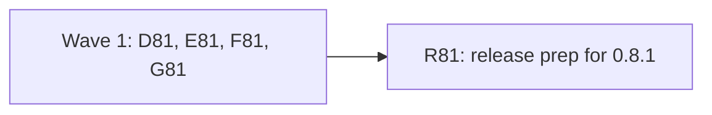

# Plan for 0.8.1

0.8.1 is a patch release after the 0.8.0 field test. It has one privacy fix: `tagreeve diff --by-page` no longer prints a canary value (#1606). Three small review fixes go with it: the `identifierRoute` pass message (#1634), event names with spaces in the consent matrix (#1611) and a flaky e2e stand-in (#1625). No new command, no record schema change, no new decoded hit or vendor, and nothing turns a pass or a warning into a failure. Each item is one PR. A PR is done when its acceptance test passes in CI, an adversarial review reports no blockers or majors, and it is squash-merged.

0.8.1 starts from `main` at `89308ea` ("Release prep for 0.8.0 (#1650)").

## Goals this release serves

From `docs/goals.md`:

- **Record what a site sends to each tracking vendor, for a scripted visitor, at each consent state.** D81 keeps `diff` from printing what the canaries planted.
- **Express expected behaviour as data, and report pass or fail with evidence.** E81 makes the pass message true. F81 keeps distinct custom events apart in the matrix, so the list of events that only a non-accept state sent is complete.

Non-goals this release comes close to:

- **Legal advice or legal responsibility.** E81 only fixes wording. A pass still means only that no planted value was found in the searched forms.
- **A hosted service, a second interface, changing GTM containers.** Unchanged. No entry adds a decoder or calls a vendor API.

## Triage

Each issue was read on 2026-11-24 against `main` at `89308ea`. The maintainer set the scope: #1606 is in, #1640 and #1648 moved to 0.9.0, #1651 is out, and a review issue is in when it is a patch-size bug fix.

| Issue | Kind | Status on main | Entry or decision | Where in the code |
| --- | --- | --- | --- | --- |
| #1606 | bug (privacy) | Open. `where()` and `recordedPages()` print the recorded page with its query. | D81 | `packages/cli/src/diff.ts` |
| #1634 | bug (wrong message) | Open. `judged` is 0 when every route went to an allowed host, so the head says "No planted value found". | E81 | `packages/expect/src/identifier-route.ts` |
| #1611 | bug | Open. `guardName` lets a name with a space pass `EVENT_NAME`, then `guardFieldName` turns it into `(other)`. | F81 | `guardName` in `packages/expect/src/state-table.ts` |
| #1625 | flaky test | Open. The stand-in exits after a fixed 800 ms. | G81 | `e2e/server-container-stape-loader.e2e.test.ts` |
| #1612 | review follow-up | Left out. Its own text says none of its three edge cases is a path real runs take, and item 3 changes what `canaryPool.match` matches. | Stays in Backlog | `packages/cli/src/run.ts`, `packages/core/src/canary.ts` |
| #1609 | docs | Left out. Already fixed on `main`: `docs/design.md` says `withdrawWith` is a scenario option only. The issue can be closed. | none | `docs/design.md` |
| #1591 | limitation | Left out. The fix records a page number or a detach time on `Request.frame`, which is a record change. Today it fails safe, with a warning. | Stays in Backlog | `loaderReachesScope` in `packages/expect/src/evaluate.ts` |
| #1640 | feature | Out. In the 0.9.0 milestone. The maintainer moved it. | none | |
| #1648 | gap in links | Out. In the 0.9.0 milestone. The maintainer moved it. A new decoder adds decoded hits, so baseline runs drift. | none | |
| #1651 | docs site | Out. Fixed by its own quick fix in this wave. | none | `site/` |

The other open issues in Backlog are not patch-size bug fixes and stay there.

## Decisions

Decided by the maintainer (2026-11-24):

1. **0.8.1 is a patch release.** No new command, no record schema change, no new decoded hit or vendor, and no change that turns a pass or a warning into a failure.
2. **In:** #1606. **Out:** #1640 and #1648 (the 0.9.0 milestone; the maintainer moved them) and #1651 (its own quick fix).

Decided in this plan:

- **#1606: the diff prints a path, never a query** (choice: maintainer may change). One rule gives the page of a hit: a URL becomes its path (no query, no fragment). A value that is not a URL is cut at the first `?` or `#`, and is kept only when what is left starts with `/`, otherwise it is `(other)`. `pagePath()` in `packages/expect/src/diff.ts` (the key page, with the existing value mask on top), `ref()` in the same file (the `page` of each added, removed and changed entry) and `where()` and `recordedPages()` in `packages/cli/src/diff.ts` (`recorded as`) all use it. So the key page, `moved[].page`, `diff --json` and the text hold no query. `recorded as` still appears only when that path differs from the key's masked page. The `page` string changes from a URL to a path. The JSON shape does not change. Real runs record absolute pages, so the non-URL branch matters for hand-built records only. It is cut anyway so the rule has no gap.
- **#1634: the head follows what was judged** (choice: maintainer may change). With routes allowed by `identifierRouteAllow` and none judged, the head is `No planted value reached a judged sink; `. "No planted value found in the" stays only when there are no routes at all. Design §11: the pass message never claims that nothing leaked.
- **#1611: a name is stored only when it reads as itself under the same check as a tag name** (choice: maintainer may change). For an event, `guardName` keeps `EVENT_NAME` and the 64 character limit, then requires `maskTagName(name) === name` (imported from `./tags.ts`, which does not change: it checks a name that holds spaces and colons part by part, with the whole-name email and phone check) and `!isValueSegment(name.replace(/\s+/g, ''))`. The second check catches a number or hash split by spaces wherever it sits in the name, such as `Callback 46 70 123 45 67`. It changes nothing for a name without spaces. It no longer sends an event name through `guardFieldName`. A name that fails any check still reads `(other)`.
- **#1625: the stand-in exits a short time after it answered its first `/healthz` request** (choice: maintainer may change). Test only. The 800 ms timer starts at launch and can fire before the runner's `/healthz` poll succeeds, so the run ends before the server container was ready. That is the flake. The test needs the stand-in gone before the loader request: the scenario waits 2 s, sends it, and asserts outcome `failed`, `serverContainer.error` `exited` and exit code 2. So the exit cannot wait for the loader request. It is 300 ms after the first `/healthz` answer, well under the 2 s wait. The test must not pass for another reason: the stand-in writes a marker file when it answers `/healthz`, and the test asserts the marker exists. `error: exited` is only set for a container that was ready and then ended, so a container that never became ready fails the test.
- **Docs owners.** No entry edits `docs/design.md`. R81 writes the release docs.
- **CHANGELOG.** No entry edits `CHANGELOG.md`. Each PR body ends with `CHANGELOG: <one line>`, and R81 writes the `## 0.8.1` section from them.

## Order and waves

All four entries run in one wave, then the release prep.

No two entries of the wave touch the same file:

- **D81:** `packages/cli/src/diff.ts` and its test, `pagePath` and `ref` in `packages/expect/src/diff.ts` and its test, and `e2e/diff.e2e.test.ts`.
- **E81:** `packages/expect/src/identifier-route.ts` and its test.
- **F81:** `packages/expect/src/state-table.ts` and its test.
- **G81:** `e2e/server-container-stape-loader.e2e.test.ts`.
- **`docs/design.md` and `docs/cli.md`.** R81 only, after every entry has merged.

## Rules for every PR

The rules in `AGENTS.md` and the earlier plans still hold: CLI only, no MCP server; no hosted service and no GTM API; fake IDs and identities only (`G-PWTEST0001`, `AW-000000001`, `100000000000001`, `GTM-PWTEST1`, `GTM-PWNOVER`); no cookie value, identity value, client ID, card value, `gtmAuth` or container config in any output; e2e only against `fixtures/site` in `stub` mode (and `server` mode on the fixture's loopback host with the stand-in container), with no Docker and no network; context-level hooks only; third-party code unmodified. The record stays at schema version 5.

More for 0.8.1:

- **A patch release.** No new command, option or record field. No entry adds a decoded hit or a vendor, or changes what a decoder outputs. No entry turns a pass or a warning into a failure. A message may change its text.
- **Each PR adds a regression test that fails without the change,** and the PR body says which line was reverted to see it fail.
- **Every negative test checks its input first.** A leak check asserts the value is in the input or the record, then that it is absent from the output.
- **Never edit a file outside the Touches line.** A flaky test is reported, not patched, except in G81, which is the fix for one. Known flaky: the second test of `e2e/unload-gap-frame-nav.e2e.test.ts` (#1608).
- **New e2e tests go in new files,** unless the entry names an existing file.
- **CHANGELOG.** The PR body ends with `CHANGELOG: <one line>`.

## PRs

### Wave 1

**D81 `diff --by-page` prints only the path of the recorded page (#1606).** Round cap 3. Touches: `where` and `recordedPages` in `packages/cli/src/diff.ts`; `packages/cli/src/diff.test.ts`; `pagePath` and `ref` in `packages/expect/src/diff.ts`; `packages/expect/src/diff.test.ts`; `e2e/diff.e2e.test.ts` (one new case).
Closes #1606
- `recorded as` is followed by the path of the recorded page, never the query or the fragment. A recorded page that is not a URL is cut at the first `?` or `#`, and kept only when what is left starts with `/`, otherwise it is `(other)`. The rule is one function in `packages/expect/src/diff.ts`, and `where()` and `recordedPages()` apply the same rule to what they print.
- `ref()` stores that path in `page` of each added, removed and changed entry, so `diff --json` holds no canary value. `pagePath()` applies the cut before the sandbox prefix and the value mask, so `key.page`, `moved[].page` and the `page` in the text hold no query either, for a URL and for a page that is not a URL. Without the cut in `pagePath`, `/products/1?gclid=TEST-x` keeps its query in the key page.
- The text still appears only when the recorded path differs from the key's masked page.
Invariants: The JSON shape is unchanged. Only the `page` string is shorter. A line with no `recorded as` is unchanged. `recorded as` shows the path where it showed the URL. The test `shows both raw pages when they differ from the key` in `packages/cli/src/diff.test.ts` expects full URLs, so its expected text changes to paths. No other existing test line is known to change. The builder runs the whole unit suite and lists in the commit message any other test whose expected result D81 alters.
Evals:

| Id | Kind | What must be true | How to check |
| --- | --- | --- | --- |
| D81-1 | behaviour | Two canary runs with the start `/products/123456`, compared with `--by-page`, print `recorded as /products/123456` and none of the six `TEST-` values, after the test checks the values are in the records. | `pnpm exec vitest run --project unit packages/cli/src/diff.test.ts`. |
| D81-2 | behaviour | A changed hit whose two recorded pages differ prints both paths with ` -> `. The old two-page test expects paths. | The same file. |
| D81-3 | behaviour | Hand-built records whose hits have the page `https://shop.test/products/1?gclid=TEST-x#TEST-y` give `diffRuns(a, b, { byPage: true })` and `formatDiff` output with no `TEST-`, after the test checks the value is in the records. The same for the page `/products/1?gclid=TEST-x`, which is not a URL: its key page and entry page read `/products/1`. A page that does not start with `/` after the cut reads `(other)`. | `pnpm exec vitest run --project unit packages/expect/src/diff.test.ts packages/cli/src/diff.test.ts`. It fails while `pagePath` keeps the query of a non-URL page and while `ref()` stores `h.page`. |
| D81-4 | behaviour | The e2e case compares a run of `e2e/scenarios/canaries.yml` with a run that differs (a run of another scenario, or one with a hit removed), so that `added`, `removed` or `changed` has an entry. It asserts exit 0, asserts that an entry has a non-empty `page`, asserts that a raw record holds a `TEST-` value, then that `diff a b --by-page --json` has no `TEST-` in stdout. | `pnpm build`, then `pnpm exec vitest run --project e2e e2e/diff.e2e.test.ts`. It fails while `ref()` stores the raw page. Two identical runs have no entry, so they would pass on `main`: the case does not use them. |

The e2e case covers JSON only. `fixtures/site` has no start path that makes `recorded as` print, so the unit tests D81-1 and D81-3 cover the text.

Acceptance: D81-3 and D81-4 pass, and fail on `main`.

**E81 The `identifierRoute` pass message is true when every route went to an allowed host (#1634).** Round cap 3. Touches: the pass message in `packages/expect/src/identifier-route.ts`; `packages/expect/src/identifier-route.test.ts`.
Closes #1634
- With one or more routes allowed by `identifierRouteAllow` and none judged, the message starts `No planted value reached a judged sink; `, then the searched text and the allowed clause as today.
- With no routes at all the message is unchanged.
Invariants: `pass`, `severity` and `evidence` are unchanged. Every failing and warning message is unchanged.
Evals:

| Id | Kind | What must be true | How to check |
| --- | --- | --- | --- |
| E81-1 | behaviour | Every route to an allowed host: the message does not hold "No planted value found" and does hold "allowed by identifierRouteAllow". | `pnpm exec vitest run --project unit packages/expect/src/identifier-route.test.ts`. |
| E81-2 | regression | No routes: the message is the old text. | The same file. |

Acceptance: E81-1 passes, and fails on `main`.

**F81 Event names with spaces or colons keep their names in the consent matrix (#1611).** Round cap 3. Touches: `guardName` in `packages/expect/src/state-table.ts` (it imports `maskTagName` from `./tags.ts`); `packages/expect/src/state-table.test.ts`.
Closes #1611
- `Add To Wishlist` and `Start Trial` are two event names in a cell, and `gtm:foo` is kept. `EVENT_NAME` and the 64 character limit stay the character rule.
- An email, a phone number (also one split by spaces, such as `555 123 4567` or `46 70 123 45 67`, and one that follows a word, such as `Callback 46 70 123 45 67`), a long ID or a hash used as an event name (also one split into words), or a name with a part that `maskTagName` or `isValueSegment` takes as a value, still reads `(other)`.
- Field and ID names keep `guardFieldName`. `tags.ts` is not edited: `maskTagName` is only imported.
Invariants: `suite.json` holds names and counts, never a value. A name without spaces gives the same result as before. A name with spaces that read `(other)` before may read as itself now, only when no check above takes it as a value.
Evals:

| Id | Kind | What must be true | How to check |
| --- | --- | --- | --- |
| F81-1 | behaviour | Reject sends `Add To Wishlist`, accept sends `Start Trial`: the reject entry lists `Add To Wishlist` in `notInAccept`. | `pnpm exec vitest run --project unit packages/expect/src/state-table.test.ts`. |
| F81-2 | behaviour | An event named by an email, by a phone number (`5551234567`, `555 123 4567`, `46 70 123 45 67`), by a number after a word (`Callback 46 70 123 45 67`, `Call 070 123 45 67 now`), by a 32-character hash and by a 32-hex hash split into 8-character words reads `(other)`, after the test checks each is in the records. `Add To Wishlist` and `gtm:foo` still read as themselves. | The same file. It fails while a name is judged word by word. |

Acceptance: F81-1 passes, and fails on `main`.

**G81 The Stape loader e2e stand-in exits after it served the loader request (#1625).** Round cap 3. Touches: `e2e/server-container-stape-loader.e2e.test.ts` only. A test-only change.
Closes #1625
- The stand-in exits 300 ms after it answered its first `/healthz` request, not 800 ms after launch. It is gone before the loader request, which is sent after the scenario's `wait: 2s`. It writes a marker file when it answers `/healthz`, and the test asserts the file exists, so the test cannot pass with a container that never became ready.
Invariants: The test checks what it checked before: the loader request is `failed`, `serverContainer.error` is `exited` and the exit code is 2. The `wait: 2s` stays.
Evals:

| Id | Kind | What must be true | How to check |
| --- | --- | --- | --- |
| G81-1 | regression | The file passes. | `pnpm exec vitest run --project e2e e2e/server-container-stape-loader.e2e.test.ts`. |
| G81-3 | behaviour | The marker file exists after the run, and the test asserts `serverContainer.error` is `exited`. | The same file. A stand-in that exits before its first `/healthz` answer has no marker and fails the test. |
| G81-2 | behaviour | No fixed 800 ms exit timer is left in this file, and the stand-in reads `/healthz` before it schedules the exit. | `git grep -n "process.exit(0), 800" -- e2e/server-container-stape-loader.e2e.test.ts` prints nothing. The unscoped grep still finds the two files in Flagged concerns, so it is not the check. |

Acceptance: G81-1 passes. The failure it removes is a timing one, so no test is made to fail without the change. The PR body says so.

## Release

**R81 Release prep for 0.8.1.** Written as its own entry after every entry above has merged. The PR runs `scripts/bump-version.sh 0.8.1`, which sets `package.json` and the version lines of the README, `docs/cli.md` and `docs/design.md`. It writes the `## 0.8.1` section of `CHANGELOG.md` from the PR lines, a README "In 0.8.1" line and a new item in design §15. It also updates the "Still open" text of the 0.8.0 item (#1606 is fixed. #1648 and #1640 stay open: both are in the 0.9.0 milestone), and re-records `site/demo/` if `pnpm docs:test` shows a change. `package.json` is gated, so the maintainer merges it, and CI publishes the release after the merge. No agent publishes, tags or starts the release workflow.

Touches: `package.json`, the "In 0.8.1" line and the version lines of `README.md`, the version lines of `docs/cli.md` and `docs/design.md`, the `## 0.8.1` section of `CHANGELOG.md`, `docs/design.md` §15, `site/demo/`.

Acceptance: `pnpm exec vitest run --project unit scripts/bump-version.test.ts` and `pnpm docs:test` pass on the release-prep PR.

## After the PRs

After CI publishes 0.8.1, run `node scripts/check-npm-dist-tag.ts 0.8.1` and the install check in `AGENTS.md`.

## Flagged concerns

- **D81 changes diff text.** A script that reads the `recorded as` text of a diff sees a path where it saw a URL.
- **F81 widens the event names stored in `suite.json`.** A name with spaces that read `(other)` before can now read as itself. The checks are `EVENT_NAME`, the length limit, `maskTagName` and a spaces-removed `isValueSegment`. A name that holds a value, split by spaces or not, still reads `(other)`.
- **Two other e2e files hold the same 800 ms timer.** `e2e/server-container-rejected.e2e.test.ts` and `e2e/server-container.e2e.test.ts` have the same stand-in line and the same flake risk. G81 does not touch them: a flaky test is reported, not patched. A follow-up can apply the same fix.
- **D81 shortens the `page` string in `diff --json`.** A script that reads it sees a path where it saw a URL. The canary values were in that string.
- **No field test of its own.** Every change is small and has a unit test. D81-4 is the only e2e test of a change here.

## Out of scope

| Item | Why it waits |
| --- | --- |
| #1640 | Exact client-ID link when the container answers before its call. In the 0.9.0 milestone; the maintainer moved it. |
| #1648 | Pinterest Conversions API linking. In the 0.9.0 milestone; the maintainer moved it. A new decoder adds decoded hits, so baseline runs drift. A patch adds none. |
| #1651 | The home page version badge. Its own quick fix in this wave. |
| #1612 | None of its three edge cases is a path real runs take. Backlog. |
| #1609 | Already fixed on `main`. The issue can be closed. |
| #1591 | Needs a record change (a page number or detach time on `Request.frame`). Backlog. |
| Other Backlog issues | Not a patch-size bug fix. |
| New commands, a record schema change, a check that turns a pass or a warning into a failure | Not allowed in a patch release. |
| An MCP server (#362) | AGENTS.md: CLI only. |
