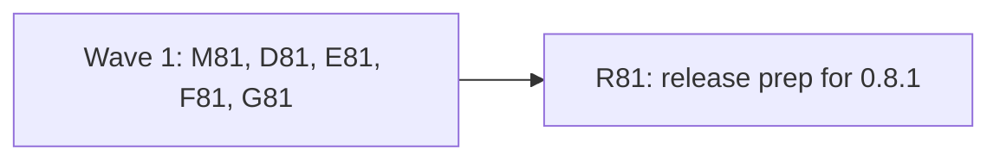

# Plan for 0.8.1

0.8.1 is a patch release after the 0.8.0 field test. It has one fix for the consent audit and one privacy fix. A Pinterest Conversions API call that the local server container sends now links to its browser hit by event ID (#1648), so its identifier routes are judged with the browser hit's consent epoch and no longer warn with `serverSendUnlinked`. `tagreeve diff --by-page` no longer prints a canary value (#1606). Three small review fixes go with them: the `identifierRoute` pass message (#1634), event names with spaces in the consent matrix (#1611) and a flaky e2e stand-in (#1625). No new command, no record schema change, and nothing turns a pass or a warning into a failure. Each item is one PR. A PR is done when its acceptance test passes in CI, an adversarial review reports no blockers or majors, and it is squash-merged.

0.8.1 starts from `main` at `89308ea` ("Release prep for 0.8.0 (#1650)").

## Goals this release serves

From `docs/goals.md`:

- **Record what a site sends to each tracking vendor, for a scripted visitor, at each consent state.** M81 lets the record say which browser hit a Pinterest server call belongs to. D81 keeps `diff` from printing what the canaries planted.
- **Express expected behaviour as data, and report pass or fail with evidence.** E81 makes the pass message true. F81 keeps distinct custom events apart in the matrix, so the list of events that only a non-accept state sent is complete.

Non-goals this release comes close to:

- **Legal advice or legal responsibility.** E81 only fixes wording. A pass still means only that no planted value was found in the searched forms.
- **A hosted service, a second interface, changing GTM containers.** Unchanged. M81 decodes what the user's own container sends. It calls no Pinterest API.
- **Explaining why a tag did not fire.** M81 links a call to a hit. It says nothing about the tag.

## Triage

Each issue was read on 2026-11-24 against `main` at `89308ea`. The maintainer set the scope: #1648 and #1606 are in, #1640 and #1651 are out, and a review issue is in when it is a patch-size bug fix.

| Issue | Kind | Status on main | Entry or decision | Where in the code |
| --- | --- | --- | --- | --- |
| #1648 | gap in links | Open. No decoder matches `api.pinterest.com`, so a Pinterest Conversions API call gives no hit and nothing to link. The tag hit already carries the event ID (`params.eventId`, from `ed.event_id`). | M81 | `packages/decoders/src/`, rule (1) of `linkServerHits` in `packages/recorder/src/server-container/link.ts` |
| #1606 | bug (privacy) | Open. `where()` and `recordedPages()` print the recorded page with its query. | D81 | `packages/cli/src/diff.ts` |
| #1634 | bug (wrong message) | Open. `judged` is 0 when every route went to an allowed host, so the head says "No planted value found". | E81 | `packages/expect/src/identifier-route.ts` |
| #1611 | bug | Open. `guardName` lets a name with a space pass `EVENT_NAME`, then `guardFieldName` turns it into `(other)`. | F81 | `guardName` in `packages/expect/src/state-table.ts` |
| #1625 | flaky test | Open. The stand-in exits after a fixed 800 ms. | G81 | `e2e/server-container-stape-loader.e2e.test.ts` |
| #1612 | review follow-up | Left out. Its own text says none of its three edge cases is a path real runs take, and item 3 changes what `canaryPool.match` matches. | Stays in Backlog | `packages/cli/src/run.ts`, `packages/core/src/canary.ts` |
| #1609 | docs | Left out. Already fixed on `main`: `docs/design.md` says `withdrawWith` is a scenario option only. The issue can be closed. | none | `docs/design.md` |
| #1591 | limitation | Left out. The fix records a page number or a detach time on `Request.frame`, which is a record change. Today it fails safe, with a warning. | Stays in Backlog | `loaderReachesScope` in `packages/expect/src/evaluate.ts` |
| #1640 | feature | Out. Needs a design decision. 0.9.0. | none | |
| #1651 | docs site | Out. Fixed by its own quick fix in this wave. | none | `site/` |

The other open issues in Backlog are not patch-size bug fixes and stay there.

## Decisions

Decided by the maintainer (2026-11-24):

1. **0.8.1 is a patch release.** No new command, no record schema change, and no change that turns a pass or a warning into a failure.
2. **In:** #1648 and #1606. **Out:** #1640 (0.9.0) and #1651 (its own quick fix).

Decided in this plan:

- **Pinterest has a shared event ID, so M81 links by it** (choice: maintainer may change). Pinterest's own docs name it. The Conversions API item has `event_id`: "A unique id string that identifies this event and can be used for deduping between events ingested via both the conversion API and Pinterest tracking" (schema `ConversionEventsDataItems` in Pinterest's v5 OpenAPI description, `github.com/pinterest/api-description`, `v5/openapi.yaml`, operation `events/create`, `POST https://api.pinterest.com/v5/ad_accounts/{ad_account_id}/events`). Pinterest's help page "Add event codes" says the tag sends the same ID as `eventID`, `event_id` or `eid`. The tag decoder already reads `ed.event_id` into `params.eventId`, and `packages/decoders/fixtures/pinterest/capture.json` has a recorded one. A store whose tag sends no event ID, or one of the other two names, stays unlinked, as today.
- **M81 is a decoder plus the existing rule (1).** A new decoder `pinterest-capi` matches `api.pinterest.com` with a path `/v5/ad_accounts/<id>/events`, reads a JSON body `{ "data": [ ... ] }` and makes one hit for each item, as `meta-capi` does. `linkServerHits` does not change. The hit's `event_id` goes to `params.eventId`, which rule (1) already reads.
- **The vendor key is `pinterest-capi`,** like `meta-capi` beside `meta` (choice: maintainer may change). A rule for `vendor: pinterest` does not match the server call, as a `meta` rule does not match a `meta-capi` call. `vendorKeys` and `names.ts` get the key, with the label `Pinterest Conversions API`.
- **Event names are made equal in the decoder** (choice: maintainer may change). Rule (1) needs both hits to have the same `event`. The tag sends `pagevisit`, `addtocart` and `checkout`. The Conversions API sends `event_name` as `page_visit`, `add_to_cart` and `checkout` (the enum in the same schema). The decoder lowercases `event_name` and removes `_`. That gives the tag names for `page_visit`, `add_to_cart`, `checkout`, `signup`, `watch_video`, `lead`, `search` and `view_category`. `custom` stays `custom`: the tag sends the custom name itself, so a custom event does not link by name and stays unlinked, as today.
- **What the decoder reads** (choice: maintainer may change). The names are those of `ConversionEventsDataItems` and its `user_data` in the OpenAPI description: `event_name`, `event_id`, `event_source_url` (the hit's page, with its own entry in `page-fields.ts`) and `user_data.em` (a list of hashed emails: the first is `hashedEmail`, the others are indexed, as `meta-capi` does). No other field is stored, and `client_ip_address` is not read. The `Authorization` header and any `access_token` are never read.
- **The stub follows `meta-capi`.** The Conversions API path on `api.pinterest.com` is a collection endpoint, so a browser request to it is stubbed. `stubResponse` in `packages/recorder/src/stub.ts` answers it `200` with `content-type: application/json` and a body in Pinterest's response shape (`num_events_received`, `num_events_processed`, `failed_events`, `events`, from the `events/create` response in the OpenAPI description). Without this the request gets the default `204`. The same function is what the recording proxy answers to the user's own container, so a real container's Pinterest call now gets `200` and JSON instead of `204`. That is the kind of answer the real API gives. The decoder exports the endpoint check, as `isMetaCapiEndpoint` is exported for Meta.
- **Further hashes are judged one by one.** `identity.hashesMatch` judges every `user_data.em` value of a `pinterest-capi` hit, as it does for `meta-capi`: `identityParamName` in `packages/expect/src/evaluate.ts` strips the `.<n>` index for both vendors. Pinterest's own example sends two `em` values. `VENDOR_IGNORE` and `capiMatchesIdentity` in the same file stay keyed on `meta-capi`: a Pinterest call is not exempted from any check, which is the safe direction.
- **The stand-in sends the Pinterest call only when asked.** `sendVendorCalls` in `fixtures/site/src/stand-in-container.ts` adds a Pinterest call to `https://api.pinterest.com/v5/ad_accounts/549755885175/events` only when the trigger URL has `pin=1`. Without it the default calls are the same as today, so `e2e/server-container.e2e.test.ts` (which pins the vendors to `ga4`, `google-ads`, `meta-capi`) and every other e2e file that uses the stand-in see no new call. The call reuses the trigger's `event_id` and sends the event name in the CAPI form (`pagevisit` as `page_visit`).
- **#1606: the diff prints a path, never a query** (choice: maintainer may change). `where()` and `recordedPages()` print the path of the recorded page. `recorded as` still appears only when that path differs from the key's masked page. `diff --json` is cut too: `ref()` in `packages/expect/src/diff.ts` puts the raw `Hit.page` in every added, removed and changed entry, and that page holds the start URL with all six canary values. It stores the path only, with no query and no fragment. A recorded page that is not a URL is cut at the first `?` or `#`. The `page` string in `diff --json` and the `recorded as` text change from a URL to a path. The JSON shape does not change.
- **#1634: the head follows what was judged** (choice: maintainer may change). With routes allowed by `identifierRouteAllow` and none judged, the head is `No planted value reached a judged sink; `. "No planted value found in the" stays only when there are no routes at all. Design §11: the pass message never claims that nothing leaked.
- **#1611: `EVENT_NAME` is the character rule for events** (choice: maintainer may change). `guardName` for an event keeps `EVENT_NAME` and the length limit. It runs `isValueSegment` and `valueKinds` (email, phone, ID, hash) on the whole name, and `isValueSegment` on each space word and each dot segment. The whole-name check is needed because a number split by spaces is a phone only as a whole (`555 123 4567`), and the dot-segment check keeps what `guardFieldName` did. It no longer sends an event name through `guardFieldName`. A name that fails any check still reads `(other)`.
- **#1625: the stand-in exits a short time after it answered its first `/healthz` request** (choice: maintainer may change). Test only. The 800 ms timer starts at launch and can fire before the runner's `/healthz` poll succeeds, so the run ends before the loader request exists. That is the flake. The test needs the stand-in gone before the loader request: the scenario waits 2 s, sends it, and asserts outcome `failed`, `serverContainer.error` `exited` and exit code 2. So the exit cannot wait for the loader request. It is 300 ms after the first `/healthz` answer, well under the 2 s wait.
- **Docs owners.** M81 documents itself in `docs/design.md` (§6 decoder table and the "Still open" text in §15). The other entries say nothing new in the docs. R81 writes the release docs.
- **CHANGELOG.** No entry edits `CHANGELOG.md`. Each PR body ends with `CHANGELOG: <one line>`, and R81 writes the `## 0.8.1` section from them.

## Order and waves

All five entries run in one wave, then the release prep.

No two entries of the wave touch the same file:

- **M81:** `packages/decoders/` (a new decoder and its tests, `registry.ts`, `registry.test.ts`, `page-fields.ts`, `decoder.ts`, `index.ts`), `packages/cli/src/report/names.ts`, `packages/recorder/src/stub.ts` and `stub.test.ts`, `packages/expect/src/evaluate.ts` (`identityParamName`) and `evaluate.test.ts`, `packages/recorder/src/server-container/link.test.ts`, `fixtures/site/` (the stand-in, one page, its route, the README), a new scenario, a new e2e file and `docs/design.md`.
- **D81:** `packages/cli/src/diff.ts` and its test, `ref` in `packages/expect/src/diff.ts` and its test, and `e2e/diff.e2e.test.ts`.
- **E81:** `packages/expect/src/identifier-route.ts` and its test.
- **F81:** `packages/expect/src/state-table.ts` and its test.
- **G81:** `e2e/server-container-stape-loader.e2e.test.ts`.
- **`docs/design.md` and `docs/cli.md`.** M81 only (design), then R81 after every entry has merged.

## Rules for every PR

The rules in `AGENTS.md` and the earlier plans still hold: CLI only, no MCP server; no hosted service and no GTM API; fake IDs and identities only (`G-PWTEST0001`, `AW-000000001`, `100000000000001`, `GTM-PWTEST1`, `GTM-PWNOVER`); no cookie value, identity value, client ID, card value, `gtmAuth` or container config in any output; e2e only against `fixtures/site` in `stub` mode (and `server` mode on the fixture's loopback host with the stand-in container), with no Docker and no network; context-level hooks only; third-party code unmodified. The record stays at schema version 5.

More for 0.8.1:

- **A patch release.** No new command, option or record field. No entry turns a pass or a warning into a failure. A message may change its text.
- **Each PR adds a regression test that fails without the change,** and the PR body says which line was reverted to see it fail.
- **Every negative test checks its input first.** A leak check asserts the value is in the input or the record, then that it is absent from the output.
- **Fixtures hold fake values only.** A Pinterest fixture uses a made-up ad account ID such as `549755885175`, the fake identity's hash and a fake token that the test shows is dropped.
- **Field names come from the vendor's own docs.** M81 cites them in the PR. Tracker Radar, EasyPrivacy and Disconnect are not sources.
- **Never edit a file outside the Touches line.** A flaky test is reported, not patched, except in G81, which is the fix for one. Known flaky: the second test of `e2e/unload-gap-frame-nav.e2e.test.ts` (#1608).
- **New e2e tests go in new files,** unless the entry names an existing file.
- **CHANGELOG.** The PR body ends with `CHANGELOG: <one line>`.

## PRs

### Wave 1

**M81 Pinterest Conversions API calls link to their browser hits (#1648).** Round cap 4. Touches: `packages/decoders/src/pinterest-capi.ts` (new); `packages/decoders/src/pinterest-capi.test.ts` (new); `packages/decoders/fixtures/pinterest-capi/` (new, a made-up call); `packages/decoders/src/registry.ts` (`direct`); `packages/decoders/src/registry.test.ts` (a `pinterest-capi` sample); `packages/decoders/src/index.ts` (export); `packages/decoders/src/decoder.ts` (`vendorKeys`); `packages/decoders/src/page-fields.ts` and `page-fields.test.ts` (the `event_source_url` entry); `packages/cli/src/report/names.ts` (the label); `packages/recorder/src/server-container/link.test.ts` (Pinterest cases for rule (1)); `packages/recorder/src/stub.ts` (`stubResponse`) and `stub.test.ts`; `packages/expect/src/evaluate.ts` (`identityParamName`) and `evaluate.test.ts`; `fixtures/site/src/stand-in-container.ts` (the opt-in Pinterest call) and `stand-in-container.test.ts`; `fixtures/site/public/pinterest-link.html` (new, no network) with its route `/pinterest-link` in `fixtures/site/src/index.ts`; `fixtures/site/README.md` (the page and the `pin=1` flag); `e2e/scenarios/pinterest-link.yml` (new); `e2e/server-container-pinterest-link.e2e.test.ts` (new); `docs/design.md` (§6 decoder table row, §15 "Still open" text of rc.4 and 0.8.0).
Closes #1648
- A request to `api.pinterest.com` on `/v5/ad_accounts/<id>/events` with a JSON body `{ "data": [ ... ] }` decodes to one `pinterest-capi` hit for each item. The hit has `event` (the name lowercased with `_` removed), `params.eventId` from `event_id`, `page` from `event_source_url`, and the `user_data.em` hashes as `hashedEmail`, with further values indexed. `Hit.fields` lists names only, through the same guard as `meta-capi`. The `Authorization` header and an `access_token` are never a field or a param.
- A body that is not JSON, has no `data` list or has an item that is not an object gives no hit for that item and does not throw, as `meta-capi` does for the same input.
- `linkServerHits` is unchanged. A server call with an `event_id` of at least 8 characters and the same event name as exactly one browser Pinterest hit links `exact` by `eventId`, with the same later-hit window as Meta.
- A `custom` call, a call with no `event_id` and a call that matches two browser hits stay unlinked, with the `linkMiss` rule (1) gives today.
- In `stub` mode a browser request to the Conversions API path is recorded and answered locally with `200`, `content-type: application/json` and a body in Pinterest's response shape (`stubResponse`). The default for any other fetch stays `204`.
- `identity.hashesMatch` judges every `user_data.em` value: `hashedEmail.1` and later count as `hashedEmail` for a `pinterest-capi` hit, so a second value sent plain or with the wrong hash fails, with the message naming the hit.
- `pinterest-link.html` makes no network call. It sends a `pagevisit` hit to `https://ct.pinterest.com/` (stubbed by host) with `ed` holding `event_id` `pw-pin-event-1` (at least 8 characters), then posts to the stand-in's trigger path with `pin=1&event_id=pw-pin-event-1&event_name=pagevisit`. The stand-in sends its default calls and also the Pinterest call, with that `event_id` and the event name `page_visit`. The scenario `pinterest-link.yml` runs the page in `server` mode.
Invariants: A Pinterest tag hit decodes as before. No other decoder's output changes. The stand-in's default calls are unchanged, so `e2e/server-container.e2e.test.ts` passes with its vendor list as is. The existing `pinterest.html` page is untouched. `ct.pinterest.com` is still stubbed by host. A request to another path on `api.pinterest.com` gets no hit.
Evals:

| Id | Kind | What must be true | How to check |
| --- | --- | --- | --- |
| M81-1 | behaviour | The fixture call decodes to the expected hits: event `addtocart` for `add_to_cart`, `eventId`, page and `hashedEmail`. | `pnpm exec vitest run --project unit packages/decoders/src/pinterest-capi.test.ts`. |
| M81-2 | error path | A body that is not JSON, and one with `data` not a list, give no hit and no throw. | The same file. |
| M81-3 | privacy | A fixture with an `access_token` query value and an `Authorization` header gives a hit with neither in `params`, `fields` or `page`, after the test checks both are in the request. | The same file. |
| M81-4 | behaviour | A Pinterest server hit and a browser hit with the same event ID and name link `exact` by `eventId`. | `pnpm exec vitest run --project unit packages/recorder/src/server-container/link.test.ts`. |
| M81-5 | behaviour | A `custom` server hit does not link by event ID. | The same file. |
| M81-6 | end to end | On the fixture site with the stand-in container, a Pinterest Conversions API call that the container sends links to the page's `pagevisit` hit, and a canary route on that call is judged by the browser hit's epoch, with no `serverSendUnlinked`. | `pnpm exec vitest run --project e2e e2e/server-container-pinterest-link.e2e.test.ts`. |
| M81-7 | regression | The decoder tests pass, with the `pinterest-capi` sample added to `registry.test.ts` (an `api.pinterest.com/v5/ad_accounts/` request). Every other test that the new vendor key alters passes too. | `pnpm exec vitest run --project unit packages/decoders packages/cli/src/report/names.test.ts packages/recorder/src/canary-routes.test.ts`. The builder runs the whole unit suite, finds each test whose expected result the new key (`vendorKeys`, `PAGE_FIELDS`) alters, and lists them in the message of the commit that applies the change. |
| M81-8 | behaviour | A stubbed POST to `https://api.pinterest.com/v5/ad_accounts/549755885175/events` is answered `200` with `content-type: application/json`. A fetch to another path on `api.pinterest.com` is still `204`. | `pnpm exec vitest run --project unit packages/recorder/src/stub.test.ts`. It fails while `stub.ts` knows only the Meta endpoint. |
| M81-9 | behaviour | A `pinterest-capi` hit with `hashedEmail` right and `hashedEmail.1` the plain run email fails `identity.hashesMatch`, and the message names the hit. | `pnpm exec vitest run --project unit packages/expect/src/evaluate.test.ts`. It passes (pass true) while `identityParamName` strips the index only for `meta-capi`. |
| M81-10 | regression | The stand-in sends only `ga4`, `google-ads` and `meta-capi` by default, and the Pinterest call only with `pin=1`. | `pnpm exec vitest run --project e2e e2e/server-container.e2e.test.ts e2e/server-container-pinterest-link.e2e.test.ts` and `pnpm exec vitest run --project unit fixtures/site/src/stand-in-container.test.ts`. `grep -n "api.pinterest.com" fixtures/site/src/stand-in-container.ts` finds the opt-in call. |

Acceptance: M81-6 passes, and fails on `main`, where the call has no hit. The PR changes only files named in the Touches line.

**D81 `diff --by-page` prints only the path of the recorded page (#1606).** Round cap 3. Touches: `where` and `recordedPages` in `packages/cli/src/diff.ts`; `packages/cli/src/diff.test.ts`; `ref` in `packages/expect/src/diff.ts`; `packages/expect/src/diff.test.ts`; `e2e/diff.e2e.test.ts` (one new case).
Closes #1606
- `recorded as` is followed by the path of the recorded page, never the query or the fragment. A recorded page that is not a URL is cut at the first `?` or `#`, and printed only when what is left starts with `/`, and otherwise as `(other)`.
- `ref()` in `packages/expect/src/diff.ts` stores the same path in `page` of each added, removed and changed entry, so `diff --json` holds no canary value either.
- The text still appears only when the recorded path differs from the key's masked page.
Invariants: The JSON shape is unchanged. Only the `page` string is shorter. A line with no `recorded as` is unchanged. `recorded as` shows the path where it showed the URL. The test `shows both raw pages when they differ from the key` in `packages/cli/src/diff.test.ts` expects full URLs and changes to expect paths. The builder finds by a run every other test whose expected result D81 alters and lists them in the commit message.
Evals:

| Id | Kind | What must be true | How to check |
| --- | --- | --- | --- |
| D81-1 | privacy | Two canary runs with the start `/products/123456`, compared with `--by-page`, print `recorded as /products/123456` and none of the six `TEST-` values, after the test checks the values are in the records. | `pnpm exec vitest run --project unit packages/cli/src/diff.test.ts`. |
| D81-2 | behaviour | A changed hit whose two recorded pages differ prints both paths with ` -> `. The old two-page test expects paths. | The same file. |
| D81-3 | privacy | `diff a b --by-page --json` and `diff a b --by-page` on two canary runs print no `TEST-` in stdout, after the test checks the values are in the records. A non-URL page `/products/1?gclid=TEST-x` reads `/products/1`. | `pnpm exec vitest run --project unit packages/expect/src/diff.test.ts` and `pnpm exec vitest run --project e2e e2e/diff.e2e.test.ts`. The JSON run fails while `ref()` stores the raw page. |

Acceptance: D81-1 and D81-3 pass, and fail on `main`.

**E81 The `identifierRoute` pass message is true when every route went to an allowed host (#1634).** Round cap 3. Touches: the pass message in `packages/expect/src/identifier-route.ts`; `packages/expect/src/identifier-route.test.ts`.
Closes #1634
- With one or more routes allowed by `identifierRouteAllow` and none judged, the message starts `No planted value reached a judged sink; `, then the searched text and the allowed clause as today.
- With no routes at all the message is unchanged.
Invariants: `pass`, `severity` and `evidence` are unchanged. Every failing and warning message is unchanged.
Evals:

| Id | Kind | What must be true | How to check |
| --- | --- | --- | --- |
| E81-1 | behaviour | Every route to an allowed host: the message does not hold "No planted value found" and does hold "allowed by identifierRouteAllow". | `pnpm exec vitest run --project unit packages/expect/src/identifier-route.test.ts`. |
| E81-2 | regression | No routes: the message is the old text. | The same file. |

Acceptance: E81-1 passes, and fails on `main`.

**F81 Event names with spaces or colons keep their names in the consent matrix (#1611).** Round cap 3. Touches: `guardName` in `packages/expect/src/state-table.ts`; `packages/expect/src/state-table.test.ts`.
Closes #1611
- `Add To Wishlist` and `Start Trial` are two event names in a cell, and `gtm:foo` is kept. `EVENT_NAME` and the 64 character limit stay the character rule.
- An email, a phone number (also one split by spaces, such as `555 123 4567` or `46 70 123 45 67`), a long ID or a hash used as an event name, or a name with a word or a dot segment that `isValueSegment` takes as a value, still reads `(other)`.
- Field and ID names keep `guardFieldName`.
Invariants: `suite.json` holds names and counts, never a value. A name that read as itself before still does.
Evals:

| Id | Kind | What must be true | How to check |
| --- | --- | --- | --- |
| F81-1 | behaviour | Reject sends `Add To Wishlist`, accept sends `Start Trial`: the reject entry lists `Add To Wishlist` in `notInAccept`. | `pnpm exec vitest run --project unit packages/expect/src/state-table.test.ts`. |
| F81-2 | privacy | An event named by an email, by a phone number (`5551234567`, `555 123 4567`, `46 70 123 45 67`) and by a 32-character hash reads `(other)`, after the test checks each is in the records. The spaced numbers fail under a per-word rule. | The same file. |

Acceptance: F81-1 passes, and fails on `main`.

**G81 The Stape loader e2e stand-in exits after it served the loader request (#1625).** Round cap 3. Touches: `e2e/server-container-stape-loader.e2e.test.ts` only. A test-only change.
Closes #1625
- The stand-in exits 300 ms after it answered its first `/healthz` request, not 800 ms after launch. It is gone before the loader request, which is sent after the scenario's `wait: 2s`.
Invariants: The test checks what it checked before: the loader request is `failed`, `serverContainer.error` is `exited` and the exit code is 2. The `wait: 2s` stays.
Evals:

| Id | Kind | What must be true | How to check |
| --- | --- | --- | --- |
| G81-1 | regression | The file passes. | `pnpm exec vitest run --project e2e e2e/server-container-stape-loader.e2e.test.ts`. |
| G81-2 | behaviour | No fixed 800 ms exit timer is left in this file, and the stand-in reads `/healthz` before it schedules the exit. | `git grep -n "process.exit(0), 800" -- e2e/server-container-stape-loader.e2e.test.ts` prints nothing. The unscoped grep still finds the two files in Flagged concerns, so it is not the check. |

Acceptance: G81-1 passes. The failure it removes is a timing one, so no test is made to fail without the change. The PR body says so.

## Release

**R81 Release prep for 0.8.1.** Written as its own entry after every entry above has merged. The PR runs `scripts/bump-version.sh 0.8.1`, which sets `package.json` and the version lines of the README, `docs/cli.md` and `docs/design.md`. It writes the `## 0.8.1` section of `CHANGELOG.md` from the PR lines, a README "In 0.8.1" line and a new item in design §15. It also updates the "Still open" text of the 0.8.0 item (#1648 and #1606 are fixed, #1640 stays), and re-records `site/demo/` if `pnpm docs:test` shows a change. `package.json` is gated, so the maintainer merges it, and CI publishes the release after the merge. No agent publishes, tags or starts the release workflow.

Touches: `package.json`, the "In 0.8.1" line and the version lines of `README.md`, the version lines of `docs/cli.md` and `docs/design.md`, the `## 0.8.1` section of `CHANGELOG.md`, `docs/design.md` §15, `site/demo/`.

Acceptance: `pnpm exec vitest run --project unit scripts/bump-version.test.ts` and `pnpm docs:test` pass on the release-prep PR.

## After the PRs

After CI publishes 0.8.1, run `node scripts/check-npm-dist-tag.ts 0.8.1` and the install check in `AGENTS.md`. If the field-test store has a Pinterest server tag, the maintainer reruns the 0.8.0 scenario and checks that its identifier routes name a linked browser hit.

## Flagged concerns

- **M81 rests on the store's tag sending `event_id`.** The recorded tag capture has it. Pinterest's help page also lists `eventID` and `eid`. The tag decoder reads `event_id` only, so a tag that uses another name stays unlinked. A field run decides if a follow-up adds them.
- **The event name rule is not a table.** Removing `_` fits the names Pinterest lists for the tag. A name that does not fit stays unlinked, which is the safe direction: the route warns, it does not pass.
- **Custom events do not link by event ID.** The tag sends its own name and the call sends `custom`. They stay at `serverSendUnlinked`. The OpenAPI description gives no field for a custom name, so the plan does not guess one.
- **M81 adds a decoder for a call a browser does not make.** The stub rule is for symmetry with `meta-capi`, and a test pins it.
- **D81 changes diff text.** A script that reads the `recorded as` text of a diff sees a path where it saw a URL.
- **F81 widens the event names stored in `suite.json`.** They are still guarded: no value-like name is kept.
- **Two other e2e files hold the same 800 ms timer.** `e2e/server-container-rejected.e2e.test.ts` and `e2e/server-container.e2e.test.ts` have the same stand-in line and the same flake risk. G81 does not touch them: a flaky test is reported, not patched. A follow-up can apply the same fix.
- **M81 changes the proxy answer to a real container.** A Pinterest call from the user's own container gets `200` and JSON, not `204`, because `stubResponse` serves both the browser stub and the recording proxy.
- **D81 shortens the `page` string in `diff --json`.** A script that reads it sees a path where it saw a URL. The canary values were in that string.
- **No field test of its own.** Every change is small and has a unit test. M81-6 is the only e2e test of the link.

## Out of scope

| Item | Why it waits |
| --- | --- |
| #1640 | Exact client-ID link when the container answers before its call. Needs a design decision. 0.9.0. |
| #1651 | The home page version badge. Its own quick fix in this wave. |
| #1612 | None of its three edge cases is a path real runs take. Backlog. |
| #1609 | Already fixed on `main`. The issue can be closed. |
| #1591 | Needs a record change (a page number or detach time on `Request.frame`). Backlog. |
| Other Backlog issues | Not a patch-size bug fix. |
| New commands, a record schema change, a check that turns a pass or a warning into a failure | Not allowed in a patch release. |
| An MCP server (#362) | AGENTS.md: CLI only. |
