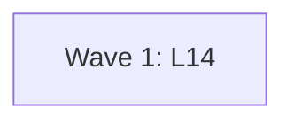

# Plan for 0.9.0

This plan holds one entry so far, for #1622. It is written while 0.8.0 is still in flight, so it does not join 0.8.0-rc.1. The maintainer picks the release it ships in and may rename this file or fold the entry into another plan. `AGENTS.md` still names `docs/plan-0.8.0.md` as the current plan, and this PR does not change that line.

The entry starts from `main` at `c5a367b` ("Fixture: send the relay page view after the consent step (#1618) (#1620)").

## Goals this release serves

From `docs/goals.md`:

- **Test an unpublished GTM workspace before publishing it, in the test browser only.** With `--server-container` and a workspace preview config, a site that sends GA4 through the Stape custom loader gets no GA4-client tag today. L14 lets those tags fire in the local container.
- **Express expected behaviour as data, and report pass or fail with evidence.** A `sentBy: server` rule on such a site fails today because of the harness, not the container. After L14 it judges what the container sent.
- **Be safe by default.** The translation is local. It changes only where the request goes inside the user's machine. Vendor calls are still answered by the recording proxy.

Non-goals this entry comes close to:

- **A hosted service.** Unchanged. The container is the user's own, in the user's Docker. No Stape service is called.
- **Changing GTM containers.** Unchanged. The page and the container config are not changed. Only the path of a request between the test browser and the local container is.
- **Explaining why a tag did not fire.** L14 does not say why a tag fired or not. It removes one cause that came from Tagreeve itself.

## Triage

Read on 2026-11-23 against `main` at `c5a367b`.

| Issue | Kind | Status on main | Entry | Where in the code |
| --- | --- | --- | --- | --- |
| #1622 | enhancement | Open. `routeToContainer` sends the loader path unchanged. Google's stock image has no Stape loader, so it answers 400 and no GA4-client tag fires. The browser side already decodes these requests (`unwrapStapeLoader`). | L14 | `routeToContainer` in `packages/recorder/src/recorder.ts`; `unwrapStapeLoader` in `packages/decoders/src/stape-custom-loader.ts` |

The issue lists three fixes. L14 builds option 1. Option 2 (rewrite the page's GA4 transport) changes what the site sends, so the run would no longer test the site as it is. Option 3 (name the loader as the likely cause when `serverContainerRejected` fires) is out of scope below. O13 (#1621, 0.8.0) already makes absence-based `sentBy: server` rules read `cannot evaluate` with the `serverContainerRejected` note, which answers the issue's point that nothing in the result said so.

## Decisions

Decided in this plan (choice: maintainer may change each):

- **Translate only to known server client paths.** A request to a `serverHosts` host is sent to the local container at its decoded path and query when `unwrapStapeLoader` gives one, and the decoded path is `/g/collect` (the GA4 client) or `/data` (the Data Client). Every other request is sent as today. This keeps paths that work today, such as the `/s` data client path in #1622, unchanged. It also guards against a plain request whose single query value happens to base64-decode to a path.
- **Keep everything else of the request.** The method, the headers (minus `host`, as today), the body and the browser's cookies are sent as before. Only the path and query change. No query parameter outside the encoded value is kept, because the loader carries the whole real path and query in that one value.
- **The record keeps what the browser sent.** `Request.url` stays the loader URL. The decoders already decode it as a GA4 or Data Client hit with the transport `... via stape-loader`. The translated URL is not stored anywhere, so no new place holds query values.
- **The run says it translated.** `ServerContainerRecord.loaderUnwrapped` is `{ loader: 'stape', requests: <n>, loses: <text> }`, set only when at least one request was translated. `loses` reads "what Stape's hosting layer does with a loader request: its own headers, Cookie Keeper and any change to the path or body". The `Server container:` summary line adds `; <n> Stape loader request(s) sent as their real path`. The record stays at schema version 5: the field is optional (design §4).
- **One pure function decides.** A new `containerPathFor(url)` in `packages/recorder/src/server-container/loader-path.ts` takes the live URL and returns the path and query to send and whether it unwrapped. `routeToContainer` calls it. It reads the live request URL, not `record.url`, which may be redacted during a handoff.

## Order and waves

One entry, one wave. It touches no file that an open 0.8.0 entry touches except `packages/core/src/records.ts` (O13 edits `ResultNote`, L14 edits `ServerContainerRecord`), `docs/cli.md` and `docs/design.md`. L14 is built after 0.8.0's last entry merges, so no landing conflict is expected.

## Rules for every PR

The rules in `AGENTS.md` and the earlier plans hold: CLI only; no hosted service and no GTM API; fake IDs only (`G-PWTEST0001`, `GTM-PWTEST1`); no `gtmAuth`, container config, cookie value or query value in any output; e2e only against `fixtures/site`, in `server` mode on the fixture's loopback host with the stand-in container, with no Docker and no network; context-level hooks only. The record schema stays at version 5.

- **The PR adds a regression test that fails without the change,** and the PR body says which line was reverted to see it fail.
- **A statement that something does not happen is tested as the positive case with one change.**
- **New e2e tests go in new files.**
- **CHANGELOG.** The entry does not edit `CHANGELOG.md`. The PR body ends with `CHANGELOG: <one line>`.

## PRs

### Wave 1

**L14 Server container: send Stape loader requests at their real path (#1622).** Round cap 4. Touches: `routeToContainer` and `recordServerContainer` in `packages/recorder/src/recorder.ts`; new `packages/recorder/src/server-container/loader-path.ts` and `loader-path.test.ts`; `ServerContainerRecord` in `packages/core/src/records.ts`; `ServerContainerSummary`, `serverContainerOf` and `serverContainerLines` in `packages/cli/src/summary.ts` and their cases in `packages/cli/src/summary.test.ts`; `fixtures/site/public/server-container-link.html` (a new `loader=stape` option); `fixtures/site/src/pages-server-container-link.test.ts`; new `e2e/server-container-stape-loader.e2e.test.ts`; `docs/design.md` (§8.5 the paragraph after the diagram, §15.5 the "Not available locally" line, and the `Run.serverContainer` field list in §4); `docs/cli.md` (the `Server container` paragraph); `docs/guide/server-container.md` (the Stape-only features list).
Closes #1622
- `containerPathFor(url)` returns `{ pathAndQuery, unwrapped: true }` when `unwrapStapeLoader` gives a URL whose path is exactly `/g/collect` or `/data`, and `{ pathAndQuery: <path + search of url>, unwrapped: false }` otherwise. It never throws.
- `routeToContainer` fetches `${origin}${pathAndQuery}` with the method, headers, body and `maxRedirects: 0` as today, and counts each unwrapped request.
- `recordServerContainer` writes `loaderUnwrapped` when the count is above 0, with the fixed `loses` text from Decisions. The count covers requests the container answered and requests whose fetch failed.
- The fixture page gets `loader=stape`: each hit goes to `<sgtmUrl>/pwloader?k=<base64 of "/g/collect?<query>">` by POST with the same empty body. `loader=stape&path=s` wraps `/s?<query>` instead, for the negative case. The `reject` option still works inside the wrapped query.
- The summary line and `--json` (`serverContainer.loaderUnwrapped`, the count only) show the translation. Docs say the stock image has no Stape loader, that Tagreeve sends loader requests for `/g/collect` and `/data` at their real path, and what that loses.
Invariants: `Request.url` of a loader request is the URL the browser sent. No record, log line, message or `--json` field holds the translated URL or a decoded query value. A request that is not a loader request, or whose decoded path is not on the list, reaches the container with exactly the path and query it has on `main`. The method, headers and body sent to the container are the same bytes as on `main`. `stub` and `live` runs and runs without `--server-container` do not change.
Evals:

| Id | Kind | What must be true | How to check |
| --- | --- | --- | --- |
| L14-1 | behaviour | On `/server-container-link?n=2&eid=e1&loader=stape` in server mode with the stand-in, the stand-in receives `/g/collect`, answers 200, and the run has server container hits linked `exact` to the browser hits. `run.serverContainer.loaderUnwrapped.requests` is 2. | `pnpm exec vitest run --project e2e e2e/server-container-stape-loader.e2e.test.ts`. |
| L14-2 | regression | The same run without `loader=stape` gives the same server hits and no `loaderUnwrapped`. | The same file, paired case. |
| L14-3 | behaviour | With `loader=stape&path=s`, the request reaches the stand-in at the loader path (the stand-in answers 404), no server hit is recorded and there is no `loaderUnwrapped`. | The same file. |
| L14-4 | behaviour | `Request.url` of each loader request is the `/pwloader?k=...` URL, and the browser hit's transport ends in `via stape-loader`. | The same file. |
| L14-5 | privacy | The decoded query (for example `tid=G-PWTEST0001` and the event ID) is in the record's loader URL only in base64, and appears in no summary text, `--json` field or stderr line. The test first checks the base64 value is in `Request.url`. | The same file. |
| L14-6 | behaviour | `containerPathFor` covers: a `/g/collect` and a `/data` loader URL; a decoded `/s` path; a decoded `/g/collect/extra`; two decodable values; a plain `/g/collect?v=2` URL; a bad URL. | `pnpm exec vitest run --project unit packages/recorder/src/server-container/loader-path.test.ts`. |
| L14-7 | behaviour | The summary line reads `...; 2 Stape loader requests sent as their real path` and `1 Stape loader request` for one. Without the field it is unchanged. | `pnpm exec vitest run --project unit packages/cli/src/summary.test.ts`. |
| L14-8 | regression | Existing server container runs keep their results. | `pnpm exec vitest run --project e2e e2e/server-container.e2e.test.ts e2e/server-container-link.e2e.test.ts e2e/server-container-rejected.e2e.test.ts`. |
| L14-9 | behaviour | The docs describe the translation and what it loses. | `grep -n "sent as their real path" docs/cli.md docs/guide/server-container.md` prints a line in each; `pnpm docs:build` passes. |

Acceptance: L14-1 passes, and fails on `main`, where the stand-in gets the loader path, answers 404 and no server hit is recorded.

## Flagged concerns

- **The list of paths is short.** `/g/collect` and `/data` are the two client paths the decoders know. A container with another client path behind the loader still gets the loader path and is still rejected. The maintainer may want `/j/collect` or a scenario option to extend the list.
- **The local run is not the Stape run.** Stape's hosting layer may add headers or change the request before the container sees it. The `loses` note says so, and the guide keeps listing the Stape-only features.
- **Not field-tested.** That the real Stape loader sends POST bodies unchanged, and that the stock GA4 client claims the translated request, is shown only by the stand-in. The release candidate field test should rerun #1622's Shopify scenario with `--network server --server-container` and a `sentBy: server` Google Ads rule.

## Out of scope

| Item | Why it waits |
| --- | --- |
| Option 2 of #1622: rewrite the page's GA4 transport | Changes what the site sends. |
| Option 3 of #1622: name the loader in `serverContainerRejected` | O13 (0.8.0) already marks the affected rules. After L14 only loader paths off the list can still be rejected; a later entry can name them if the field test shows it matters. |
| Sending the loader path to a real Stape server | A hosted service. Not planned. |
