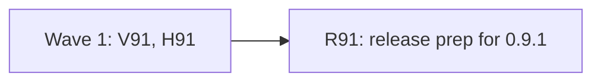

# Plan for 0.9.1

0.9.1 is a patch release after 0.9.0. It fixes two bugs found in the 0.9.0-rc.1 field test: a `{name}` inside a variable value is never filled (#1666), and a padded Base64 SHA-256 match in an `identifierRoute` flag reads transform `other` (#1667). No new command, option or record field, no record schema change, no new decoded hit or vendor, and nothing turns a pass or a warning into a failure, except V91 (see its Flagged concerns). Each item is one PR. A PR is done when its acceptance test passes in CI, an adversarial review reports no blockers or majors, and it is squash-merged.

0.9.1 starts from `main` at `050ebe8` ("Release prep for 0.9.0 (#1668)").

## Goals this release serves

From `docs/goals.md`:

- **Record what a site sends to each tracking vendor, for a scripted visitor, at each consent state.** V91 makes the run open the page the scenario names. H91 makes the route line say how a value was hashed.
- **Express expected behaviour as data, and report pass or fail with evidence.** Both fixes make the evidence match what ran.

Non-goals this release comes close to:

- **Legal advice or legal responsibility.** Unchanged. A pass still means only that no planted value was found in the searched forms.
- **A hosted service, a second interface, changing GTM containers.** Unchanged. No entry adds a decoder or calls a vendor API.

## Triage

The maintainer set the scope: exactly #1666 and #1667, both in the 0.9.1 milestone and both found in the 0.9.0-rc.1 field test. No other issue is in.

| Issue | Kind | Status on main | Entry or decision | Where in the code |
| --- | --- | --- | --- | --- |
| #1666 | bug (wrong page) | Open. `resolveSitePath` fills once, and `executeRun` fills the start once before it plants canaries, so a `{name}` in a var value stays as written and the browser opens `%7Bname%7D`. | V91 | `packages/recorder/src/steps.ts`, `packages/cli/src/run.ts` |
| #1667 | bug (wrong transform) | Open. `scan()` looks the transform up with `transforms.has(layer)` only, while `canaryPool.match` also strips trailing `=`. | H91 | `packages/recorder/src/canary-routes.ts` |

The other open issues are not in this release.

## Decisions

Decided by the maintainer (2026-11-26):

1. **0.9.1 is a patch release.** No new command, option or record field, no schema change (stays 5), no new decoded hit or vendor, no baseline key change.
2. **In:** #1666 and #1667. Nothing else.

Decided in this plan:

- **V91: nested variables are filled** (choice: maintainer may change). This is the first option of the issue: fill until no `{name}` of a declared variable is left. One new function in `@tagreeve/core`, in a new file `packages/core/src/vars.ts` with its test, exported from `packages/core/src/index.ts`, fills a text from vars. A `{name}` that is not declared stays as written, as today. `resolveSitePath` and the canary planting in `executeRun` both use it. A cycle is refused. A cycle is a var reached again while it is being filled, such as `a: "{b}", b: "{a}"` or `a: "x{a}"`. `executeRun` fills the start and every `visit` path before any browser starts. A cycle exits 2 with a message that names the variables of the cycle and where (`start` or the step), never a var value. The fill runs after `--var` and store overrides are merged: `runCommand` merges `--var` at `run.ts:431` and `suite.ts:326` merges store and `--var` values into `parsed.vars`, both before `executeRun`. Canary planting then always plants on the fully filled start. `withCanaries` already puts the canaries before a `#`, so the `refilled` branch, `usedVarValues` and the "`#` while a `{placeholder}` is filled again" refusal in `run.ts` are removed. A `#` in a used variable now runs, with the canaries before the `#`. This loosens a refusal C90 added. The tests that expect that refusal change on purpose: `a canary run whose var value holds a placeholder keeps the start unresolved...` and `a canary run refuses a var value that holds a placeholder and a #` in `packages/cli/src/run.test.ts`, and any case in `e2e/canaries.e2e.test.ts` that does the same. The builder lists each one in the commit message.
- **H91: a padded Base64 SHA-256 match reads the bare form's transform** (choice: maintainer may change). In `scan()`, a layer that has no entry in the transform map is tried again without its trailing `=`, the rule `canaryPool.match` uses. A padded Base64 SHA-256 digest reads `sha256`, and a canary value followed by `=` reads `plain`. A `GCL.` or `fb.1.` cookie form stays `other`. The body search path (`pool.forms` in `postData`) already gives the bare form's transform and does not change.
- **Docs owners.** V91 edits the `--var` row and the `canaries` row of `docs/cli.md`. H91 edits one sentence in the `identifierRoute` paragraph of `docs/cli.md`. R91 edits the version lines of `docs/cli.md` and writes `docs/design.md` §15.
- **CHANGELOG.** This is a plan PR and needs no `CHANGELOG:` line. The two code PRs end their body with `CHANGELOG: <one line>`, and R91 writes the `## 0.9.1` section from them.

## Order and waves

Both entries run in one wave, then the release prep. There is no release candidate for a patch release, as for 0.8.1.

No two entries of the wave touch the same file or the same lines:

- **V91:** `packages/core/src/vars.ts` (new) and its test, `packages/core/src/index.ts` (one export line), `resolveSitePath` in `packages/recorder/src/steps.ts` and its test, `executeRun`, `usedVarValues` and the canary planting in `packages/cli/src/run.ts` and `packages/cli/src/run.test.ts`, `e2e/canaries.e2e.test.ts` (only where it expects the removed refusal), a new e2e file.
- **H91:** `scan` in `packages/recorder/src/canary-routes.ts` and its test.
- **`docs/cli.md`.** V91 edits the `--var` row and the `canaries` row of the run options table. H91 edits one sentence in the `identifierRoute` paragraph. R91 edits only its version lines.
- **`docs/design.md`.** R91 only, after both entries have merged.

## Rules for every PR

The rules in `AGENTS.md` and the earlier plans still hold: CLI only, no MCP server; no hosted service and no GTM API; fake IDs and identities only (`G-PWTEST0001`, `AW-000000001`, `100000000000001`, `GTM-PWTEST1`, `GTM-PWNOVER`); no cookie value, identity value, client ID, card value, `gtmAuth` or container config in any output; e2e only against `fixtures/site` in `stub` mode (and `server` mode on the fixture's loopback host with the stand-in container), with no Docker and no network; context-level hooks only; third-party code unmodified. The record stays at schema version 5.

More for 0.9.1:

- **A patch release.** No new command, option or record field. No entry adds a decoded hit or a vendor, or changes what a decoder outputs. No baseline key changes. No entry turns a pass or a warning into a failure, except V91, which the maintainer accepted: it makes a run open the page it names, so a scenario can fail checks it passed on the wrong page, and a variable cycle exits 2 (see its Flagged concerns). H91 and R91 stay under the rule. A message may change its text.
- **Each PR adds a regression test that fails without the change,** and the PR body says which line was reverted to see it fail. R91 is exempt: it changes no code, and its Acceptance line names the tests it runs.
- **Every negative test checks its input first.** A leak check asserts the value is in the input or the record, then that it is absent from the output.
- **Never edit a file outside the Touches line.** A flaky test is reported, not patched. Known flaky: the second test of `e2e/unload-gap-frame-nav.e2e.test.ts` (#1608).
- **New e2e tests go in new files,** unless the entry names an existing file.
- **CHANGELOG.** The PR body ends with `CHANGELOG: <one line>`.

## PRs

### Wave 1

**V91 A `{name}` inside a variable value is filled (#1666).** Round cap 3. Touches: `packages/core/src/vars.ts` (new) and `packages/core/src/vars.test.ts` (new); the export line in `packages/core/src/index.ts`; `resolveSitePath` in `packages/recorder/src/steps.ts` and its test in `packages/recorder/src/steps.test.ts`; the canary planting, `usedVarValues` and the fill before the browser starts in `executeRun` in `packages/cli/src/run.ts`; `packages/cli/src/run.test.ts`; `e2e/canaries.e2e.test.ts` (only a case that expects the removed refusal); one new e2e file; the `--var` row and the `canaries` row of the run options table in `docs/cli.md`.
Closes #1666
- A new function `fillVars(text, vars)` in `@tagreeve/core` fills every `{name}` of a declared variable, and fills the `{name}`s in the value it inserted, until none is left. A `{name}` that is not declared stays as written. It throws an error that holds the variable names of a cycle and never a value.
- `resolveSitePath` uses it. `executeRun` uses it to fill the start and every `visit` path before any browser starts. A cycle exits 2 with a message that names the variables and says `start` or the step number, never a var value.
- The canary planting plants on the fully filled start. `refilled`, `usedVarValues` and the "`#` while a `{placeholder}` is filled again" refusal are removed. A `#` in a used variable runs, with the canaries before the `#`.
- `docs/cli.md`: the `canaries` row loses the placeholder and `#` sentences and says a `#` in the start URL, written or from a variable, keeps the canaries before it. The `--var` row says a var value can use another var's `{name}`, filled until none is left, and that a cycle exits 2.

Invariants: A `{name}` that is not declared stays as written. A start with no nested variable fills to the same text as on main. The `start already holds the gclid parameter` refusal sees the fully filled start. No record field changes. A `#` in an unused variable still runs. The builder runs the whole unit suite and lists in the commit message every test whose expected result V91 alters.

Evals:

| Id | Kind | What must be true | How to check |
| --- | --- | --- | --- |
| V91-1 | behaviour | `fillVars('/c/{coll}', { coll: 'yarn' })` is `/c/yarn`. `fillVars('{path}', { path: '/c/{coll}', coll: 'yarn' })` is `/c/yarn`. Three levels deep fill too. | `pnpm exec vitest run --project unit packages/core/src/vars.test.ts`. |
| V91-2 | behaviour | An undeclared `{x}` stays `{x}`, also inside a filled value. A name that is a property of `Object.prototype` (`constructor`, `toString`) is not treated as declared. | The same file. |
| V91-3 | error path | `a: "{b}", b: "{a}"` and `a: "x{a}"` throw an error that names the variables and holds no var value, after the test checks the values are in the vars. | The same file. |
| V91-4 | behaviour | `resolveSitePath('{path}', site, { path: '/p/{x}', x: 'tee' })` is `site/p/tee`. | `pnpm exec vitest run --project unit packages/recorder/src/steps.test.ts`. |
| V91-5 | error path | A scenario with a cyclic var in `start`, or in a `visit` step, makes `runCommand` exit 2 before the recorder starts, and stderr names the variables and the place, with no var value. | `pnpm exec vitest run --project unit packages/cli/src/run.test.ts`. |
| V91-6 | regression | A canary run with a nested var in the start passes the fully filled start, with the canaries after it, to the recorder. A `#` in a used variable runs, and the canaries come before the `#`. The two old tests that expected the refusal are changed. | The same file. It fails while `executeRun` plants on the unfilled start. |
| V91-7 | behaviour | An e2e scenario with `start: "{path}"` and `vars: { path: "<a fixture path>/{x}", x: "<value>" }` against `fixtures/site` in `stub` mode records a page path that is the filled one, with no `%7B` in any recorded page. | `pnpm build`, then `pnpm exec vitest run --project e2e <the new file>`. It fails on `main`, where the page is `%7Bx%7D`. |

Acceptance: V91-6 and V91-7 pass, and fail on `main`.

**H91 A padded Base64 SHA-256 match reads transform `sha256` (#1667).** Round cap 3. Touches: `scan` in `packages/recorder/src/canary-routes.ts`; `packages/recorder/src/canary-routes.test.ts` (or the existing test file for that module); one sentence in the `identifierRoute` paragraph of `docs/cli.md`.
Closes #1667
- In `scan()`, the transform of a match is looked up with the same padding rule as `canaryPool.match` (`nameOf` in `packages/core/src/canary.ts`): the layer is tried as written, then without its trailing `=`. The transform is that of the bare form. A padded Base64 SHA-256 digest reads `sha256`. A canary value followed by `=` reads `plain`, as the bare canary does. A `GCL.` or `fb.1.` cookie form stays `other`.
- The sentence in `docs/cli.md` says a padded Base64 digest reads the same transform as the unpadded one.

Invariants: The set of matches does not change, only the transform text. No verdict, severity or `pass` changes. The body search path does not change. The unpadded forms read as on main.

Evals:

| Id | Kind | What must be true | How to check |
| --- | --- | --- | --- |
| H91-1 | behaviour | A canary's Base64 SHA-256 with `=` padding, in a URL param, matches with transform `sha256`. The identity email's padded digest reads `sha256`. | `pnpm exec vitest run --project unit packages/recorder/src/canary-routes.test.ts`. |
| H91-2 | behaviour | A canary value followed by `=` reads `plain`. | The same file. |
| H91-3 | regression | The unpadded Base64 SHA-256 reads `sha256` as on main, and a `GCL.` cookie form reads `other`. | The same file. |
| H91-4 | regression | The padded and unpadded digest of one value give the same transform in the same test, so the two report rows are one. | The same file. It fails while `scan()` uses `transforms.has(layer)` alone. |

Acceptance: H91-1 passes, and fails on `main`. H91-3 passes on `main` and on the branch.

## Release

**R91 Release prep for 0.9.1.** Written as its own entry after V91 and H91 have merged. The PR runs `scripts/bump-version.sh 0.9.1`, which sets `package.json` and the version lines of the README, `docs/cli.md` and `docs/design.md`. It writes the `## 0.9.1` section of `CHANGELOG.md` from the PR lines, a README "In 0.9.1" line and a new item in design §15.9. It removes #1666 and #1667 from the "Still open" text of the 0.9.0 item and from the 0.9.0 Known items in `CHANGELOG.md`. It updates the §15.9 0.9 bullet that says a `#` in an unused variable no longer refuses the run, because after V91 no `#` in a variable refuses it. It re-records `site/demo/` if `pnpm docs:test` shows a change. There is no release candidate, as for 0.8.1. `package.json` is gated, so the maintainer merges it, and CI publishes the release after the merge. No agent publishes, tags or starts the release workflow.

Touches: `package.json`, the "In 0.9.1" line and the version lines of `README.md`, the version lines of `docs/cli.md` and `docs/design.md`, the `## 0.9.1` section and the 0.9.0 Known items of `CHANGELOG.md`, `docs/design.md` §15, `site/demo/`.

Acceptance: `pnpm exec vitest run --project unit scripts/bump-version.test.ts` and `pnpm docs:test` pass on the release-prep PR.

## After the PRs

After CI publishes 0.9.1, run `node scripts/check-npm-dist-tag.ts 0.9.1` and the install check in `AGENTS.md`.

## Flagged concerns

- **V91 changes which page a scenario opens.** A scenario that used to open a literal `%7Bname%7D` page now opens the filled page. Its checks can now fail where they passed on the wrong page. That is the fix, but a suite that was green may turn red.
- **V91 makes a cycle an error.** A scenario with a var cycle used to run on a literal `{name}` page. It now exits 2 before the browser starts.
- **V91 loosens a refusal.** C90 refused a `#` in a variable that a canary run used when another value was filled again. Such a run now runs, with the canaries before the `#`.
- **H91 changes transform text.** In `identifierRoute` flags, route lines and report rows, `other` becomes `sha256` or `plain` for a padded match. Report rows that were split by the transform now merge. A script that reads the transform text sees the new word. No verdict changes.
- **No field test of its own.** Both changes are small and have unit tests. V91-7 is the only e2e test of a change here.

## Out of scope

| Item | Why it waits |
| --- | --- |
| Every other open issue | The maintainer set the scope to #1666 and #1667. |
| The second option of #1666 (refuse a start that still holds a declared `{name}`) | V91 takes the first option. The maintainer may change it. |
| New commands, a record schema change, a new decoded hit or vendor, a check that turns a pass or a warning into a failure | Not allowed in a patch release. The one exception is V91, accepted by the maintainer (see its Flagged concerns). |
| An MCP server (#362) | AGENTS.md: CLI only. |
