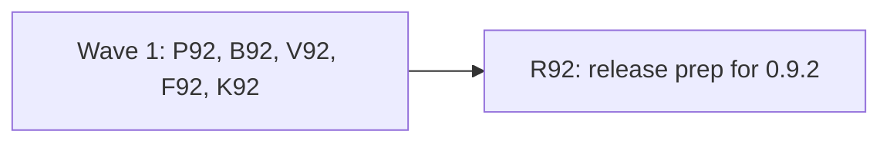

# Plan for 0.9.2

0.9.2 is a patch release after 0.9.1. It has six issues, set by the maintainer: a `body.only` rule on `pinterest-capi` that fails on transport fields (#1662), a baseline that reports drift and "not drift" for the same hits (#1599), an undeclared `{name}` inside a variable value that opens literally with no word (#1673), a flaky e2e test (#1608), and two small cleanups (#1600, #1485). No new command, option or record field, no record schema change, no new decoded hit or vendor, and nothing turns a pass or a warning into a failure. Each item is one PR. A PR is done when its acceptance test passes in CI, an adversarial review reports no blockers or majors, and it is squash-merged.

0.9.2 starts from `main` at `53cde13` ("Release prep for 0.9.1 (#1672)").

## Goals this release serves

From `docs/goals.md`:

- **Express expected behaviour as data, and report pass or fail with evidence.** P92 stops a `body.only` rule from failing on fields the vendor always sends. B92 makes a baseline say one thing about one set of hits.
- **Record what a site sends to each tracking vendor, for a scripted visitor, at each consent state.** V92 tells the person when a variable names a page that is not the one they meant.

Non-goals this release comes close to:

- **Legal advice or legal responsibility.** Unchanged. A pass still means only that no planted value was found in the searched forms.
- **A hosted service, a second interface, changing GTM containers.** Unchanged. No entry adds a decoder or calls a vendor API.

## Triage

The maintainer set the scope: the six issues in milestone 0.9.2, no others. Every claim below was read on `main` at `53cde13`.

| Issue | Kind | Status on main | Entry or decision | Where in the code |
| --- | --- | --- | --- | --- |
| #1662 | bug (false failure) | Open. `VENDOR_IGNORE` has `ga4`, `meta`, `meta-capi` and `sgtm`, and no `pinterest-capi`. The decoder emits the five transport fields as hit fields (`jsonEntries(item)`). | P92 | `packages/decoders/src/ignore-lists.ts`, `VENDOR_IGNORE` in `packages/expect/src/evaluate.ts` |
| #1599 | bug (wrong verdict) | Open. In `diffShapes`, a new tuple that pairs with a gone gcd-letter candidate gets a `gcdLetters` entry, and the rest of its need goes to `added`. A paired gone tuple that is not fully used goes to `removed` when the new tuple also exists in the baseline. | B92 | `diffShapes` in `packages/expect/src/diff.ts`, the warning text in `packages/cli/src/baseline.ts` |
| #1673 | bug (no warning) | Open. `executeRun` fills the start and each `visit` path with `fillVars` and keeps only the filled start. A `{name}` that no variable declares stays as written. The parser's `checkVars` looks at the written text only. | V92 | `executeRun` in `packages/cli/src/run.ts` |
| #1608 | flaky e2e | Open. The first test of `e2e/unload-gap-frame-nav.e2e.test.ts` failed twice with `expected [] to have a length of 1`. The only `toHaveLength(1)` in that test is on the `unloadGap` flags. | F92 | `e2e/unload-gap-frame-nav.e2e.test.ts` and the file that holds the cause |
| #1600 | review minors | Open. The sandbox-prefix test in `packages/recorder/src/steps.test.ts` does not first check its input or pin the masked path. The JSDoc of `createCartCheck` sits above `cartRequestTest`. | K92 | `packages/recorder/src/steps.test.ts`, `packages/recorder/src/steps.ts` |
| #1485 | review minor | The rename the issue asked for is on main: `HASH_MESSAGE_VENDOR_LABELS` in `packages/expect/src/evaluate.ts`. Only the "later" part is open. | K92 | `packages/expect/src/evaluate.ts`, `packages/expect/src/evaluate.test.ts` |

The other open issues are not in this release.

## Decisions

Decided by the maintainer (2026-11-26):

1. **0.9.2 is a patch release.** No new command, option or record field, no schema change (stays 5), no new decoded hit or vendor, no baseline key change.
2. **No entry turns a pass or a warning into a failure.** There is no exception in 0.9.2.
3. **In:** #1662, #1599, #1673, #1608, #1600 and #1485. Nothing else.

Decided in this plan (each is a choice: maintainer may change):

- **P92: a `PINTEREST_CAPI_BODY_ONLY_IGNORE` list.** New export in `packages/decoders/src/ignore-lists.ts`, next to the meta-capi one, holding `event_name`, `event_time`, `event_id`, `event_source_url` and `action_source`. Pinterest's Conversions API reference (developers.pinterest.com/docs/api/v5/events-create/) lists these as the per-event fields of an item of `data`, and the `pinterest-capi` decoder emits each as a hit field. The builder checks the list against that page and adds no other field. A field is added only when the page shows it is a per-event transport field and the decoder emits it. `VENDOR_IGNORE` gets `'pinterest-capi': PINTEREST_CAPI_BODY_ONLY_IGNORE`. This only removes a false failure.
- **B92: the first fix of #1599.** Once a new tuple is paired with a gone gcd-letter candidate, the rest of that tuple is a count change, not an addition. The same holds on the gone side: a gone tuple that was paired and is not fully used is a count change, not a removal. For the two shapes fixed here the warning "This is not drift." no longer comes with drift. It still can in the related case below. No baseline key changes. It only removes false drift. Three cases of the issue are not changed, and the issue stays open for them; see Out of scope. The issue's second example (p x1 and q x1, then q x1) is real drift on main (a lone p hit that nothing pairs is `removed`, with no gcd warning), so it stays drift. The related case (p x1, then q x1 and r x1: `first.left = 0`) still gives drift together with a gcd warning on the same tuple. A later release may use the issue's second fix (push the `gcdLetters` entry only when the whole tuple is accounted for).
- **V92: a warning, not exit 2.** Exit 2 would turn a run that exits 0 into a failure, and a patch does not do that. Exit 2 can come in 0.10.0. A site path may also hold literal braces. After the fill in `executeRun`, a filled start or `visit` path that still holds a `{name}` that no variable declares, and that came from a variable value, prints one warning line on stderr, and the run goes on as today. The channel is the one the run already uses for scenario parse warnings: `io.stderr("Warning: ...\n")` in `run.ts`. With `--json` the summary on stdout is unchanged and the warning goes to stderr. No new record field.
- **K92: a guard test for #1485, with `Refs #1485`.** The shared table is not moved in 0.9.2. The message uses a sentence label, `the Conversions API`, where the report uses `Meta Conversions API` (`VENDOR_NAMES` in `packages/cli/src/report/names.ts`). One vendor is in `HASH_REQUIRED_VENDORS`, so moving the table to `@tagreeve/core` would add a module and rewrite the `meta-capi` message and its tests (`evaluate.test.ts` lines 298 and 312) for no change in what a person sees. That is more than a patch cleanup, and the maintainer has not ruled on it. The smallest change is a test in `packages/expect/src/evaluate.test.ts` that fails when a vendor is in `HASH_REQUIRED_VENDORS` and has no entry in `HASH_MESSAGE_VENDOR_LABELS`, so the message can never show a raw key. That needs `HASH_MESSAGE_VENDOR_LABELS` exported. The `meta-capi` message text does not change. The issue stays open for the move.
- **Test-only entries.** F92 changes the test file, or the file its cause is in. K92 changes tests, a comment block and one `export` keyword. Neither changes behaviour unless F92's cause is in the recorder (then F92 is a code entry and adds its own regression test). Otherwise the rule of a regression test that fails without the change is met by a mutation check in the PR body: F92 by the invariant below, K92 by adding a vendor to the set with no label and seeing the guard fail. R92 is exempt, as R91 was.
- **Docs owners.** P92 adds a `pinterest-capi` row to the ignore table in `docs/cli.md`. B92 edits the baseline paragraph in `docs/cli.md`. V92 edits the `--var` row of `docs/cli.md`. R92 edits only the version lines and §15.
- **CHANGELOG.** This is a plan PR and needs no `CHANGELOG:` line. The code PRs end their body with `CHANGELOG: <one line>`, and R92 writes the `## 0.9.2` section from them.

## Order and waves

All five entries run in one wave, then the release prep. There is no release candidate for a patch release, as for 0.8.1 and 0.9.1.

No two entries edit the same part of a file:

- **P92:** `packages/decoders/src/ignore-lists.ts` and its test, the import line and `VENDOR_IGNORE` in `packages/expect/src/evaluate.ts`, `packages/expect/src/body-rules.test.ts`.
- **B92:** `diffShapes` in `packages/expect/src/diff.ts`, `packages/expect/src/diff.test.ts`, `packages/cli/src/baseline.test.ts`.
- **V92:** `executeRun` in `packages/cli/src/run.ts`, `packages/cli/src/run.test.ts`.
- **F92:** `e2e/unload-gap-frame-nav.e2e.test.ts`, and the one of the scenario, the frame fixture page, `recorder.ts` (frame ids) or `flags.ts` (`sameFrame`) that holds the cause.
- **K92:** `packages/recorder/src/steps.ts` and its test, `HASH_MESSAGE_VENDOR_LABELS` in `packages/expect/src/evaluate.ts`, `packages/expect/src/evaluate.test.ts`.
- **`packages/expect/src/evaluate.ts`.** P92 edits the import line and `VENDOR_IGNORE`. K92 edits the `HASH_MESSAGE_VENDOR_LABELS` line. Different parts.
- **`docs/cli.md`.** P92 edits the ignore table. B92 edits the baseline paragraph. V92 edits the `--var` row. R92 edits only its version lines.
- **`docs/design.md`.** R92 only, after the five entries have merged.

## Rules for every PR

The rules in `AGENTS.md` and the earlier plans still hold: CLI only, no MCP server; no hosted service and no GTM API; fake IDs and identities only (`G-PWTEST0001`, `AW-000000001`, `100000000000001`, `GTM-PWTEST1`, `GTM-PWNOVER`); no cookie value, identity value, client ID, card value, `gtmAuth` or container config in any output; e2e only against `fixtures/site` in `stub` mode (and `server` mode on the fixture's loopback host with the stand-in container), with no Docker and no network; context-level hooks only; third-party code unmodified. The record stays at schema version 5.

More for 0.9.2:

- **A patch release.** No new command, option or record field. No entry adds a decoded hit or a vendor, or changes what a decoder outputs. No baseline key changes. No entry turns a pass or a warning into a failure, and there is no exception. A message may change its text.
- **Each code PR adds a regression test that fails without the change,** and the PR body says which line was reverted to see it fail. R92 is exempt, and so are F92 and K92 under the Decisions above.
- **Every negative test checks its input first.** A leak check asserts the value is in the input or the record, then that it is absent from the output.
- **Never edit a file outside the Touches line.** A flaky test is reported, not patched, except in F92, whose fix it is.
- **New e2e tests go in new files,** unless the entry names an existing file.
- **CHANGELOG.** The PR body ends with `CHANGELOG: <one line>`.

## PRs

### Wave 1

**P92 A `body.only` rule on `pinterest-capi` ignores its transport fields (#1662).** Round cap 3. Touches: `PINTEREST_CAPI_BODY_ONLY_IGNORE` (new) in `packages/decoders/src/ignore-lists.ts` and its case in `packages/decoders/src/ignore-lists.test.ts`; the import line and `VENDOR_IGNORE` in `packages/expect/src/evaluate.ts`; a case in `packages/expect/src/body-rules.test.ts`; a `pinterest-capi` row in the ignore table of `docs/cli.md`.
Closes #1662
- The list is exported from `@tagreeve/decoders` like the others (`index.ts` already re-exports `ignore-lists.ts`) and wired into `VENDOR_IGNORE`.
- The test in `ignore-lists.test.ts` is the meta-capi one for Pinterest: it decodes a `pinterest-capi` request whose body holds only the five transport fields and checks that no hit field is outside `PINTEREST_CAPI_BODY_ONLY_IGNORE`.
- The `docs/cli.md` row names the five fields.

Invariants: The other four lists and their wiring do not change. No decoder output changes. A `body.only` rule on `pinterest-capi` still fails on a field that is not in `only` and not in the list (`custom_data.*` and `user_data.*` are the author's to list). No rule that passed fails.

Evals:

| Id | Kind | What must be true | How to check |
| --- | --- | --- | --- |
| P92-1 | behaviour | A `pinterest-capi` hit with `event_name`, `event_time`, `event_id`, `event_source_url`, `action_source`, `custom_data.value` and `user_data.em`, under the rule `body.only: [custom_data.*, user_data.*]`, passes. | `pnpm exec vitest run --project unit packages/expect/src/body-rules.test.ts`. It fails while `VENDOR_IGNORE` has no `pinterest-capi` entry. |
| P92-2 | regression | The same hit with an extra field `partner_name` fails and names `partner_name` only, after the test checks the field is on the hit. The same rule on `meta-capi` passes as on main. | The same file. |
| P92-3 | behaviour | A decoded `pinterest-capi` request whose body holds only the five transport fields has no field outside the list. | `pnpm exec vitest run --project unit packages/decoders/src/ignore-lists.test.ts`. |

Acceptance: P92-1 passes, and fails on `main`.

**B92 A gcd letter split with a count change reports no drift (#1599).** Round cap 3. Touches: `diffShapes` in `packages/expect/src/diff.ts`; `packages/expect/src/diff.test.ts`; `packages/cli/src/baseline.test.ts`; the baseline paragraph in `docs/cli.md`.
Refs #1599. The PR does not close the issue: cases 2 and 3 below stay open, and the PR body says so and comments on the issue.
- Shape 1 (the issue's first): baseline `view_product` tuple `13p3p3p2p5l1` x2, run `13p3p3p2p5l1` x1 and `13q3q3q2q5l1` x3, same gcs and IDs. On main the q tuple pairs with the one spare p hit and gets a `gcdLetters` entry, and the remaining 2 hits of the q tuple go to one `added` entry: drift with 1 added, and also "This is not drift." After the fix the remaining 2 are a count change, not `added`: `drift` is false, `added` and `removed` are 0, and `gcdLetters` has one entry.
- Shape 2 (a merge with a count drop): baseline p x2 and q x1, run q x2. On main the q tuple pairs with one p hit and the other p hit goes to `removed`: drift, with the "not drift" warning. After the fix the unused p hit is a count change, so `drift` is false. The issue words this shape as "p x1 plus q x1, then q x1". The builder traces that literal input first: on main a lone p hit that nothing pairs is `removed` with no gcd warning, which is real drift and does not change. The test names the input that gives drift with the warning, as above.
- What prints after the fix, for shape 1: `--json` has `baseline.drift: false`, `added: 0`, `removed: 0`, `countChanges: 2` (p 2 -> 1 and q 2 -> 3. The p line is the `before` branch of `diffShapes`. The q tuple has no baseline entry, so it pairs with the baseline p tuple and its line takes `a` from the paired tuple's baseline count, 2, and `b` from the run, 3. On main that paired branch runs only when the paired tuple is not in the run, which is false here, so the fix extends it: a new tuple that paired with a gcd partner is a count change, not `added`, whether or not the partner is still in the run. That is the one rule for both shapes), one entry in `warnings` (the gcd letter line, unchanged text) and the matching `changes` lines. The text summary prints `Baseline: no drift (0 added, 0 removed, 2 count changes)`, and each count line ends `(not drift)`. For shape 2, `countChanges` is 2 (q 1 -> 2, p 2 -> 1), with the same warning. The builder confirms both by running them before the edit and after.
- No baseline key changes. `docs/cli.md` says a gcd letter change together with a count change is a count change and is not drift.

Invariants: A tuple that is on one side only, with no gcd pair, is still `added` or `removed`. Every other letter change (`p` to `t`) and any change in `gcs` stays drift. Identical shapes give no drift as before. `hitShape` and the baseline file format do not change. The branch for a gone tuple that is not in the run (`first.left = 0`) keeps its result.

Evals:

| Id | Kind | What must be true | How to check |
| --- | --- | --- | --- |
| B92-1 | regression | Shape 1 gives `drift` false, no `added`, one `gcdLetters` entry and a count change for q. | `pnpm exec vitest run --project unit packages/expect/src/diff.test.ts`. It fails while the rest of the q tuple goes to `added`. |
| B92-2 | regression | Shape 2 gives `drift` false and no `removed`. | The same file. |
| B92-3 | regression | `compareBaseline` for shape 1 gives `drift: false`, `countChanges: 2` and one gcd warning. | `pnpm exec vitest run --project unit packages/cli/src/baseline.test.ts`. |
| B92-4 | regression | A new tuple with no gcd partner is `added`, a gone one with no partner is `removed`, and `p` to `t` is drift, as on main. The issue's literal second example (p x1 and q x1, then q x1) is drift. The related case (p x1, then q x1 and r x1) keeps its result: `diff.test.ts` pins it, so a later fix shows as a test change. | `diff.test.ts`. |

Acceptance: B92-1 and B92-3 pass, and fail on `main`.

**V92 An undeclared `{name}` inside a variable value prints a warning (#1673).** Round cap 3. Touches: `executeRun` in `packages/cli/src/run.ts` (after the fill, next to the cycle check); `packages/cli/src/run.test.ts`; the `--var` row of the run options table in `docs/cli.md`.
Closes #1673
- After the fill, when the filled start or a filled `visit` path still holds a `{name}` that no variable declares, the run prints one line on stderr for each variable that supplies that place, directly or through nested references, and whose own value holds that `{name}`. The line starts with `Warning: ` and names the variable, the placeholder and where (`start` or `step N`), for example `Warning: variable path holds {nope}, which no variable declares (start).`. It never prints a value. A variable that does not supply the start or a visit path is never named, even when its value holds the same `{name}`. A variable that only passes the placeholder on through a nested reference is not named unless its own value holds it. The run goes on as today and exits as today.
- A `{name}` written in `start` or a step is not warned about: the parser already exits 2 for it. The check covers `--var` and store overrides because `executeRun` runs after they are merged. A name that is a property of `Object.prototype` (`constructor`) counts as undeclared, as in `fillVars`.
- One line for each variable, placeholder and place. The stream and prefix are those of the scenario parse warnings. The `--json` stdout summary is unchanged. No new record field.
- The `--var` row of `docs/cli.md` says an undeclared `{name}` inside a value stays as written and prints this warning. It does not exit 2, and the row says so.

Invariants: Exit codes do not change. The start and every visit path that the recorder gets are the same text as on main. A scenario with no such placeholder prints no new line. A run that holds a variable cycle still exits 2 with the cycle message. No value of a variable appears in any output.

Evals:

| Id | Kind | What must be true | How to check |
| --- | --- | --- | --- |
| V92-1 | behaviour | `vars: { path: "/collections/{nope}" }`, `start: "{path}"` gives one warning that names `path`, `nope` and `start`, passes the start `/collections/{nope}` to the recorder and exits as before. | `pnpm exec vitest run --project unit packages/cli/src/run.test.ts`. It fails while `executeRun` prints nothing. |
| V92-2 | behaviour | The same in a `visit` step names `step N`. A `--var path=/c/{nope}` override warns the same way. | The same file. |
| V92-3 | error path | The warning holds no variable value: the test checks a marker value is in the vars, then that it is absent from stderr, and the warning names the variable. | The same file. |
| V92-4 | regression | A fully declared nested variable prints no warning. A `{name}` written in `start` still exits 2 from the parser. A cycle still exits 2. | The same file. |

Acceptance: V92-1 passes, and fails on `main`.

**F92 The unload-gap frame-nav e2e waits for what it asserts (#1608).** Round cap 3. Touches: `e2e/unload-gap-frame-nav.e2e.test.ts` (first test only), `e2e/scenarios/unload-gap-frame-nav.yml`, `fixtures/site/public/unload-gap-frame-nav-frame.html`, and the frame-id code in `packages/recorder/src/recorder.ts` (where `eventFrames` and `requestFrameIds` are set) and `packages/recorder/src/flags.ts` (the `sameFrame` rule in `buildUnloadGapFlags`). Only for a product cause, also the regression test for it: `packages/recorder/src/flags.test.ts` for a `flags.ts` cause, or a new `packages/recorder/src/frame-ids.test.ts` for a `recorder.ts` cause. The cause picks the file. Only the file that holds the cause changes, and the PR body says which.
Design 5.3 already says that a push sent by a frame after its own navigation started is grouped with the next document, and that the counter goes up when a navigation starts. A cause that is this documented grouping (the fixture page pushes `add_to_cart` and navigates at once, so under load the push gets the next document's id and a hit from that document covers it) is fixed in the fixture page: it waits until the push is recorded, or settles briefly, before it navigates. The recorder stays. A recorder or `flags.ts` change is allowed only when it keeps design 5.3 true. A cause that contradicts 5.3 stops the PR for the maintainer. A product fix adds no record field, keeps schema 5, changes no verdict, and only removes a wrong `unloadGap` result. The PR body names the line reverted to see its regression test fail.
Closes #1608 only when a fix lands and F92-1 passes. When the cause is not found, or the fix needs a file outside this Touches line, the PR is an investigation: it changes nothing but may add a note, it says `Refs #1608` and reports the cause or what it ruled out, and a follow-up issue is filed.
- The builder first runs the test in a loop under load (parallel CPU work) and names the assertion that fails. The issue's message points to the `unloadGap` flags, the only `toHaveLength(1)` in the test. The cause is not confirmed in this plan. The CLI run is finished when the test reads the records, and the scenario waits a fixed `wait: 3s`, so the issue's reading ("the records are read before the frame's next document sent its hit") does not fit the code as it stands. The builder finds the real cause (the frame's two documents and their 400 ms timers in `fixtures/site/public/unload-gap-frame-nav-frame.html` against the fixed wait and the frame and navigation times the recorder keeps) before changing anything.
- The test calls `run()` once and reads the records after the CLI has exited, so the test has nothing later to wait for. A test-only wait fits only if the cause is in the test. More likely causes: the fixed `wait: 3s` in the scenario against the frame's 400 ms timers, or a race in the recorder between `frameDocumentId` when the binding runs (`eventFrames`) and when the request is seen (`requestFrameIds`), which makes the `sameFrame` rule cover the push. A product cause (recorder or `flags.ts`) is a code change and needs the regression test rule of the plan, with the revert named. A scenario or fixture cause waits for an event instead of a timer, as #1504 did.
- #1504 (closed) was fixed by making the fixture wait for an event instead of a timer. The same shape applies here only if the cause is a timer.

Invariants: Every assertion of the test stays. The second test is untouched. The test still fails when the frame rule it guards is reverted: the document-id comparison of #883 in `sameFrame` (`packages/recorder/src/flags.ts`). The builder changes the body of `sameFrame` to compare frame URLs only (`return b != null && a.url !== null && a.url === b.url;`), sees the first test fail with `expected [] to have a length of 1` on the `unloadGap` flags, and restores it. Deleting the `sameFrame` cover line in `buildUnloadGapFlags` is not the mutation: that line only adds a cover, the gap stays flagged and the test still passes.

Evals:

| Id | Kind | What must be true | How to check |
| --- | --- | --- | --- |
| F92-1 | quality bar | The test passes 20 times in a row under CPU load, run alone. | `pnpm build`, then a loop of `pnpm exec vitest run --project e2e e2e/unload-gap-frame-nav.e2e.test.ts -t "next document"`, with parallel load. |
| F92-2 | regression | With `sameFrame` in `flags.ts` comparing frame URLs only (#883 reverted), the test fails on the `unloadGap` length assertion with `expected [] to have a length of 1`. | The same command, with the body of `sameFrame` changed to `return b != null && a.url !== null && a.url === b.url;`. |

Acceptance: the outcome is a fix when the builder finds a cause inside the Touches line: then F92-1 and F92-2 pass, and the PR body names the cause found and the line reverted. The outcome is an investigation when no cause is found or the fix needs a file outside the Touches line: then the PR says `Refs #1608`, its body says what was ruled out, and the test is unchanged or only gains diagnostics. An investigation-only F92 finishes its entry for the release-prep gate: R92 starts when all five entries are merged or ended this way.

**K92 Two cleanups: sandbox-prefix test and doc placement (#1600), and the hash message label guard (#1485).** Round cap 3. Touches: the test `masks value segments inside a sandbox prefix` in `packages/recorder/src/steps.test.ts`; the JSDoc block of `createCartCheck` and `cartRequestTest` in `packages/recorder/src/steps.ts`; the `HASH_MESSAGE_VENDOR_LABELS` line (the `export` keyword) in `packages/expect/src/evaluate.ts`; a case in `packages/expect/src/evaluate.test.ts`.
Closes #1600
Refs #1485
- #1600, the test: it first asserts that the built request URL contains `12345678`, as the sibling `keeps only the pathname` test does, then pins the message to `/(other)/(other)/sandbox/strict/cart/add.js`, then checks `12345678` is not in the message.
- #1600, the comment: the JSDoc of `createCartCheck` moves from above `cartRequestTest` to above `createCartCheck`. `cartRequestTest` gets one plain line of its own if it needs one. No code changes.
- #1485: `HASH_MESSAGE_VENDOR_LABELS` is exported, and a test checks every vendor in `HASH_REQUIRED_VENDORS` has a label. The message text for `meta-capi` does not change, and no test line of `evaluate.test.ts` that holds it changes. The PR says `Refs #1485` and leaves the issue open for the shared-table move, which is in Out of scope.

Invariants: No behaviour changes. The messages are as on main. `steps.ts` changes comments only. The exported set `HASH_REQUIRED_VENDORS` still holds `meta-capi` only.

Evals:

| Id | Kind | What must be true | How to check |
| --- | --- | --- | --- |
| K92-1 | quality bar | The sandbox-prefix test asserts its input holds `12345678` and pins the masked path. It still fails when the masking in `cartAnswerNote` is broken. `maskValuePath` (`packages/decoders/src/sandbox.ts`) is not called by `steps.ts` and is not the mutation target. | `pnpm exec vitest run --project unit packages/recorder/src/steps.test.ts`, once with the masking in `cartAnswerNote` (`packages/recorder/src/steps.ts`) broken, so the `.map` callback returns the segment unchanged (`(segment) => segment`). The test must fail on the pinned path `/(other)/(other)/sandbox/strict/cart/add.js`. The new `12345678` precondition on the built URL does not depend on the masking and stays true. |
| K92-2 | quality bar | The diff of `steps.ts` holds only comment lines, and the JSDoc is directly above `createCartCheck`. | Read the diff. |
| K92-3 | error path | The guard test fails when a vendor is added to `HASH_REQUIRED_VENDORS` with no label, and passes on the branch. | `pnpm exec vitest run --project unit packages/expect/src/evaluate.test.ts`, once with `ga4` added to the set and no label. |

Acceptance: K92-1 and K92-3 pass, each failing under its mutation. For K92-3 the mutation is made in the source set in `evaluate.ts`. The two existing tests that add `ga4` to the set at run time and remove it again are not the guard, and the guard reads the set in its own test.

## Release

**R92 Release prep for 0.9.2.** Written as its own entry after the five entries have merged. The PR runs `scripts/bump-version.sh 0.9.2`, which sets `package.json` and the version lines of the README, `docs/cli.md` and `docs/design.md`. It writes the `## 0.9.2` section of `CHANGELOG.md` from the PR lines, a README "In 0.9.2" line and a new item in design §15.9. It re-records `site/demo/` if `pnpm docs:test` shows a change. There is no release candidate, as for 0.8.1 and 0.9.1. `package.json` is gated, so the maintainer merges it, and CI publishes the release after the merge. No agent publishes, tags or starts the release workflow.

Touches: `package.json`, the "In 0.9.2" line and the version lines of `README.md`, the version lines of `docs/cli.md` and `docs/design.md`, the `## 0.9.2` section of `CHANGELOG.md`, `docs/design.md` §15, `site/demo/`.

Acceptance: `pnpm exec vitest run --project unit scripts/bump-version.test.ts` and `pnpm docs:test` pass on the release-prep PR.

## After the PRs

After CI publishes 0.9.2, run `node scripts/check-npm-dist-tag.ts 0.9.2` and the install check in `AGENTS.md`.

## Flagged concerns

- **P92 makes a failing rule pass.** A `body.only` rule on `pinterest-capi` that failed on the five transport fields now passes. A suite that was red for that reason turns green. That is the fix.
- **B92 closes #1599 only in part.** It fixes the first shape and the merge with a count drop in the form that gives the warning. The related split case still reports drift with a "not drift" warning on the same tuple. The PR says `Refs #1599`.
- **B92 makes some `run --baseline` results stop reporting drift.** A gcd letter split together with a count change used to give drift, exit code 1 and `pass` false. It now gives no drift. A suite that relied on that exit code sees a pass. Real drift (a tuple on one side only, with no gcd pair) is unchanged.
- **V92 adds a stderr warning line.** A script that treats any stderr output as a failure sees a new line on a run that has an undeclared `{name}` in a variable value. The exit code and the stdout summary do not change.
- **K92 does not unify the two vendor name tables.** #1485 gets a guard test and stays open. The `meta-capi` message keeps `the Conversions API`, and the report keeps `Meta Conversions API`. A later vendor in `HASH_REQUIRED_VENDORS` needs its label, and the guard test says so.
- **F92's cause is not confirmed in this plan.** The plan names the failing assertion from the issue's message and the test file. The builder must reproduce it before the fix and report the cause. F92 may turn out to be an investigation that closes nothing. If the cause is in the recorder, F92 changes behaviour and not only a test.
- **No field test of its own.** The changes are small and have unit tests. No entry adds an e2e file.

## Out of scope

| Item | Why it waits |
| --- | --- |
| Every other open issue | The maintainer set the scope to the six issues in the 0.9.2 milestone. |
| Exit 2 for an undeclared `{name}` in a variable value (#1673) | It would turn a run that exits 0 into a failure. A patch does not do that. It can come in 0.10.0. |
| The issue's second example and its related case (#1599): p x1 and q x1 then q x1, and a gone tuple that splits into two new gcd-letter variants | The first is real drift. The second still gives drift with a gcd warning, and the issue calls it unlikely in the #1569 race. B92 does not change the `first.left = 0` branch. #1599 stays open for them, with a comment from the B92 PR. |
| Moving `VENDOR_NAMES` to `@tagreeve/core` so the message uses `vendorName()` (#1485) | See K92. It adds a module and rewrites the `meta-capi` message and its tests. #1485 stays open for it. |
| New commands, a record schema change, a new decoded hit or vendor, a check that turns a pass or a warning into a failure | Not allowed in a patch release. |
| An MCP server (#362) | AGENTS.md: CLI only. |
